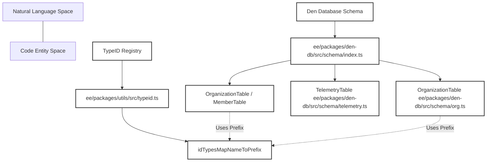
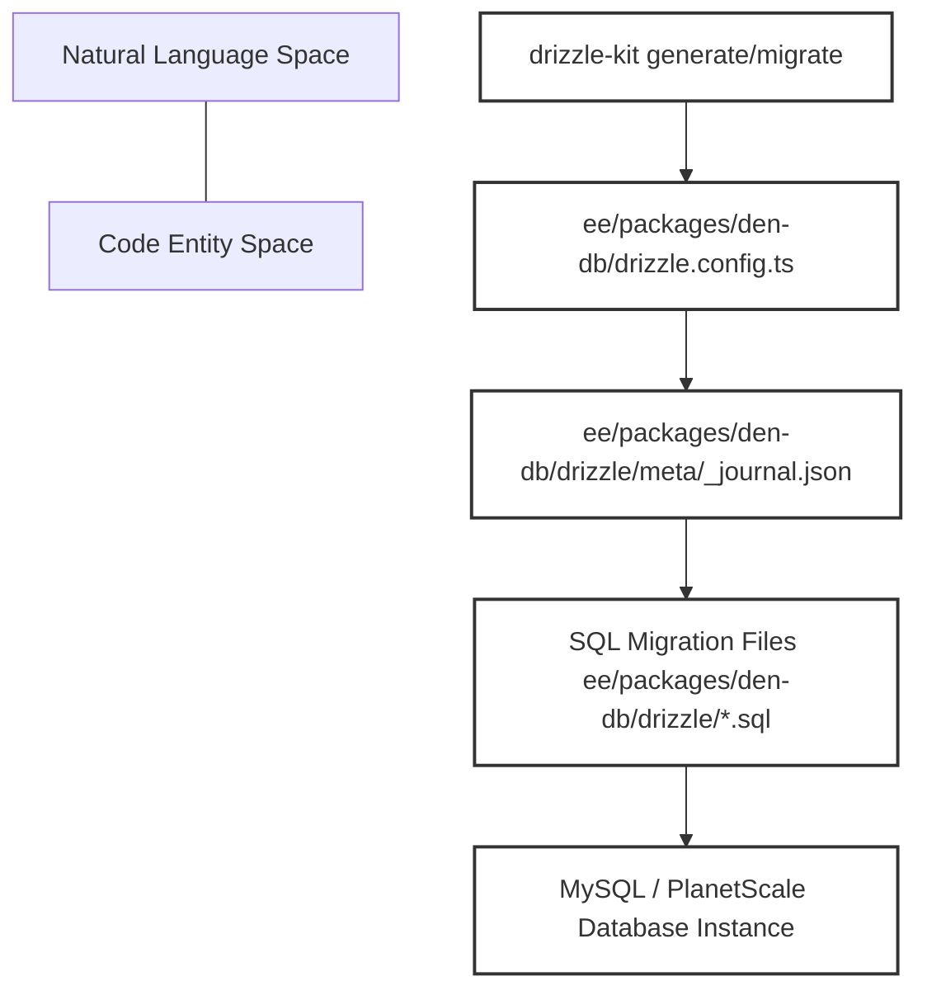

<!-- source: DeepWiki mcp.deepwiki.com · repo different-ai/openwork · page 5.7 den-db Schema and Migrations · fetched 2026-10-26 -->

# den-db Schema and Migrations

<details>
<summary>Relevant source files</summary>

The following files were used as context for generating this wiki page:

- [.github/workflows/api-contract.yml](.github/workflows/api-contract.yml)
- [.github/workflows/ci-enterprise-mcp-mock.yml](.github/workflows/ci-enterprise-mcp-mock.yml)
- [.github/workflows/ci-i18n.yml](.github/workflows/ci-i18n.yml)
- [.github/workflows/ci-openwork-ui-mcp.yml](.github/workflows/ci-openwork-ui-mcp.yml)
- [.github/workflows/ci-sdk.yml](.github/workflows/ci-sdk.yml)
- [.github/workflows/den-db-check.yml](.github/workflows/den-db-check.yml)
- [.github/workflows/den-db-migrate.yml](.github/workflows/den-db-migrate.yml)
- [.github/workflows/publish-ee-images.yml](.github/workflows/publish-ee-images.yml)
- [ee/apps/den-api/scripts/migrate-skills-to-plugins.ts](ee/apps/den-api/scripts/migrate-skills-to-plugins.ts)
- [ee/apps/den-api/src/mcp/admin-query-limit.ts](ee/apps/den-api/src/mcp/admin-query-limit.ts)
- [ee/apps/den-api/src/mcp/admin-tools.ts](ee/apps/den-api/src/mcp/admin-tools.ts)
- [ee/apps/den-api/src/routes/org/index.ts](ee/apps/den-api/src/routes/org/index.ts)
- [ee/apps/den-api/test/admin-query-limit.test.ts](ee/apps/den-api/test/admin-query-limit.test.ts)
- [ee/packages/den-admin-mcp/README.md](ee/packages/den-admin-mcp/README.md)
- [ee/packages/den-admin-mcp/index.mjs](ee/packages/den-admin-mcp/index.mjs)
- [ee/packages/den-admin-mcp/package.json](ee/packages/den-admin-mcp/package.json)
- [ee/packages/den-admin-mcp/scripts/smoke.mjs](ee/packages/den-admin-mcp/scripts/smoke.mjs)
- [ee/packages/den-db/.env.example](ee/packages/den-db/.env.example)
- [ee/packages/den-db/README.md](ee/packages/den-db/README.md)
- [ee/packages/den-db/drizzle.config.ts](ee/packages/den-db/drizzle.config.ts)
- [ee/packages/den-db/drizzle/meta/_journal.json](ee/packages/den-db/drizzle/meta/_journal.json)
- [ee/packages/den-db/package.json](ee/packages/den-db/package.json)
- [ee/packages/den-db/scripts/baseline-migrations.ts](ee/packages/den-db/scripts/baseline-migrations.ts)
- [ee/packages/den-db/scripts/bootstrap.ts](ee/packages/den-db/scripts/bootstrap.ts)
- [ee/packages/den-db/scripts/build-assets.mjs](ee/packages/den-db/scripts/build-assets.mjs)
- [ee/packages/den-db/scripts/db-executor.ts](ee/packages/den-db/scripts/db-executor.ts)
- [ee/packages/den-db/scripts/migration-0097-compat.ts](ee/packages/den-db/scripts/migration-0097-compat.ts)
- [ee/packages/den-db/scripts/migration-0097-schema.ts](ee/packages/den-db/scripts/migration-0097-schema.ts)
- [ee/packages/den-db/src/schema/index.ts](ee/packages/den-db/src/schema/index.ts)
- [ee/packages/den-db/tsup.config.ts](ee/packages/den-db/tsup.config.ts)
- [ee/packages/utils/src/typeid.ts](ee/packages/utils/src/typeid.ts)
- [packaging/helm/openwork-ee/tests/upgrade-and-migration.mjs](packaging/helm/openwork-ee/tests/upgrade-and-migration.mjs)
- [pnpm-workspace.yaml](pnpm-workspace.yaml)

</details>


The `@openwork-ee/den-db` package provides the relational data layer, Drizzle ORM schema definitions, migration journals, and execution scripts for the Den control plane (`ee/apps/den-api`) [ee/packages/den-db/README.md:1-3]. It supports standard MySQL and PlanetScale runtime modes, utilizing strongly typed schema definitions, TypeID primary keys, and strict encryption enforcement for sensitive credentials [ee/packages/den-db/package.json:178-180, ee/packages/utils/src/typeid.ts:11-135].

---

## 1. Drizzle Schema Modules and Type Architecture

The Den control plane schema is modularized under `ee/packages/den-db/src/schema/` and exported via `ee/packages/den-db/src/schema/index.ts` [ee/packages/den-db/src/schema/index.ts:1-39]. Each module defines tables using Drizzle ORM constructs (e.g., `mysqlTable`), establishing foreign-key relationships, indexes, and column types. Primary and foreign keys consistently incorporate type-safe identifiers generated via `@openwork-ee/utils/typeid` [ee/packages/utils/src/typeid.ts:11-135], ensuring unique prefixes per entity (e.g., `org_` for organizations, `om_` for members/memberships).

### Schema Structure & Entity Mapping


*Figure 1: Mapping high-level Den database concepts to Drizzle modules (`ee/packages/den-db/src/schema/index.ts`) and TypeID prefix registries (`ee/packages/utils/src/typeid.ts`).*

Sources: `ee/packages/den-db/src/schema/index.ts` [ee/packages/den-db/src/schema/index.ts:1-39], `ee/packages/utils/src/typeid.ts` [ee/packages/utils/src/typeid.ts:11-135]

---

## 2. Migration Journal and Drizzle-Kit Workflow

Schema evolution is managed using `drizzle-kit` against a MySQL dialect [ee/packages/den-db/README.md:7-10]. Migration versions, timestamps, and tags are recorded sequentially in the migration journal at `ee/packages/den-db/drizzle/meta/_journal.json` [ee/packages/den-db/drizzle/meta/_journal.json:1-40].

### Migration Journal Structure

| Index (`idx`) | Version | Tag | Purpose / Feature |
| :--- | :--- | :--- | :--- |
| 1 | 5 | `0001_desktop_handoff_grants` | Desktop handoff grants [ee/packages/den-db/drizzle/meta/_journal.json:9-10] |
| 2 | 5 | `0002_worker_activity_heartbeat` | Worker activity heartbeats [ee/packages/den-db/drizzle/meta/_journal.json:16-17] |
| 9 | 5 | `0009_api_keys` | Organization API keys [ee/packages/den-db/drizzle/meta/_journal.json:65-66] |
| 10 | 5 | `0010_plugin_arch` | Next-gen plugin architecture [ee/packages/den-db/drizzle/meta/_journal.json:72-73] |
| 21 | 5 | `0021_telemetry_event` | Telemetry events tracking [ee/packages/den-db/drizzle/meta/_journal.json:149-150] |


*Figure 2: Data flow mapping for schema generation and migration application via Drizzle Kit execution entries.*

Sources: `ee/packages/den-db/drizzle/meta/_journal.json` [ee/packages/den-db/drizzle/meta/_journal.json:1-150], `ee/packages/den-db/package.json` [ee/packages/den-db/package.json:168-170]

---

## 3. Bootstrap, Baseline, and Reconciliation Scripts

To initialize fresh development, staging, or production environments, `ee/packages/den-db` exposes several npm script targets in `ee/packages/den-db/package.json`:
- `db:bootstrap`: Invokes `dist/scripts/bootstrap.js` to install or upgrade a production database, running predecessors and handling compatibility paths [ee/packages/den-db/README.md:32-42].
- `db:baseline`: Runs `scripts/baseline-migrations.ts` to consolidate historical schema migrations [ee/packages/den-db/package.json:165].
- `db:migrate` / `db:push`: Executes standard Drizzle migrations or applies schema directly during local development [ee/packages/den-db/package.json:169-170].
- `db:reconcile-permissions`: Runs `scripts/reconcile-permissions.ts` to synchronize catalog permissions across default permission sets [ee/packages/den-db/README.md:44-51].

### Production 0097 Upgrade Preconditions
For existing databases with canonical migration `0097` pending, the upgrade process requires external writer isolation and explicit acknowledgement via `DEN_DB_0097_WRITERS_STOPPED=1` before executing `bootstrap.js` [ee/packages/den-db/README.md:53-69]. Helm deployments handle this by temporarily configuring `migrations.writersStoppedFor0097=true` in the migration Job [ee/packages/den-db/README.md:76-88].

Sources: `ee/packages/den-db/package.json` [ee/packages/den-db/package.json:162-173], `ee/packages/den-db/README.md` [ee/packages/den-db/README.md:32-108]

---

## 4. CI/CD Migration and Check Workflows

Automated validation pipelines ensure database schema integrity and prevent migration regressions prior to merge:
- `.github/workflows/den-db-migrate.yml`: Applies pending Drizzle migrations to the production PlanetScale database when migration files land on `dev` or via manual dispatch [:.github/workflows/den-db-migrate.yml:1-44].
- `.github/workflows/den-db-check.yml`: Runs type validation and schema drift detection via Drizzle assertions on pull requests touching the package [ee/packages/den-db/README.md:133-140].

Sources: `.github/workflows/den-db-migrate.yml` [:.github/workflows/den-db-migrate.yml:1-65], `ee/packages/den-db/README.md` [ee/packages/den-db/README.md:133-142]

---

## 5. Credential Encryption and Security Model

To protect sensitive information stored within database rows (such as external OAuth tokens, connector secrets, and API credentials), Den requires a dedicated encryption key enforced at runtime initialization.

In `ee/apps/den-api/src/env.ts`, the environment validator strictly enforces the length and presence of the encryption key:

```typescript
const EnvSchema = z.object({
  // ...
  DEN_DB_ENCRYPTION_KEY: z.string().trim().min(32),
  // ...
})
```
*Code snippet: Environment schema validation for `DEN_DB_ENCRYPTION_KEY`.* [ee/apps/den-api/src/env.ts:21]

If `DEN_DB_ENCRYPTION_KEY` is omitted or contains fewer than 32 characters, the Den API service halts execution immediately during startup to prevent unencrypted token persistence.

Sources: `ee/apps/den-api/src/env.ts` [ee/apps/den-api/src/env.ts:16-22]

---

