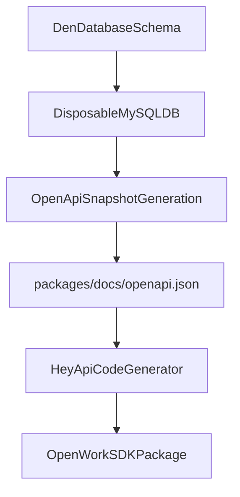
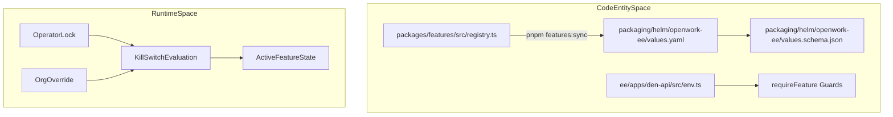
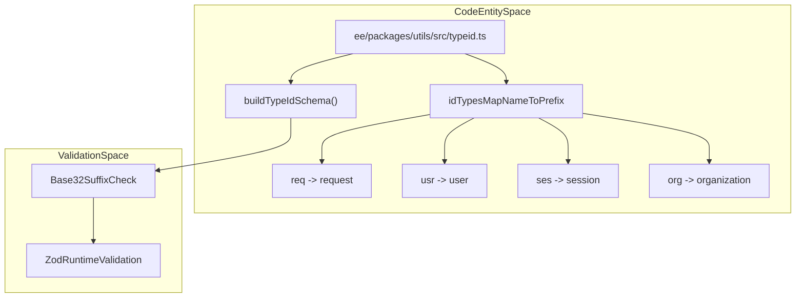
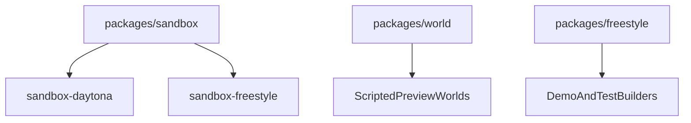
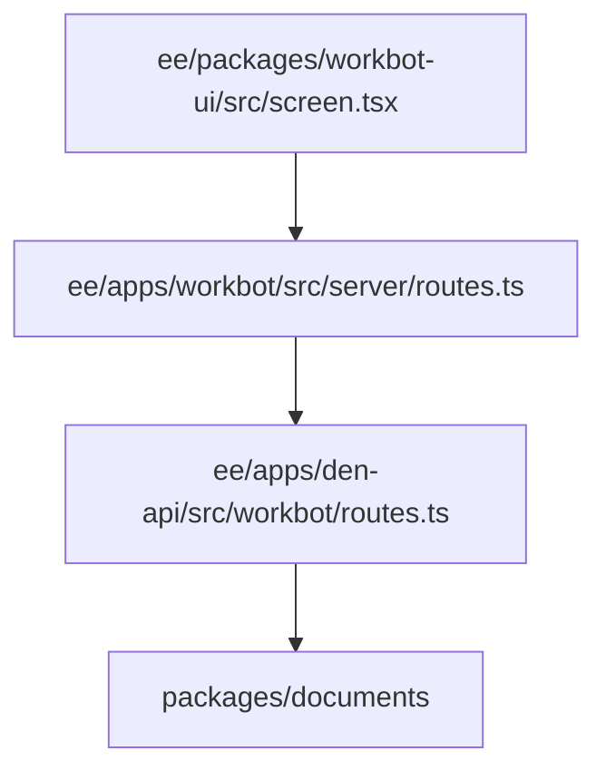

<!-- source: DeepWiki mcp.deepwiki.com · repo different-ai/openwork · page 6 Shared Packages and Contracts · fetched 2026-10-26 -->

# Shared Packages and Contracts

Relevant source files

The following files were used as context for generating this wiki page:

- [ee/apps/den-api/src/audit/routes/org.ts](ee/apps/den-api/src/audit/routes/org.ts)
- [ee/apps/den-api/src/workbot/routes.ts](ee/apps/den-api/src/workbot/routes.ts)
- [ee/apps/diagnostics/.env.example](ee/apps/diagnostics/.env.example)
- [ee/apps/diagnostics/README.md](ee/apps/diagnostics/README.md)
- [ee/apps/diagnostics/app/api/connections/identity/route.ts](ee/apps/diagnostics/app/api/connections/identity/route.ts)
- [ee/apps/diagnostics/app/api/connections/incidents/route.ts](ee/apps/diagnostics/app/api/connections/incidents/route.ts)
- [ee/apps/diagnostics/app/connections/incident-filters.tsx](ee/apps/diagnostics/app/connections/incident-filters.tsx)
- [ee/apps/diagnostics/app/connections/page.tsx](ee/apps/diagnostics/app/connections/page.tsx)
- [ee/apps/diagnostics/app/debug-proxy/[accessKey]/page.tsx](ee/apps/diagnostics/app/debug-proxy/[accessKey]/page.tsx)
- [ee/apps/diagnostics/app/page.tsx](ee/apps/diagnostics/app/page.tsx)
- [ee/apps/diagnostics/app/styles.css](ee/apps/diagnostics/app/styles.css)
- [ee/apps/diagnostics/app/via/[scenario]/[[...path]]/route.ts](ee/apps/diagnostics/app/via/[scenario]/[[...path]]/route.ts)
- [ee/apps/diagnostics/proxy.ts](ee/apps/diagnostics/proxy.ts)
- [ee/apps/diagnostics/scripts/connect-debug-proxy-smoke.mjs](ee/apps/diagnostics/scripts/connect-debug-proxy-smoke.mjs)
- [ee/apps/diagnostics/src/connect-debug-proxy-browser-route.ts](ee/apps/diagnostics/src/connect-debug-proxy-browser-route.ts)
- [ee/apps/diagnostics/src/connect-debug-proxy-config.ts](ee/apps/diagnostics/src/connect-debug-proxy-config.ts)
- [ee/apps/diagnostics/src/connect-debug-proxy-faults.ts](ee/apps/diagnostics/src/connect-debug-proxy-faults.ts)
- [ee/apps/diagnostics/src/connection-incident-query.ts](ee/apps/diagnostics/src/connection-incident-query.ts)
- [ee/apps/diagnostics/src/connection-incident-store.ts](ee/apps/diagnostics/src/connection-incident-store.ts)
- [ee/apps/workbot/src/client/host.ts](ee/apps/workbot/src/client/host.ts)
- [ee/apps/workbot/src/server/den.ts](ee/apps/workbot/src/server/den.ts)
- [ee/apps/workbot/src/server/routes.ts](ee/apps/workbot/src/server/routes.ts)
- [ee/packages/workbot-ui/src/host.ts](ee/packages/workbot-ui/src/host.ts)
- [ee/packages/workbot-ui/src/screen.tsx](ee/packages/workbot-ui/src/screen.tsx)
- [packages/docs/openapi.json](packages/docs/openapi.json)
- [packages/features/src/registry.ts](packages/features/src/registry.ts)
- [packages/sdk/src/gen/sdk.gen.ts](packages/sdk/src/gen/sdk.gen.ts)
- [packages/sdk/src/gen/types.gen.ts](packages/sdk/src/gen/types.gen.ts)
- [packages/types/package.json](packages/types/package.json)
- [packages/types/src/index.ts](packages/types/src/index.ts)
- [packages/types/tsup.config.ts](packages/types/tsup.config.ts)
- [packaging/helm/openwork-ee/README.md](packaging/helm/openwork-ee/README.md)
- [packaging/helm/openwork-ee/values.schema.json](packaging/helm/openwork-ee/values.schema.json)
- [packaging/helm/openwork-ee/values.yaml](packaging/helm/openwork-ee/values.yaml)

The purpose of this section is to provide a high-level overview of the cross-cutting packages housed under `packages/` and `ee/packages/` that define the core contracts, types, utilities, and infrastructure shared across OpenWork applications (desktop, server, and the Den control plane). These packages ensure strict protocol alignment, type safety, feature flag consistency, and schema validation across the entire monorepo.

For granular technical details, refer to the respective child pages:
- [OpenAPI Contract and Generated SDK](#6.1)
- [Feature Flag System](#6.2)
- [Shared Types and Utilities](#6.3)
- [Sandbox, World and Freestyle Packages](#6.4)
- [Documents and Office Editing](#6.5)

---

## 6.1 OpenAPI Contract and Generated SDK

The Den control plane exposes a strictly defined HTTP API documented via an OpenAPI 3.1 specification. The contract pipeline utilizes database schema states and automated snapshot generation, normalization, and formatting to produce `@openwork/sdk` client definitions. This pipeline ensures that client applications and external integrations interact with the control plane through guaranteed type-safe contracts.

For details, see [OpenAPI Contract and Generated SDK](#6.1).

### Contract Pipeline Architecture

*Figure 6.1: Contract generation pipeline transforming database structures into client SDK types.*

Sources: `packages/docs/openapi.json`, `ee/apps/den-api/src/app.ts`

---

## 6.2 Feature Flag System

OpenWork employs a centralized feature flag registry located in `packages/features/src/registry.ts` [packages/features/src/registry.ts:1-26](). Features are declared with rollout dimensions including supported deployments (`cloud`, `self_hosted`), default states, and permanent tracking flags [packages/features/src/registry.ts:28-47](). The features-sync script propagates these definitions into Helm values (`values.yaml` and `values.schema.json`) to control runtime behavior and operator locks across self-hosted installations.

For details, see [Feature Flag System](#6.2).

### Feature Rollout and Guard Flow

*Figure 6.2: Mapping feature definitions from code entities to deployment runtime gates.*

Sources: `packages/features/src/registry.ts`, `packaging/helm/openwork-ee/values.yaml`, `packaging/helm/openwork-ee/values.schema.json`, `ee/apps/den-api/src/env.ts`

---

## 6.3 Shared Types and Utilities

Cross-cutting types and helper utilities are distributed across `packages/types` and `ee/packages/utils`. These packages establish shared primitives such as desktop IPC command maps, automation definitions, and TypeID mappings [ee/packages/utils/src/typeid.ts:1-129](). The TypeID module (`typeid.ts`) enforces strict base32 formatting and maps domain names to database prefixes (e.g., `request` to `req`, `user` to `usr`, `session` to `ses`) [ee/packages/utils/src/typeid.ts:11-20]().

For details, see [Shared Types and Utilities](#6.3).

### TypeID and Prefix Mapping System

*Figure 6.3: TypeID name-to-prefix associations and validation schema construction.*

Sources: `ee/packages/utils/src/typeid.ts`, `packages/types/package.json`

---

## 6.4 Sandbox, World and Freestyle Packages

To facilitate rigorous evaluation, agent testing, and reproducible local environments, OpenWork provides sandboxing and scriptable preview packages under `packages/sandbox`, `packages/world`, and `packages/freestyle`. These libraries manage isolated runtime execution profiles, Daytona environment snapshots, and scripted fixture worlds used in end-to-end test scenarios.

For details, see [Sandbox, World and Freestyle Packages](#6.4).

### Sandbox and Simulation Environment Hierarchy

*Figure 6.4: Structural relationships among sandbox drivers, test worlds, and freestyle builders.*

Sources: `packages/sandbox`, `packages/world`, `packages/freestyle`

---

## 6.5 Documents and Office Editing

The document and office editing packages (`packages/documents`, `office-engine`, and `office-server`) provide core capabilities for inline document rendering, spreadsheet management, and Collabora container integrations. These shared modules integrate tightly with `den-api` document routes and `workbot` workspace surfaces to support collaborative office file editing.

For details, see [Documents and Office Editing](#6.5).

### Document Editing Architecture

*Figure 6.5: Document workflow routing from the Workbot UI interface to enterprise Den API endpoints.*

Sources: `ee/apps/workbot/src/server/routes.ts`, `ee/packages/workbot-ui/src/screen.tsx`, `ee/apps/den-api/src/workbot/routes.ts`

---

