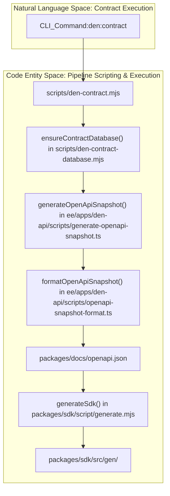
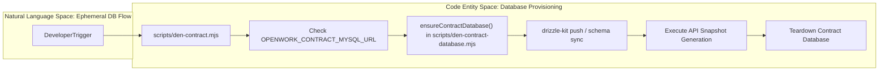
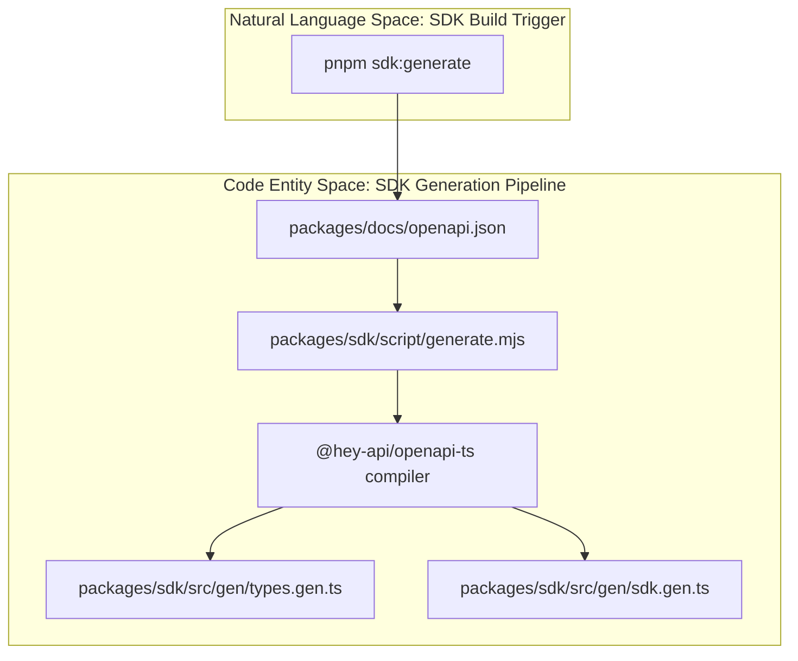
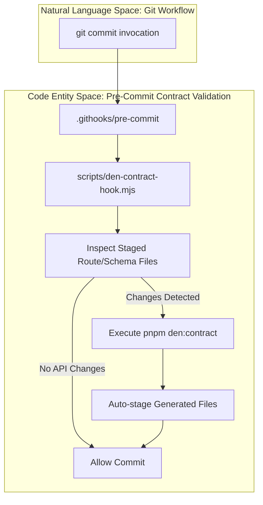

<!-- source: DeepWiki mcp.deepwiki.com · repo different-ai/openwork · page 6.1 OpenAPI Contract and Generated SDK · fetched 2026-10-26 -->

# OpenAPI Contract and Generated SDK

Relevant source files

The following files were used as context for generating this wiki page:

- [.github/workflows/ci-tests.yml](.github/workflows/ci-tests.yml)
- [AGENTS.md](AGENTS.md)
- [README.md](README.md)
- [TRANSLATIONS.md](TRANSLATIONS.md)
- [ee/apps/den-api/src/audit/routes/org.ts](ee/apps/den-api/src/audit/routes/org.ts)
- [ee/apps/den-api/src/workbot/routes.ts](ee/apps/den-api/src/workbot/routes.ts)
- [ee/apps/workbot/src/client/host.ts](ee/apps/workbot/src/client/host.ts)
- [ee/apps/workbot/src/server/den.ts](ee/apps/workbot/src/server/den.ts)
- [ee/apps/workbot/src/server/routes.ts](ee/apps/workbot/src/server/routes.ts)
- [ee/packages/workbot-ui/src/host.ts](ee/packages/workbot-ui/src/host.ts)
- [ee/packages/workbot-ui/src/screen.tsx](ee/packages/workbot-ui/src/screen.tsx)
- [evals/README.md](evals/README.md)
- [package.json](package.json)
- [packages/docs/openapi.json](packages/docs/openapi.json)
- [packages/features/src/registry.ts](packages/features/src/registry.ts)
- [packages/sdk/src/gen/sdk.gen.ts](packages/sdk/src/gen/sdk.gen.ts)
- [packages/sdk/src/gen/types.gen.ts](packages/sdk/src/gen/types.gen.ts)
- [packaging/helm/openwork-ee/README.md](packaging/helm/openwork-ee/README.md)
- [packaging/helm/openwork-ee/values.schema.json](packaging/helm/openwork-ee/values.schema.json)
- [packaging/helm/openwork-ee/values.yaml](packaging/helm/openwork-ee/values.yaml)
- [translated_readmes/README.md](translated_readmes/README.md)
- [translated_readmes/README_JA.md](translated_readmes/README_JA.md)
- [translated_readmes/README_ZH.md](translated_readmes/README_ZH.md)
- [translated_readmes/README_ZH_hk.md](translated_readmes/README_ZH_hk.md)

## Purpose and Scope

This section details the contract pipeline (`den:contract`) used across the OpenWork monorepo to maintain strict API synchronization between the Den control plane service (`ee/apps/den-api`) and client SDK packages (`@openwork/sdk`). The pipeline automates temporary database initialization, OpenAPI specification snapshot generation, snapshot normalization, deterministic merge-friendly formatting, client SDK code emission, and pre-commit enforcement.

---

## 1. The `den:contract` Pipeline Architecture

The contract pipeline is orchestrated by `scripts/den-contract.mjs` and invoked via workspace scripts [package.json:9-12](). It executes a sequential series of lifecycle steps that compile database models, spin up an isolated schema instance, export route specifications, format the resulting JSON document, and compile type-safe TypeScript clients.

Sources: [package.json:9-12](), [AGENTS.md:46-58]()

---

## 2. Disposable MySQL Database Management

Before generating API snapshots, route handlers and database schemas often evaluate dynamic database bindings or initialize entity structures. The contract pipeline manages a disposable MySQL database instance via `scripts/den-contract-database.mjs` to ensure a predictable environment without polluting persistent developer data.

- **Isolation**: The database helper script provisions or connects to a temporary instance using configuration isolated from production environments.
- **Environment Handling**: It relies on `OPENWORK_CONTRACT_MYSQL_URL` for custom connection strings while bypassing standard default workspace write targets [AGENTS.md:52-54]().
- **Teardown**: Upon snapshot completion or error states, the ephemeral database schemas are purged or disconnected gracefully.

Sources: [AGENTS.md:46-58](), [package.json:28-30]()

---

## 3. OpenAPI Snapshot Generation and Normalization

The Den API leverages Hono to declare routes with strongly typed request/response schemas. 

1. **Snapshot Export**: `ee/apps/den-api/scripts/generate-openapi-snapshot.ts` loads the Hono application definition and evaluates spec generation to emit raw OpenAPI 3.1 specifications.
2. **Normalization & Formatting**: `ee/apps/den-api/scripts/openapi-snapshot-format.ts` standardizes key ordering, property sorting, and indentation. This ensures deterministic version control diffs and prevents merge conflicts on generated metadata.
3. **Target Destination**: The resulting file is written directly to `packages/docs/openapi.json` [packages/docs/openapi.json:1-16]().

| Pipeline Step | Module / Script Path | Role & Output Target |
| :--- | :--- | :--- |
| **Snapshot Generation** | `ee/apps/den-api/scripts/generate-openapi-snapshot.ts` | Bootstraps Hono routes and compiles specs into memory. |
| **Normalization** | `ee/apps/den-api/scripts/openapi-snapshot-format.ts` | Sorts paths, tags, and schemas deterministically. |
| **Artifact Staging** | `packages/docs/openapi.json` | The canonical OpenAPI 3.1 artifact read by documentation sites and SDK generators. |

Sources: [packages/docs/openapi.json:1-16](), [package.json:44-45]()

---

## 4. SDK Generation via `@hey-api/openapi-ts`

Once `packages/docs/openapi.json` is updated, the `@openwork/sdk` package consumes it to generate type-safe client methods and TypeScript definitions.

Sources: [package.json:9-11](), [packages/sdk/src/gen/types.gen.ts:1-6](), [packages/sdk/src/gen/sdk.gen.ts:1-4]()

- **Execution**: Triggered via `pnpm sdk:generate` or as part of the broader `den:contract` command [package.json:9-11]().
- **Artifacts**: Outputs are placed under `packages/sdk/src/gen/`, including `types.gen.ts` [packages/sdk/src/gen/types.gen.ts:1-12]() and `sdk.gen.ts` [packages/sdk/src/gen/sdk.gen.ts:1-5](). These files provide complete type definitions for all Den API entities (such as `DenApiHealthResponse`, error models, and administrative structures).

Sources: [package.json:9-11](), [packages/sdk/src/gen/types.gen.ts:1-23](), [packages/sdk/src/gen/sdk.gen.ts:1-10]()

---

## 5. API Design Conventions (`api-style.md`)

All new endpoints added to `ee/apps/den-api` must adhere to strict design specifications. 

- **Versioning & Paths**: Routes follow standard resource naming conventions under `/v1/...`.
- **Security Schemes**: Every endpoint must declare its authentication requirements (e.g., Bearer session tokens or `x-api-key` headers) [packages/docs/openapi.json:5-29]() or explicitly mark public visibility via an empty security array.
- **Error Responses**: Standardized error interfaces (`InvalidRequestError`, `UnauthorizedError`, `ForbiddenError`, `NotFoundError`) must be reused across routes to guarantee predictable client-side error handling [packages/sdk/src/gen/types.gen.ts:142-161]().
- **Metadata Tagging**: Operations must be grouped under descriptive OpenAPI tags (e.g., `System`, `Authentication`, `Organizations`, `Inference Providers`) as defined in `packages/docs/openapi.json` [packages/docs/openapi.json:30-103]().

Sources: [packages/docs/openapi.json:5-103](), [packages/sdk/src/gen/types.gen.ts:142-161]()

---

## 6. Pre-Commit Integration and Verification Hooks

To prevent drift between backend route implementations and client contracts, OpenWork provides automated git hook integration.

- **Hook Installation**: Developers can install git hooks via `pnpm hooks:install`, which invokes `scripts/install-git-hooks.mjs` [package.json:13-13]().
- **Pre-Commit Action**: The pre-commit hook inspects staged changes. If route definitions or shared schemas have been modified, it automatically regenerates contract files (`packages/docs/openapi.json` and `packages/sdk/src/gen/**`) and stages the updated outputs [AGENTS.md:46-58]().
- **Validation Constraints**: The hook refuses to proceed if contract inputs or outputs are partially staged or untracked, ensuring atomic commits for API changes [AGENTS.md:59-61]().

Sources: [package.json:13-13](), [AGENTS.md:46-61]()

---

