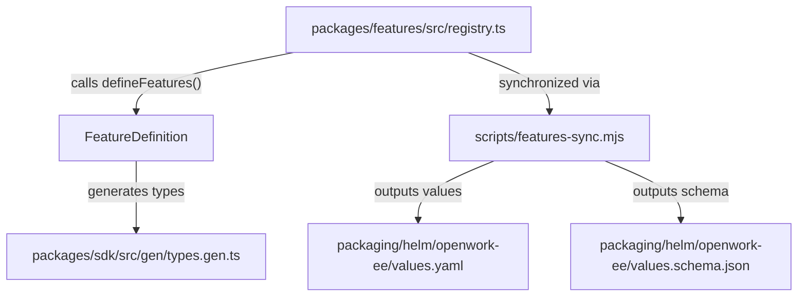
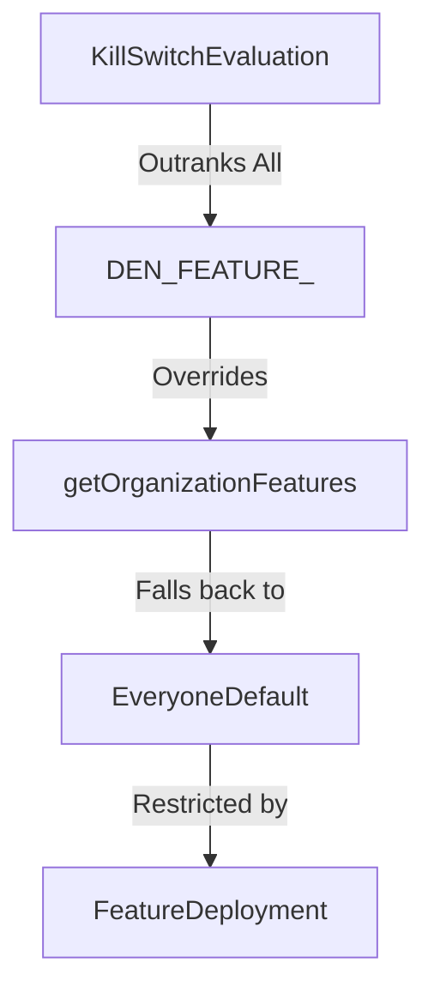

<!-- source: DeepWiki mcp.deepwiki.com · repo different-ai/openwork · page 6.2 Feature Flag System · fetched 2026-10-26 -->

# Feature Flag System

Relevant source files

The following files were used as context for generating this wiki page:

- [.github/workflows/features-check.yml](.github/workflows/features-check.yml)
- [.warden/skills/design-spec-review/SKILL.md](.warden/skills/design-spec-review/SKILL.md)
- [docs/quality/ui-guardrails.md](docs/quality/ui-guardrails.md)
- [ee/apps/den-api/scripts/check-audit-route-coverage.ts](ee/apps/den-api/scripts/check-audit-route-coverage.ts)
- [ee/apps/den-api/src/audit/job-outcomes.ts](ee/apps/den-api/src/audit/job-outcomes.ts)
- [ee/apps/den-api/src/audit/routes/org.ts](ee/apps/den-api/src/audit/routes/org.ts)
- [ee/apps/den-api/src/audit/service-actions.ts](ee/apps/den-api/src/audit/service-actions.ts)
- [ee/apps/den-api/src/cache.ts](ee/apps/den-api/src/cache.ts)
- [ee/apps/den-api/src/credential-revocation.ts](ee/apps/den-api/src/credential-revocation.ts)
- [ee/apps/den-api/src/features.ts](ee/apps/den-api/src/features.ts)
- [ee/apps/den-api/src/generation-cache.ts](ee/apps/den-api/src/generation-cache.ts)
- [ee/apps/den-api/src/member-teams.ts](ee/apps/den-api/src/member-teams.ts)
- [ee/apps/den-api/src/middleware/member-permissions.ts](ee/apps/den-api/src/middleware/member-permissions.ts)
- [ee/apps/den-api/src/middleware/member-teams.ts](ee/apps/den-api/src/middleware/member-teams.ts)
- [ee/apps/den-api/src/routes/admin/member-features.ts](ee/apps/den-api/src/routes/admin/member-features.ts)
- [ee/apps/den-api/src/routes/org/google-document-editor.ts](ee/apps/den-api/src/routes/org/google-document-editor.ts)
- [ee/apps/den-api/src/routes/org/plugin-system/agent-plugin-v1.ts](ee/apps/den-api/src/routes/org/plugin-system/agent-plugin-v1.ts)
- [ee/apps/den-api/src/routes/org/plugin-system/github-app.ts](ee/apps/den-api/src/routes/org/plugin-system/github-app.ts)
- [ee/apps/den-api/src/routes/org/plugin-system/github-discovery.ts](ee/apps/den-api/src/routes/org/plugin-system/github-discovery.ts)
- [ee/apps/den-api/src/session.ts](ee/apps/den-api/src/session.ts)
- [ee/apps/den-api/src/user-deletion.ts](ee/apps/den-api/src/user-deletion.ts)
- [ee/apps/den-api/src/workbot/routes.ts](ee/apps/den-api/src/workbot/routes.ts)
- [ee/apps/den-api/src/workers/github-sync-retry.ts](ee/apps/den-api/src/workers/github-sync-retry.ts)
- [ee/apps/den-api/src/workers/github-sync.ts](ee/apps/den-api/src/workers/github-sync.ts)
- [ee/apps/den-api/test/api/github-sync-poll.api.test.ts](ee/apps/den-api/test/api/github-sync-poll.api.test.ts)
- [ee/apps/den-api/test/auth-cache.test.ts](ee/apps/den-api/test/auth-cache.test.ts)
- [ee/apps/den-api/test/feature-cache-invalidation.test.ts](ee/apps/den-api/test/feature-cache-invalidation.test.ts)
- [ee/apps/den-api/test/generation-cache.test.ts](ee/apps/den-api/test/generation-cache.test.ts)
- [ee/apps/den-api/test/member-team-cache.test.ts](ee/apps/den-api/test/member-team-cache.test.ts)
- [ee/apps/den-api/test/member-team-revocation.test.ts](ee/apps/den-api/test/member-team-revocation.test.ts)
- [ee/apps/den-api/test/permission-feature-cache.test.ts](ee/apps/den-api/test/permission-feature-cache.test.ts)
- [ee/apps/den-web/app/(den)/dashboard/_components/integration-data.tsx](ee/apps/den-web/app/(den)/dashboard/_components/integration-data.tsx)
- [ee/apps/workbot/src/client/host.ts](ee/apps/workbot/src/client/host.ts)
- [ee/apps/workbot/src/server/den.ts](ee/apps/workbot/src/server/den.ts)
- [ee/apps/workbot/src/server/routes.ts](ee/apps/workbot/src/server/routes.ts)
- [ee/packages/den-db/src/organization-features.ts](ee/packages/den-db/src/organization-features.ts)
- [ee/packages/workbot-ui/src/host.ts](ee/packages/workbot-ui/src/host.ts)
- [ee/packages/workbot-ui/src/screen.tsx](ee/packages/workbot-ui/src/screen.tsx)
- [evals/packages/labs/src/index.ts](evals/packages/labs/src/index.ts)
- [evals/packages/labs/src/mock-github.ts](evals/packages/labs/src/mock-github.ts)
- [packages/docs/openapi.json](packages/docs/openapi.json)
- [packages/features/src/registry.ts](packages/features/src/registry.ts)
- [packages/sdk/src/gen/sdk.gen.ts](packages/sdk/src/gen/sdk.gen.ts)
- [packages/sdk/src/gen/types.gen.ts](packages/sdk/src/gen/types.gen.ts)
- [packaging/helm/openwork-ee/README.md](packaging/helm/openwork-ee/README.md)
- [packaging/helm/openwork-ee/values.schema.json](packaging/helm/openwork-ee/values.schema.json)
- [packaging/helm/openwork-ee/values.yaml](packaging/helm/openwork-ee/values.yaml)
- [scripts/features-sync.mjs](scripts/features-sync.mjs)

## Purpose and Scope

The Feature Flag System in OpenWork manages the introduction, gradual rollout, operational locking, and emergency shutdown of user-facing features across different deployment topologies (`cloud` and `self_hosted`) [packages/features/src/registry.ts:28-47](). It ensures that code changes can be merged safely while remaining dormant until explicitly enabled via the Den control plane [AGENTS.md:55-58](), environment configurations [ee/apps/den-api/src/env.ts:12](), or operator overrides in Helm charts [packaging/helm/openwork-ee/values.yaml:23-28]().

Sources: [packages/features/src/registry.ts:28-47](), [AGENTS.md:55-58](), [ee/apps/den-api/src/env.ts:12](), [packaging/helm/openwork-ee/values.yaml:23-28]()

---

## Feature Registry Architecture (`packages/features/src/registry.ts`)

Every feature in OpenWork is declared in a single source of truth: `packages/features/src/registry.ts` [packages/features/src/registry.ts:1-3](). Features are defined using the `defineFeatures` helper utility [packages/features/src/registry.ts:49-51]() with strict TypeScript types (`FeatureDefinition`) [packages/features/src/registry.ts:30-47]().

Each feature definition specifies:
- `label`: A human-readable short name displayed to platform administrators and operators [packages/features/src/registry.ts:32]().
- `description`: A single sentence explaining the user-visible impact of the feature [packages/features/src/registry.ts:33-34]().
- `since`: The year and month the feature was introduced or modified (e.g., `"2026-10"`) [packages/features/src/registry.ts:35]().
- `deployments`: The target products where the feature is valid, such as `["cloud"]` or `["cloud", "self_hosted"]` [packages/features/src/registry.ts:37-38]().
- `default`: The initial boolean state for fresh deployments [packages/features/src/registry.ts:39]().
- `permanent`: Optional flag indicating whether the feature switch is a permanent toggle rather than a temporary rollout [packages/features/src/registry.ts:41-46]().

Diagram: Feature Flag Registry to Code Entities

Sources: [packages/features/src/registry.ts:1-51](), [packaging/helm/openwork-ee/values.yaml:22-53](), [packaging/helm/openwork-ee/values.schema.json:1-3](), [packages/sdk/src/gen/types.gen.ts:164-200]()

---

## Rollout Dimensions and Evaluation Hierarchy

Features in OpenWork are evaluated and controlled across five distinct rollout dimensions [packages/features/src/registry.ts:9-17]():

1. **Deployments**: Filters feature availability based on whether the runtime is OpenWork Cloud or a self-hosted installation [packages/features/src/registry.ts:11]().
2. **Operator Lock**: Self-hosted operators can hardcode feature states globally using Helm values (`config.features`) [packaging/helm/openwork-ee/values.yaml:23-28]() which render into `DEN_FEATURE_<KEY>` environment variables [packaging/helm/openwork-ee/values.schema.json:21-30]().
3. **Everyone Default**: Platform administrators modify global defaults in the `/admin` interface without requiring a redeployment [packages/features/src/registry.ts:12-13]().
4. **Organization Override**: Platform administrators can explicitly enable or disable specific features for individual organizations [packages/features/src/registry.ts:14]().
5. **Kill Switch**: A global safety switch that can immediately disable a feature across the entire installation, outranking all other configuration layers [packages/features/src/registry.ts:16]().

Diagram: Rollout Dimension Precedence

Sources: [packages/features/src/registry.ts:9-17](), [packaging/helm/openwork-ee/values.yaml:23-28](), [packaging/helm/openwork-ee/values.schema.json:21-30](), [ee/apps/den-api/src/features.js]()

---

## Synchronization Script (`scripts/features-sync.mjs`)

Because feature definitions govern multiple downstream targets (such as OpenAPI specifications, Helm value definitions, and JSON schemas), OpenWork uses a synchronization script (`scripts/features-sync.mjs`) invoked via package scripts [package.json:56-57]().

When developers modify `packages/features/src/registry.ts` [packages/features/src/registry.ts:1](), running `pnpm features:sync` or `pnpm den:contract` [package.json:9,56]() performs the following operations:
- Validates consistency across feature declarations.
- Generates updated Helm configuration templates (`packaging/helm/openwork-ee/values.yaml`) [packaging/helm/openwork-ee/values.yaml:22-53]().
- Updates JSON schema restrictions for Helm (`packaging/helm/openwork-ee/values.schema.json`) [packaging/helm/openwork-ee/values.schema.json:1-3]().
- Updates OpenAPI type definitions for admin feature responses (`packages/sdk/src/gen/types.gen.ts`) [packages/sdk/src/gen/types.gen.ts:164-200]().

Sources: [package.json:9,56-57](), [scripts/features-sync.mjs](), [packages/features/src/registry.ts:1](), [packaging/helm/openwork-ee/values.yaml:22-53](), [packaging/helm/openwork-ee/values.schema.json:1-3](), [packages/sdk/src/gen/types.gen.ts:164-200]()

---

## Helm Value Generation and Schema Validation

Self-hosted deployments manage feature locks through the `openwork-ee` Helm chart [packaging/helm/openwork-ee/README.md:1-4](). The `values.yaml` file exposes a `config.features` map where each feature key accepts [packaging/helm/openwork-ee/values.yaml:23-28]():
- `""`: Follows the control plane `/admin` configuration [packaging/helm/openwork-ee/values.yaml:24]().
- `"true"` or `true`: Force-enabled for the entire installation [packaging/helm/openwork-ee/values.yaml:25]().
- `"false"` or `false`: Force-disabled for the entire installation [packaging/helm/openwork-ee/values.yaml:26]().

The corresponding JSON schema (`packaging/helm/openwork-ee/values.schema.json`) validates these options during chart rendering to prevent invalid configuration states [packaging/helm/openwork-ee/values.schema.json:17-215]().

Sources: [packaging/helm/openwork-ee/README.md:1-4](), [packaging/helm/openwork-ee/values.yaml:23-53](), [packaging/helm/openwork-ee/values.schema.json:17-215]()

---

## API Integration and Guards (`requireFeature`)

At runtime, the Den control plane (`ee/apps/den-api`) inspects feature states using resolution helpers such as `getOrganizationFeatures` [ee/apps/den-api/src/app.ts:16](). Route handlers enforce feature availability by applying feature guards (e.g. `requireFeature`) that evaluate the deployment tier, operator locks, organization settings, and kill switches before processing requests. If a guarded feature is disabled, the API returns a standard forbidden error response.

Sources: [ee/apps/den-api/src/app.ts:16](), [ee/apps/den-api/src/features.js]()

---

