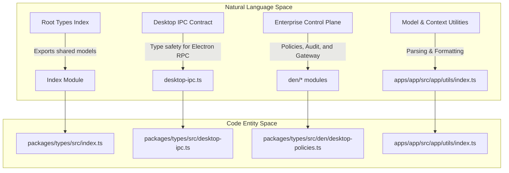
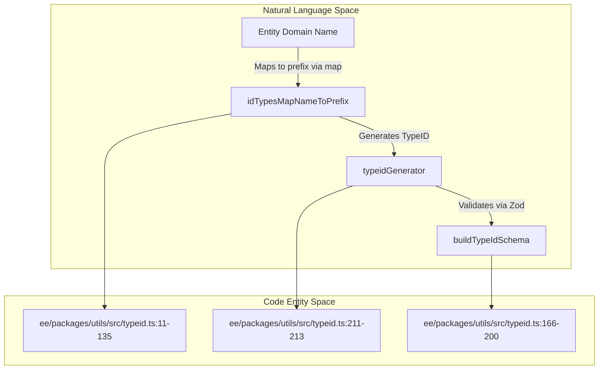
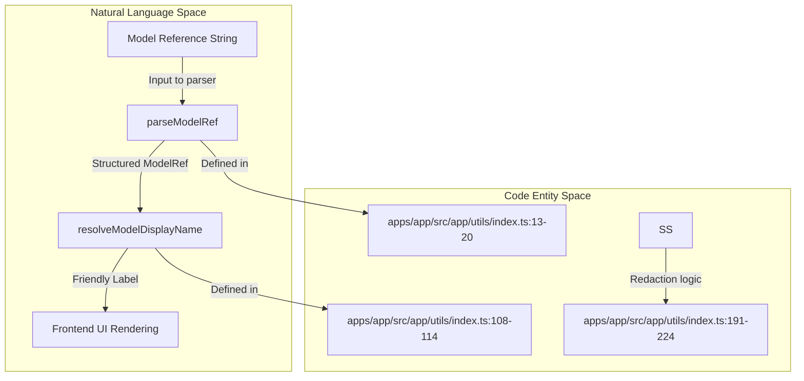
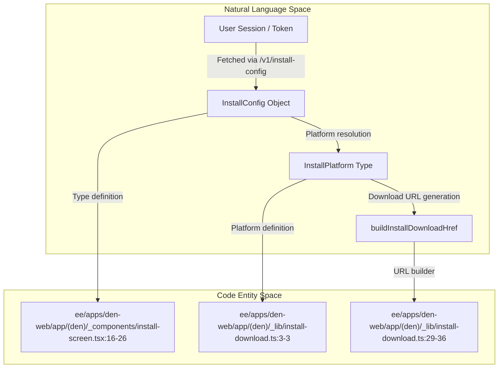

<!-- source: DeepWiki mcp.deepwiki.com · repo different-ai/openwork · page 6.3 Shared Types and Utilities · fetched 2026-10-26 -->

# Shared Types and Utilities

Relevant source files

The following files were used as context for generating this wiki page:

- [ee/apps/den-api/src/mcp/admin-query-limit.ts](ee/apps/den-api/src/mcp/admin-query-limit.ts)
- [ee/apps/den-api/src/mcp/admin-tools.ts](ee/apps/den-api/src/mcp/admin-tools.ts)
- [ee/apps/den-api/src/routes/org/index.ts](ee/apps/den-api/src/routes/org/index.ts)
- [ee/apps/den-api/test/admin-query-limit.test.ts](ee/apps/den-api/test/admin-query-limit.test.ts)
- [ee/apps/diagnostics/.env.example](ee/apps/diagnostics/.env.example)
- [ee/apps/diagnostics/README.md](ee/apps/diagnostics/README.md)
- [ee/apps/diagnostics/app/api/connections/identity/route.ts](ee/apps/diagnostics/app/api/connections/identity/route.ts)
- [ee/apps/diagnostics/app/api/connections/incidents/route.ts](ee/apps/diagnostics/app/api/connections/incidents/route.ts)
- [ee/apps/diagnostics/app/connections/incident-filters.tsx](ee/apps/diagnostics/app/connections/incident-filters.tsx)
- [ee/apps/diagnostics/app/connections/page.tsx](ee/apps/diagnostics/app/connections/page.tsx)
- [ee/apps/diagnostics/app/debug-proxy/[accessKey]/page.tsx](ee/apps/diagnostics/app/debug-proxy/[accessKey]/page.tsx)
- [ee/apps/diagnostics/app/page.tsx](ee/apps/diagnostics/app/page.tsx)
- [ee/apps/diagnostics/app/styles.css](ee/apps/diagnostics/app/styles.css)
- [ee/apps/diagnostics/app/via/[scenario]/[[...path]]/route.ts](ee/apps/diagnostics/app/via/[scenario]/[[...path]]/route.ts)
- [ee/apps/diagnostics/proxy.ts](ee/apps/diagnostics/proxy.ts)
- [ee/apps/diagnostics/scripts/connect-debug-proxy-smoke.mjs](ee/apps/diagnostics/scripts/connect-debug-proxy-smoke.mjs)
- [ee/apps/diagnostics/src/connect-debug-proxy-browser-route.ts](ee/apps/diagnostics/src/connect-debug-proxy-browser-route.ts)
- [ee/apps/diagnostics/src/connect-debug-proxy-config.ts](ee/apps/diagnostics/src/connect-debug-proxy-config.ts)
- [ee/apps/diagnostics/src/connect-debug-proxy-faults.ts](ee/apps/diagnostics/src/connect-debug-proxy-faults.ts)
- [ee/apps/diagnostics/src/connection-incident-query.ts](ee/apps/diagnostics/src/connection-incident-query.ts)
- [ee/apps/diagnostics/src/connection-incident-store.ts](ee/apps/diagnostics/src/connection-incident-store.ts)
- [ee/packages/den-admin-mcp/README.md](ee/packages/den-admin-mcp/README.md)
- [ee/packages/den-admin-mcp/index.mjs](ee/packages/den-admin-mcp/index.mjs)
- [ee/packages/den-admin-mcp/package.json](ee/packages/den-admin-mcp/package.json)
- [ee/packages/den-admin-mcp/scripts/smoke.mjs](ee/packages/den-admin-mcp/scripts/smoke.mjs)
- [ee/packages/den-db/drizzle/meta/_journal.json](ee/packages/den-db/drizzle/meta/_journal.json)
- [ee/packages/den-db/package.json](ee/packages/den-db/package.json)
- [ee/packages/den-db/src/schema/index.ts](ee/packages/den-db/src/schema/index.ts)
- [ee/packages/den-db/tsup.config.ts](ee/packages/den-db/tsup.config.ts)
- [ee/packages/utils/src/typeid.ts](ee/packages/utils/src/typeid.ts)
- [packages/types/package.json](packages/types/package.json)
- [packages/types/src/index.ts](packages/types/src/index.ts)
- [packages/types/tsup.config.ts](packages/types/tsup.config.ts)
- [pnpm-workspace.yaml](pnpm-workspace.yaml)

This page documents the cross-cutting contract definitions in `packages/types` and utility libraries in `ee/packages/utils`. These packages provide strict typing, serialization safety, platform detection, TypeID generation, and shared runtime data structures used across OpenWork desktop clients, local server sidecars, and the Den enterprise control plane.

---

## 1. packages/types Subpath Architecture and Module Layout

The `@openwork/types` package is structured as an ESM module with dedicated subpath exports managed via `packages/types/package.json` [packages/types/package.json:1-186]() and bundled using `tsup` [packages/types/tsup.config.ts:1-29](). It exposes distinct modules for desktop IPC contracts, enterprise control plane policies (`den/*`), MCP applications, automations, and provider structures.

Sources: [packages/types/package.json:1-186](), [packages/types/tsup.config.ts:1-29](), [packages/types/src/index.ts:1-16](), [apps/app/src/app/utils/index.ts:1-25]()

---

## 2. TypeID System and Database Identifiers (`ee/packages/utils/src/typeid.ts`)

OpenWork Enterprise uses prefixed, time-ordered TypeIDs (based on `typeid-js` and `uuidv7`) for primary keys and references across the Den database schema [ee/packages/utils/src/typeid.ts:1-135](). The prefix map `idTypesMapNameToPrefix` associates entity domain names with short 2-4 letter prefixes (e.g., `usr` for users, `ses` for sessions, `org` for organizations, `atm` for automations) [ee/packages/utils/src/typeid.ts:11-135]().

### Key Mechanisms
* `idTypesMapNameToPrefix`: Maps logical entity names to their corresponding database prefix strings [ee/packages/utils/src/typeid.ts:11-135]().
* `TypeId<T>`: A template literal type enforcing the format `${Prefix}_${string}` for specific entity types [ee/packages/utils/src/typeid.ts:150-151]().
* `buildTypeIdSchema(prefix)`: Generates a Zod schema validating prefix length, base32 encoding of the suffix, and structural validity [ee/packages/utils/src/typeid.ts:166-200]().

Sources: [ee/packages/utils/src/typeid.ts:1-215]()

---

## 3. Model References, Sanitization, and Platform Utilities

Client-side utilities in `apps/app/src/app/utils/index.ts` handle model reference parsing, provider/model friendly name resolution, sanitization for logging, and runtime OS checks.

### Key Functions
* `formatModelRef(model: ModelRef)`: Formats a model reference object into a `providerID/modelID` string [apps/app/src/app/utils/index.ts:9-11]().
* `parseModelRef(raw: string | null)`: Parses raw strings into structured `ModelRef` entities [apps/app/src/app/utils/index.ts:13-20]().
* `resolveModelDisplayName(modelID: string)`: Resolves friendly UI names using substring mapping (`FRIENDLY_MODEL_LABELS`) or falls back to title-casing [apps/app/src/app/utils/index.ts:47-114]().
* `safeStringify(value: unknown)`: Recursively stringifies state objects while protecting circular references and redacting sensitive keys (e.g., API keys, tokens, authorization headers) [apps/app/src/app/utils/index.ts:191-224]().

Sources: [apps/app/src/app/utils/index.ts:1-225]()

---

## 4. Den Enterprise Configuration and Install Contracts

Enterprise configuration schemas and installation handoff contracts are defined across `ee/apps/den-web` and `packages/types`. These structures govern deployment channels, API endpoints, and credential handoffs.

### Installation Configuration Schema (`InstallConfig`)
* `appName`: Application branding label [ee/apps/den-web/app/(den)/_components/install-screen.tsx:18]()
* `clientName`: Enterprise client identifier [ee/apps/den-web/app/(den)/_components/install-screen.tsx:17]()
* `webUrl` / `apiUrl`: Control plane endpoints [ee/apps/den-web/app/(den)/_components/install-screen.tsx:19-20]()
* `requireSignin`: Authentication enforcement flag [ee/apps/den-web/app/(den)/_components/install-screen.tsx:21]()
* `desktopVersion`: Minimum pinned desktop version [ee/apps/den-web/app/(den)/_components/install-screen.tsx:24]()
* `distribution`: Deployment topology (`cloud` or `enterprise`) [ee/apps/den-web/app/(den)/_components/install-screen.tsx:25]()

Sources: [ee/apps/den-web/app/(den)/_components/install-screen.tsx:16-154](), [ee/apps/den-web/app/(den)/_lib/install-download.ts:1-46]()

---

## 5. Summary of Shared Package Exports

| Package / Module Path | Primary Role | Key Exports / Structures |
|-----------------------|--------------|--------------------------|
| `packages/types/src/desktop-ipc.ts` | Desktop Electron IPC contracts | `DesktopCommandMap`, IPC channel types [packages/types/package.json:180-184]() |
| `packages/types/src/automations.ts` | Automation schedules & models | Automation triggers, workflow schemas [packages/types/package.json:50-64]() |
| `packages/types/src/den/desktop-policies.ts` | Enterprise desktop management | Policy restriction types, managed settings [packages/types/package.json:104-108]() |
| `packages/types/src/den/inference.ts` | Gateway & LLM token quotas | Inference limits, provider access mappings [packages/types/package.json:150-154]() |
| `packages/types/src/mcp-app.ts` | MCP App Frame definitions | Client sandbox states, dashboard tile types [packages/types/package.json:77-81]() |
| `ee/packages/utils/src/typeid.ts` | TypeID Generation & Validation | `idTypesMapNameToPrefix`, `TypeId`, `buildTypeIdSchema` [ee/packages/utils/src/typeid.ts:1-135]() |

Sources: [packages/types/package.json:1-217](), [packages/types/src/index.ts:1-16](), [ee/packages/utils/src/typeid.ts:1-215]()

---

