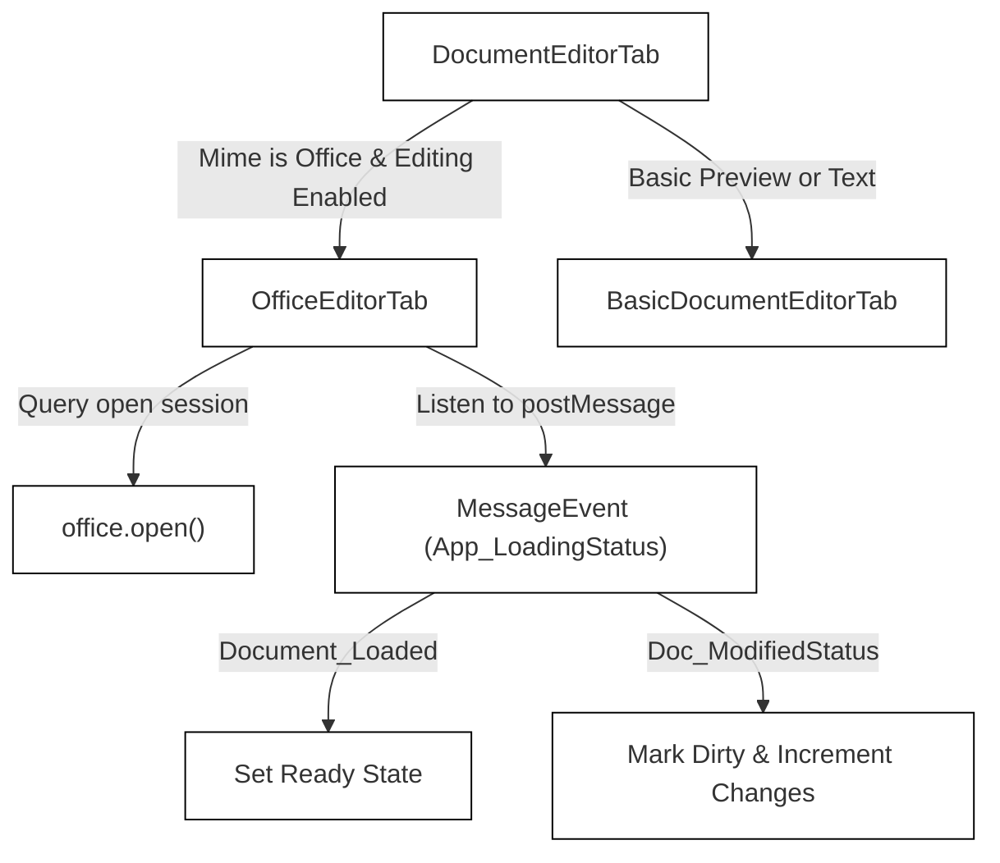
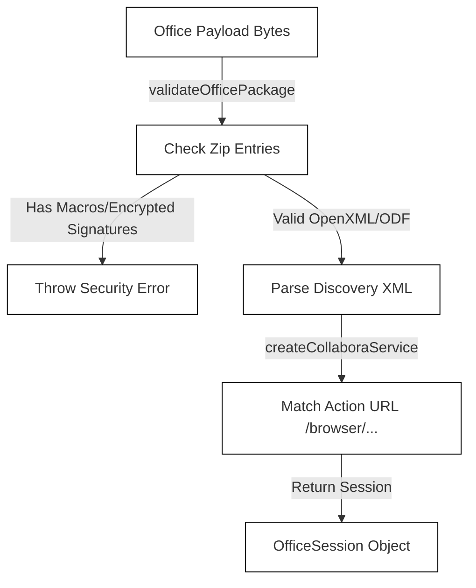
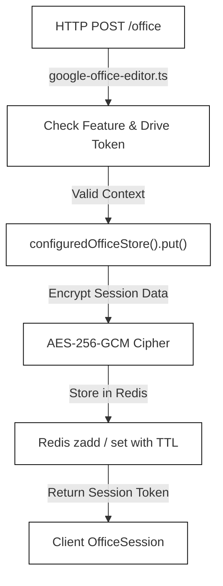
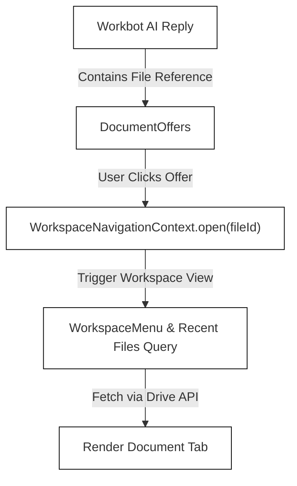

<!-- source: DeepWiki mcp.deepwiki.com · repo different-ai/openwork · page 6.5 Documents and Office Editing · fetched 2026-10-26 -->

# Documents and Office Editing

Relevant source files

The following files were used as context for generating this wiki page:

- [ee/apps/den-api/src/documents-office-store.ts](ee/apps/den-api/src/documents-office-store.ts)
- [ee/apps/den-api/src/routes/org/google-office-editor.ts](ee/apps/den-api/src/routes/org/google-office-editor.ts)
- [ee/packages/workbot-ui/src/documents.tsx](ee/packages/workbot-ui/src/documents.tsx)
- [ee/packages/workbot-ui/src/workspace.tsx](ee/packages/workbot-ui/src/workspace.tsx)
- [evals/proofs/workbot-documents.proof.test.ts](evals/proofs/workbot-documents.proof.test.ts)
- [evals/worlds/workbot-workspace.ts](evals/worlds/workbot-workspace.ts)
- [packages/documents/README.md](packages/documents/README.md)
- [packages/documents/collabora/Dockerfile](packages/documents/collabora/Dockerfile)
- [packages/documents/src/browser.tsx](packages/documents/src/browser.tsx)
- [packages/documents/src/editor-actions.tsx](packages/documents/src/editor-actions.tsx)
- [packages/documents/src/editor.tsx](packages/documents/src/editor.tsx)
- [packages/documents/src/index.ts](packages/documents/src/index.ts)
- [packages/documents/src/office-editor.tsx](packages/documents/src/office-editor.tsx)
- [packages/documents/src/office-engine.ts](packages/documents/src/office-engine.ts)
- [packages/documents/src/office-server.ts](packages/documents/src/office-server.ts)
- [packages/documents/src/styles.css](packages/documents/src/styles.css)
- [packages/documents/src/unsaved-dialog.tsx](packages/documents/src/unsaved-dialog.tsx)
- [packages/documents/test/office-sessions.test.ts](packages/documents/test/office-sessions.test.ts)

This wiki page covers the technical implementation of OpenWork’s document editing and office integration systems. The architecture spans the `@openwork/documents` frontend package (`packages/documents`), the Office engine and server protocols (`packages/documents/src/office-engine.ts`, `packages/documents/src/office-server.ts`), the Collabora container (`packages/documents/collabora/Dockerfile`), Den API Google Office routes (`ee/apps/den-api/src/routes/org/google-office-editor.ts`), the Redis-backed office draft store (`ee/apps/den-api/src/documents-office-store.ts`), and Workbot workspace document integration surfaces (`ee/packages/workbot-ui/src/workspace.tsx`).

---

## 1. Frontend Architecture and Editor Tabs (`packages/documents`)

The documents package provides a robust, state-aware document workspace. It manages lightweight file previews, text editing, and transitions into full office suites when requested.

- **`DocumentEditorTab` (`packages/documents/src/editor.tsx:16-27`)**: Acts as the master orchestrator for opening document items. It routes between the basic preview/text editor (`BasicDocumentEditorTab`) and the full office suite editor (`OfficeEditorTab`) depending on the file's MIME type and whether editing is enabled.
- **`OfficeEditorTab` (`packages/documents/src/office-editor.tsx:20-101`)**: Manages the lifecycle of an active Collabora/WOPI editing session. It handles asynchronous opening retries when Den reports `office_starting`, monitors iframe `postMessage` protocol states, handles dirty states (`dirty`), tracks unsaved changes (`UnsavedChangesDialog`), and manages page unload events via `pagehide` and `beforeunload`.
- **Styling (`packages/documents/src/styles.css:1-73`)**: Implements the `.ow-documents` design system, utilizing CSS custom properties for surface colors (`--doc-bg`, `--doc-text`, `--doc-line`, `--doc-chip`) and responsive layouts for sidebars, grids, and detail panes.

*Sources: [packages/documents/src/editor.tsx:16-27](), [packages/documents/src/office-editor.tsx:20-101](), [packages/documents/src/styles.css:1-73]()*

---

## 2. Office Engine and Server (`office-engine` & `office-server`)

The underlying office manipulation layer handles secure package validation, format definitions, and communication with the Collabora Online server using the WOPI protocol.

- **`officeFileTypeSchema` and `officeFormats` (`packages/documents/src/office-engine.ts:1-36`)**: Define supported office formats (`docx`, `xlsx`, `pptx`, `odt`, `ods`, `odp`), their respective MIME types, and client display labels. The `officeEditor` factory constructs standard RPC operations (`open`, `status`, `save`, `close`).
- **Package Validation (`packages/documents/src/office-server.ts:9-37`)**: `validateOfficePackage` inspects zip container entries for macro-enabled scripts (`vbaproject`, `Basic/`, `Scripts/`), encrypted files, and signs. For OpenDocument formats (`odt`, `ods`, `odp`), it parses XML content safely using `htmlparser2` to reject embedded encryption data, event listeners, and external DTDs.
- **Collabora Service Integration (`packages/documents/src/office-server.ts:98-112`)**: `createCollaboraService` queries the Collabora discovery endpoint (`/hosting/discovery`), parses the XML capability index, verifies secure HTTPS origins, and establishes signed edit/view URLs for the session.

*Sources: [packages/documents/src/office-engine.ts:1-36](), [packages/documents/src/office-server.ts:9-37](), [packages/documents/src/office-server.ts:98-112]()*

---

## 3. Den API Routes and Office Store (`den-api`)

Enterprise document integration routes and session persistence are coordinated through Den API and Redis.

- **Google Office Editor Routes (`ee/apps/den-api/src/routes/org/google-office-editor.ts:42-81`)**: Registers REST handlers under `/v1/documents/google-drive/files/:fileId/office`. These routes enforce organization feature flags (`workbotDocuments`, `workbotDocumentEditing`), validate secure service origins, check Google Drive token authorization, and spin up editing sessions via Collabora.
- **Redis Office Store (`ee/apps/den-api/src/documents-office-store.ts:7-118`)**: `configuredOfficeStore` provides an AES-256-GCM encrypted persistence layer for `OfficeDraft` records in Redis. It enforces concurrency limits (`OFFICE_SESSION_LIMIT = 5`), manages worker leases (`holdOfficeWorker`, `releaseOfficeWorker`), and handles atomic session locking during background saves.

*Sources: [ee/apps/den-api/src/routes/org/google-office-editor.ts:42-81](), [ee/apps/den-api/src/documents-office-store.ts:7-118]()*

---

## 4. Workbot Workspace Document Surfaces (`ee/packages/workbot-ui`)

Workbot integrates document management directly into chat interfaces and workspace navigation bars.

- **`WorkspaceLink` and `DocumentOffers` (`ee/packages/workbot-ui/src/workspace.tsx:21-43`)**: Intercepts link clicks on file references (`googleDriveFileId`), routing them directly into internal workspace document views rather than opening external tabs. `DocumentOffers` renders guided UI pills for the first file referenced in an AI agent's response.
- **`WorkspaceMenu` (`ee/packages/workbot-ui/src/workspace.tsx:76-90`)**: Renders a navigation drawer backed by the authenticated member's Google Drive metadata queries (`recent` query via TanStack Query), supporting quick switching between home, calendar, documents, and computer views.

*Sources: [ee/packages/workbot-ui/src/workspace.tsx:21-90]*

---

