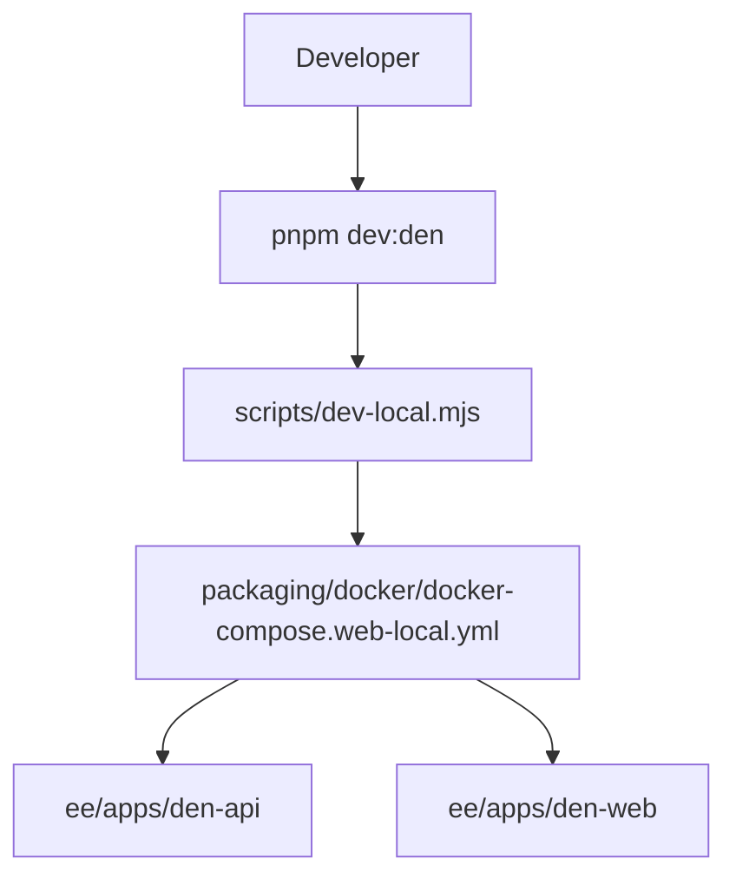
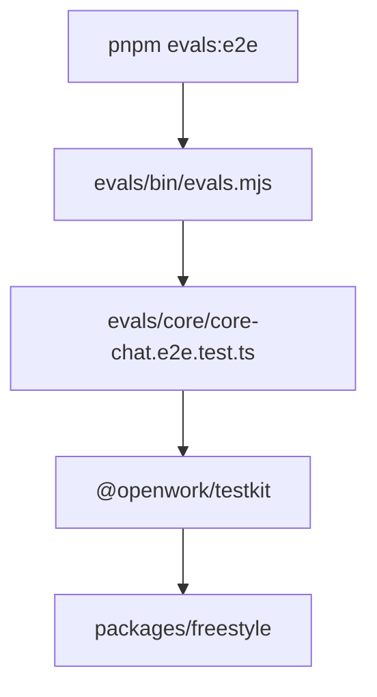

<!-- source: DeepWiki mcp.deepwiki.com · repo different-ai/openwork · page 7 Development Guide · fetched 2026-10-26 -->

# Development Guide

Relevant source files

The following files were used as context for generating this wiki page:

- [.github/workflows/ci-tests.yml](.github/workflows/ci-tests.yml)
- [.opencode/opencode.json](.opencode/opencode.json)
- [AGENTS.md](AGENTS.md)
- [README.md](README.md)
- [TRANSLATIONS.md](TRANSLATIONS.md)
- [apps/app/package.json](apps/app/package.json)
- [apps/desktop/package.json](apps/desktop/package.json)
- [apps/server/package.json](apps/server/package.json)
- [constants.json](constants.json)
- [ee/apps/den-api/src/generated/desktop-versions.ts](ee/apps/den-api/src/generated/desktop-versions.ts)
- [evals/README.md](evals/README.md)
- [package.json](package.json)
- [pnpm-lock.yaml](pnpm-lock.yaml)
- [translated_readmes/README.md](translated_readmes/README.md)
- [translated_readmes/README_JA.md](translated_readmes/README_JA.md)
- [translated_readmes/README_ZH.md](translated_readmes/README_ZH.md)
- [translated_readmes/README_ZH_hk.md](translated_readmes/README_ZH_hk.md)

This page covers how to build, run, test, and contribute to OpenWork. OpenWork is a multi-language monorepo integrating a React frontend (`apps/app`) [apps/app/package.json:2](), an Electron-based desktop shell (`apps/desktop`) [apps/desktop/package.json:2](), a Bun-powered server (`apps/server`) [apps/server/package.json:4](), and the Den enterprise control plane (`ee/`) [README.md:138](). 

For detailed technical specifications, see the child pages:
- [Local Development Workflow](#7.1) — pnpm/turbo dev scripts, docker-compose stacks (`dev`, `den-dev`, `eval`), `scripts/dev-local.mjs`, and container sandboxes.
- [Build System](#7.2) — Multi-stage builds, Vite web bundle, bun binary, sidecars, and Electron packaging.
- [Testing and Evals](#7.3) — Evals harness, unit test suites, spec runtimes, and evidence review.
- [CI/CD Pipelines](#7.4) — GitHub Actions workflows, PR proofs, Warden security reviews, and fork CI.
- [Release Process](#7.5) — Multi-platform builds, channels, AUR automation, rollbacks, and changelogs.
- [Download Statistics and Telemetry](#7.6) — Telemetry collection, PostHog events, and download stats processing.
- [Agent Skills and Repo Automation](#7.7) — OpenCode agent skills, repository automation, and contributor flows.

Sources: [README.md:132-138](), [apps/app/package.json:2-3](), [apps/desktop/package.json:2-3](), [apps/server/package.json:4-5]()

## 7.1. Local Development Workflow

The primary entry points for development are the root workspace scripts defined in `package.json` [package.json:8-38](). OpenWork utilizes environment flags such as `OPENWORK_DEV_MODE=1` to enable hot reloading and local profile isolation [package.json:16](). Developers can spin up specific slices of the stack, ranging from UI-only servers to full cloud control planes using Docker Compose stacks managed via scripts like `scripts/dev-local.mjs` [package.json:22-29]().

*Figure 7.1.1: Mapping natural language local environment commands to concrete backend and control-plane entities.*

For details, see [Local Development Workflow](#7.1).

Sources: [package.json:8-35]()

## 7.2. Build System

OpenWork uses a multi-stage build system to compile assets before desktop packaging or server publishing. This entails building the Vite web bundle (`pnpm build:ui`) [package.json:40](), compiling the Bun server binary (`bun build:bin`) [apps/server/package.json:13](), preparing sidecar runtimes, and invoking `electron-builder` configurations [apps/desktop/package.json:16-22]().

For details, see [Build System](#7.2).

Sources: [package.json:39-41](), [apps/desktop/package.json:16-22](), [apps/server/package.json:13-15]()

## 7.3. Testing and Evals

The evaluation harness in `evals/` provides deterministic testing specs built on top of `@openwork/testkit` [evals/README.md:3-8](). It exercises end-to-end flows, engine parity across versions, and browser automation drivers. Unit tests run across individual application packages using workspace filters [evals/README.md:5-9]().

*Figure 7.3.1: Associating user evaluation triggers with test runtimes and container snapshots.*

For details, see [Testing and Evals](#7.3).

Sources: [package.json:67-71](), [evals/README.md:3-12]()

## 7.4. CI/CD Pipelines

GitHub Actions workflows under `.github/workflows/` coordinate continuous integration, PR verification, and automated security screenings [.github/workflows/ci-tests.yml:1-15](). Pull requests undergo change classification via automated scripts to optimize build execution [.github/workflows/ci-tests.yml:28-62]().

For details, see [CI/CD Pipelines](#7.4).

Sources: [.github/workflows/ci-tests.yml:1-62]()

## 7.5. Release Process

Releasing OpenWork involves cutting multi-platform builds (macOS `aarch64`, Windows, Linux), signing binaries, publishing server distributions to npm, and syncing AUR package descriptions [package.json:66-71](). The release pipeline relies on automated rollback scripts and release review validations.

For details, see [Release Process](#7.5).

Sources: [package.json:66-71]()

## 7.6. Download Statistics and Telemetry

Download metrics and telemetry events are gathered via custom analysis scripts like `scripts/stats.mjs` and processed against `STATS.md` / `STATS_V2.md` classifications. Client-side instrumentation transmits events to PostHog and internal Den telemetry endpoints.

For details, see [Download Statistics and Telemetry](#7.6).

Sources: [package.json:29]()

## 7.7. Agent Skills and Repo Automation

OpenWork integrates repository automation via `.opencode/skills/` [AGENTS.md:70-77](). AI contributors and maintainers use specialized agent skills such as `release`, `write-a-spec`, `preview-my-work`, `browser-automation`, and `add-a-feature` to execute common workflows, check specs, and maintain code quality standards.

For details, see [Agent Skills and Repo Automation](#7.7).

Sources: [README.md:134](), [AGENTS.md:70-77]()

---

