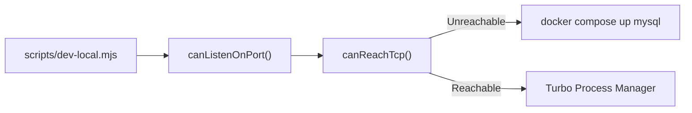

<!-- source: DeepWiki mcp.deepwiki.com · repo different-ai/openwork · page 7.1 Local Development Workflow · fetched 2026-10-26 -->

# Local Development Workflow

<details>
<summary>Relevant source files</summary>

The following files were used as context for generating this wiki page:

- [.devcontainer/Dockerfile.daytona-vnc](.devcontainer/Dockerfile.daytona-vnc)
- [.devcontainer/README.md](.devcontainer/README.md)
- [.devcontainer/capture-daytona-screenshot.sh](.devcontainer/capture-daytona-screenshot.sh)
- [.devcontainer/create-daytona-openwork-snapshot.sh](.devcontainer/create-daytona-openwork-snapshot.sh)
- [.devcontainer/dev-sandbox.sh](.devcontainer/dev-sandbox.sh)
- [.devcontainer/setup-daytona-secrets-volume.sh](.devcontainer/setup-daytona-secrets-volume.sh)
- [.devcontainer/start-daytona-electron.sh](.devcontainer/start-daytona-electron.sh)
- [.devcontainer/start-daytona-recording.sh](.devcontainer/start-daytona-recording.sh)
- [.devcontainer/start-daytona-vnc.sh](.devcontainer/start-daytona-vnc.sh)
- [.devcontainer/start-services.sh](.devcontainer/start-services.sh)
- [.devcontainer/test-on-daytona.sh](.devcontainer/test-on-daytona.sh)
- [.github/workflows/daytona-eval-image.yml](.github/workflows/daytona-eval-image.yml)
- [ee/packages/den-db/src/schema.ts](ee/packages/den-db/src/schema.ts)
- [packages/docs/self-host/deploy-to-your-cloud/first-administrator.mdx](packages/docs/self-host/deploy-to-your-cloud/first-administrator.mdx)
- [packages/docs/self-host/evaluate-with-docker-compose.mdx](packages/docs/self-host/evaluate-with-docker-compose.mdx)
- [packaging/docker/README.md](packaging/docker/README.md)
- [packaging/docker/den-dev-up.sh](packaging/docker/den-dev-up.sh)
- [packaging/docker/docker-compose.den-dev.yml](packaging/docker/docker-compose.den-dev.yml)
- [packaging/docker/docker-compose.dev.yml](packaging/docker/docker-compose.dev.yml)
- [packaging/docker/docker-compose.eval.yml](packaging/docker/docker-compose.eval.yml)
- [scripts/dev-local.mjs](scripts/dev-local.mjs)

</details>


## Purpose and Scope

This page details the local development workflow for contributors and operators working on OpenWork [packaging/docker/README.md:1-31](). It covers pnpm/turbo dev scripts, Docker-compose stacks (`den-dev`, `dev`, `eval`), local environment orchestration via `scripts/dev-local.mjs`, Daytona cloud sandboxes, and development profile isolation through `OPENWORK_DEV_MODE` [packaging/docker/docker-compose.den-dev.yml:116](), [scripts/dev-local.mjs:18-20]().

For system architecture, see [System Architecture](1.2). For compilation and build steps, see [Build System](7.2).

---

## Development Environments

OpenWork supports three distinct runtime environments for development, debugging, and integration testing:

1.  **Local Direct Execution**: Running workspace services directly via `pnpm` and `turbo` orchestration scripts against local or containerized backing services [scripts/dev-local.mjs:100-120]().
2.  **Daytona Cloud Sandboxes**: Full-stack ephemeral environments executing the real Electron application within a virtual display server (Xvfb/XFCE/noVNC) [.devcontainer/README.md:1-15]().
3.  **Docker Compose Dev Stacks**: Containerized service stacks (`den-dev`, `dev`, `eval`) providing isolated databases, control planes, and sidecars [packaging/docker/README.md:3-43]().

### OPENWORK_DEV_MODE Isolation

The `OPENWORK_DEV_MODE` environment variable and related dev flags dictate runtime behavior across apps and backend services:
- **State Isolation**: Forces server instances and engines to use developer paths instead of system production state directories [packaging/docker/docker-compose.dev.yml:125](), [packaging/docker/docker-compose.den-dev.yml:116]().
- **Security Bypass**: Relaxes specific password breach screening or native picker constraints for automated testing.
- **Config Handoff**: Passes explicit configuration overrides and token maps via environment injection.

Sources: [packaging/docker/docker-compose.den-dev.yml:113-130](), [packaging/docker/docker-compose.dev.yml:120-128]()

---

## Docker-Compose Dev Stacks (`den-dev`, `dev`, `eval`)

OpenWork provides pre-configured Docker Compose definitions under `packaging/docker/` to spin up supporting infrastructure and control plane services [packaging/docker/README.md:3-43]().

### 1. Eval Stack (`docker-compose.eval.yml`)
A pull-only evaluation stack designed to test published images without requiring a local repository build [packaging/docker/README.md:3-17](). It runs MySQL, Den API, and Den Web, binding ports to loopback [packaging/docker/README.md:21-22]().

### 2. Den Local Stack (`docker-compose.den-dev.yml` & `den-dev-up.sh`)
The `packaging/docker/den-dev-up.sh` script automates starting the Den control plane, MySQL database, and web dashboard with randomized host ports [packaging/docker/den-dev-up.sh:4-46](). 
- Starts **MySQL** on a configurable port [packaging/docker/docker-compose.den-dev.yml:74-95]().
- Boots the **Den Control Plane** (`den-api` on port `8788`) with `PROVISIONER_MODE=stub` [packaging/docker/README.md:40-41]().
- Automatically runs database migrations using `drizzle-kit push` inside the `den` container entrypoint [packaging/docker/docker-compose.den-dev.yml:101]().
- Launches **Den Web** (the cloud dashboard on port `3005`) wired to the local API [packaging/docker/README.md:43-44]().

You can seed a local demo organization (with mock plugins, users, and access grants) by executing [packaging/docker/README.md:66-72]():
```bash
pnpm dev:den:seed-demo
```

### 3. Server-Only Dev Stack (`docker-compose.dev.yml`)
Runs the OpenWork server and companion web services inside Node/Bun containers sharing monorepo source mounts and local volumes [packaging/docker/docker-compose.dev.yml:23-35]().

```mermaid
graph TD
    subgraph "DockerComposeDenDev["docker-compose.den-dev.yml"]"
        MySQL["mysql Container:3306"]
        DenAPI["den Container:8788"]
        DenWeb["web Container:3005"]
        
        MySQL -- "openwork_den DB" --> DenAPI
        DenAPI -- "API Proxy" --> DenWeb
    end
```
**Den Local Docker Stack Architecture**

Sources: [packaging/docker/README.md:3-92](), [packaging/docker/docker-compose.den-dev.yml:73-130](), [packaging/docker/den-dev-up.sh:4-46]()

---

## Local Script Orchestration (`dev-local.mjs`)

The script `scripts/dev-local.mjs` orchestrates local development tasks by validating ports, checking TCP reachability for MySQL and Redis, and spawning multi-service processes [scripts/dev-local.mjs:21-120]().

- **Endpoint Parsing**: Validates `DATABASE_URL` and ensures migrations only target loopback MySQL instances [scripts/dev-local.mjs:175-184]().
- **Port Availability Checks**: Tests listener availability on `den-api` (`8788`), `den-web` (`3005`), and gateway ports before spawning [scripts/dev-local.mjs:186-191]().
- **Docker Fallback**: Automatically invokes `docker compose` to start MySQL if a local TCP connection fails [scripts/dev-local.mjs:193-205]().


**Local Dev Orchestration Flow (`scripts/dev-local.mjs`)**

Sources: [scripts/dev-local.mjs:21-120](), [scripts/dev-local.mjs:174-211]()

---

## Daytona Dev Sandboxes and Devcontainers

Daytona sandboxes provide cloud-based virtual environments where the real Electron application runs on a virtual display [.devcontainer/README.md:1-4]().

### Daytona Startup Pipeline
1. **Snapshot Resolution**: `test-on-daytona.sh` validates or creates the base snapshot (`openwork-eval-vnc`) containing Xvfb, XFCE, x11vnc, and noVNC [.devcontainer/README.md:23-28]().
2. **Volume Mounting**: Mounts shared persistent volumes for `pnpm` store caching and provider secrets (`openwork-eval-secrets`) [.devcontainer/README.md:28-41]().
3. **Server & Client Execution**: Starts backend services and starts Electron with automated Chromium fallback arguments [.devcontainer/start-daytona-electron.sh:35-66]().

```mermaid
graph TD
    subgraph "BrowserClient["Your Browser"]"
        noVNC["noVNC UI (Port 6080)"]
        CDP["CDP Client (Port 9825)"]
    end

    subgraph "DaytonaSandbox["Daytona Sandbox Environment"]"
        XServer["Xvfb / XFCE Display (:99)"]
        Electron["OpenWork Electron Shell"]
        Vite["Vite Dev Server (Port 5173)"]
        
        XServer --> Electron
        Electron --> Vite
    end

    noVNC -- "RFB over WebSockets" --> XServer
    CDP -- "Chrome DevTools Protocol" --> Electron
```
**Daytona Full-Stack Sandbox Architecture**

Sources: [.devcontainer/README.md:1-99](), [.devcontainer/test-on-daytona.sh:1-120](), [.devcontainer/start-daytona-electron.sh:1-86]()

---

## Debugging and Evals Integration

Development environments integrate logging and automated verification tools to track component state during execution.

### Log Redirection and Inspection
In cloud and containerized workflows, background processes output to designated system logs:
- **Electron Application Logs**: Tailored via `/tmp/electron.log` [.devcontainer/start-daytona-electron.sh:13]()
- **Vite Hot Module Replacement**: Tailored via Vite dev output streams
- **VNC Display Server**: Tailored via container initialization logs

### Test Automation and Fiber Injection
Automated test suites (`evals/`) verify user journeys by driving the UI over the Chrome DevTools Protocol (CDP) port `9825` [.devcontainer/README.md:12-15](). Where native system interactions (such as file dialogs) cannot be triggered headlessly, tests inject actions directly into component structures to mutate state [.devcontainer/README.md:150-153]().

Sources: [.devcontainer/README.md:9-15](), [.devcontainer/start-daytona-electron.sh:10-33]()

---

