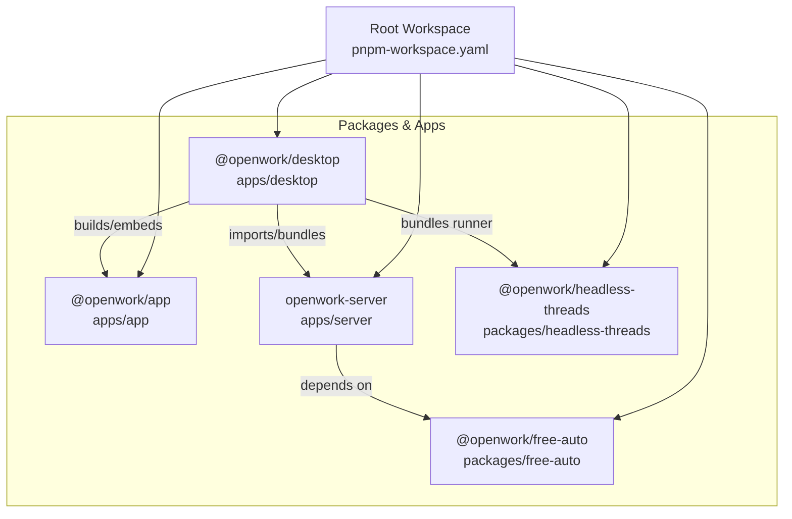
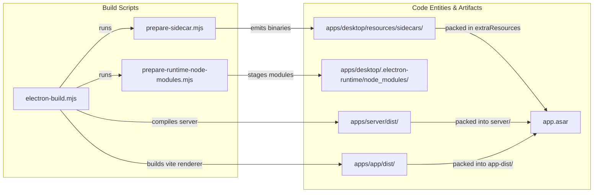

<!-- source: DeepWiki mcp.deepwiki.com · repo different-ai/openwork · page 7.2 Build System · fetched 2026-10-26 -->

# Build System

Relevant source files

The following files were used as context for generating this wiki page:

- [.github/actions/windows-signing/action.yml](.github/actions/windows-signing/action.yml)
- [.opencode/opencode.json](.opencode/opencode.json)
- [apps/app/package.json](apps/app/package.json)
- [apps/desktop/electron-builder.yml](apps/desktop/electron-builder.yml)
- [apps/desktop/package.json](apps/desktop/package.json)
- [apps/desktop/scripts/electron-after-pack.cjs](apps/desktop/scripts/electron-after-pack.cjs)
- [apps/desktop/scripts/prepare-runtime-node-modules.mjs](apps/desktop/scripts/prepare-runtime-node-modules.mjs)
- [apps/desktop/scripts/prepare-sidecar.mjs](apps/desktop/scripts/prepare-sidecar.mjs)
- [apps/desktop/scripts/windows-sign.cjs](apps/desktop/scripts/windows-sign.cjs)
- [apps/desktop/test/sidecar-layout.test.mjs](apps/desktop/test/sidecar-layout.test.mjs)
- [apps/desktop/test/windows-sign.test.cjs](apps/desktop/test/windows-sign.test.cjs)
- [apps/server/package.json](apps/server/package.json)
- [constants.json](constants.json)
- [ee/apps/den-api/src/generated/desktop-versions.ts](ee/apps/den-api/src/generated/desktop-versions.ts)
- [pnpm-lock.yaml](pnpm-lock.yaml)
- [scripts/release/windows-signatures.ps1](scripts/release/windows-signatures.ps1)
- [scripts/release/windows-signatures.test.ps1](scripts/release/windows-signatures.test.ps1)

## Purpose and Scope

This document provides a high-level overview of the multi-stage build system architecture in the OpenWork monorepo. OpenWork combines Vite for frontend bundling, TypeScript compilation for server execution, specialized sidecar binary preparation, and `electron-builder` packaging to produce native desktop applications for macOS, Linux, and Windows [apps/desktop/scripts/electron-build.mjs:48-69](), [apps/desktop/electron-builder.base.yml:63-107]().

This is a parent page. For deep technical details, see the child pages:
- [Sidecar and Runtime Preparation](#7.2.1) — Covers `prepare-opencode-v2`, `prepare-runtime-node-modules`, platform/target triples, and artifact pinning.
- [Electron Desktop Build](#7.2.2) — Covers `electron-dev.mjs`, `electron-build.mjs`, `electron-builder.yml`, after-sign/after-pack hooks, notarization, and packaging flavors.

---

## Monorepo Build Dependencies

OpenWork manages dependencies and builds through a unified `pnpm` workspace structure (`pnpm-workspace.yaml`). The build system coordinates package compilation across the React frontend (`@openwork/app`), the core server (`openwork-server`), shared libraries (`@openwork/free-auto`, `@openwork/headless-threads`), and the Electron shell (`@openwork/desktop`) [apps/desktop/package.json:29-57](), [apps/server/package.json:55-74]().

**Sources:** [apps/desktop/scripts/electron-build.mjs:54-67](), [apps/desktop/electron-builder.base.yml:1-18]()

---

## Build Pipelines and Stages

The production build process executed by `electron-build.mjs` integrates several distinct pipelines before assembling the final Electron artifact [apps/desktop/scripts/electron-build.mjs:48-78]().

1. **Sidecar Preparation:** Resolves platform-specific binaries (`opencode`, `opencode2`) and version manifests for target platform triples [apps/desktop/scripts/electron-build.mjs:48](), [apps/desktop/electron-builder.base.yml:51-105]().
2. **Runtime Module Staging:** Bundles necessary production node modules using `prepare-runtime-node-modules.mjs` and verifies runtime dependencies via `electron-after-pack.cjs` [apps/desktop/scripts/electron-build.mjs:49](), [apps/desktop/scripts/electron-after-pack.cjs:58-97]().
3. **Server and Package Compilation:** Builds `@openwork/free-auto`, `openwork-server`, and `@openwork/headless-threads` from TypeScript to JavaScript so Electron can load them in-process [apps/desktop/scripts/electron-build.mjs:53-63]().
4. **Vite Frontend Bundling:** Compiles the React UI (`apps/app`) with `OPENWORK_ELECTRON_BUILD="1"` to ensure relative asset URLs (`./`) are emitted for `file://` loading [apps/desktop/scripts/electron-build.mjs:67-69]().

### Build Pipeline to Code Entity Mapping

The following diagram maps high-level build stages and scripts to their corresponding code entities and output artifacts.

**Sources:** [apps/desktop/scripts/electron-build.mjs:48-74](), [apps/desktop/electron-builder.base.yml:1-31]()

---

## Child Pages

For comprehensive technical documentation on specific build subsystems, refer to the child pages:

- [Sidecar and Runtime Preparation](#7.2.1) — Details on `prepare-opencode-v2`, `prepare-runtime-node-modules`, target triples, and binary version pinning.
- [Electron Desktop Build](#7.2.2) — Details on `electron-dev.mjs`, `electron-build.mjs`, `electron-builder.yml`, after-sign/after-pack hooks, notarization, and signing workflows.

---

