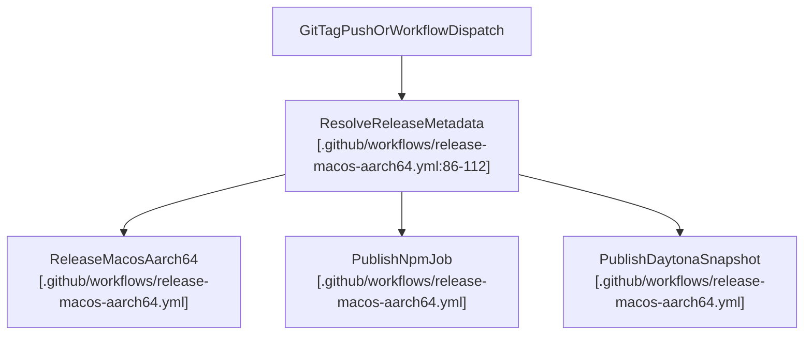
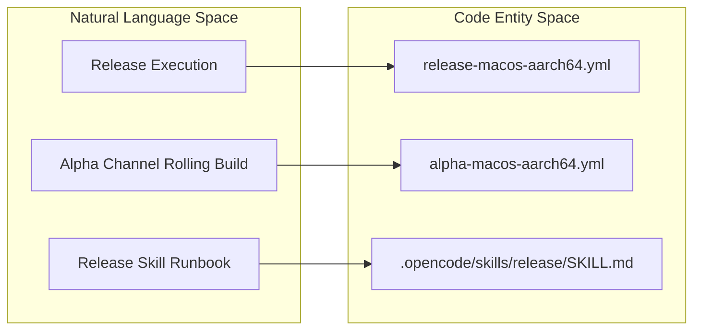
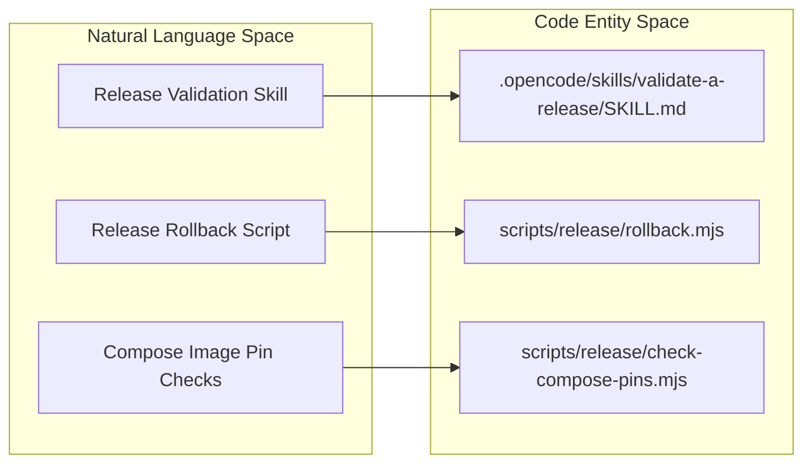

<!-- source: DeepWiki mcp.deepwiki.com · repo different-ai/openwork · page 7.5 Release Process · fetched 2026-10-26 -->

# Release Process

Relevant source files

The following files were used as context for generating this wiki page:

- [.github/actionlint.yaml](.github/actionlint.yaml)
- [.github/scripts/alpha-windows.test.mjs](.github/scripts/alpha-windows.test.mjs)
- [.github/workflows/alpha-macos-aarch64.yml](.github/workflows/alpha-macos-aarch64.yml)
- [.github/workflows/build-electron-desktop.yml](.github/workflows/build-electron-desktop.yml)
- [.github/workflows/release-macos-aarch64.yml](.github/workflows/release-macos-aarch64.yml)
- [.opencode/skills/browser-automation/SKILL.md](.opencode/skills/browser-automation/SKILL.md)
- [.opencode/skills/release/SKILL.md](.opencode/skills/release/SKILL.md)
- [.opencode/skills/validate-a-release/SKILL.md](.opencode/skills/validate-a-release/SKILL.md)
- [docs/RELEASING.md](docs/RELEASING.md)
- [evals/worlds/released-enterprise-activated.ts](evals/worlds/released-enterprise-activated.ts)
- [scripts/release/check-compose-pins.mjs](scripts/release/check-compose-pins.mjs)
- [scripts/release/check-windows-alpha-version.mjs](scripts/release/check-windows-alpha-version.mjs)
- [scripts/release/pin-compose-images.mjs](scripts/release/pin-compose-images.mjs)
- [scripts/release/prune-alpha-assets.mjs](scripts/release/prune-alpha-assets.mjs)
- [scripts/release/purge-legacy-releases.mjs](scripts/release/purge-legacy-releases.mjs)
- [scripts/release/rollback.mjs](scripts/release/rollback.mjs)

This wiki page provides a high-level overview of the OpenWork release process, detailing how releases are cut, validated, and published across multiple desktop and server platforms. 

As a PARENT page, this document summarizes the release lifecycle and delegates deep technical specifics to its child pages:
- For multi-platform build matrices, alpha rolling channels, and signing/notarization, see [Multi-Platform Builds and Channels](#7.5.1).
- For GitHub releases, npm publishing, updater manifests, and Arch Linux AUR automation, see [Distribution Channels and AUR](#7.5.2).
- For release rollbacks, composition pins, validation skills, and changelog workflows, see [Rollback, Validation and Changelog](#7.5.3).

---

## 1. Release Triggers and Workflow Architecture

The release process is coordinated through tag-driven GitHub Actions workflows. Releases can be initiated automatically by pushing a version tag or manually dispatched with customizable parameters [.github/workflows/release-macos-aarch64.yml:4-7]().

### Diagram: Release Orchestration

Sources: [.github/workflows/release-macos-aarch64.yml:4-112]()

### Natural Language to Code Entity Mapping: Release Management

This diagram associates release management concepts with their concrete code entities and workflows in the repository.

Sources: [.github/workflows/release-macos-aarch64.yml:1-10](), [.github/workflows/alpha-macos-aarch64.yml:1-15](), [.opencode/skills/release/SKILL.md:1-12]()

---

## 2. Multi-Platform Builds and Channels

OpenWork builds binaries and installers across macOS, Linux, and Windows architectures. Version stamping is handled dynamically at build time via `scripts/release/stamp-version.mjs`, while package sources maintain a permanent development placeholder [.opencode/skills/release/SKILL.md:13-17]().

For detailed coverage of the build matrix, notarization scripts, Azure signing, and rolling alpha builds, refer to the child page:
- **[Multi-Platform Builds and Channels](#7.5.1)**

Sources: [.opencode/skills/release/SKILL.md:13-17](), [.github/workflows/alpha-macos-aarch64.yml:110-135]()

---

## 3. Distribution Channels and AUR

Once built and signed, artifacts are fanned out to GitHub Releases, npm (`openwork-server`), and the Arch User Repository (AUR). Updater manifests (`latest*.yml`) are updated to ensure desktop clients seamlessly discover updates.

For detailed instructions on AUR `PKGBUILD` and `.SRCINFO` automation, npm publishing, and release manifests, refer to the child page:
- **[Distribution Channels and AUR](#7.5.2)**

Sources: [.github/workflows/release-macos-aarch64.yml:99-105]()

---

## 4. Rollback, Validation and Changelog

Ensuring release stability involves automated smoke tests, pre-release checks (`validate-a-release`), compose pin validations, and changelog generation [.opencode/skills/validate-a-release/SKILL.md:1-5](), [scripts/release/rollback.mjs:1-10]().

### Natural Language to Code Entity Mapping: Release Safety & Validation

This diagram connects release validation tools to their implementation scripts.

Sources: [.opencode/skills/validate-a-release/SKILL.md:1-10](), [scripts/release/rollback.mjs:1-15](), [scripts/release/check-compose-pins.mjs:1-15]()

For comprehensive guidelines on rolling back failed deployments, auditing releases, and managing automated changelogs, see the child page:
- **[Rollback, Validation and Changelog](#7.5.3)**

Sources: [.opencode/skills/validate-a-release/SKILL.md:1-10](), [scripts/release/rollback.mjs:1-15]()

---

