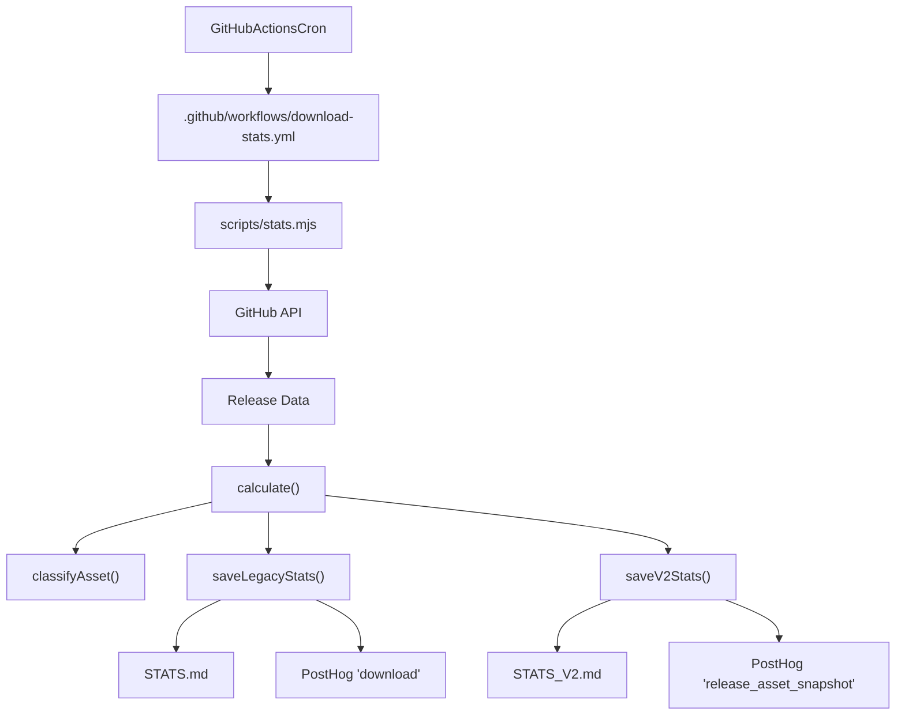
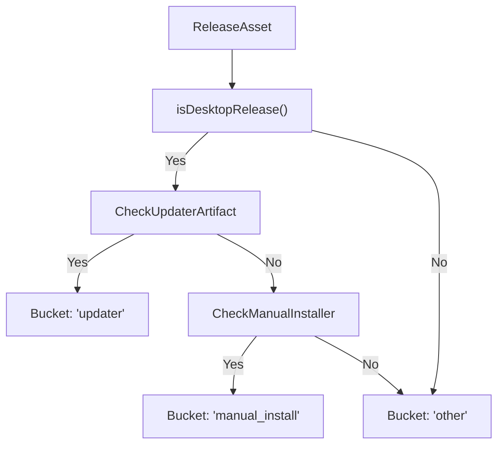
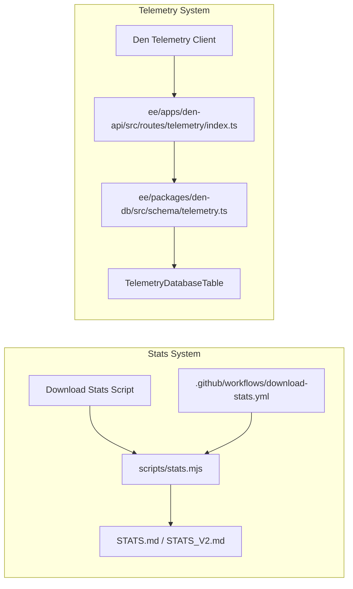

<!-- source: DeepWiki mcp.deepwiki.com · repo different-ai/openwork · page 7.6 Download Statistics and Telemetry · fetched 2026-10-26 -->

# Download Statistics and Telemetry

Relevant source files

The following files were used as context for generating this wiki page:

- [.github/workflows/aur-validate.yml](.github/workflows/aur-validate.yml)
- [.github/workflows/daytona-snapshot-drift.yml](.github/workflows/daytona-snapshot-drift.yml)
- [.github/workflows/dev-daytona-snapshot.yml](.github/workflows/dev-daytona-snapshot.yml)
- [.github/workflows/download-stats.yml](.github/workflows/download-stats.yml)
- [.github/workflows/opencode-agents.yml](.github/workflows/opencode-agents.yml)
- [.github/workflows/release-daytona-snapshot.yml](.github/workflows/release-daytona-snapshot.yml)
- [STATS.md](STATS.md)
- [STATS_V2.md](STATS_V2.md)
- [packaging/aur/.SRCINFO](packaging/aur/.SRCINFO)
- [packaging/aur/PKGBUILD](packaging/aur/PKGBUILD)
- [packaging/aur/README.md](packaging/aur/README.md)
- [scripts/aur/publish-aur.sh](scripts/aur/publish-aur.sh)
- [scripts/aur/update-aur.sh](scripts/aur/update-aur.sh)
- [scripts/prune-daytona-dev-snapshots.mjs](scripts/prune-daytona-dev-snapshots.mjs)
- [scripts/stats.mjs](scripts/stats.mjs)
- [scripts/update-daytona-snapshot-pin.mjs](scripts/update-daytona-snapshot-pin.mjs)

This page details the OpenWork system for tracking download statistics of release artifacts and telemetry event reporting for usage analytics. It covers the implementation of download stats collection (`scripts/stats.mjs`), classification of release assets (`STATS.md` and `STATS_V2.md`), client-side telemetry event batching, and the server-side ingestion and analytic querying of telemetry data (`ee/apps/den-api/src/routes/telemetry/index.ts`, `ee/packages/den-db/src/schema/telemetry.ts`).

Sources: [.github/workflows/download-stats.yml:1-59](), `STATS.md:1-5]`, `STATS_V2.md:1-5]()`

---

## Purpose and Scope

The telemetry and download statistics system is designed to:

- Accurately measure and classify downloads of OpenWork release assets.
- Record usage telemetry from clients in a privacy-conscious and low-overhead manner.
- Provide dimensional analytics on sessions, tasks, and adoption within organizations.
- Integrate with PostHog for event analytics and business intelligence dashboards.
- Store telemetry data efficiently in the Den enterprise control plane's database.

Sources: [.github/workflows/download-stats.yml:1-59](), `STATS.md:1-5]`, `STATS_V2.md:1-5]()`

---

## Download Statistics System

### Overview

OpenWork tracks cumulative and classified download statistics of release assets hosted on GitHub. Two primary markdown files persist historical summaries: `STATS.md` (legacy cumulative totals) and `STATS_V2.md` (classified asset bucket totals). The system fetches releases via GitHub's REST API, aggregates download counts, classifies assets by type, updates both markdown files, and reports snapshot events to PostHog.

Sources: [.github/workflows/download-stats.yml:40-50](), `STATS.md:1-10]`, `STATS_V2.md:1-10]()`

### Data Flow

Sources: [.github/workflows/download-stats.yml:1-50](), `STATS.md:1-10]`, `STATS_V2.md:1-10]()`

### Asset Classification

Assets are classified into three buckets by `classifyAsset()` depending on file suffix and release type:

Sources: `STATS_V2.md:1-10]`, `packaging/aur/PKGBUILD:1-20]()`

- **Manual installers**: Files like `.dmg`, `.msi`, `.deb`, `.rpm`, `.pkg`, `.appimage`, `.exe`.
- **Updater artifacts**: Auto-updater files such as `latest.json`, `.blockmap`, `.app.tar.gz`.
- **Other**: Signatures, sidecar binaries, or development builds.

Sources: `STATS_V2.md:1-10]`, `packaging/aur/PKGBUILD:1-20]()`

---

## Telemetry Event Reporting

### Client-Side Telemetry

The OpenWork client reports lightweight telemetry events to the Den control plane if the user is signed into Den. Events are batched in-memory up to a max size or flushed every 10 seconds to `/v1/telemetry/ingest`. Telemetry respects privacy by never including prompt contents, file paths, or user data.

Sources: [ee/apps/den-api/src/routes/telemetry/index.ts:1-50](), [ee/packages/den-db/src/schema/telemetry.ts:1-40]()

### Telemetry Schema (`ee/packages/den-db/src/schema/telemetry.ts`)

Telemetry data is stored using two main database tables:
- `TelemetryEventTable`: Records discrete events per organization and member (`org_id`, `member_id`, `event_type`, `event_timestamp`, `source`, `session_id`, `duration_ms`, `success`).
- `TelemetrySessionDimensionTable`: Stores analytical dimension key-value pairs per session.

Sources: [ee/packages/den-db/src/schema/telemetry.ts:1-40]()

### Server-Side Telemetry Routes (`ee/apps/den-api/src/routes/telemetry/index.ts`)

Den API exposes key endpoints:
- `POST /v1/telemetry/ingest`: Authenticated members submit batches of telemetry events validated via `telemetryIngestBatchSchema`.
- `GET /v1/telemetry/dimensions`: Returns distinct dimension values to populate UI filters.

Sources: [ee/apps/den-api/src/routes/telemetry/index.ts:1-50]()

---

## Integration with PostHog Analytics

The daily stats workflow reports summarized snapshot metrics to PostHog for dashboarding and trend analytics using environment variables for keys and ingestion endpoints.

Sources: [.github/workflows/download-stats.yml:40-50]()

---

## Summary Diagram: Natural Language Space to Code Entities

Sources: [scripts/stats.mjs:1-50](), [ee/apps/den-api/src/routes/telemetry/index.ts:1-50](), [ee/packages/den-db/src/schema/telemetry.ts:1-40]()

---

## Environment Variables Relevant to Download Stats

| Variable       | Default                      | Notes                                      |
|----------------|------------------------------|--------------------------------------------|
| `GITHUB_TOKEN`   | None                         | Used for elevated GitHub API rate limits. |
| `POSTHOG_KEY`    | None                         | PostHog project API key [scripts/stats.mjs:7]() |
| `POSTHOG_HOST`   | `https://us.i.posthog.com`      | PostHog ingestion endpoint [scripts/stats.mjs:8]() |
| `GITHUB_REPO`    | `different-ai/openwork`         | Owner/Repo for release stats [scripts/stats.mjs:12]() |

Sources: [.github/workflows/download-stats.yml:41-48]()

---

