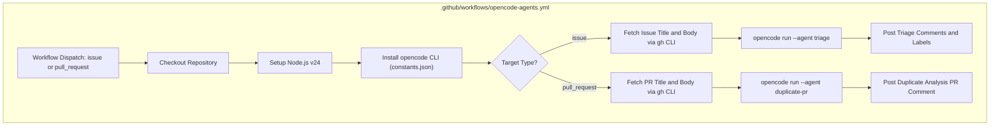
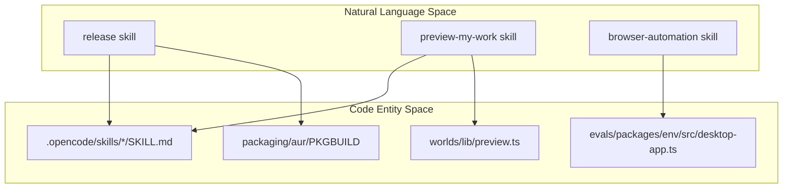
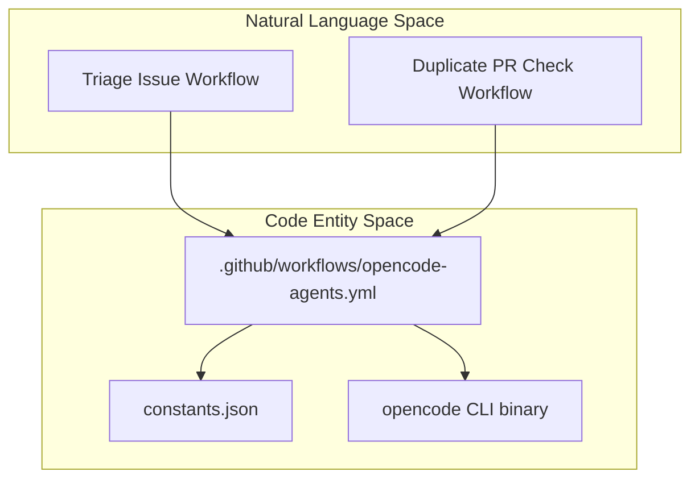

<!-- source: DeepWiki mcp.deepwiki.com · repo different-ai/openwork · page 7.7 Agent Skills and Repo Automation · fetched 2026-10-26 -->

# Agent Skills and Repo Automation

Relevant source files

The following files were used as context for generating this wiki page:

- [.github/workflows/aur-validate.yml](.github/workflows/aur-validate.yml)
- [.github/workflows/daytona-snapshot-drift.yml](.github/workflows/daytona-snapshot-drift.yml)
- [.github/workflows/dev-daytona-snapshot.yml](.github/workflows/dev-daytona-snapshot.yml)
- [.github/workflows/download-stats.yml](.github/workflows/download-stats.yml)
- [.github/workflows/opencode-agents.yml](.github/workflows/opencode-agents.yml)
- [.github/workflows/release-daytona-snapshot.yml](.github/workflows/release-daytona-snapshot.yml)
- [.opencode/skills/daytona/SKILL.md](.opencode/skills/daytona/SKILL.md)
- [.opencode/skills/preview-my-work/SKILL.md](.opencode/skills/preview-my-work/SKILL.md)
- [.opencode/skills/preview-my-work/scripts/update-preview.py](.opencode/skills/preview-my-work/scripts/update-preview.py)
- [STATS.md](STATS.md)
- [STATS_V2.md](STATS_V2.md)
- [evals/packages/env/src/desktop-app.ts](evals/packages/env/src/desktop-app.ts)
- [evals/packages/env/src/world-requirements.ts](evals/packages/env/src/world-requirements.ts)
- [evals/packages/hosts/src/windows-release.ts](evals/packages/hosts/src/windows-release.ts)
- [packages/world/src/catalog.ts](packages/world/src/catalog.ts)
- [packages/world/src/drift.ts](packages/world/src/drift.ts)
- [packaging/aur/.SRCINFO](packaging/aur/.SRCINFO)
- [packaging/aur/PKGBUILD](packaging/aur/PKGBUILD)
- [packaging/aur/README.md](packaging/aur/README.md)
- [scripts/aur/publish-aur.sh](scripts/aur/publish-aur.sh)
- [scripts/aur/update-aur.sh](scripts/aur/update-aur.sh)
- [scripts/prune-daytona-dev-snapshots.mjs](scripts/prune-daytona-dev-snapshots.mjs)
- [scripts/stats.mjs](scripts/stats.mjs)
- [scripts/update-daytona-snapshot-pin.mjs](scripts/update-daytona-snapshot-pin.mjs)
- [worlds/README.md](worlds/README.md)
- [worlds/lib/preview.ts](worlds/lib/preview.ts)
- [worlds/lib/workbot.ts](worlds/lib/workbot.ts)
- [worlds/preview-den.ts](worlds/preview-den.ts)
- [worlds/preview-desktop.ts](worlds/preview-desktop.ts)
- [worlds/preview-workbot.ts](worlds/preview-workbot.ts)

This page details the implementation and usage of AI agent skills within the `.opencode/skills` directory, the automation agents employed by AI contributors, and the related workflows and scenarios for previewing and reporting on code changes in the OpenWork repository. The focus is on core contributor skills (`release`, `write-a-spec`, `preview-my-work`, `browser-automation`, `add-a-feature`), the `opencode-agents` GitHub Actions workflow, preview environments in `worlds/`, and supporting examples and reports.

---

## 1. Agent Skills in `.opencode/skills`

The `.opencode/skills` directory defines AI agent specifications used by contributors to automate repository operations, build features, run validations, and manage previews. Each skill is encapsulated in a dedicated directory containing metadata, execution instructions, and operational scripts.

### Core Contributor Skills

- **preview-my-work**: Bootstraps, reopens, updates, or resets OpenWork pull request preview environments. It uses disposable script worlds (`worlds/lib/preview.ts`) to configure and test surfaces such as `preview-desktop` (app only), `preview-den` (Den API only), `preview-full` (Den plus desktop), and `preview-app-web` [.opencode/skills/preview-my-work/SKILL.md:1-118](). It provides a three-step path: `pnpm world help`, `pnpm world plan`, and `pnpm world up`.
- **add-a-feature**: Guides AI contributors through architecting, writing, and testing new feature sets across the monorepo, updating corresponding TypeScript types and specifications.
- **release**: Automates artifact generation, changelog compilation, and publishing workflows across distribution channels including GitHub Releases and the Arch User Repository (AUR) [packaging/aur/PKGBUILD:1-64]().
- **write-a-spec**: Assists in drafting and verifying functional specifications and test matrices that accompany pull requests.
- **browser-automation**: Drives automated browser testing and interaction validation via headless Chromium drivers and CDP integrations [evals/packages/env/src/desktop-app.ts:1-7]().

Sources: [.opencode/skills/preview-my-work/SKILL.md:1-118](), [packaging/aur/PKGBUILD:1-64](), [evals/packages/env/src/desktop-app.ts:1-7]()

---

## 2. GitHub Actions Automation: opencode-agents

The `.github/workflows/opencode-agents.yml` workflow integrates AI-powered automation into the GitHub Actions pipeline to handle issue triage and duplicate pull request identification.

### Workflow Jobs

- **triage-issue**: Triggered via manual workflow dispatch (`target: issue`), this job checks out the repository, sets up Node.js v24, installs a pinned version of the `opencode` CLI using `constants.json`, retrieves issue details via the GitHub CLI (`gh`), and executes `opencode run --agent triage` [.github/workflows/opencode-agents.yml:19-54]().
- **duplicate-prs**: Triggered via manual dispatch (`target: pull_request`), this job gathers PR title and body contents via `gh`, constructs a prompt file, and runs `opencode run --agent duplicate-pr` to post LLM-generated duplicate analysis directly as a PR comment [.github/workflows/opencode-agents.yml:55-106]().

Sources: [.github/workflows/opencode-agents.yml:1-106]()

---

## 3. Workflow Architecture Diagram

Sources: [.github/workflows/opencode-agents.yml:1-106]()

---

## 4. Preview Scenarios, Worlds, Examples, and Reports

Preview environments are structured around the `worlds/` directory and managed via `worlds/lib/preview.ts`. They provide robust testing harnesses for developers and automated systems.

- **Preview Scenarios**: Defined as typed sets (`blank`, `fresh`, `team`, `restricted`, `workspace`), representing different states of a Den organization or desktop profile [worlds/lib/preview.ts:28-51]().
- **Preview Surfaces**: Controls runtime isolation shapes including `desktop` (app alone), `den` (control plane alone), and `full` (integrated Den and desktop) [worlds/lib/preview.ts:33-51]().
- **Scenarios and Examples Directories**: The repository utilizes `scenarios/` and `examples/` to supply seed data, mock API payloads, and workspace layouts for local and cloud testing.
- **Reports**: Automated run reports and metrics (such as `STATS.md` and `STATS_V2.md`) track download counts, release asset snapshots, and diagnostic telemetry [STATS.md:1-5], [STATS_V2.md:1-5]().

Sources: [worlds/lib/preview.ts:28-51](), [STATS.md:1-5](), [STATS_V2.md:1-5]()

---

## 5. Bridging Natural Language Space to Code Entity Space

The following diagrams map natural language agent skills and automation workflows directly to their underlying code implementations and file structures.

### Diagram 1: Skill Definitions to Code Modules

Sources: [.opencode/skills/preview-my-work/SKILL.md:1-118](), [packaging/aur/PKGBUILD:1-64](), [evals/packages/env/src/desktop-app.ts:1-7](), [worlds/lib/preview.ts:28-51]()

### Diagram 2: GitHub Actions to Agent Executables

Sources: [.github/workflows/opencode-agents.yml:1-106]()

---

