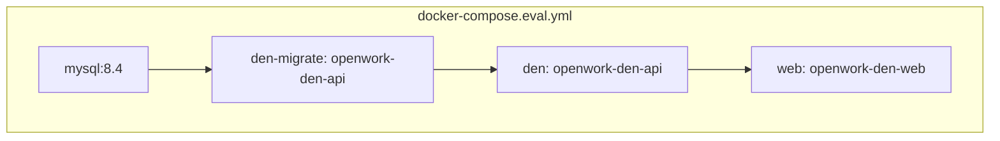
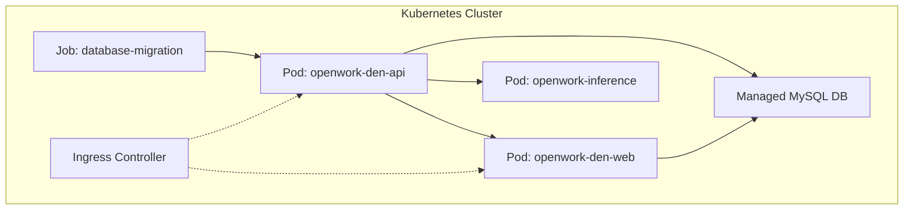
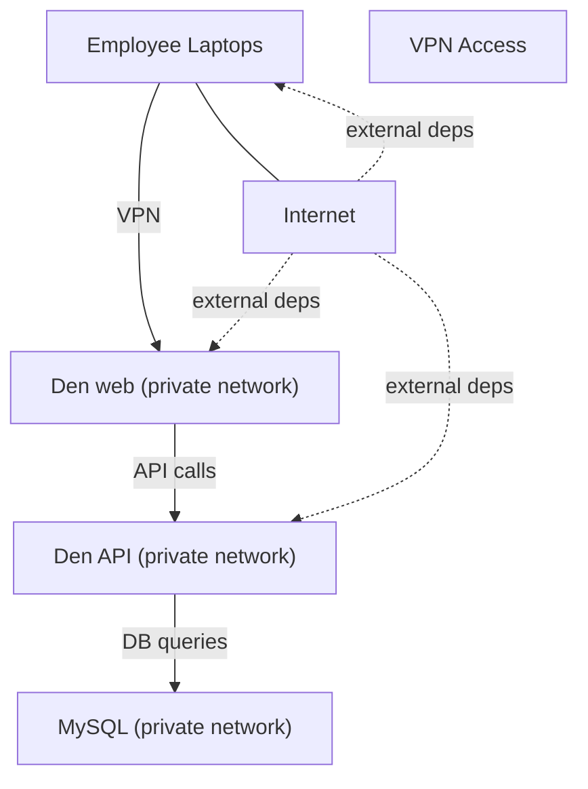
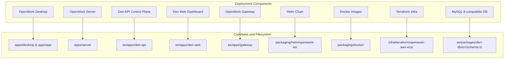
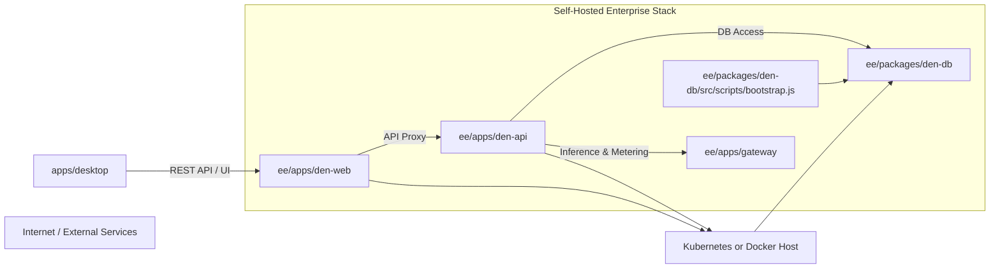

<!-- source: DeepWiki mcp.deepwiki.com · repo different-ai/openwork · page 8 Deployment and Self-Hosting · fetched 2026-10-26 -->

# Deployment and Self-Hosting

Relevant source files

The following files were used as context for generating this wiki page:

- [docs/enterprise/outbound-access.md](docs/enterprise/outbound-access.md)
- [docs/org-install-links.md](docs/org-install-links.md)
- [docs/support/enterprise-network-doctor.md](docs/support/enterprise-network-doctor.md)
- [ee/apps/den-web/app/(den)/_lib/runtime-config.ts](ee/apps/den-web/app/(den)/_lib/runtime-config.ts)
- [ee/apps/den-web/app/api/runtime-config/route.ts](ee/apps/den-web/app/api/runtime-config/route.ts)
- [ee/packages/den-db/src/schema.ts](ee/packages/den-db/src/schema.ts)
- [infra/terraform/AGENTS.md](infra/terraform/AGENTS.md)
- [infra/terraform/MODULE_CONTRACT.md](infra/terraform/MODULE_CONTRACT.md)
- [packages/docs/cloud/enterprise.mdx](packages/docs/cloud/enterprise.mdx)
- [packages/docs/self-host/deploy-to-your-cloud/first-administrator.mdx](packages/docs/self-host/deploy-to-your-cloud/first-administrator.mdx)
- [packages/docs/self-host/evaluate-with-docker-compose.mdx](packages/docs/self-host/evaluate-with-docker-compose.mdx)
- [packages/docs/start-here/air-gapped-deployment.mdx](packages/docs/start-here/air-gapped-deployment.mdx)
- [packages/docs/start-here/installer-delivery.mdx](packages/docs/start-here/installer-delivery.mdx)
- [packages/docs/start-here/network-diagnostics.mdx](packages/docs/start-here/network-diagnostics.mdx)
- [packages/docs/start-here/on-prem-branding.mdx](packages/docs/start-here/on-prem-branding.mdx)
- [packages/docs/start-here/outbound-network-access.mdx](packages/docs/start-here/outbound-network-access.mdx)
- [packages/docs/start-here/private-network-deployment.mdx](packages/docs/start-here/private-network-deployment.mdx)
- [packages/docs/start-here/self-host.mdx](packages/docs/start-here/self-host.mdx)
- [packaging/docker/README.md](packaging/docker/README.md)
- [packaging/docker/den-dev-up.sh](packaging/docker/den-dev-up.sh)
- [packaging/docker/docker-compose.den-dev.yml](packaging/docker/docker-compose.den-dev.yml)
- [packaging/docker/docker-compose.dev.yml](packaging/docker/docker-compose.dev.yml)
- [packaging/docker/docker-compose.eval.yml](packaging/docker/docker-compose.eval.yml)
- [scripts/dev-local.mjs](scripts/dev-local.mjs)
- [scripts/support/openwork-doctor.ps1](scripts/support/openwork-doctor.ps1)
- [scripts/support/setup-openwork-tls-repro.ps1](scripts/support/setup-openwork-tls-repro.ps1)

This page provides a high-level overview of running OpenWork Enterprise on your own infrastructure. It covers deployment methods including Docker, Helm charts for Kubernetes, Terraform-based infrastructure automation, and managed deployment options. For detailed, step-by-step instructions, configuration references, and operational considerations, please consult the linked child pages dedicated to each topic.

---

## Overview of Self-Hosting OpenWork Enterprise

OpenWork is designed to run in three main runtime shapes:

1. **Desktop Direct** — The OpenWork Desktop app runs with an embedded local server (sidecar) and OpenCode engine, suitable for single users on laptops.
2. **Self-Hosted Server** — Organizations deploy a central OpenWork server alongside the Den control plane for multi-user environments with team workspaces and shared capabilities.
3. **Cloud-Hosted** — Use OpenWork Cloud, the managed SaaS offering that abstracts infrastructure and operational complexity.

Self-hosting typically targets the second shape, giving teams control over their data, user management, and connectivity while using the same clients (desktop or web) that connect to a remote self-hosted backend.

Sources: `packages/docs/start-here/self-host.mdx:6-8`

---

## Deployment Methods

### Docker Images and Compose

For rapid evaluation or local development, Docker Compose offers the easiest route. You can start a full-stack evaluation environment on one machine by running pre-built images published on GitHub Container Registry [packages/docs/start-here/self-host.mdx:10-12, packaging/docker/README.md:3-19](). This evaluation uses loopback ports and default credentials, allowing you to test Den API, Den Web, and a MySQL backend without building from source [packaging/docker/README.md:21]().

For local development of the Den control plane, a dedicated Compose stack brings up MySQL, Den API, and the Den Web app with environment variables for ports, secrets, and demo data seeding [packaging/docker/README.md:23-46](). This stack supports running migrations automatically and configuring the environment for single- or multi-organization modes [packaging/docker/README.md:39-46]().

> **Note:** These Compose stacks are not recommended for production. They lack enterprise-grade security, secret management, TLS, high availability, external worker provisioning, and email [packaging/docker/README.md:21]().

For full details about Dockerfiles, published images, environment variables, and Compose stacks (`den-dev`, `eval`, `dev`), see [Docker Images and Compose](#8.1).

### Diagram: Docker Compose Evaluation Stack

Sources: `packages/docs/start-here/self-host.mdx:10-12`, `packaging/docker/README.md:3-21`, `packaging/docker/docker-compose.eval.yml:34-132`

---

### Helm Chart for Kubernetes

Production-grade deployments utilize Kubernetes with the official OpenWork Helm chart (`openwork-ee`) [packages/docs/start-here/self-host.mdx:51-57](). This chart packages Den API (`ee/apps/den-api`), Den Web (`ee/apps/den-web`), optional OpenWork Gateway (`ee/apps/gateway`) for inference routing and metering, database migrations, and ingress configuration [packages/docs/start-here/self-host.mdx:47-49](). It supports integration with managed MySQL instances and TLS setup [packages/docs/start-here/self-host.mdx:19-21]().

Helm values allow configuring feature flags, secrets (Better Auth key, DB encryption key), network and ingress details, and operator locks for feature control [packages/docs/start-here/self-host.mdx:54-57]().

For details on `values.yaml`, templates, cloud-provider ingress examples, secrets management, and feature operator locks, refer to [Helm Chart (openwork-ee)](#8.2).

### Diagram: Kubernetes Helm Chart Components

Sources: `packages/docs/start-here/self-host.mdx:39-64`, `packaging/helm/openwork-ee/README.md` (child page)

---

### Terraform and Managed Deployments

For teams running cloud infrastructure as code or non-Kubernetes container platforms, OpenWork provides Terraform modules and managed deployment tooling for AWS ECS, Fargate, and Cloud Run [packages/docs/start-here/self-host.mdx:22-27]().

The Terraform modules (`infra/terraform/openwork-aws-ecs` and `infra/terraform/openwork-gcp-cloud-run`) provision ECS clusters, load balancers, ACM certificates, and support headless runners [packages/docs/start-here/self-host.mdx:22](). Managed deployments simplify service scaling, secrets, and routing.

This infrastructure code deploys the same published container images (`openwork-den-api`, `openwork-den-web`, `openwork-inference`) and mirrors architectures seen in Helm/Kubernetes setups [packages/docs/start-here/self-host.mdx:32-37]().

Details about Terraform modules, ECS/Fargate configuration, hosted workers, and cloud-run packaging are available in [Terraform and Managed Deployments](#8.3).

Sources: `packages/docs/start-here/self-host.mdx:22-30`, `infra/terraform/AGENTS.md:1-24`

---

### Network, Air-Gapped, and Enterprise Operations

Enterprise deployments often have strict networking, security, and operational requirements. OpenWork supports:

- **Private network deployments:** where employee laptops have internet + VPN access to a Den instance running within a private network boundary [packages/docs/start-here/private-network-deployment.mdx:6-11]().
- **Air-gapped deployments:** full network isolation with all dependencies available internally [packages/docs/start-here/air-gapped-deployment.mdx]().
- **TLS and certificate management:** configuring trusted certificate roots and proxies for Den, MySQL, and desktop clients [packages/docs/start-here/self-host.mdx:72]().
- **Installer delivery:** secure distribution options for desktop installers, including semi-air-gapped and fully internal artifact serving [packages/docs/start-here/installer-delivery.mdx:8-15]().
- **Enterprise branding:** customizing desktop icons, wordmarks, and organization names inside the deployment [packages/docs/start-here/on-prem-branding.mdx]().
- **Operational tools:** diagnostics scripts, network doctor tooling, outbound access inventories, and IT security reviews [packages/docs/start-here/network-diagnostics.mdx]().

For thorough coverage of networking topology, security settings, diagnostic tooling, and installation delivery strategies, see [Network, Air-Gapped and Enterprise Operations](#8.4).

### Diagram: Private Network Deployment Architecture

Sources: `packages/docs/start-here/private-network-deployment.mdx:1-38`, `packages/docs/start-here/installer-delivery.mdx:1-16`

---

## System and Code Entity Mapping

To bridge the conceptual and code worlds, here are two diagrams showing key system components in Natural Language Space aligned to their primary code entities and files.

### Diagram: Deployment Components to Code Entities

Sources: `packages/docs/start-here/self-host.mdx:39-48`, `ee/packages/den-db/src/schema.ts`, `packaging/docker/README.md:47-50`

### Diagram: Enterprise Service Interactions in Runtime

Sources: `packaging/docker/docker-compose.eval.yml:53-122`, `ee/apps/den-api/`, `ee/apps/den-web/`

---

## Summary and Next Steps

This overview described the high-level deployment and self-hosting options for OpenWork Enterprise. For your specific needs, use the links below to dive into details:

- For building and running OpenWork control plane with Docker and Compose, see [Docker Images and Compose](#8.1)
- For production-grade Kubernetes deployments with Helm Charts, see [Helm Chart (openwork-ee)](#8.2)
- For infrastructure as code and managed cloud deployments using Terraform and ECS/Fargate, see [Terraform and Managed Deployments](#8.3)
- For network planning, air-gapped setups, enterprise installation, and operational concerns, see [Network, Air-Gapped and Enterprise Operations](#8.4)

Sources: `packages/docs/start-here/self-host.mdx:14-30`, `packaging/docker/README.md:1-25`

---

