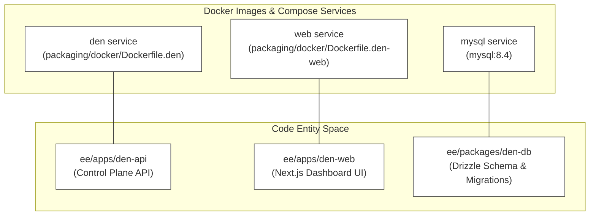
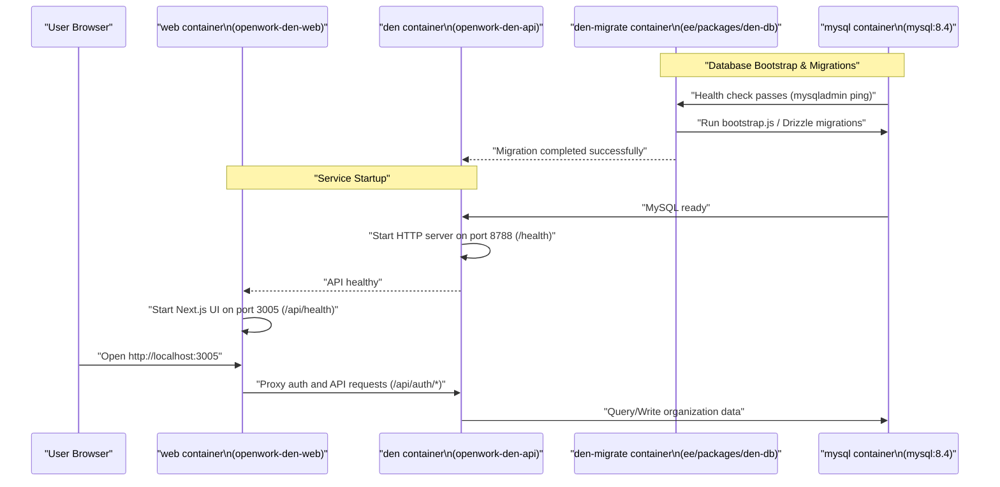

<!-- source: DeepWiki mcp.deepwiki.com · repo different-ai/openwork · page 8.1 Docker Images and Compose · fetched 2026-10-26 -->

# Docker Images and Compose

Relevant source files

The following files were used as context for generating this wiki page:

- [.github/workflows/api-contract.yml](.github/workflows/api-contract.yml)
- [.github/workflows/ci-enterprise-mcp-mock.yml](.github/workflows/ci-enterprise-mcp-mock.yml)
- [.github/workflows/ci-i18n.yml](.github/workflows/ci-i18n.yml)
- [.github/workflows/ci-openwork-ui-mcp.yml](.github/workflows/ci-openwork-ui-mcp.yml)
- [.github/workflows/ci-sdk.yml](.github/workflows/ci-sdk.yml)
- [.github/workflows/den-db-check.yml](.github/workflows/den-db-check.yml)
- [.github/workflows/den-db-migrate.yml](.github/workflows/den-db-migrate.yml)
- [.github/workflows/publish-ee-images.yml](.github/workflows/publish-ee-images.yml)
- [ee/apps/den-api/scripts/migrate-skills-to-plugins.ts](ee/apps/den-api/scripts/migrate-skills-to-plugins.ts)
- [ee/packages/den-db/.env.example](ee/packages/den-db/.env.example)
- [ee/packages/den-db/README.md](ee/packages/den-db/README.md)
- [ee/packages/den-db/drizzle.config.ts](ee/packages/den-db/drizzle.config.ts)
- [ee/packages/den-db/scripts/baseline-migrations.ts](ee/packages/den-db/scripts/baseline-migrations.ts)
- [ee/packages/den-db/scripts/bootstrap.ts](ee/packages/den-db/scripts/bootstrap.ts)
- [ee/packages/den-db/scripts/build-assets.mjs](ee/packages/den-db/scripts/build-assets.mjs)
- [ee/packages/den-db/scripts/db-executor.ts](ee/packages/den-db/scripts/db-executor.ts)
- [ee/packages/den-db/scripts/migration-0097-compat.ts](ee/packages/den-db/scripts/migration-0097-compat.ts)
- [ee/packages/den-db/scripts/migration-0097-schema.ts](ee/packages/den-db/scripts/migration-0097-schema.ts)
- [ee/packages/den-db/src/schema.ts](ee/packages/den-db/src/schema.ts)
- [packages/docs/self-host/deploy-to-your-cloud/first-administrator.mdx](packages/docs/self-host/deploy-to-your-cloud/first-administrator.mdx)
- [packages/docs/self-host/evaluate-with-docker-compose.mdx](packages/docs/self-host/evaluate-with-docker-compose.mdx)
- [packaging/docker/README.md](packaging/docker/README.md)
- [packaging/docker/den-dev-up.sh](packaging/docker/den-dev-up.sh)
- [packaging/docker/docker-compose.den-dev.yml](packaging/docker/docker-compose.den-dev.yml)
- [packaging/docker/docker-compose.dev.yml](packaging/docker/docker-compose.dev.yml)
- [packaging/docker/docker-compose.eval.yml](packaging/docker/docker-compose.eval.yml)
- [packaging/helm/openwork-ee/tests/upgrade-and-migration.mjs](packaging/helm/openwork-ee/tests/upgrade-and-migration.mjs)
- [scripts/dev-local.mjs](scripts/dev-local.mjs)

This page gives an in-depth technical overview of the Docker images and Compose files used to package and deploy the OpenWork system components, particularly in local development, evaluation, and control plane (`Den`) environments. It explains the Dockerfiles for the main server applications (`den`, `den-web`, `gateway`, `den-gateway`, `headless-runner`, `workbot`), describes the Docker Compose stacks for development (`dev`), Den local development (`den-dev`), and evaluation (`eval`), and details the enterprise image publishing workflow.

Sources: `packaging/docker/README.md:1-141`, `packaging/docker/docker-compose.eval.yml:1-35`

---

## 1. Docker Images Overview

OpenWork uses several Docker images to containerize its core services for development, evaluation, and production deployments. Key enterprise images are built from Dockerfiles located under `packaging/docker/`:

- **Den API (`openwork-den-api`)**: Built from `Dockerfile.den` [packaging/docker/docker-compose.den-dev.yml:98-100] — The control plane backend responsible for organization management, authentication (`Better Auth`), RBAC, billing, and migrations via `ee/packages/den-db` [ee/packages/den-db/README.md:1-3].
- **Den Web (`openwork-den-web`)**: Built from `Dockerfile.den-web` [.github/workflows/publish-ee-images.yml:135-136] — The frontend web dashboard (`ee/apps/den-web`), providing the Next.js UI for the control plane.
- **Inference Gateway (`openwork-inference`)**: Built from `Dockerfile.gateway` [.github/workflows/publish-ee-images.yml:140-142] — The stable image repository retained for existing Gateway deployments proxying LLM requests.
- **Den Gateway (`openwork-den-gateway`)**: Built from `Dockerfile.den-gateway` [.github/workflows/publish-ee-images.yml:151-152] — Edge proxy and routing gateway interacting with `den-api`.
- **Headless Runner (`openwork-headless-runner`)**: Built from `Dockerfile.headless-runner` [.github/workflows/publish-ee-images.yml:159-160] — Handles self-hosted Slack replies, headless automations, and background agent loops.
- **Workbot (`openwork-workbot`)**: Built from `Dockerfile.workbot` [.github/workflows/publish-ee-images.yml:168-169] — Assistant integration runtime container.

### Dockerfiles Implementation Details

- **`Dockerfile.den`** (Den API Image)
  - Base: `node:22-bookworm-slim` (or similar bookworm base).
  - Installs system build tools and uses `pnpm` workspace dependency layout.
  - Copies core packages (`ee/packages/den-db`, `packages/features`, `packages/telemetry`) and `ee/apps/den-api`.
  - Exposes port `8788` and implements a health check probing `GET /health` [packaging/docker/docker-compose.den-dev.yml:107-108].
  - Executes the compiled bundle at `ee/apps/den-api/dist/main.js` [packaging/docker/docker-compose.den-dev.yml:101].

- **`Dockerfile.den-web`** (Den Web Image)
  - Base: `node:22-bookworm-slim` with `corepack` enabled.
  - Installs minimal packages for running Next.js.
  - Exposes port `3005` and probes `GET /api/health` for health checks [.github/workflows/publish-ee-images.yml:138].

Sources: `packaging/docker/README.md:47-52`, `.github/workflows/publish-ee-images.yml:118-178`

---

## 2. Docker Compose Files

OpenWork orchestrates service stacks using several dedicated Docker Compose configurations:

### 2.1 Evaluation Stack (`docker-compose.eval.yml`)
- **Purpose**: Pulls pre-built production images from GitHub Container Registry (`ghcr.io/different-ai/`) without cloning or building the repository [packaging/docker/docker-compose.eval.yml:1-13].
- **Services**:
  - `mysql`: Pinned to `mysql:8.4` with tuned buffer pool and internal network binding (no exposed host port) [packaging/docker/docker-compose.eval.yml:35-51].
  - `den-migrate`: A transient container running database bootstrap via `ee/packages/den-db/dist/scripts/bootstrap.js` [packaging/docker/docker-compose.eval.yml:53-64].
  - `den`: Den API service dependent on successful migration completion, exposing port `8788` on loopback [packaging/docker/docker-compose.eval.yml:65-101].
  - `web`: Den Web Next.js application bound to loopback port `3005` [packaging/docker/docker-compose.eval.yml:102-132].

Sources: `packaging/docker/docker-compose.eval.yml:1-135`, `packages/docs/self-host/evaluate-with-docker-compose.mdx:1-132`

### 2.2 Den Local Development Stack (`docker-compose.den-dev.yml`)
- **Purpose**: Provides a local control plane testing environment [packaging/docker/docker-compose.den-dev.yml:1-6].
- **Services**:
  - `mysql`: Local MySQL 8.4 instance with performance schema disabled and volume mount `den-mysql-data:/var/lib/mysql` [packaging/docker/docker-compose.den-dev.yml:74-94].
  - `den`: Builds `packaging/docker/Dockerfile.den`, executes Drizzle migrations inline (`drizzle-kit push`), and starts `ee/apps/den-api/dist/main.js` [packaging/docker/docker-compose.den-dev.yml:96-101].
- **Features**: Supports observability environment injection (`OTEL_EXPORTER_OTLP_ENDPOINT`, `SENTRY_DSN`) and mock worker provisioning modes (`DEN_PROVISIONER_MODE=stub`) [packaging/docker/docker-compose.den-dev.yml:30-71, 103-128].

Sources: `packaging/docker/docker-compose.den-dev.yml:1-184`, `packaging/docker/README.md:23-105`

### 2.3 Development Stack (`docker-compose.dev.yml`)
- **Purpose**: Runs the OpenWork server and web UI directly from source with live host mounts [packaging/docker/docker-compose.dev.yml:1-22].
- **Services**:
  - `openwork-server`: Uses `node:24.22.1-bookworm-slim`, mounts the entire monorepo root to `/app`, installs `bun` and `pnpm` dynamically, builds `openwork-server`, fetches the pinned OpenCode binary using `constants.json`, and starts the server CLI via `pnpm --filter openwork-server exec bun dist/cli.js` [packaging/docker/docker-compose.dev.yml:23-128].
  - `web`: Next.js web UI container wired to the backend server tokens [packaging/docker/docker-compose.dev.yml:129-161].

Sources: `packaging/docker/docker-compose.dev.yml:1-185`

---

## 3. Den Dev Bootstrap Script (`den-dev-up.sh`)

- **Purpose**: Wrapper shell script to provision local Den testability stacks with dynamic port allocation and collision avoidance [packaging/docker/den-dev-up.sh:1-16].
- **Behavior**:
  - Automatically picks available TCP ports for `DEN_API_PORT`, `DEN_WEB_PORT`, and `DEN_MYSQL_PORT` using Node.js net server checks [packaging/docker/den-dev-up.sh:30-40, 126-134].
  - Detects LAN IPv4 addresses or Tailscale DNS names to establish valid CORS and trusted origins [packaging/docker/den-dev-up.sh:47-82, 137-159].
  - Generates secure random secrets for Better Auth (`DEN_BETTER_AUTH_SECRET`) and database encryption (`DEN_DB_ENCRYPTION_KEY`) [packaging/docker/den-dev-up.sh:140-141].
  - Writes runtime variables to `tmp/.den-dev-env-<id>` and starts a background log watcher for OTP authentication codes [packaging/docker/den-dev-up.sh:175-196].

Sources: `packaging/docker/den-dev-up.sh:1-302`

---

## 4. Enterprise Images Publishing Workflow (`publish-ee-images.yml`)

- **Trigger**: Runs on `workflow_dispatch` (with manual push and chart version inputs) or on push to `dev` and version tags (`v*`) [.github/workflows/publish-ee-images.yml:3-21].
- **Jobs**:
  - `artifact-version`: Resolves target chart versions and publish flags based on Git references [.github/workflows/publish-ee-images.yml:34-67].
  - `helm-chart`: Sets up Helm and Node, lints and renders the Helm chart (`packaging/helm/openwork-ee`), runs chart tests, and pushes to `oci://ghcr.io/different-ai/charts/openwork-ee` [packaging/workflows/publish-ee-images.yml:68-117].
  - `ee-images`: Matrix build for `openwork-den-api`, `openwork-den-web`, `openwork-inference`, `openwork-den-gateway`, `openwork-headless-runner`, and `openwork-workbot`. Validates images locally with automated HTTP health endpoint probes [.github/workflows/publish-ee-images.yml:118-178].

Sources: `.github/workflows/publish-ee-images.yml:1-466`

---

## 5. Data Flow & Key Components Mapping

The container architecture maps natural service roles to precise codebase entities and deployment definitions.

### Component-to-Code Mapping Table

| Container Service | Codebase Source Directory | Primary Role & Entrypoint |
|-------------------|--------------------------|---------------------------|
| `den` | `ee/apps/den-api` [packaging/docker/Dockerfile.den]() | Control plane backend, API routes, Better Auth (`ee/apps/den-api/dist/main.js`) |
| `den-web` | `ee/apps/den-web` [packaging/docker/Dockerfile.den-web]() | Control plane frontend dashboard UI (`next start`) |
| `mysql` | `ee/packages/den-db` [ee/packages/den-db/README.md]() | Relational persistence (`mysql:8.4` with Drizzle schema management) |
| `openwork-server` | `apps/server` [packaging/docker/docker-compose.dev.yml:36-112]() | Local OpenCode engine wrapper and server sidecar (`dist/cli.js`) |

Sources: `packaging/docker/docker-compose.den-dev.yml:96-101`, `ee/packages/den-db/README.md:1-50`

### Diagram 1: Natural Language Space to Code Entity Space — Docker Architecture

Sources: `packaging/docker/docker-compose.den-dev.yml:74-128`, `ee/packages/den-db/README.md:1-25`

### Diagram 2: Docker Compose Evaluation Stack Execution Flow

Sources: `packaging/docker/docker-compose.eval.yml:35-132`, `packages/docs/self-host/evaluate-with-docker-compose.mdx:30-41`

---

