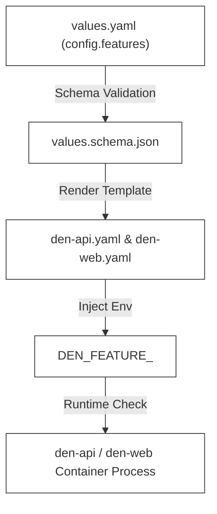

<!-- source: DeepWiki mcp.deepwiki.com · repo different-ai/openwork · page 8.2 Helm Chart (openwork-ee) · fetched 2026-10-26 -->

# Helm Chart (openwork-ee)

Relevant source files

The following files were used as context for generating this wiki page:

- [docs/aws-eks-helm.md](docs/aws-eks-helm.md)
- [docs/azure-aks-helm.md](docs/azure-aks-helm.md)
- [docs/gcp-gke-helm.md](docs/gcp-gke-helm.md)
- [ee/apps/den-api/src/audit/routes/org.ts](ee/apps/den-api/src/audit/routes/org.ts)
- [ee/apps/den-api/src/workbot/routes.ts](ee/apps/den-api/src/workbot/routes.ts)
- [ee/apps/workbot/src/client/host.ts](ee/apps/workbot/src/client/host.ts)
- [ee/apps/workbot/src/server/den.ts](ee/apps/workbot/src/server/den.ts)
- [ee/apps/workbot/src/server/routes.ts](ee/apps/workbot/src/server/routes.ts)
- [ee/packages/workbot-ui/src/host.ts](ee/packages/workbot-ui/src/host.ts)
- [ee/packages/workbot-ui/src/screen.tsx](ee/packages/workbot-ui/src/screen.tsx)
- [evals/fixtures/kube/mysql.yaml](evals/fixtures/kube/mysql.yaml)
- [packages/docs/openapi.json](packages/docs/openapi.json)
- [packages/docs/start-here/github-connector-helm.mdx](packages/docs/start-here/github-connector-helm.mdx)
- [packages/features/src/registry.ts](packages/features/src/registry.ts)
- [packages/sdk/src/gen/sdk.gen.ts](packages/sdk/src/gen/sdk.gen.ts)
- [packages/sdk/src/gen/types.gen.ts](packages/sdk/src/gen/types.gen.ts)
- [packaging/helm/openwork-ee/README.md](packaging/helm/openwork-ee/README.md)
- [packaging/helm/openwork-ee/examples/values.aws-load-balancer-http-smoke.yaml](packaging/helm/openwork-ee/examples/values.aws-load-balancer-http-smoke.yaml)
- [packaging/helm/openwork-ee/examples/values.aws-load-balancer.yaml](packaging/helm/openwork-ee/examples/values.aws-load-balancer.yaml)
- [packaging/helm/openwork-ee/examples/values.azure-ingress.yaml](packaging/helm/openwork-ee/examples/values.azure-ingress.yaml)
- [packaging/helm/openwork-ee/examples/values.gcp-ingress.yaml](packaging/helm/openwork-ee/examples/values.gcp-ingress.yaml)
- [packaging/helm/openwork-ee/templates/_helpers.tpl](packaging/helm/openwork-ee/templates/_helpers.tpl)
- [packaging/helm/openwork-ee/templates/den-api.yaml](packaging/helm/openwork-ee/templates/den-api.yaml)
- [packaging/helm/openwork-ee/templates/den-web.yaml](packaging/helm/openwork-ee/templates/den-web.yaml)
- [packaging/helm/openwork-ee/templates/inference.yaml](packaging/helm/openwork-ee/templates/inference.yaml)
- [packaging/helm/openwork-ee/templates/migration-job.yaml](packaging/helm/openwork-ee/templates/migration-job.yaml)
- [packaging/helm/openwork-ee/templates/secret.yaml](packaging/helm/openwork-ee/templates/secret.yaml)
- [packaging/helm/openwork-ee/tests/custom-ca.sh](packaging/helm/openwork-ee/tests/custom-ca.sh)
- [packaging/helm/openwork-ee/tests/observability-env.sh](packaging/helm/openwork-ee/tests/observability-env.sh)
- [packaging/helm/openwork-ee/tests/private-mcp-urls.sh](packaging/helm/openwork-ee/tests/private-mcp-urls.sh)
- [packaging/helm/openwork-ee/values.schema.json](packaging/helm/openwork-ee/values.schema.json)
- [packaging/helm/openwork-ee/values.yaml](packaging/helm/openwork-ee/values.yaml)

This page documents the **OpenWork Enterprise Edition Helm Chart** (`openwork-ee`), which provides a production-grade Kubernetes deployment architecture for the Den enterprise control plane stack and its supporting services. The chart coordinates core components including `den-api` (control plane API), `den-web` (dashboard web application), optional gateway/inference services, and database migration jobs, complete with strict values validation, feature operator locks, and cloud ingress configurations.

Sources:
`packaging/helm/openwork-ee/README.md:1-120`
`packaging/helm/openwork-ee/values.yaml:1-66`

---

## 1. Purpose and Scope

The `openwork-ee` Helm chart encapsulates the packaging lifecycle for deploying OpenWork EE into self-hosted or cloud Kubernetes clusters. Its core design objectives include:

- Standardizing deployments for `den-api`, `den-web`, inference/gateway engines, and automated database migration jobs [packaging/helm/openwork-ee/README.md:3-18]().
- Managing centralized ConfigMaps and Kubernetes Secrets with flexible provider integration [packaging/helm/openwork-ee/README.md:112-119]().
- Enforcing global feature availability via operator-level locks that override runtime UI toggles [packaging/helm/openwork-ee/values.yaml:23-27]().
- Providing cloud-native ingress patterns for AWS, Azure, and GCP [packaging/helm/openwork-ee/README.md:60-65]().

Sources:
`packaging/helm/openwork-ee/README.md:1-120`
`packaging/helm/openwork-ee/values.yaml:1-66`

---

## 2. Values Definition and Schema Validation

### 2.1. Configuration Defaults (`values.yaml`)

The chart values file establishes defaults across multiple domains:

- **Image Settings:** `image.tag` defaults to empty, automatically pinning to the chart's `appVersion` to guarantee version parity during releases [packaging/helm/openwork-ee/values.yaml:4-9]().
- **Deployment Mode:** `config.deployment` distinguishes between `cloud` and `self_hosted` runtimes, controlling feature availability and rendering `DEN_DEPLOYMENT` [packaging/helm/openwork-ee/values.yaml:19-21]().
- **Feature Operator Locks:** Under `config.features`, flags such as `nativeDictation`, `organizationGrants`, and `connectionMcpServers` accept boolean inputs, strings (`"true"`, `"false"`), or empty values (`""`) to defer to runtime database defaults [packaging/helm/openwork-ee/values.yaml:28-54]().
- **Tenancy and Audit:** Establishes single-organization modes (`config.tenancy.mode`), owner emails, and self-hosted audit capture behavior [packaging/helm/openwork-ee/values.yaml:55-66]().

Sources:
`packaging/helm/openwork-ee/values.yaml:1-66`

### 2.2. JSON Schema Enforcement (`values.schema.json`)

To prevent misconfigurations, `values.schema.json` validates user-supplied values during `helm install` or `helm upgrade` actions [packaging/helm/openwork-ee/values.schema.json:1-153](). 

- Constrains `config.deployment` strictly to enum values `["cloud", "self_hosted"]` [packaging/helm/openwork-ee/values.schema.json:9-16]().
- Applies strict property matching (`additionalProperties: false`) and enum type checks to every feature flag registered in `packages/features/src/registry.ts` [packaging/helm/openwork-ee/values.schema.json:3-53]().

Sources:
`packaging/helm/openwork-ee/values.schema.json:1-153`
`packages/features/src/registry.ts:1-50`

---

## 3. Template Architecture and Deployable Services

The Helm chart templates dynamically provision Kubernetes primitives for the enterprise control plane.

### 3.1. Core Service Templates

- **`den-api.yaml`**: Provisions the `den-api` Deployment, injecting database secrets, node options (`config.denApiNodeOptions`), and feature environment variables [packaging/helm/openwork-ee/templates/den-api.yaml]().
- **`den-web.yaml`**: Deploys the Next.js control plane dashboard UI (`den-web`), configuring service bindings on port `3005` [packaging/helm/openwork-ee/templates/den-web.yaml]() [packaging/helm/openwork-ee/README.md:5-6]().
- **`inference.yaml`**: Manages the optional Gateway service (`ee/apps/gateway`), maintaining legacy `inference.*` aliases for upgrade compatibility while respecting canonical `gateway.enabled` structural rules [packaging/helm/openwork-ee/README.md:9-40]() [packaging/helm/openwork-ee/templates/inference.yaml]().
- **`migration-job.yaml`**: Implements a pre-install and pre-upgrade Kubernetes `Job` lifecycle hook that executes database migrations safely before rolling out updated application deployments [packaging/helm/openwork-ee/README.md:17-118]() [packaging/helm/openwork-ee/templates/migration-job.yaml]().

Sources:
`packaging/helm/openwork-ee/README.md:3-48`
`packaging/helm/openwork-ee/templates/den-api.yaml`
`packaging/helm/openwork-ee/templates/den-web.yaml`
`packaging/helm/openwork-ee/templates/inference.yaml`
`packaging/helm/openwork-ee/templates/migration-job.yaml`

---

## 4. Feature Operator Locks

OpenWork utilizes feature operator locks to govern capability rollouts. When an operator defines a feature state in `values.yaml`, the chart renders environment variables matching the pattern `DEN_FEATURE_<KEY>` [packaging/helm/openwork-ee/values.yaml:22-27]().

*Figure 1: Feature Operator Lock Propagation from Helm Values to Container Runtimes.*

Sources:
`packaging/helm/openwork-ee/values.yaml:22-54`
`packaging/helm/openwork-ee/values.schema.json:1-53`

---

## 5. Cloud Ingress Examples

To accommodate different enterprise hosting environments, the chart bundles reference configuration files under `packaging/helm/openwork-ee/examples/`:

- **AWS Load Balancer (`values.aws-load-balancer.yaml`)**: Configures annotation-driven AWS ALB Ingress Controller rules for target group bindings [packaging/helm/openwork-ee/examples/values.aws-load-balancer.yaml]().
- **Azure AKS (`values.azure-ingress.yaml`)**: Sets up routes optimized for Azure Application Gateway or NGINX ingress controllers [packaging/helm/openwork-ee/examples/values.azure-ingress.yaml]().
- **Google GKE (`values.gcp-ingress.yaml`)**: Implements GCP HTTP(S) load balancing annotations and backend health checks [packaging/helm/openwork-ee/examples/values.gcp-ingress.yaml]().

Sources:
`packaging/helm/openwork-ee/README.md:60-65`
`packaging/helm/openwork-ee/examples/values.aws-load-balancer.yaml`
`packaging/helm/openwork-ee/examples/values.azure-ingress.yaml`
`packaging/helm/openwork-ee/examples/values.gcp-ingress.yaml`

---

## 6. Chart Tests and Verification

Chart regressions and deployment templates are validated via automated tests located in `packaging/helm/openwork-ee/tests/`:

- **Observability and Environment Tests (`observability-env.sh`)**: Validates correct environment injection and structured logging flags [packaging/helm/openwork-ee/tests/observability-env.sh]().
- **Private MCP URL Verification (`private-mcp-urls.sh`)**: Ensures that gateway and MCP service endpoints reject loopback or insecure origins in production manifests [packaging/helm/openwork-ee/tests/private-mcp-urls.sh]() [packaging/helm/openwork-ee/README.md:82-86]().
- **Custom CA Injection (`custom-ca.sh`)**: Verifies proper mounting of enterprise trust stores into container workloads [packaging/helm/openwork-ee/tests/custom-ca.sh]().

Sources:
`packaging/helm/openwork-ee/README.md:82-89`
`packaging/helm/openwork-ee/tests/observability-env.sh`
`packaging/helm/openwork-ee/tests/private-mcp-urls.sh`
`packaging/helm/openwork-ee/tests/custom-ca.sh`

---

