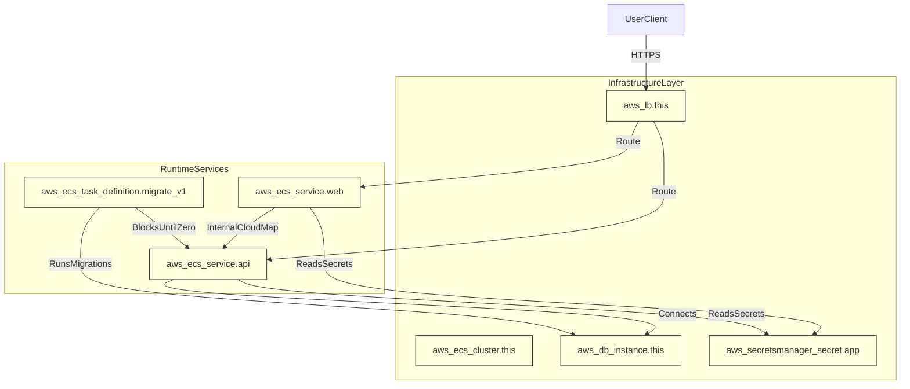
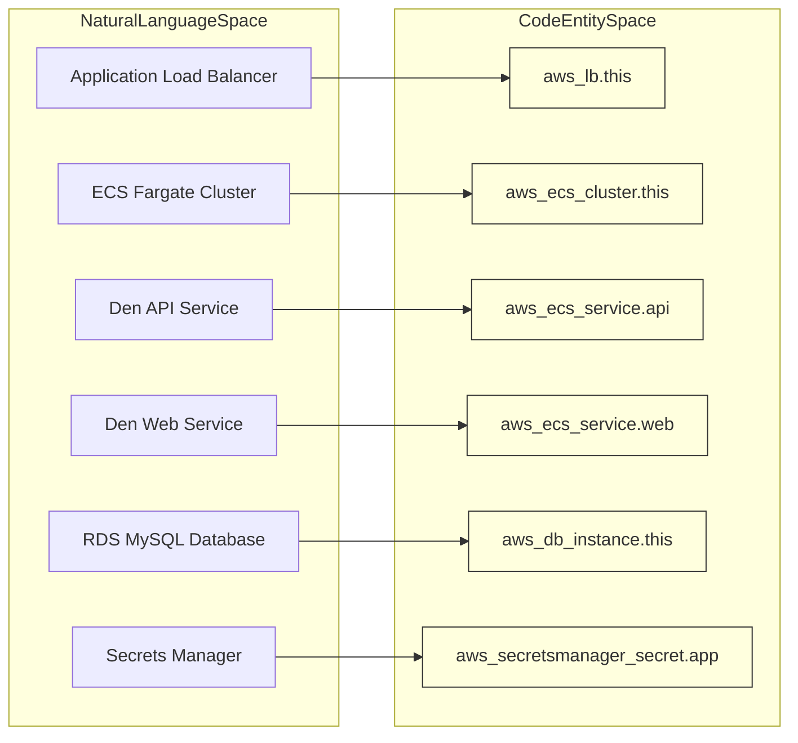
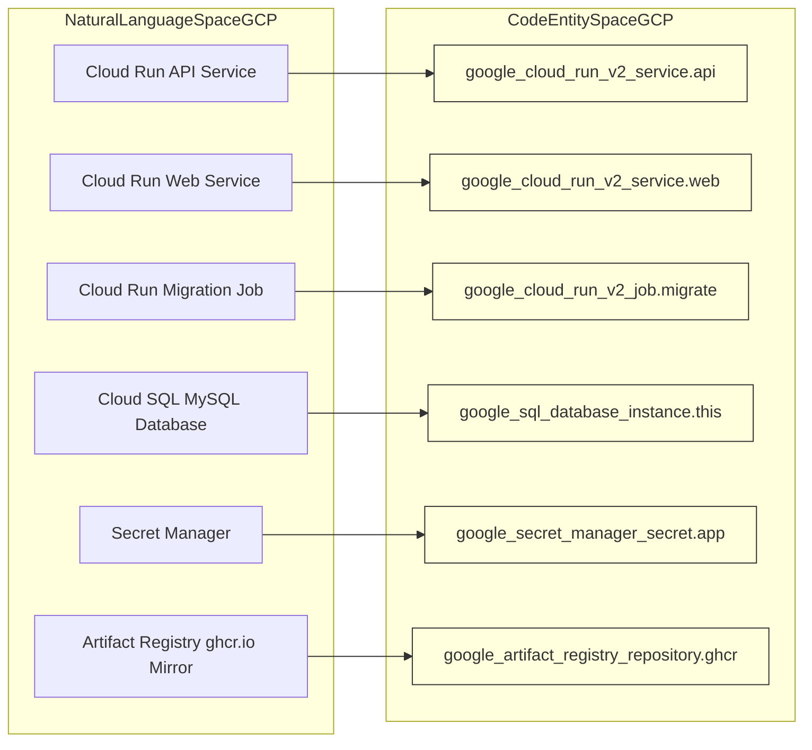

<!-- source: DeepWiki mcp.deepwiki.com · repo different-ai/openwork · page 8.3 Terraform and Managed Deployments · fetched 2026-10-26 -->

# Terraform and Managed Deployments

<details>
<summary>Relevant source files</summary>

The following files were used as context for generating this wiki page:

- [infra/terraform/modules/openwork-aws-ecs/README.md](infra/terraform/modules/openwork-aws-ecs/README.md)
- [infra/terraform/modules/openwork-aws-ecs/acm.tf](infra/terraform/modules/openwork-aws-ecs/acm.tf)
- [infra/terraform/modules/openwork-aws-ecs/alb.tf](infra/terraform/modules/openwork-aws-ecs/alb.tf)
- [infra/terraform/modules/openwork-aws-ecs/ecs.tf](infra/terraform/modules/openwork-aws-ecs/ecs.tf)
- [infra/terraform/modules/openwork-aws-ecs/examples/complete/main.tf](infra/terraform/modules/openwork-aws-ecs/examples/complete/main.tf)
- [infra/terraform/modules/openwork-aws-ecs/examples/complete/variables.tf](infra/terraform/modules/openwork-aws-ecs/examples/complete/variables.tf)
- [infra/terraform/modules/openwork-aws-ecs/gateway.tf](infra/terraform/modules/openwork-aws-ecs/gateway.tf)
- [infra/terraform/modules/openwork-aws-ecs/headless.tf](infra/terraform/modules/openwork-aws-ecs/headless.tf)
- [infra/terraform/modules/openwork-aws-ecs/main.tf](infra/terraform/modules/openwork-aws-ecs/main.tf)
- [infra/terraform/modules/openwork-aws-ecs/outputs.tf](infra/terraform/modules/openwork-aws-ecs/outputs.tf)
- [infra/terraform/modules/openwork-aws-ecs/tests/agents.tftest.hcl](infra/terraform/modules/openwork-aws-ecs/tests/agents.tftest.hcl)
- [infra/terraform/modules/openwork-aws-ecs/tests/contract.tftest.hcl](infra/terraform/modules/openwork-aws-ecs/tests/contract.tftest.hcl)
- [infra/terraform/modules/openwork-aws-ecs/tests/ecs_cluster.tftest.hcl](infra/terraform/modules/openwork-aws-ecs/tests/ecs_cluster.tftest.hcl)
- [infra/terraform/modules/openwork-aws-ecs/tests/load_balancer.tftest.hcl](infra/terraform/modules/openwork-aws-ecs/tests/load_balancer.tftest.hcl)
- [infra/terraform/modules/openwork-aws-ecs/tests/openwork_web.tftest.hcl](infra/terraform/modules/openwork-aws-ecs/tests/openwork_web.tftest.hcl)
- [infra/terraform/modules/openwork-aws-ecs/variables.tf](infra/terraform/modules/openwork-aws-ecs/variables.tf)
- [infra/terraform/modules/openwork-gcp-cloud-run/README.md](infra/terraform/modules/openwork-gcp-cloud-run/README.md)
- [infra/terraform/modules/openwork-gcp-cloud-run/cloudrun.tf](infra/terraform/modules/openwork-gcp-cloud-run/cloudrun.tf)
- [infra/terraform/modules/openwork-gcp-cloud-run/database.tf](infra/terraform/modules/openwork-gcp-cloud-run/database.tf)
- [infra/terraform/modules/openwork-gcp-cloud-run/examples/complete/main.tf](infra/terraform/modules/openwork-gcp-cloud-run/examples/complete/main.tf)
- [infra/terraform/modules/openwork-gcp-cloud-run/main.tf](infra/terraform/modules/openwork-gcp-cloud-run/main.tf)
- [infra/terraform/modules/openwork-gcp-cloud-run/outputs.tf](infra/terraform/modules/openwork-gcp-cloud-run/outputs.tf)
- [infra/terraform/modules/openwork-gcp-cloud-run/tests/cloud_run.tftest.hcl](infra/terraform/modules/openwork-gcp-cloud-run/tests/cloud_run.tftest.hcl)
- [infra/terraform/modules/openwork-gcp-cloud-run/tests/database.tftest.hcl](infra/terraform/modules/openwork-gcp-cloud-run/tests/database.tftest.hcl)
- [infra/terraform/modules/openwork-gcp-cloud-run/tests/load_balancer.tftest.hcl](infra/terraform/modules/openwork-gcp-cloud-run/tests/load_balancer.tftest.hcl)
- [infra/terraform/modules/openwork-gcp-cloud-run/variables.tf](infra/terraform/modules/openwork-gcp-cloud-run/variables.tf)
- [packages/docs/self-host/deploy-to-your-cloud/aws.mdx](packages/docs/self-host/deploy-to-your-cloud/aws.mdx)
- [packages/docs/self-host/deploy-to-your-cloud/azure.mdx](packages/docs/self-host/deploy-to-your-cloud/azure.mdx)
- [packages/docs/self-host/deploy-to-your-cloud/google-cloud.mdx](packages/docs/self-host/deploy-to-your-cloud/google-cloud.mdx)
- [packages/docs/self-host/deploy-to-your-cloud/overview.mdx](packages/docs/self-host/deploy-to-your-cloud/overview.mdx)
- [packaging/docker/Dockerfile.workbot](packaging/docker/Dockerfile.workbot)

</details>


This page details the infrastructure-as-code (IaC) modules and managed deployment tooling available for OpenWork under `infra/terraform` and `infra/managed-deployments` [packages/docs/self-host/deploy-to-your-cloud/overview.mdx:1-6](). It focuses on the [`openwork-aws-ecs`](infra/terraform/modules/openwork-aws-ecs/README.md:1-28)() and [`openwork-gcp-cloud-run`](infra/terraform/modules/openwork-gcp-cloud-run/README.md:1-17)() Terraform modules for deploying OpenWork control plane services (Den) without requiring a full Kubernetes cluster, and describes the shared module contracts, secrets-out-of-state management, and deployment execution patterns.

---

## 1. Introduction and Scope

OpenWork supports container-based deployments via Kubernetes Helm charts (`packaging/helm/openwork-ee`) [infra/terraform/modules/openwork-aws-ecs/README.md:29-31]() as well as dedicated cloud-native Terraform modules for AWS and Google Cloud [packages/docs/self-host/deploy-to-your-cloud/overview.mdx:6-17](). These Terraform modules provide streamlined, Kubernetes-free orchestration using managed container services (AWS ECS Fargate and Google Cloud Run), managed relational databases (Amazon RDS and Cloud SQL), secret stores (AWS Secrets Manager and Google Cloud Secret Manager), and external application load balancers [infra/terraform/modules/openwork-aws-ecs/README.md:12-24](), [infra/terraform/modules/openwork-gcp-cloud-run/README.md:9-16]().

All Terraform modules are designated as **beta** on the `dev` branch and conform to a shared deployment contract (`MODULE_CONTRACT.md`) governing migration ordering, secrets isolation, and compute profiles [packages/docs/self-host/deploy-to-your-cloud/overview.mdx:20-51]().

Sources:
- `packages/docs/self-host/deploy-to-your-cloud/overview.mdx:1-51`
- `infra/terraform/modules/openwork-aws-ecs/README.md:1-28`
- `infra/terraform/modules/openwork-gcp-cloud-run/README.md:1-17`

---

## 2. `openwork-aws-ecs` Terraform Module Overview

The [`infra/terraform/modules/openwork-aws-ecs`](infra/terraform/modules/openwork-aws-ecs/README.md:1-28)() module deploys a private, single-organization OpenWork control plane on AWS ECS Fargate [infra/terraform/modules/openwork-aws-ecs/README.md:11-12]().

### What It Deploys
- **ECS Cluster:** Creates an ECS cluster named `${var.name}-den` or accepts an existing cluster via `ecs_cluster_arn` [infra/terraform/modules/openwork-aws-ecs/variables.tf:136-144]().
- **Services:** Fargate services for Den API (`ghcr.io/different-ai/openwork-den-api`, port `8788`) and Den web (`ghcr.io/different-ai/openwork-den-web`, port `3005`), registered in an AWS Cloud Map private DNS namespace (`${var.name}.internal`) [infra/terraform/modules/openwork-aws-ecs/README.md:16-18](), [infra/terraform/modules/openwork-aws-ecs/ecs.tf:26-47]().
- **Database:** Amazon RDS for MySQL 8.4 (encrypted, private subnets) or an external `database_url` [infra/terraform/modules/openwork-aws-ecs/README.md:20](). Sizing defaults to `db.t4g.small` (2 GiB memory) to prevent micro-tier memory exhaustion [packages/docs/self-host/deploy-to-your-cloud/aws.mdx:78-86]().
- **Migrations:** A standalone Fargate task (`aws_ecs_task_definition.migrate_v1`), synchronously observed by a Lambda invocation (`aws_lambda_invocation.migrate`), ensuring terminal exit `0` before API and web services roll out [infra/terraform/modules/openwork-aws-ecs/README.md:19](), [infra/terraform/modules/openwork-aws-ecs/outputs.tf:105-118]().
- **Load Balancing:** Application Load Balancer (ALB) configuring HTTPS (`domain_name` for Den web, `api.<domain_name>` for Den API) with automatic HTTP-to-HTTPS redirects [infra/terraform/modules/openwork-aws-ecs/README.md:22]().
- **Secrets:** AWS Secrets Manager secret injected as ECS container secrets (`aws_secretsmanager_secret.app`), supporting write-only state configurations [infra/terraform/modules/openwork-aws-ecs/README.md:24](), [infra/terraform/modules/openwork-aws-ecs/outputs.tf:71-74]().

### Example Usage
```hcl
module "openwork" {
  source = "github.com/different-ai/openwork//infra/terraform/modules/openwork-aws-ecs?ref=<commit>"

  openwork_version   = "0.18.58"
  write_only_secrets = true
  owner_emails       = ["admin@example.com"]
  org_name           = "Example Co"

  vpc_id             = "vpc-..."
  alb_subnet_ids     = ["subnet-public-a", "subnet-public-b"]
  service_subnet_ids = ["subnet-private-a", "subnet-private-b"]

  domain_name        = "openwork.example.com"
  route53_zone_id    = "Z0123456789ABC"
}
```

Sources:
- `infra/terraform/modules/openwork-aws-ecs/README.md:1-103`
- `infra/terraform/modules/openwork-aws-ecs/variables.tf:136-153`
- `infra/terraform/modules/openwork-aws-ecs/ecs.tf:26-47`
- `packages/docs/self-host/deploy-to-your-cloud/aws.mdx:78-86`

---

## 3. `openwork-gcp-cloud-run` Terraform Module Overview

The [`infra/terraform/modules/openwork-gcp-cloud-run`](infra/terraform/modules/openwork-gcp-cloud-run/README.md:1-19)() module deploys the Den control plane on Google Cloud Serverless infrastructure [packages/docs/self-host/deploy-to-your-cloud/google-cloud.mdx:6-13]().

### What It Deploys
- **Cloud Run Services:** Serverless services for Den API (`<name>-den-api`, port `8788`) and Den web (`<name>-den-web`, port `3005`) [infra/terraform/modules/openwork-gcp-cloud-run/README.md:9]().
- **Cloud Run Job:** A dedicated migration job (`<name>-den-migrate`) running `/app/ee/packages/den-db/dist/scripts/bootstrap.js`, executed during apply and gated to finish successfully before updating service revisions [infra/terraform/modules/openwork-gcp-cloud-run/README.md:10](), [infra/terraform/modules/openwork-gcp-cloud-run/tests/cloud_run.tftest.hcl:111-130]().
- **Database:** Cloud SQL for MySQL 8.4 accessed securely through Cloud Run's IAM-authorized, verified-TLS socket connector (`/cloudsql/<project>:<region>:<instance>`) [infra/terraform/modules/openwork-gcp-cloud-run/README.md:11](), [infra/terraform/modules/openwork-gcp-cloud-run/tests/database.tftest.hcl:36-64](). Defaults to `db-g1-small` (1.7 GB memory) with 20 GB auto-resizing storage [packages/docs/self-host/deploy-to-your-cloud/overview.mdx:62-71](), [infra/terraform/modules/openwork-gcp-cloud-run/tests/database.tftest.hcl:78-84]().
- **Secret Manager:** Application secrets (database URL, auth secret, encryption keys) referenced via Secret Manager versions rather than stored in plain environment variables [infra/terraform/modules/openwork-gcp-cloud-run/README.md:12](), [infra/terraform/modules/openwork-gcp-cloud-run/tests/cloud_run.tftest.hcl:93-104]().
- **Artifact Registry:** Automatic proxy/mirror repository for `ghcr.io` images (`<name>-ghcr`) since Cloud Run cannot pull directly from `ghcr.io` without a mirror [infra/terraform/modules/openwork-gcp-cloud-run/README.md:13](), [infra/terraform/modules/openwork-gcp-cloud-run/variables.tf:52-56]().

Sources:
- `infra/terraform/modules/openwork-gcp-cloud-run/README.md:1-19`
- `packages/docs/self-host/deploy-to-your-cloud/google-cloud.mdx:6-13`
- `infra/terraform/modules/openwork-gcp-cloud-run/tests/cloud_run.tftest.hcl:93-130`
- `infra/terraform/modules/openwork-gcp-cloud-run/tests/database.tftest.hcl:36-84`

---

## 4. Module Architecture and Implementation Details

### 4.1 Secrets Management and Write-Only Mode
Both modules support `write_only_secrets = true`, ensuring sensitive credentials (such as database passwords, Better Auth secrets, and DB encryption keys) are generated or supplied via write-only arguments (`password_wo_version`, secret data write-only attributes) and are never exposed in Terraform state outputs [infra/terraform/modules/openwork-gcp-cloud-run/tests/database.tftest.hcl:113-128](). Secrets are retrieved directly by ECS task execution roles or Cloud Run secret version bindings.

### 4.2 Migration Sequencing
To prevent race conditions across concurrent application replicas, migrations are isolated from runtime application instances:
- **AWS ECS (`aws_ecs_task_definition.migrate_v1`):** Runs as a standalone ECS task invoked by an internal Lambda function that polls for completion [infra/terraform/modules/openwork-aws-ecs/README.md:19](), [infra/terraform/modules/openwork-aws-ecs/outputs.tf:105-118]().
- **GCP Cloud Run (`google_cloud_run_v2_job.migrate`):** Executes a dedicated Cloud Run Job during Terraform apply using `run_execution_token`, blocking service rollout until the job returns exit code `0` [infra/terraform/modules/openwork-gcp-cloud-run/README.md:10](), [infra/terraform/modules/openwork-gcp-cloud-run/tests/cloud_run.tftest.hcl:111-130]().

Sources:
- `infra/terraform/modules/openwork-aws-ecs/README.md:19`
- `infra/terraform/modules/openwork-aws-ecs/outputs.tf:105-118`
- `infra/terraform/modules/openwork-gcp-cloud-run/tests/database.tftest.hcl:113-128`
- `infra/terraform/modules/openwork-gcp-cloud-run/tests/cloud_run.tftest.hcl:111-130`

---

## 5. Data Flow and Deployment Process



**Data Flow Explanation:**
1. Incoming traffic hits `aws_lb.this`, which routes traffic to `aws_ecs_service.web` (`den-web`) and `aws_ecs_service.api` (`den-api`) [infra/terraform/modules/openwork-aws-ecs/README.md:17-22]().
2. During provisioning or updates, `aws_ecs_task_definition.migrate_v1` executes database migrations against `aws_db_instance.this` [infra/terraform/modules/openwork-aws-ecs/README.md:19]().
3. Upon successful migration completion, `aws_ecs_service.api` and `aws_ecs_service.web` start up, loading secure parameters from `aws_secretsmanager_secret.app` [infra/terraform/modules/openwork-aws-ecs/README.md:24]().

Sources:
- `infra/terraform/modules/openwork-aws-ecs/README.md:17-24`
- `infra/terraform/modules/openwork-aws-ecs/outputs.tf:105-112`

---

## 6. Managed Deployments and Cloud Contracts

The `infra/managed-deployments` directory contains scripts and configuration templates that facilitate automated customer cloud deployments on AWS and GCP. These tools build upon the core Terraform modules by enforcing standardized organization provisioning, automated bootstrap code generation, and enterprise feature-flag gating [packages/docs/self-host/deploy-to-your-cloud/overview.mdx:103-110]().

---

## 7. Code-to-System Entity Mapping

### Diagram: AWS ECS Module Entity Association


### Diagram: GCP Cloud Run Module Entity Association


Sources:
- `infra/terraform/modules/openwork-aws-ecs/ecs.tf:8-24`
- `infra/terraform/modules/openwork-aws-ecs/outputs.tf:61-74`
- `infra/terraform/modules/openwork-gcp-cloud-run/tests/cloud_run.tftest.hcl:36-50`
- `infra/terraform/modules/openwork-gcp-cloud-run/tests/database.tftest.hcl:7-12`

---

## 8. Testing and Verification

Both Terraform modules include offline test suites using Terraform's built-in test framework (`.tftest.hcl`) [packages/docs/self-host/deploy-to-your-cloud/aws.mdx:49](), [packages/docs/self-host/deploy-to-your-cloud/google-cloud.mdx:68]():
- **AWS ECS Tests:** `infra/terraform/modules/openwork-aws-ecs/tests/` verifies contract-v1 compliance, write-only secret handling, and service connect rules [infra/terraform/modules/openwork-aws-ecs/README.md:33-47]().
- **GCP Cloud Run Tests:** `infra/terraform/modules/openwork-gcp-cloud-run/tests/database.tftest.hcl` and `cloud_run.tftest.hcl` validate Cloud SQL socket bindings, environment parity with manual runbooks, and single-job migration barriers under mocked providers [infra/terraform/modules/openwork-gcp-cloud-run/tests/database.tftest.hcl:1-64](), [infra/terraform/modules/openwork-gcp-cloud-run/tests/cloud_run.tftest.hcl:65-109]().

Sources:
- `infra/terraform/modules/openwork-aws-ecs/README.md:33-47`
- `infra/terraform/modules/openwork-gcp-cloud-run/tests/database.tftest.hcl:1-64`
- `infra/terraform/modules/openwork-gcp-cloud-run/tests/cloud_run.tftest.hcl:65-109`

---

