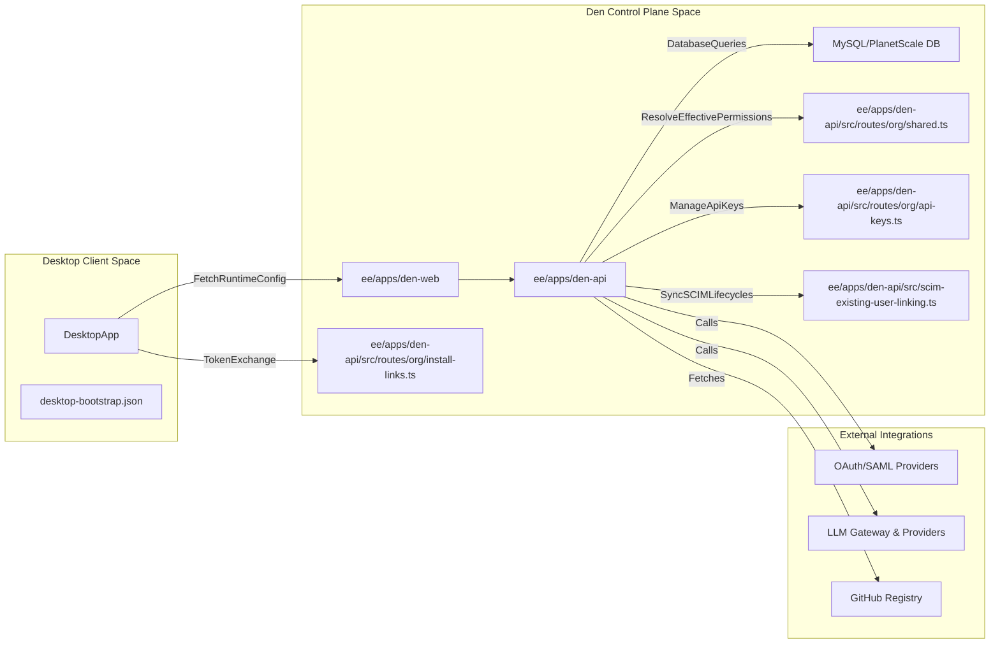
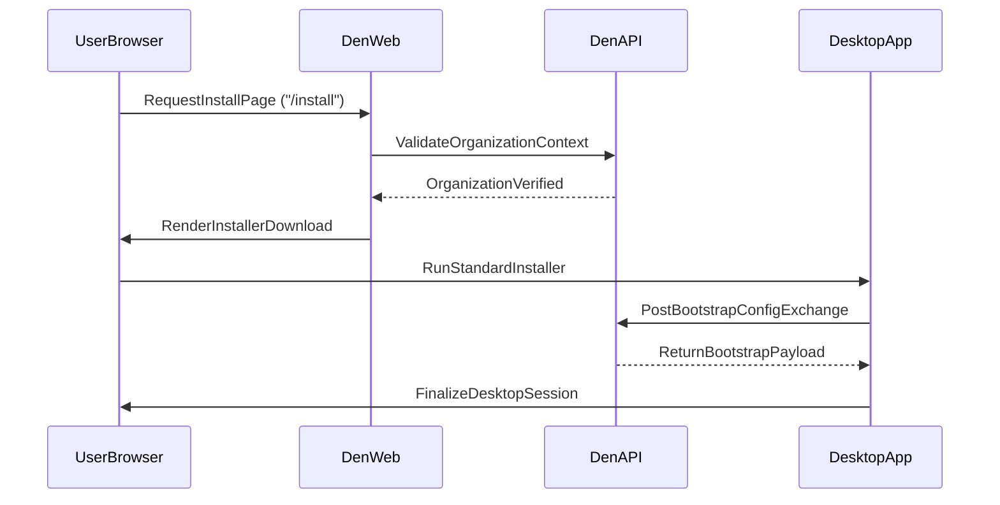
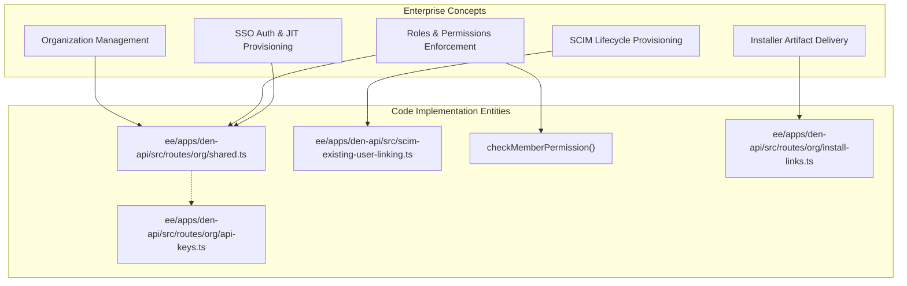

<!-- source: DeepWiki mcp.deepwiki.com · repo different-ai/openwork · page 8.4 Network, Air-Gapped and Enterprise Operations · fetched 2026-10-26 -->

# Network, Air-Gapped and Enterprise Operations

Relevant source files

The following files were used as context for generating this wiki page:

- [docs/enterprise/outbound-access.md](docs/enterprise/outbound-access.md)
- [docs/org-install-links.md](docs/org-install-links.md)
- [docs/support/enterprise-network-doctor.md](docs/support/enterprise-network-doctor.md)
- [ee/apps/den-api/src/routes/org/api-keys.ts](ee/apps/den-api/src/routes/org/api-keys.ts)
- [ee/apps/den-api/src/routes/org/shared.ts](ee/apps/den-api/src/routes/org/shared.ts)
- [ee/apps/den-api/src/scim-existing-user-linking.ts](ee/apps/den-api/src/scim-existing-user-linking.ts)
- [ee/apps/den-web/app/(den)/_lib/runtime-config.ts](ee/apps/den-web/app/(den)/_lib/runtime-config.ts)
- [ee/apps/den-web/app/api/runtime-config/route.ts](ee/apps/den-web/app/api/runtime-config/route.ts)
- [infra/terraform/AGENTS.md](infra/terraform/AGENTS.md)
- [infra/terraform/MODULE_CONTRACT.md](infra/terraform/MODULE_CONTRACT.md)
- [packages/docs/cloud/enterprise.mdx](packages/docs/cloud/enterprise.mdx)
- [packages/docs/cloud/get-started.mdx](packages/docs/cloud/get-started.mdx)
- [packages/docs/cloud/members-and-rbac.mdx](packages/docs/cloud/members-and-rbac.mdx)
- [packages/docs/cloud/run-in-the-cloud/open-cloud-in-browser.mdx](packages/docs/cloud/run-in-the-cloud/open-cloud-in-browser.mdx)
- [packages/docs/cloud/run-in-the-cloud/shared-workspace.mdx](packages/docs/cloud/run-in-the-cloud/shared-workspace.mdx)
- [packages/docs/cloud/scim-google-workspace.mdx](packages/docs/cloud/scim-google-workspace.mdx)
- [packages/docs/cloud/scim-microsoft-entra.mdx](packages/docs/cloud/scim-microsoft-entra.mdx)
- [packages/docs/cloud/scim-okta.mdx](packages/docs/cloud/scim-okta.mdx)
- [packages/docs/cloud/security-and-operations.mdx](packages/docs/cloud/security-and-operations.mdx)
- [packages/docs/cloud/sso-google-workspace.mdx](packages/docs/cloud/sso-google-workspace.mdx)
- [packages/docs/cloud/sso-microsoft-entra.mdx](packages/docs/cloud/sso-microsoft-entra.mdx)
- [packages/docs/cloud/sso-okta.mdx](packages/docs/cloud/sso-okta.mdx)
- [packages/docs/images/cloud-org-settings.png](packages/docs/images/cloud-org-settings.png)
- [packages/docs/start-here/air-gapped-deployment.mdx](packages/docs/start-here/air-gapped-deployment.mdx)
- [packages/docs/start-here/installer-delivery.mdx](packages/docs/start-here/installer-delivery.mdx)
- [packages/docs/start-here/network-diagnostics.mdx](packages/docs/start-here/network-diagnostics.mdx)
- [packages/docs/start-here/on-prem-branding.mdx](packages/docs/start-here/on-prem-branding.mdx)
- [packages/docs/start-here/outbound-network-access.mdx](packages/docs/start-here/outbound-network-access.mdx)
- [packages/docs/start-here/private-network-deployment.mdx](packages/docs/start-here/private-network-deployment.mdx)
- [packages/docs/start-here/self-host.mdx](packages/docs/start-here/self-host.mdx)
- [scripts/support/openwork-doctor.ps1](scripts/support/openwork-doctor.ps1)
- [scripts/support/setup-openwork-tls-repro.ps1](scripts/support/setup-openwork-tls-repro.ps1)

This page describes enterprise and self-hosting considerations for OpenWork deployments, including outbound network egress requirements, private-network and air-gapped deployment topologies, TLS and diagnostics support scripts, on-premises branding and install delivery mechanisms, and key security and operational documentation. The intended audience is platform operators, network administrators, and IT security teams provisioning and maintaining OpenWork in secure, private, or enterprise-controlled environments.

Sources: `packages/docs/start-here/self-host.mdx:1-84` [packages/docs/start-here/self-host.mdx:1-84](), `packages/docs/cloud/security-and-operations.mdx:1-83` [packages/docs/cloud/security-and-operations.mdx:1-83]()

---

## 1. Outbound Access Requirements

### Desktop Access Requirements

The OpenWork desktop app requires outbound connections to the self-hosted Den API and Den Web URLs over HTTPS. The target endpoint is configured via organization settings (`DEN_BASE_URL`), e.g., `https://openwork.example.com`. The desktop client fetches runtime configuration from `${DEN_BASE_URL}/api/runtime-config` to resolve API and MCP endpoints [packages/docs/start-here/private-network-deployment.mdx:16-20]().

When external providers or cloud features are utilized, desktops may require outbound internet access to:
- GitHub for source imports and plugin catalogs [packages/docs/start-here/private-network-deployment.mdx:27]().
- Model providers or inference relays.
- Software update and release assets (`github.com`, `release-assets.githubusercontent.com`).
- Federation and OAuth endpoints (Microsoft, Google, Okta, Entra).

For restricted environments, refer to the customer IT hostname inventory and outbound allowlisting guidelines documented in `packages/docs/start-here/outbound-network-access.mdx` [packages/docs/start-here/self-host.mdx:71-71]().

### Den API and Web Access Requirements

The Den API backend must reach:
- The MySQL-compatible database endpoint (PlanetScale or managed database) [packages/docs/start-here/self-host.mdx:19-21]().
- Container registries and Helm chart repositories at deployment time, unless local mirrors are established [packages/docs/start-here/private-network-deployment.mdx:33-35]().
- External service connectors based on active configurations (Google Workspace, Microsoft 365, GitHub, custom LLM endpoints) [packages/docs/start-here/private-network-deployment.mdx:36-37]().

Sources: `packages/docs/start-here/private-network-deployment.mdx:14-38` [packages/docs/start-here/private-network-deployment.mdx:14-38](), `packages/docs/start-here/self-host.mdx:65-75` [packages/docs/start-here/self-host.mdx:65-75]()

---

## 2. Private Networks and Air-Gapped Deployments

Self-hosted and enterprise OpenWork installations frequently operate behind corporate firewalls or within air-gapped environments.

### Private Network Deployment

The typical private network topology assumes:
- Employee workstations have standard enterprise internet access coupled with VPN connectivity to private corporate segments [packages/docs/start-here/private-network-deployment.mdx:6-11]().
- Den Web and Den API services reside entirely within the private network [packages/docs/start-here/private-network-deployment.mdx:9-10]().
- Desktop clients connect securely over VPN to the enterprise Den URL [packages/docs/start-here/private-network-deployment.mdx:10-11]().

Special considerations for private networks include internal MCP server validation, where SSRF protection blocks private IP ranges by default unless explicitly disabled via `DEN_ALLOW_PRIVATE_MCP_URLS=1` [packages/docs/start-here/private-network-deployment.mdx:42-49]().

### Air-Gapped Deployment

For fully isolated environments lacking external internet connectivity, OpenWork supports air-gapped operations through internal artifact mirroring:
- Installer binaries and release assets are mounted or streamed from internal storage paths (`OPENWORK_INSTALLER_ARTIFACTS_DIR`) [docs/org-install-links.md:66-67]().
- External runtime dependencies (e.g., `npx` packages) must be mirrored locally.
- TLS certificates are provisioned via internal Certificate Authorities.
- Diagnostics operate entirely against local infrastructure [packages/docs/start-here/private-network-deployment.mdx:27-28]().

Sources: `packages/docs/start-here/private-network-deployment.mdx:1-56` [packages/docs/start-here/private-network-deployment.mdx:1-56](), `docs/org-install-links.md:53-84` [docs/org-install-links.md:53-84]()

---

## 3. TLS, Certificates, and Diagnostic Support

### TLS Management

Production deployments must enforce TLS across all components:
- Termination at edge load balancers or reverse proxies for Den Web (`DEN_BASE_URL`) and Den API [packages/docs/cloud/security-and-operations.mdx:14-16]().
- Strict TLS verification for MySQL-protocol database connections [packages/docs/cloud/security-and-operations.mdx:19-20]().
- Internal service-to-service encryption where required by corporate policy.

### Diagnostic Tools and Scripts

- **OpenWork Doctor Script**: PowerShell-based utility (`scripts/support/openwork-doctor.ps1`) verifying network connectivity, DNS resolution, and TLS trust bundles for Windows environments.
- **TLS Repro Script**: Support script (`scripts/support/setup-openwork-tls-repro.ps1`) assisting with trust chain validation and proxy debugging.

Sources: `packages/docs/cloud/security-and-operations.mdx:10-24` [packages/docs/cloud/security-and-operations.mdx:10-24]()

---

## 4. Installer Delivery and Desktop Bootstrap Process

Organization install pages (`/install`) streamline onboarding by supplying standard enterprise installers tied to the authenticated user's organization [docs/org-install-links.md:8-19]().

### Delivery Modes

- **Internet-Connected**: Immediate HTTP `302` redirect to GitHub release assets (`OPENWORK_INSTALLER_RELEASE_REPO`) [docs/org-install-links.md:65-66]().
- **Semi-Air-Gapped / Internal**: Streams matching installers directly from a mounted directory (`OPENWORK_INSTALLER_ARTIFACTS_DIR`) without external fetches [docs/org-install-links.md:66-68]().

### Managed Fleets (MDM and Bootstrap Files)

Managed deployments can skip installer deep-link handoffs by deploying the enterprise binary (`openwork-enterprise-<os>-<arch>-<version>.<ext>`) via MDM and provisioning `desktop-bootstrap.json` at canonical paths (e.g., `%LOCALAPPDATA%\openwork\desktop-bootstrap.json` on Windows or `$XDG_CONFIG_HOME/openwork/desktop-bootstrap.json` on Linux/macOS) [docs/org-install-links.md:85-108]().

Sources: `docs/org-install-links.md:1-122` [docs/org-install-links.md:1-121](), `packages/docs/start-here/installer-delivery.mdx:1-43` [packages/docs/start-here/installer-delivery.mdx:1-43]()

---

## 5. On-Premises Branding

Enterprises can customize wordmarks, logos, and desktop icons to match organizational branding:
- Branding configurations are applied post-installation via desktop bootstrap parameters [packages/docs/start-here/on-prem-branding.mdx]() (implied).
- This ensures updates remain fully compatible with upstream enterprise releases without maintaining custom-patched source forks.

Sources: `packages/docs/start-here/on-prem-branding.mdx` (implied)

---

## 6. Security, Identity, and Operational Practices

Production deployments enforce strict governance and hardening controls:

- **Encryption**: AES-256-GCM application-level encryption for sensitive database columns (`DEN_DB_ENCRYPTION_KEY`), alongside storage encryption at rest [packages/docs/cloud/security-and-operations.mdx:19-21]().
- **Secrets Management**: Credentials must reside in secure key management vaults, segregated by environment, and rotated on regular schedules [packages/docs/cloud/security-and-operations.mdx:25-36]().
- **Access Governance**: Separation of roles (`Owner`, `Admin`, `Member`), team-based RBAC, SCIM synchronization, and SSO just-in-time provisioning [packages/docs/cloud/members-and-rbac.mdx:7-26]().
- **Session Freshness**: Privileged operations require re-authentication or a session active within the last 15 minutes [packages/docs/cloud/security-and-operations.mdx:61]().

Sources: `packages/docs/cloud/security-and-operations.mdx:1-83` [packages/docs/cloud/security-and-operations.mdx:1-83](), `packages/docs/cloud/members-and-rbac.mdx:1-106` [packages/docs/cloud/members-and-rbac.mdx:1-106]()

---

## 7. Key Code Entities and Data Flow

*Figure 1: Architectural data flow mapping natural language services to code implementation modules.*

Sources: `ee/apps/den-api/src/routes/org/shared.ts:1-145` [ee/apps/den-api/src/routes/org/shared.ts:1-144](), `ee/apps/den-api/src/routes/org/api-keys.ts:107-163` [ee/apps/den-api/src/routes/org/api-keys.ts:107-163](), `packages/docs/start-here/private-network-deployment.mdx:14-25` [packages/docs/start-here/private-network-deployment.mdx:14-25]()

---

## 8. Network and Security Flow for Install Link Exchange

*Figure 2: Sequence flow of installer provisioning and desktop bootstrap credential exchange.*

Sources: `docs/org-install-links.md:10-84` [docs/org-install-links.md:10-84]()

---

## 9. Access Governance, RBAC and SCIM Integration

Enterprise organizations rely on federated identity and automated provisioning:
- **SSO Integration**: SAML/OIDC authentication routed via organization-specific domains (e.g., Microsoft Entra ID or Okta) [packages/docs/cloud/sso-microsoft-entra.mdx:6-50]().
- **SCIM Provisioning**: Automated user creation, attribute updates, and deactivation via connectors defined in `ee/apps/den-api/src/scim-existing-user-linking.ts` [packages/docs/cloud/scim-okta.mdx:6-80]().
- **Team Admin Grants**: Approved SCIM groups or manual teams can be assigned organization-wide `Admin` privileges through explicit owner consent [packages/docs/cloud/members-and-rbac.mdx:81-93]().

Sources: `packages/docs/cloud/members-and-rbac.mdx:1-106` [packages/docs/cloud/members-and-rbac.mdx:1-106](), `packages/docs/cloud/scim-okta.mdx:1-125` [packages/docs/cloud/scim-okta.mdx:1-125]()

---

## 10. Summary Table of Environment Variables

| Variable | Description | Default / Notes |
|---|---|---|
| `DEN_BASE_URL` | Den Web origin URL | Required for desktop bootstrap config [packages/docs/start-here/private-network-deployment.mdx:16-21]() |
| `DEN_API_PUBLIC_URL` | Public API origin if separate from Den Web | Optional [packages/docs/start-here/private-network-deployment.mdx:21]() |
| `DEN_ALLOW_PRIVATE_MCP_URLS` | Allow private IP addresses for MCP servers | `0` (secure); `1` to bypass SSRF protection [packages/docs/start-here/private-network-deployment.mdx:47-48]() |
| `DEN_DIAGNOSTICS_ORIGIN` | Diagnostics endpoint URL | Defaults to public diagnostic service [packages/docs/start-here/private-network-deployment.mdx:58-62]() |
| `DEN_PASSWORD_BREACH_SCREENING_ENABLED` | Enable HaveIBeenPwned password screening | `true` by default; set to `false` in air-gapped installs [packages/docs/cloud/security-and-operations.mdx:77]() |
| `OPENWORK_INSTALLER_ARTIFACTS_DIR` | Directory containing mounted installer artifacts | Used for semi-air-gapped and internal deployments [docs/org-install-links.md:66-67]() |

Sources: `packages/docs/start-here/private-network-deployment.mdx:16-62` [packages/docs/start-here/private-network-deployment.mdx:16-62](), `packages/docs/cloud/security-and-operations.mdx:77` [packages/docs/cloud/security-and-operations.mdx:77]()

---

## 11. Enterprise Concepts to Code Mapping

*Figure 3: Mapping of enterprise operational concepts directly to underlying API routes and security verification functions.*

Sources: `ee/apps/den-api/src/routes/org/shared.ts:61-136` [ee/apps/den-api/src/routes/org/shared.ts:61-136](), `ee/apps/den-api/src/routes/org/api-keys.ts:107-163` [ee/apps/den-api/src/routes/org/api-keys.ts:107-163]()

---

