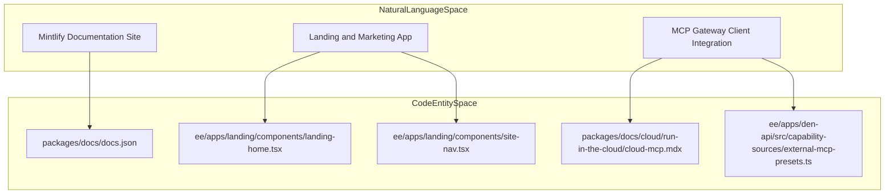
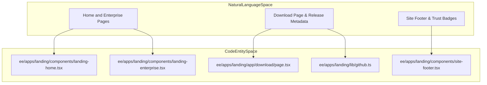

<!-- source: DeepWiki mcp.deepwiki.com · repo different-ai/openwork · page 9 Documentation Site and Marketing · fetched 2026-10-26 -->

# Documentation Site and Marketing

Relevant source files

The following files were used as context for generating this wiki page:

- [ee/apps/den-api/src/capability-sources/external-mcp-presets.ts](ee/apps/den-api/src/capability-sources/external-mcp-presets.ts)
- [ee/apps/landing/app/alternatives/claude-cowork-3p/page.tsx](ee/apps/landing/app/alternatives/claude-cowork-3p/page.tsx)
- [ee/apps/landing/app/alternatives/claude-cowork/page.tsx](ee/apps/landing/app/alternatives/claude-cowork/page.tsx)
- [ee/apps/landing/app/download/page.tsx](ee/apps/landing/app/download/page.tsx)
- [ee/apps/landing/app/enterprise/page.tsx](ee/apps/landing/app/enterprise/page.tsx)
- [ee/apps/landing/app/globals.css](ee/apps/landing/app/globals.css)
- [ee/apps/landing/app/layout.tsx](ee/apps/landing/app/layout.tsx)
- [ee/apps/landing/app/page.tsx](ee/apps/landing/app/page.tsx)
- [ee/apps/landing/components/hero-download-button.tsx](ee/apps/landing/components/hero-download-button.tsx)
- [ee/apps/landing/components/landing-enterprise.tsx](ee/apps/landing/components/landing-enterprise.tsx)
- [ee/apps/landing/components/landing-faq.tsx](ee/apps/landing/components/landing-faq.tsx)
- [ee/apps/landing/components/landing-home.tsx](ee/apps/landing/components/landing-home.tsx)
- [ee/apps/landing/components/site-footer.tsx](ee/apps/landing/components/site-footer.tsx)
- [ee/apps/landing/components/site-nav.tsx](ee/apps/landing/components/site-nav.tsx)
- [ee/apps/landing/lib/github.ts](ee/apps/landing/lib/github.ts)
- [ee/apps/landing/public/.well-known/agent-skills/workspace-guide/SKILL.md](ee/apps/landing/public/.well-known/agent-skills/workspace-guide/SKILL.md)
- [ee/apps/landing/public/robots.txt](ee/apps/landing/public/robots.txt)
- [packages/docs/ai-gateway/compare-litellm-bifrost.mdx](packages/docs/ai-gateway/compare-litellm-bifrost.mdx)
- [packages/docs/ai-gateway/overview.mdx](packages/docs/ai-gateway/overview.mdx)
- [packages/docs/cloud/run-in-the-cloud/cloud-mcp.mdx](packages/docs/cloud/run-in-the-cloud/cloud-mcp.mdx)
- [packages/docs/cloud/share-with-your-team/mcp-server-compatibility.mdx](packages/docs/cloud/share-with-your-team/mcp-server-compatibility.mdx)
- [packages/docs/cloud/share-with-your-team/shared-mcp-connections.mdx](packages/docs/cloud/share-with-your-team/shared-mcp-connections.mdx)
- [packages/docs/docs.json](packages/docs/docs.json)
- [packages/docs/start-here/connect-openwork-mcp.mdx](packages/docs/start-here/connect-openwork-mcp.mdx)
- [packages/docs/start-here/connect-your-stack/add-an-mcp-server.mdx](packages/docs/start-here/connect-your-stack/add-an-mcp-server.mdx)
- [packages/docs/start-here/connect-your-stack/enable-exa-search.mdx](packages/docs/start-here/connect-your-stack/enable-exa-search.mdx)
- [packages/docs/start-here/get-started.mdx](packages/docs/start-here/get-started.mdx)
- [packages/docs/style.css](packages/docs/style.css)

This section provides a high-level overview of the public documentation site powered by Mintlify (`packages/docs`), the marketing landing site managed via the `ee/apps/landing` Next.js application, and how these components relate to the broader OpenWork ecosystem. The documentation and marketing web assets serve to onboard users, explain features and architecture, and promote OpenWork's capabilities for both individual users and organizations.

For details on specific child topics, refer to the child pages:
- [Docs Site Structure](#9.1)
- [MCP Client Integration Guides](#9.2)
- [Landing Site](#9.3)

---

## 1. Documentation Site Overview

The OpenWork documentation site is built on Mintlify, a platform designed for clear, searchable, and versioned technical documentation. It uses a structured JSON configuration file to define its navigation, styling, and SEO metadata.

- The main configuration for the docs site is located in `packages/docs/docs.json`. This file defines the theme, color palette, logo assets, SEO metadata, and markdown instructions for agents `[packages/docs/docs.json:1-38]`.
- The hierarchical navigation structure encompasses key tabs such as **Start here**, **Desktop App**, **Integrations**, **Slack**, **AI Gateway**, and **MCP Gateway**, linking to detailed guides and setups `[packages/docs/docs.json:39-200]`.
- Getting started guides and onboarding pathways are detailed in `packages/docs/start-here/get-started.mdx` `[packages/docs/start-here/get-started.mdx:1-85]`.

For further details, see the child page [Docs Site Structure](#9.1).

Sources:
- `packages/docs/docs.json:1-200`
- `packages/docs/start-here/get-started.mdx:1-85`

---

## 2. Marketing and Landing Site

The marketing and landing site is implemented as a Next.js application located under `ee/apps/landing`. This app presents the OpenWork product to visitors and potential customers, providing product overviews, pricing, downloads, and enterprise trust information.

- **Key Marketing Components:** The landing page shell and home view are defined in `ee/apps/landing/components/landing-home.tsx`, while enterprise value propositions are handled in `ee/apps/landing/components/landing-enterprise.tsx` `[ee/apps/landing/components/landing-home.tsx:1-40]`, `[ee/apps/landing/components/landing-enterprise.tsx:1-50]`.
- **Navigation and Footer:** Global navigation and footer bars are implemented in `ee/apps/landing/components/site-nav.tsx` and `ee/apps/landing/components/site-footer.tsx` `[ee/apps/landing/components/site-nav.tsx:1-35]`, `ee/apps/landing/components/site-footer.tsx:1-30`.
- **Downloads and Releases:** The download page fetches release metadata and installers via `ee/apps/landing/app/download/page.tsx` and `ee/apps/landing/lib/github.ts` `[ee/apps/landing/app/download/page.tsx:1-45]`, `ee/apps/landing/lib/github.ts:1-50`.
- **Styling and Design System:** Global CSS variables and typography rules reside in `ee/apps/landing/app/globals.css` `[ee/apps/landing/app/globals.css:1-40]`.

For detailed marketing site architecture and routes, see the child page [Landing Site](#9.3).

Sources:
- `ee/apps/landing/components/landing-home.tsx:1-40`
- `ee/apps/landing/components/landing-enterprise.tsx:1-50`
- `ee/apps/landing/components/site-nav.tsx:1-35`
- `ee/apps/landing/components/site-footer.tsx:1-30`
- `ee/apps/landing/app/download/page.tsx:1-45`
- `ee/apps/landing/lib/github.ts:1-50`
- `ee/apps/landing/app/globals.css:1-40`

---

## 3. MCP Client Integration and External Connections

OpenWork promotes interoperation with multiple AI clients through the Model Context Protocol (MCP) Gateway. This allows external agents such as Claude Code, Cursor, Codex, VS Code, and others to connect to OpenWork's MCP endpoint at `https://api.openworklabs.com/mcp/agent` `[packages/docs/cloud/run-in-the-cloud/cloud-mcp.mdx:1-15]`.

- Client integration guides and setup instructions are maintained under `packages/docs/cloud/run-in-the-cloud/cloud-mcp.mdx` `[packages/docs/cloud/run-in-the-cloud/cloud-mcp.mdx:1-30]`.
- Shared team MCP connection capabilities and connectors (e.g. GitHub, Notion, Linear, Slack, Exa) are documented in `packages/docs/cloud/share-with-your-team/shared-mcp-connections.mdx` `[packages/docs/cloud/share-with-your-team/shared-mcp-connections.mdx:1-40]`.
- Backend presets for quick-add external MCP connections are defined in `ee/apps/den-api/src/capability-sources/external-mcp-presets.ts` `[ee/apps/den-api/src/capability-sources/external-mcp-presets.ts:1-40]`.

For complete MCP client integration guidance and connection sharing, see the child page [MCP Client Integration Guides](#9.2).

Sources:
- `packages/docs/cloud/run-in-the-cloud/cloud-mcp.mdx:1-30`
- `packages/docs/cloud/share-with-your-team/shared-mcp-connections.mdx:1-40`
- `ee/apps/den-api/src/capability-sources/external-mcp-presets.ts:1-40`

---

## 4. Relationship Diagrams: Natural Language Space to Code Entity Space

### Diagram: Documentation and Marketing Core Architecture

Sources:
- `packages/docs/docs.json:1-38`
- `ee/apps/landing/components/landing-home.tsx:1-40`
- `ee/apps/landing/components/site-nav.tsx:1-35`
- `packages/docs/cloud/run-in-the-cloud/cloud-mcp.mdx:1-30`
- `ee/apps/den-api/src/capability-sources/external-mcp-presets.ts:1-40`

---

### Diagram: Landing Pages and Data Modules

Sources:
- `ee/apps/landing/components/landing-home.tsx:1-40`
- `ee/apps/landing/components/landing-enterprise.tsx:1-50`
- `ee/apps/landing/app/download/page.tsx:1-45`
- `ee/apps/landing/lib/github.ts:1-50`
- `ee/apps/landing/components/site-footer.tsx:1-30`

---

## Summary

The Documentation Site and Marketing parent section introduces two primary outward-facing components of OpenWork's public presence:
- **Documentation Site (Mintlify):** Structured, comprehensive docs for setup, usage, integrations, and architecture, serving developers and operators.
- **Marketing Landing Site (`ee/apps/landing`):** Promotional and onboarding website with SEO, analytics, and user engagement flows, driving downloads and organization signups.
- **MCP Integration:** Crucial connective tissue allowing AI clients and external MCP apps to connect seamlessly through OpenWork.

This parent page links downward to dedicated child pages that cover each topic in detail:
- [Docs Site Structure](#9.1)
- [MCP Client Integration Guides](#9.2)
- [Landing Site](#9.3)

---

# Links to Children

- For documentation site structure and navigation details, see [Docs Site Structure](#9.1).
- For guides on connecting external MCP clients to OpenWork's MCP Gateway, see [MCP Client Integration Guides](#9.2).
- For marketing site features, pages, and APIs, see [Landing Site](#9.3).

---

*End of Documentation Site and Marketing section.*

---

# Sources

- `packages/docs/docs.json:1-200`
- `packages/docs/start-here/get-started.mdx:1-85`
- `ee/apps/landing/components/landing-home.tsx:1-40`
- `ee/apps/landing/components/landing-enterprise.tsx:1-50`
- `packages/docs/cloud/run-in-the-cloud/cloud-mcp.mdx:1-30`
- `ee/apps/landing/components/site-footer.tsx:1-30`
- `packages/docs/cloud/share-with-your-team/shared-mcp-connections.mdx:1-40`
- `ee/apps/landing/components/site-nav.tsx:1-35`
- `ee/apps/landing/app/download/page.tsx:1-45`
- `ee/apps/landing/app/globals.css:1-40`
- `ee/apps/landing/lib/github.ts:1-50`
- `ee/apps/den-api/src/capability-sources/external-mcp-presets.ts:1-40`

---

