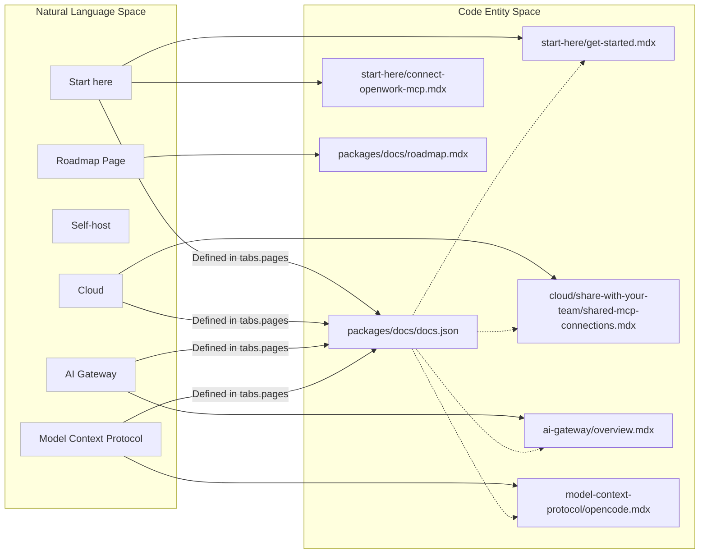

<!-- source: DeepWiki mcp.deepwiki.com · repo different-ai/openwork · page 9.1 Docs Site Structure · fetched 2026-10-26 -->

# Docs Site Structure

<details>
<summary>Relevant source files</summary>

The following files were used as context for generating this wiki page:

- [ee/apps/den-api/src/capability-sources/external-mcp-presets.ts](ee/apps/den-api/src/capability-sources/external-mcp-presets.ts)
- [ee/apps/landing/app/docs/roadmap/page.tsx](ee/apps/landing/app/docs/roadmap/page.tsx)
- [ee/apps/landing/app/roadmap/page.tsx](ee/apps/landing/app/roadmap/page.tsx)
- [ee/apps/landing/components/roadmap-page-shell.tsx](ee/apps/landing/components/roadmap-page-shell.tsx)
- [ee/apps/landing/components/roadmap-previews.tsx](ee/apps/landing/components/roadmap-previews.tsx)
- [packages/docs/ai-gateway/compare-litellm-bifrost.mdx](packages/docs/ai-gateway/compare-litellm-bifrost.mdx)
- [packages/docs/ai-gateway/overview.mdx](packages/docs/ai-gateway/overview.mdx)
- [packages/docs/cloud/run-in-the-cloud/cloud-mcp.mdx](packages/docs/cloud/run-in-the-cloud/cloud-mcp.mdx)
- [packages/docs/cloud/share-with-your-team/mcp-server-compatibility.mdx](packages/docs/cloud/share-with-your-team/mcp-server-compatibility.mdx)
- [packages/docs/cloud/share-with-your-team/shared-mcp-connections.mdx](packages/docs/cloud/share-with-your-team/shared-mcp-connections.mdx)
- [packages/docs/docs.json](packages/docs/docs.json)
- [packages/docs/roadmap.mdx](packages/docs/roadmap.mdx)
- [packages/docs/start-here/connect-openwork-mcp.mdx](packages/docs/start-here/connect-openwork-mcp.mdx)
- [packages/docs/start-here/connect-your-stack/add-an-mcp-server.mdx](packages/docs/start-here/connect-your-stack/add-an-mcp-server.mdx)
- [packages/docs/start-here/connect-your-stack/enable-exa-search.mdx](packages/docs/start-here/connect-your-stack/enable-exa-search.mdx)
- [packages/docs/start-here/get-started.mdx](packages/docs/start-here/get-started.mdx)
- [packages/docs/style.css](packages/docs/style.css)
- [packages/ui/README.md](packages/ui/README.md)
- [packages/ui/src/react/roadmap.tsx](packages/ui/src/react/roadmap.tsx)

</details>


This page documents the structure, content organization, and implementation details of the OpenWork documentation website as defined by the `docs.json` configuration file located in `packages/docs/docs.json`. It explains the high-level navigation hierarchy, the main documentation sections (`start-here`, `cloud`, `self-host`, `ai-gateway`, `model-context-protocol`), the integration of images and screenshots, as well as specialized pages like the roadmap and changelog. Additionally, it touches on the screenshot capture pipeline that supports visual documentation.

Sources: `packages/docs/docs.json:1-414` [packages/docs/docs.json]()

---

## Purpose and Scope

The OpenWork documentation site is built using Mintlify, configured by the `docs.json` file, which drives the primary navigation structure, theming, branding, SEO, and content grouping. This page serves as a leaf node in the documentation (section 9.1), focusing exclusively on how the docs site is organized and how navigation and content sections relate to the underlying documentation files. It is critical for developers maintaining documentation or extending it to understand how topics are grouped, linked, and displayed in the site navigation UI.

Sources: `packages/docs/docs.json:1-38` [packages/docs/docs.json]()

---

## Navigation Structure via `docs.json`

The core of the documentation site navigation is declared in the `navigation` key of `packages/docs/docs.json`. This JSON object defines "tabs" corresponding to top-level navigation bars or menu tabs, each containing nested "pages" or grouped "pages" arrays.

### Key Elements:

- **Tabs**: Top-level navigation categories like "Start here", "Desktop App", "AI Gateway", "MCP Gateway", etc. `[packages/docs/docs.json:40-184]()`
- **Pages**: Individual documentation pages identified by their relative MDX paths, e.g., `start-here/get-started`. `[packages/docs/docs.json:43-49]()`
- **Groups**: Nested page groups allow subcategorization within tabs, for example, under "Start here" there is a group for "Help improve OpenWork". `[packages/docs/docs.json:50-56]()`

### Example: Start Here Tab Excerpt

```json
{
  "tab": "Start here",
  "pages": [
    "start-here/get-started",
    "start-here/downloads",
    "start-here/use-openwork-from-an-ai-agent",
    "start-here/pricing-and-licensing",
    { "group": "Help improve OpenWork",
      "pages": [
        "start-here/missing-docs",
        "start-here/missing-languages"
      ]
    }
  ]
}
```

Sources: `packages/docs/docs.json:40-58` [packages/docs/docs.json]()

### High-Level Tab Breakdown

- **Start here:** Basic onboarding, downloads, pricing, migration guides. `[packages/docs/docs.json:41-58]()`
- **Desktop App:** Detailed user guides and troubleshooting for the desktop experience. `[packages/docs/docs.json:60-120]()`
- **AI Gateway:** Setup and management of AI Providers and cost tracking. `[packages/docs/docs.json:150-181]()`
- **MCP Gateway:** Connecting external MCP clients (Claude, Cursor, VS Code, etc.). `[packages/docs/docs.json:183-200]()`

Sources: `packages/docs/docs.json:40-200` [packages/docs/docs.json]()

---

## Data Flow and Rendering

The documentation UI builds its sidebar and top navigation based on this JSON structure at build-time. Each referenced path corresponds to an MDX file inside the `packages/docs` package directory, or subdirectories beneath it, which are rendered into HTML pages by the Mintlify framework.

- Mintlify imports each MDX page as specified in `docs.json`. `[packages/docs/docs.json:39-200]()`
- Markdown content can embed JSX components, images, and interactive UI elements. `[packages/docs/cloud/run-in-the-cloud/cloud-mcp.mdx:7-15]()`
- The `docs.json` configuration controls theme colors, branding logos (`/logo/light.svg`, `/logo/dark.svg`), favicon, and SEO metadata for social sharing. `[packages/docs/docs.json:3-27]()`

Sources: `packages/docs/docs.json:1-38` [packages/docs/docs.json](), `packages/docs/cloud/run-in-the-cloud/cloud-mcp.mdx:1-15` [packages/docs/cloud/run-in-the-cloud/cloud-mcp.mdx]()

---

## Key Functionality and Classes

- **`docs.json` schema**: Declared at the root `"https://mintlify.com/docs.json"` for validation. `[packages/docs/docs.json:2-3]()`
- **`navigation.tabs`**: Main entry point for UI navigation tabs and sidebar tree. `[packages/docs/docs.json:39-41]()`
- **`pages` entries**: Map directly to `.mdx` files under the `packages/docs/` directory. `[packages/docs/docs.json:43-48]()`
- **Grouping pages** under named `"groups"` creates collapsible sections in the sidebar. `[packages/docs/docs.json:50-56]()`
- **Images and screenshot management**: Pages reference images stored in `/images/`, e.g., usage screenshots under `/images/desktop-org-mcp-chat.png`. `[packages/docs/cloud/share-with-your-team/shared-mcp-connections.mdx:135-138]()`
- **Changelog and Roadmap Integration**: Specialized `.mdx` pages like `/docs/roadmap.mdx` provide dynamic project status and update history. `[packages/docs/roadmap.mdx:1-12]`

Sources: `packages/docs/docs.json:1-58` [packages/docs/docs.json](), `packages/docs/roadmap.mdx:1-12` [packages/docs/roadmap.mdx]()

---

## Mermaid Diagram: Docs Navigation Mapping

This diagram bridges the Natural Language Navigation Names to their Code Entity Representations (file paths, JSON keys, MDX files).

```mermaid
graph TD
  A["Tab: 'Start here'"] -->|Contains| B["Page: 'start-here/get-started.mdx'"]
  A --> C["Group: 'Help improve OpenWork'"]
  C --> D["Pages: 'start-here/missing-docs.mdx' and 'start-here/missing-languages.mdx'"]

  E["Tab: 'AI Gateway'"] --> F["Group: 'Overview'"]
  F -->|Page| G["ai-gateway/overview.mdx"]
  F -->|Page| H["ai-gateway/counting-usage.mdx"]
  E --> I["Group: 'Providers for your org'"]
  I -->|Page| J["cloud/share-with-your-team/managed-llm-provider.mdx"]

  K["docs.json"] -->|Defines tabs| A
  K --> E

  subgraph Docs JSON Navigation Object
    direction TB
    K
  end

  subgraph Docs Files (packages/docs)
    direction TB
    B
    D
    G
    H
    J
  end
```

Sources: `packages/docs/docs.json:39-180` [packages/docs/docs.json]()

---

## Docs Sections and Their Roles

### 1. Start Here
- Core onboarding material: installation, first session, model connection. `[packages/docs/start-here/get-started.mdx:50-65]()`
- Includes guides for connecting MCP servers and other services. `[packages/docs/docs.json:70-76]()`
- Example files: `start-here/get-started.mdx`, `start-here/connect-your-stack/*.mdx` `[packages/docs/docs.json:43-47]()`

### 2. Cloud
- Guides on team sharing, managing MCP connections organization-wide, and desktop policies. `[packages/docs/cloud/share-with-your-team/shared-mcp-connections.mdx:1-9]`
- Contains organizational RBAC and governance documentation. `[packages/docs/roadmap.mdx:66-80]`
- Example files: `cloud/share-with-your-team/shared-mcp-connections.mdx` `[packages/docs/cloud/share-with-your-team/shared-mcp-connections.mdx:1-5]`

### 3. Self-Host
- Instructions on running OpenWork in self-hosted Docker/Helm environments. `[packages/docs/start-here/get-started.mdx:79-81]()`
- Enterprise deployment guides and configuration references. `[packages/docs/ai-gateway/overview.mdx:41-42]`

### 4. AI Gateway
- Setup and management of AI model providers. `[packages/docs/ai-gateway/overview.mdx:7-9]`
- Controls usage, access, billing, and request flow. `[packages/docs/ai-gateway/overview.mdx:30-38]`
- Example: `ai-gateway/overview.mdx` `[packages/docs/ai-gateway/overview.mdx:1-5]`

### 5. MCP Gateway / Model Context Protocol
- Walk-throughs for integrating third-party MCP clients such as Claude, Cursor, Codex, and VS Code. `[packages/docs/start-here/connect-openwork-mcp.mdx:4-7]`
- Protocol design, authorization, and connection setup. `[packages/docs/cloud/run-in-the-cloud/cloud-mcp.mdx:97-111]`
- Example pages: `model-context-protocol/opencode.mdx`, `start-here/connect-openwork-mcp.mdx` `[packages/docs/docs.json:130-132]`, `[packages/docs/start-here/connect-openwork-mcp.mdx:1-5]`

Sources: `packages/docs/docs.json:40-200` [packages/docs/docs.json](), `packages/docs/start-here/get-started.mdx:1-85` [packages/docs/start-here/get-started.mdx](), `packages/docs/ai-gateway/overview.mdx:1-42` [packages/docs/ai-gateway/overview.mdx]()

---

## Roadmap and Changelog

- `/roadmap.mdx` displays the project roadmap with current status labels such as "Live", "Preview", "Building". `[packages/docs/roadmap.mdx:1-15]()`
- Roadmap items are backed by TypeScript definitions in packages such as `packages/ui/src/react/roadmap.tsx`. `[packages/ui/src/react/roadmap.tsx:1-16]()`
- Changelog and release tracking pages record release changes, linked from the site footer and navigation. `[packages/docs/start-here/get-started.mdx:85-85]()`

Sources: `packages/docs/roadmap.mdx:1-15` [packages/docs/roadmap.mdx](), `packages/ui/src/react/roadmap.tsx:1-16` [packages/ui/src/react/roadmap.tsx]()

---

## Images and Screenshots Usage

- Images referenced in docs pages are stored under `/images/` in the docs package or hosted externally. `[packages/docs/start-here/connect-your-stack/add-an-mcp-server.mdx:20-22]()`
- Example screenshot `desktop-org-mcp-chat.png` illustrates org-shared MCP tool execution in chat. `[packages/docs/cloud/share-with-your-team/shared-mcp-connections.mdx:135-138]()`
- Automated screenshot capture scripts (`docs-shots`) generate visual validation assets. `[packages/docs/docs.json:23-26]()`
- The landing site and documentation site share assets and consistent branding logos referenced in `docs.json`. `[packages/docs/docs.json:5-9]()`

Sources: `packages/docs/docs.json:5-26` [packages/docs/docs.json](), `packages/docs/cloud/share-with-your-team/shared-mcp-connections.mdx:135-138` [packages/docs/cloud/share-with-your-team/shared-mcp-connections.mdx]()

---

## Comprehensive Mermaid Diagram: Natural Language Concept to Code Entity

This diagram visualizes several documentation sections with code entities (JSON config keys, MDX file names), illustrating the docs site structure and source code mapping for navigation.



Sources: `packages/docs/docs.json:39-195` [packages/docs/docs.json](), `packages/docs/roadmap.mdx:1-12` [packages/docs/roadmap.mdx]()

---

## Summary

The OpenWork documentation site is systematically structured through a centralized `docs.json` Mintlify configuration, defining the full navigation experience across key sections such as onboarding, cloud collaboration, self-host deployments, AI Gateway, and MCP Gateway protocols. Each tab corresponds to clustered `.mdx` content executed and rendered by Mintlify with embedded images, roadmap updates, and changelog history.

Writers and developers extending OpenWork documentation should maintain this configuration and add pages under appropriate tabs and groups to preserve navigational clarity.

Sources: `packages/docs/docs.json:1-414` [packages/docs/docs.json]()

---

