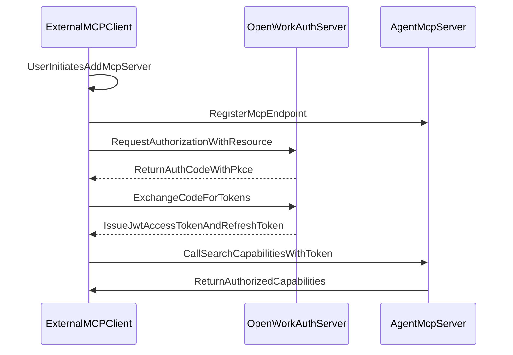
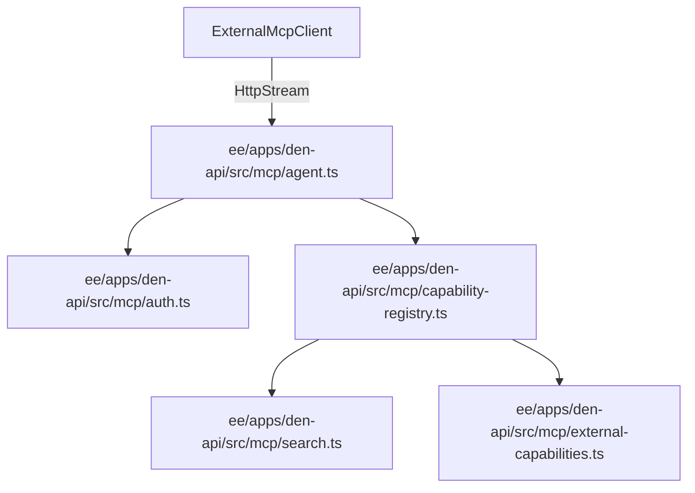
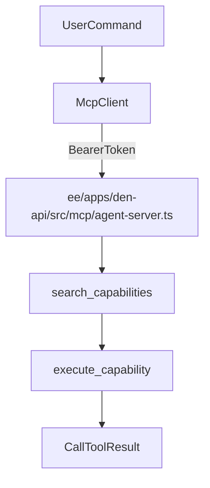

<!-- source: DeepWiki mcp.deepwiki.com · repo different-ai/openwork · page 9.2 MCP Client Integration Guides · fetched 2026-10-26 -->

# MCP Client Integration Guides

<details>
<summary>Relevant source files</summary>

The following files were used as context for generating this wiki page:

- [docs/marketplace-capabilities-architecture.md](docs/marketplace-capabilities-architecture.md)
- [ee/apps/den-api/src/capability-sources/external-mcp-presets.ts](ee/apps/den-api/src/capability-sources/external-mcp-presets.ts)
- [ee/apps/den-api/src/mcp/README.md](ee/apps/den-api/src/mcp/README.md)
- [ee/apps/den-api/src/mcp/agent-server.ts](ee/apps/den-api/src/mcp/agent-server.ts)
- [ee/apps/den-api/src/mcp/agent.ts](ee/apps/den-api/src/mcp/agent.ts)
- [ee/apps/den-api/src/mcp/app-builder-tools.ts](ee/apps/den-api/src/mcp/app-builder-tools.ts)
- [ee/apps/den-api/src/mcp/capability-registry.ts](ee/apps/den-api/src/mcp/capability-registry.ts)
- [ee/apps/den-api/src/mcp/codemode-tools.ts](ee/apps/den-api/src/mcp/codemode-tools.ts)
- [ee/apps/den-api/src/mcp/connect-tool-view.ts](ee/apps/den-api/src/mcp/connect-tool-view.ts)
- [ee/apps/den-api/src/mcp/external-capabilities.ts](ee/apps/den-api/src/mcp/external-capabilities.ts)
- [ee/apps/den-api/src/mcp/external-connection-proxy.ts](ee/apps/den-api/src/mcp/external-connection-proxy.ts)
- [ee/apps/den-api/src/mcp/search.ts](ee/apps/den-api/src/mcp/search.ts)
- [ee/apps/den-api/test/api/connect-full-tools.api.test.ts](ee/apps/den-api/test/api/connect-full-tools.api.test.ts)
- [ee/apps/den-api/test/api/external-connection-proxy.api.test.ts](ee/apps/den-api/test/api/external-connection-proxy.api.test.ts)
- [ee/apps/den-api/test/connect-full-tools.test.ts](ee/apps/den-api/test/connect-full-tools.test.ts)
- [ee/apps/den-api/test/mcp-gateway-metadata.test.ts](ee/apps/den-api/test/mcp-gateway-metadata.test.ts)
- [evals/core/agent-signup-via-mcp.e2e.test.ts](evals/core/agent-signup-via-mcp.e2e.test.ts)
- [evals/worlds/thread-restart.ts](evals/worlds/thread-restart.ts)
- [packages/docs/ai-gateway/compare-litellm-bifrost.mdx](packages/docs/ai-gateway/compare-litellm-bifrost.mdx)
- [packages/docs/ai-gateway/overview.mdx](packages/docs/ai-gateway/overview.mdx)
- [packages/docs/cloud/run-in-the-cloud/cloud-mcp.mdx](packages/docs/cloud/run-in-the-cloud/cloud-mcp.mdx)
- [packages/docs/cloud/share-with-your-team/mcp-server-compatibility.mdx](packages/docs/cloud/share-with-your-team/mcp-server-compatibility.mdx)
- [packages/docs/cloud/share-with-your-team/shared-mcp-connections.mdx](packages/docs/cloud/share-with-your-team/shared-mcp-connections.mdx)
- [packages/docs/docs.json](packages/docs/docs.json)
- [packages/docs/start-here/connect-openwork-mcp.mdx](packages/docs/start-here/connect-openwork-mcp.mdx)
- [packages/docs/start-here/connect-your-stack/add-an-mcp-server.mdx](packages/docs/start-here/connect-your-stack/add-an-mcp-server.mdx)
- [packages/docs/start-here/connect-your-stack/enable-exa-search.mdx](packages/docs/start-here/connect-your-stack/enable-exa-search.mdx)
- [packages/docs/start-here/get-started.mdx](packages/docs/start-here/get-started.mdx)
- [packages/docs/style.css](packages/docs/style.css)

</details>


## 1. Purpose and Scope

OpenWork exposes a hosted Model Context Protocol (MCP) gateway endpoint at:

```text
https://api.openworklabs.com/mcp/agent
```

which external MCP clients use as a streamlined, OAuth-protected interface granting access to organization-shared skills, plugins, and external connections. This guide covers the integration procedures, OAuth security models, configuration options, and troubleshooting steps for connecting external MCP clients—such as Claude, Cursor, VS Code, Codex, Zed, Gemini CLI, and Windsurf—to the OpenWork platform.

The gateway exposes two core operational tools to minimize client context windows:
- `search_capabilities`: discovers available skills, plugins, workflows, and connections [`ee/apps/den-api/src/mcp/search.ts:19-20]()
- `execute_capability`: executes an exact capability identifier returned by search [`ee/apps/den-api/src/mcp/search.ts:20-21]()

Access respects the organization's membership, roles, and administrative policies. The OpenWork desktop client automatically authenticates and connects via this interface upon user sign-in.

Sources: `[packages/docs/cloud/run-in-the-cloud/cloud-mcp.mdx:1-40]()`, `[packages/docs/docs.json:28-38]()`

---

## 2. MCP Gateway Conceptual Integration Flow

The connection process between an external MCP client and the OpenWork cloud endpoint relies on an OAuth 2.0 flow with PKCE support and protected-resource metadata discovery (RFC 9728).

### Sequence Diagram: External MCP Client to OpenWork OAuth and Gateway



Sources: `[packages/docs/cloud/run-in-the-cloud/cloud-mcp.mdx:97-111](), [ee/apps/den-api/src/mcp/README.md:1-27]()`

---

## 3. Client Integration Details

Per-client integration commands and configuration files establish communication with the OpenWork MCP gateway.

### 3.1 OpenCode Client
- **Configuration (`opencode.json`)**:
  ```json
  {
    "mcp": {
      "openwork": {
        "type": "remote",
        "enabled": true,
        "url": "https://api.openworklabs.com/mcp/agent",
        "oauth": {}
      }
    }
  }
  ```
- **CLI Authentication**:
  ```sh
  opencode mcp auth openwork
  ```

Sources: `[packages/docs/cloud/run-in-the-cloud/cloud-mcp.mdx:48-71]()`

### 3.2 Claude Code Client
- **CLI Integration**:
  ```sh
  claude mcp add --transport http openwork https://api.openworklabs.com/mcp/agent
  ```
- **Authentication**: Run `/mcp`, select `openwork`, and complete browser authorization.

Sources: `[packages/docs/cloud/run-in-the-cloud/cloud-mcp.mdx:52-53]()`

### 3.3 Cursor Client
- **Integration**: Supports native OAuth with PKCE S256 and allowlisted custom callback schemes (`cursor://anysphere.cursor-mcp/oauth/callback`).

Sources: `[packages/docs/cloud/run-in-the-cloud/cloud-mcp.mdx:50-50]()`

Sources for this section: `[packages/docs/cloud/run-in-the-cloud/cloud-mcp.mdx:18-60]()`

---

## 4. OAuth and Security Details

The OpenWork MCP gateway enforces strict security boundaries:
- **Protected Resource**: `https://api.openworklabs.com/mcp/agent` discovered via RFC 9728 metadata [`ee/apps/den-api/src/mcp/README.md:1-12]()`.
- **Tokens**: Access tokens are EdDSA-signed JWTs with a 45-minute expiry [`packages/docs/cloud/run-in-the-cloud/cloud-mcp.mdx:107-107]()`. Refresh tokens are rotating opaque tokens with a 30-day inactivity window [`packages/docs/cloud/run-in-the-cloud/cloud-mcp.mdx:108-108]()`.
- **Scopes**: 
  - `mcp:read`: discovery and read-only operations [`packages/docs/cloud/run-in-the-cloud/cloud-mcp.mdx:114-114]()`.
  - `mcp:write`: mandatory for all external tool executions regardless of `readOnlyHint` values [`packages/docs/cloud/run-in-the-cloud/cloud-mcp.mdx:114-116]()`.

Sources: `[packages/docs/cloud/run-in-the-cloud/cloud-mcp.mdx:97-120](), [ee/apps/den-api/src/mcp/README.md:112-122]()`

---

## 5. Common Troubleshooting

| Error | Cause | Remediation |
| --- | --- | --- |
| `401 missing or invalid token` | Expired or missing auth token | Run client login command again [`packages/docs/cloud/run-in-the-cloud/cloud-mcp.mdx:89-89`]() |
| `403 membership or scope error` | Unauthorized org or role violation | Verify organization membership [`packages/docs/cloud/run-in-the-cloud/cloud-mcp.mdx:90-90`]() |
| `invalid_grant` | Revoked or replayed refresh token | Log out and sign in again [`packages/docs/cloud/run-in-the-cloud/cloud-mcp.mdx:91-91`]() |
| `429 rate limit` | Request threshold exceeded | Wait for `Retry-After` header [`packages/docs/cloud/run-in-the-cloud/cloud-mcp.mdx:92-92`]() |

Sources: `[packages/docs/cloud/run-in-the-cloud/cloud-mcp.mdx:87-96]()`

---

## 6. Bridging Natural Language Clients and Code Entities

This diagram correlates natural language MCP clients with the backend code structures that handle authorization, tool dispatching, and capability registration.

### Diagram: Natural Language Clients to OpenWork Code Architecture



Sources: `[ee/apps/den-api/src/mcp/agent.ts:1-30](), [ee/apps/den-api/src/mcp/capability-registry.ts:124-145]()`

---

## 7. Data Flow: From User Command to Capability Execution

Detailed request lifecycle from natural language query to tool invocation.

### Diagram: Request Lifecycle for MCP Tool Invocation



Sources: `[ee/apps/den-api/src/mcp/agent-server.ts:15-27](), [ee/apps/den-api/src/mcp/search.ts:19-20]()`

---

