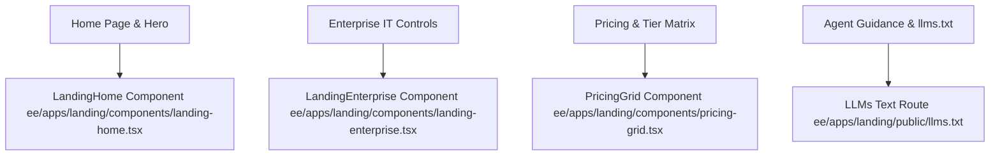
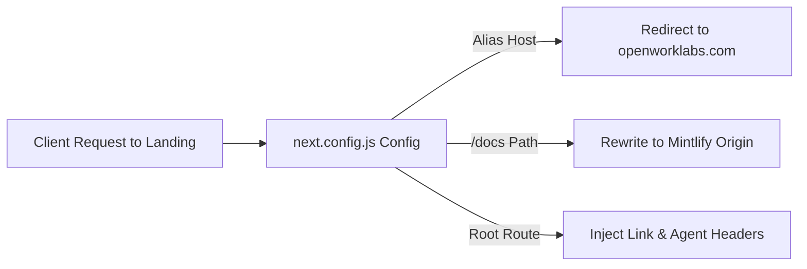

<!-- source: DeepWiki mcp.deepwiki.com · repo different-ai/openwork · page 9.3 Landing Site · fetched 2026-10-26 -->

# Landing Site

Relevant source files

The following files were used as context for generating this wiki page:

- [ee/apps/landing/app/alternatives/claude-cowork-3p/page.tsx](ee/apps/landing/app/alternatives/claude-cowork-3p/page.tsx)
- [ee/apps/landing/app/alternatives/claude-cowork/page.tsx](ee/apps/landing/app/alternatives/claude-cowork/page.tsx)
- [ee/apps/landing/app/download/page.tsx](ee/apps/landing/app/download/page.tsx)
- [ee/apps/landing/app/enterprise/page.tsx](ee/apps/landing/app/enterprise/page.tsx)
- [ee/apps/landing/app/globals.css](ee/apps/landing/app/globals.css)
- [ee/apps/landing/app/layout.tsx](ee/apps/landing/app/layout.tsx)
- [ee/apps/landing/app/page.tsx](ee/apps/landing/app/page.tsx)
- [ee/apps/landing/app/pricing/page.tsx](ee/apps/landing/app/pricing/page.tsx)
- [ee/apps/landing/app/sitemap.ts](ee/apps/landing/app/sitemap.ts)
- [ee/apps/landing/components/book-call-form.tsx](ee/apps/landing/components/book-call-form.tsx)
- [ee/apps/landing/components/capability-matrix.tsx](ee/apps/landing/components/capability-matrix.tsx)
- [ee/apps/landing/components/cowork-comparison.tsx](ee/apps/landing/components/cowork-comparison.tsx)
- [ee/apps/landing/components/cowork-cost-calculator.tsx](ee/apps/landing/components/cowork-cost-calculator.tsx)
- [ee/apps/landing/components/hero-download-button.tsx](ee/apps/landing/components/hero-download-button.tsx)
- [ee/apps/landing/components/landing-enterprise.tsx](ee/apps/landing/components/landing-enterprise.tsx)
- [ee/apps/landing/components/landing-faq.tsx](ee/apps/landing/components/landing-faq.tsx)
- [ee/apps/landing/components/landing-home.tsx](ee/apps/landing/components/landing-home.tsx)
- [ee/apps/landing/components/lp-cta.tsx](ee/apps/landing/components/lp-cta.tsx)
- [ee/apps/landing/components/lp-demo-panels.tsx](ee/apps/landing/components/lp-demo-panels.tsx)
- [ee/apps/landing/components/lp-primitives.tsx](ee/apps/landing/components/lp-primitives.tsx)
- [ee/apps/landing/components/lp-trust-row.tsx](ee/apps/landing/components/lp-trust-row.tsx)
- [ee/apps/landing/components/pricing-grid.tsx](ee/apps/landing/components/pricing-grid.tsx)
- [ee/apps/landing/components/roadmap-page.tsx](ee/apps/landing/components/roadmap-page.tsx)
- [ee/apps/landing/components/site-footer.tsx](ee/apps/landing/components/site-footer.tsx)
- [ee/apps/landing/components/site-nav.tsx](ee/apps/landing/components/site-nav.tsx)
- [ee/apps/landing/components/webmcp-provider.tsx](ee/apps/landing/components/webmcp-provider.tsx)
- [ee/apps/landing/lib/agent-markdown.ts](ee/apps/landing/lib/agent-markdown.ts)
- [ee/apps/landing/lib/cowork-capabilities.ts](ee/apps/landing/lib/cowork-capabilities.ts)
- [ee/apps/landing/lib/cowork-cost.ts](ee/apps/landing/lib/cowork-cost.ts)
- [ee/apps/landing/lib/enterprise-sections.ts](ee/apps/landing/lib/enterprise-sections.ts)
- [ee/apps/landing/lib/faq.ts](ee/apps/landing/lib/faq.ts)
- [ee/apps/landing/lib/github.ts](ee/apps/landing/lib/github.ts)
- [ee/apps/landing/lib/trust-center.ts](ee/apps/landing/lib/trust-center.ts)
- [ee/apps/landing/middleware.ts](ee/apps/landing/middleware.ts)
- [ee/apps/landing/next.config.js](ee/apps/landing/next.config.js)
- [ee/apps/landing/public/.well-known/agent-skills/workspace-guide/SKILL.md](ee/apps/landing/public/.well-known/agent-skills/workspace-guide/SKILL.md)
- [ee/apps/landing/public/llms.txt](ee/apps/landing/public/llms.txt)
- [ee/apps/landing/public/robots.txt](ee/apps/landing/public/robots.txt)
- [packages/docs/start-here/pricing-and-licensing.mdx](packages/docs/start-here/pricing-and-licensing.mdx)

## Purpose and Scope

The OpenWork landing site is a Next.js application located at `ee/apps/landing` that functions as the public-facing marketing and informational portal for OpenWork. It presents the project’s products and offerings across several key pages including:

- **Home**: Overview of OpenWork’s mission and product highlights, with direct calls-to-action (CTA) for downloads and cloud signup [ee/apps/landing/components/landing-home.tsx:29-164]().
- **Enterprise**: Details on enterprise-grade features, compliance, deployment options, and contact forms [ee/apps/landing/components/landing-enterprise.tsx:86-149]().
- **Pricing**: Interactive pricing tiers displayed in a grid with feature lists and pricing breakdown [ee/apps/landing/components/pricing-grid.tsx:109-189]().
- **Download**: Platform-specific OpenWork desktop app installers dynamically derived from GitHub releases.
- **Trust & Compliance**: Security, privacy, and compliance details, referencing the Trust Center (`TRUST_CENTER_URL`) [ee/apps/landing/lib/trust-center.ts]().
- **Additional Routes**: Includes resources such as `/llms.txt` for agent guidance [ee/apps/landing/public/llms.txt:1-77]() and markdown rendering routes for agent content [ee/apps/landing/lib/agent-markdown.ts:1-122]().

The site also implements utility features such as an interactive cost calculator (`cowork-cost-calculator.tsx`), WebMCP capability injection (`webmcp-provider.tsx`), sitemap generation (`app/sitemap.ts`), and Next.js configuration rules for domain aliasing, header injection, and documentation rewrites [ee/apps/landing/next.config.js:1-104]().

Sources: [ee/apps/landing/components/landing-home.tsx:29-164](), [ee/apps/landing/components/landing-enterprise.tsx:86-149](), [ee/apps/landing/components/pricing-grid.tsx:109-189](), [ee/apps/landing/public/llms.txt:1-77](), [ee/apps/landing/lib/agent-markdown.ts:1-122](), [ee/apps/landing/next.config.js:1-104]()

---

## Architecture Overview

- The site is built as a **Next.js App Router** application, with server and client components organized under the `app/` and `components/` directories.
- Styling relies on **Tailwind CSS**, while interactive widgets use **React** hooks and client-side state management.
- Integration points expose machine-readable resources via special headers and static routes, including the `WebMcpProvider` component which dynamically registers browser-side agent tools via `navigator.modelContext` [ee/apps/landing/components/webmcp-provider.tsx:164-181]().
- Alias hosts are redirected to the canonical domain (`openworklabs.com`) in `next.config.js` [ee/apps/landing/next.config.js:6-47]().

### Natural Language to Code Entity Mapping: Landing Sections

Sources: [ee/apps/landing/components/landing-home.tsx:29-164](), [ee/apps/landing/components/landing-enterprise.tsx:86-149](), [ee/apps/landing/components/pricing-grid.tsx:109-189](), [ee/apps/landing/public/llms.txt:1-77]()

---

## Detailed Implementation

### 1. Home Page (`components/landing-home.tsx`)

The home page component `LandingHome` renders the core value proposition ("Sovereign AI for knowledge workers") and dynamically adjusts CTAs depending on visitor characteristics [ee/apps/landing/components/landing-home.tsx:29-164]().

- **Mobile Visitors**: Renders an "Open in browser" button pointing to `https://app.openworklabs.com` [ee/apps/landing/components/landing-home.tsx:29-32]().
- **Desktop Visitors**: Renders the `HeroDownloadButton` and feature showcases [ee/apps/landing/components/landing-home.tsx:92-94]() alongside the `LandingHeroPrompt` [ee/apps/landing/components/landing-home.tsx:115]().
- **Navigation & Footer**: Integrated via `SiteNav` and `SiteFooter` [ee/apps/landing/components/landing-home.tsx:13-14]().

Sources: [ee/apps/landing/components/landing-home.tsx:29-164]()

---

### 2. Enterprise Page (`components/landing-enterprise.tsx`)

The enterprise page showcases governance, shadow AI mitigation, and IT control planes [ee/apps/landing/components/landing-enterprise.tsx:86-149]().

- Displays administrative control factors (`enterpriseControls`) [ee/apps/landing/components/landing-enterprise.tsx:123-128]().
- Compares shadow AI workflows with sanctioned paths (`enterpriseShadowAi`) [ee/apps/landing/components/landing-enterprise.tsx:130-149]().
- Integrates `LpDemoAiGateway` and booking call forms for sales outreach [ee/apps/landing/components/landing-enterprise.tsx:4,121]().

Sources: [ee/apps/landing/components/landing-enterprise.tsx:86-149]()

---

### 3. Pricing Grid and Plans (`app/pricing/page.tsx` & `components/pricing-grid.tsx`)

The pricing page defines schema metadata (`pricingSchema`) and renders the `PricingGrid` component [ee/apps/landing/app/pricing/page.tsx:8-43,81]().

- **Free Tier**: $0/mo up to 5 users, open-source desktop app, bring-your-own-keys [ee/apps/landing/components/pricing-grid.tsx:112-127]().
- **Team Tier**: $10 per user/month, unlimited users, SSO/SAML, Extension Marketplace [ee/apps/landing/components/pricing-grid.tsx:128-147]().
- **Enterprise Tier**: Custom pricing, SCIM provisioning, audit logs, desktop policies, and managed inference [ee/apps/landing/components/pricing-grid.tsx:148-168]().

Sources: [ee/apps/landing/app/pricing/page.tsx:8-91](), [ee/apps/landing/components/pricing-grid.tsx:109-189]()

---

### 4. Interactive Cost Calculator (`components/cowork-cost-calculator.tsx`)

An interactive widget that compares costs between traditional usage models and OpenWork tiers [ee/apps/landing/components/cowork-cost-calculator.tsx:1-207]().

- Allows adjusting user volume, usage profiles (`light`, `typical`, `heavy`), and model selection (`ModelSelect`) [ee/apps/landing/components/cowork-cost-calculator.tsx:85-145]().
- Computes series data utilizing utilities from `ee/apps/landing/lib/cowork-cost.ts` [ee/apps/landing/components/cowork-cost-calculator.tsx:6-21]().

Sources: [ee/apps/landing/components/cowork-cost-calculator.tsx:1-207]()

---

### 5. AI Agent Integration & Machine-Readable Routes

The landing site exposes machine-readable endpoints and agent files:

- **`llms.txt`**: Served directly from static assets to instruct visiting LLMs and autonomous agents on how to install, configure, and connect to OpenWork [ee/apps/landing/public/llms.txt:1-77]().
- **`agent-markdown.ts`**: Provides programmatic markdown strings for pricing, enterprise, and alternative comparisons [ee/apps/landing/lib/agent-markdown.ts:1-122]().
- **`WebMcpProvider`**: Injects browser-based WebMCP tools (`navigate_to`, `open_enterprise_contact`, `get_pricing_summary`, `get_download_links`) into `navigator.modelContext` if supported [ee/apps/landing/components/webmcp-provider.tsx:95-181]().

Sources: [ee/apps/landing/public/llms.txt:1-77](), [ee/apps/landing/lib/agent-markdown.ts:1-122](), [ee/apps/landing/components/webmcp-provider.tsx:164-181]()

---

### 6. Next.js Configuration and Routing (`next.config.js`)

The `next.config.js` file configures redirects, rewrites, headers, and environment variables [ee/apps/landing/next.config.js:1-104]().

- **Redirects**: Automatically maps alias hostnames (`www.openworklabs.com`, `openwork.software`, etc.) to the canonical domain, and routes `/trust` to the external Trust Center [ee/apps/landing/next.config.js:6-47]().
- **Rewrites**: Proxies `/docs` and `/docs/:match*` to the Mintlify documentation origin (`https://differentai.mintlify.dev`) [ee/apps/landing/next.config.js:48-59]().
- **Headers**: Injects HTTP `Link` headers for service documentation, agent-skills indexes, and MCP server cards on the root route, alongside strict content-type headers for well-known discovery files [ee/apps/landing/next.config.js:60-101]().

Sources: [ee/apps/landing/next.config.js:1-104]()

---

## Summary

The OpenWork landing site (`ee/apps/landing`) serves as a comprehensive marketing, developer-onboarding, and agent-discovery portal. Through optimized Next.js App Router design, specialized Markdown endpoints (`llms.txt`), WebMCP hooks (`webmcp-provider.tsx`), and robust pricing calculators, it bridges human users and AI agents to OpenWork’s desktop clients, cloud control planes, and enterprise solutions.

Sources: [ee/apps/landing/components/landing-home.tsx:29-164](), [ee/apps/landing/components/landing-enterprise.tsx:86-149](), [ee/apps/landing/components/pricing-grid.tsx:109-189](), [ee/apps/landing/public/llms.txt:1-77](), [ee/apps/landing/next.config.js:1-104]()

---

