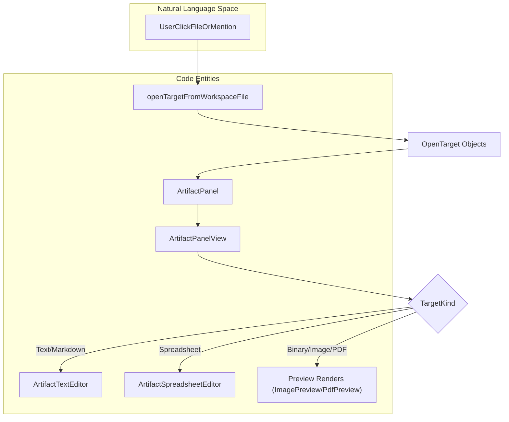
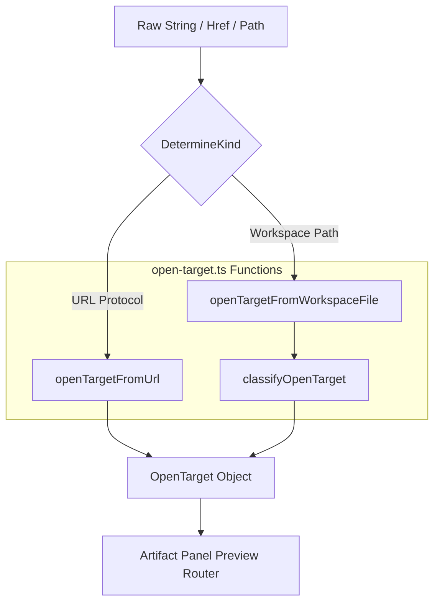
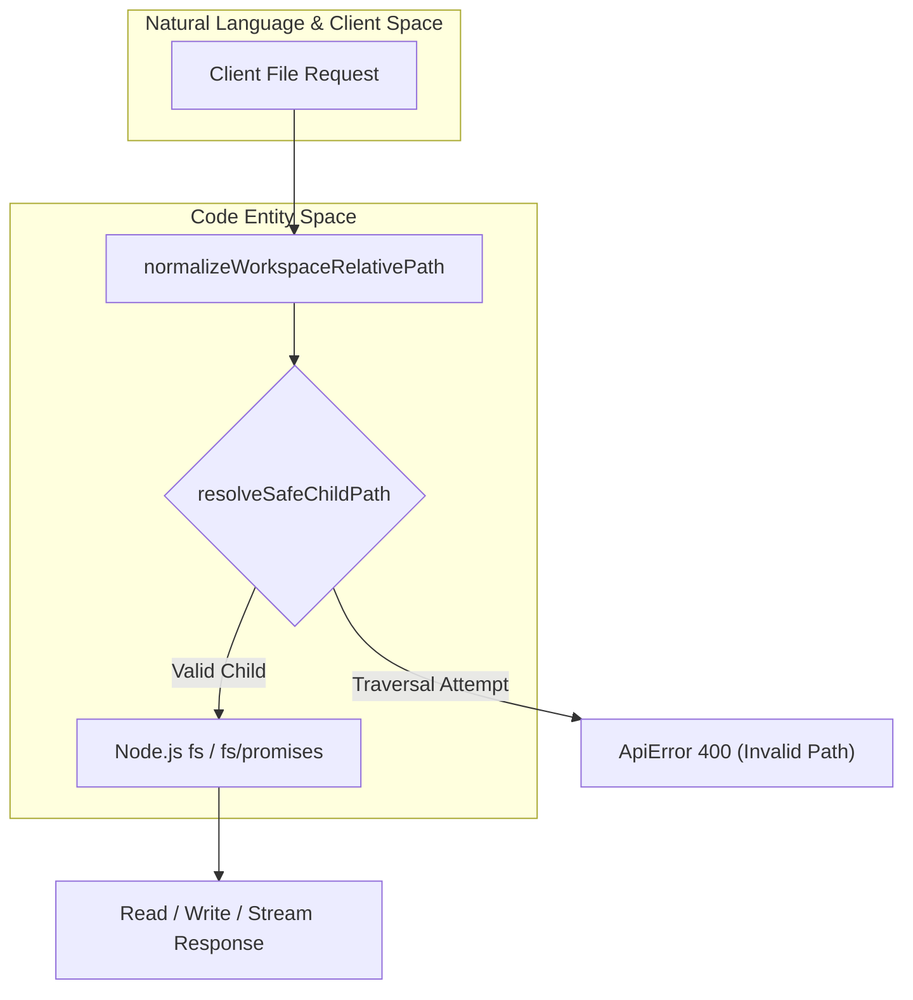

<!-- source: DeepWiki mcp.deepwiki.com · repo different-ai/openwork · extra page Artifacts and File Editors · fetched 2026-10-26 -->

# Artifacts and File Editors

Relevant source files

The following files were used as context for generating this wiki page:

- [apps/app/src/react-app/domains/session/artifacts/artifact-panel.tsx](apps/app/src/react-app/domains/session/artifacts/artifact-panel.tsx)
- [apps/app/src/react-app/domains/session/artifacts/artifact-spreadsheet-editor.tsx](apps/app/src/react-app/domains/session/artifacts/artifact-spreadsheet-editor.tsx)
- [apps/app/src/react-app/domains/session/artifacts/artifact-spreadsheet-model.ts](apps/app/src/react-app/domains/session/artifacts/artifact-spreadsheet-model.ts)
- [apps/app/src/react-app/domains/session/artifacts/artifact-text-editor.tsx](apps/app/src/react-app/domains/session/artifacts/artifact-text-editor.tsx)
- [apps/app/src/react-app/domains/session/artifacts/markdown-live-preview.ts](apps/app/src/react-app/domains/session/artifacts/markdown-live-preview.ts)
- [apps/app/src/react-app/domains/session/artifacts/open-target.ts](apps/app/src/react-app/domains/session/artifacts/open-target.ts)
- [apps/app/src/react-app/domains/session/artifacts/resolve-open-target.ts](apps/app/src/react-app/domains/session/artifacts/resolve-open-target.ts)
- [apps/server/src/routes/files.ts](apps/server/src/routes/files.ts)

## 1. Purpose and Scope

The artifact subsystem provides users with a dedicated side panel (`ArtifactPanel`) to view, edit, and interact with files, documents, code snippets, spreadsheets, and web links referenced or generated during AI agent sessions. It acts as a bridge between conversational chat references and direct workspace file modifications.

Sources: `[apps/app/src/react-app/domains/session/artifacts/artifact-panel.tsx:1-90]()`, `[apps/app/src/react-app/domains/session/artifacts/open-target.ts:1-43]()`

---

## 2. Artifact Panel Architecture and Panel State

The `ArtifactPanel` component `[apps/app/src/react-app/domains/session/artifacts/artifact-panel.tsx:71-90]()` resolves the active artifact tab state using `usePanelTabStore` and delegates rendering to `ArtifactPanelView` `[apps/app/src/react-app/domains/session/artifacts/artifact-panel.tsx:92-123]()`. 

Key components and hooks involved in panel management:
- `ArtifactPanel`: Reads transcript artifact targets and matches them with tab identifiers.
- `ArtifactPanelView`: Manages query state (`useQuery`), saving mutations (`useMutation`), draft buffers, and lazy loads specialized editors (`ArtifactTextEditor`, `ArtifactSpreadsheetEditor`, `WorkspaceFileTree`) `[apps/app/src/react-app/domains/session/artifacts/artifact-panel.tsx:22-33]()`.
- `openTargetFromWorkspaceFile`: Utility function that constructs an `OpenTarget` for explicit workspace file paths [apps/app/src/react-app/domains/session/artifacts/open-target.ts:134-140]().

*Figure 1: Natural Language Space to Code Entity Space Mapping for Artifact Selection.*

Sources: `[apps/app/src/react-app/domains/session/artifacts/artifact-panel.tsx:1-123]()`, `[apps/app/src/react-app/domains/session/artifacts/open-target.ts:134-140]()`

---

## 3. Open-Target Resolution and Classification

Targets are represented by the `OpenTarget` type `[apps/app/src/react-app/domains/session/artifacts/open-target.ts:18-29]()`, which classifies items into kinds (`url` or `file`) and preview renderers (`browser`, `markdown`, `code`, `sheet`, `slides`, `document`, `image`, `pdf`, `html`, `text`, `external`).

Functions in `open-target.ts` and `resolve-open-target.ts`:
- `openTargetFromUrl`: Parses explicit `http:` or `https:` hrefs into URL targets `[apps/app/src/react-app/domains/session/artifacts/open-target.ts:32-43]()`.
- `classifyOpenTarget`: Evaluates file extensions against known mappings (e.g., `.md` $\rightarrow$ `markdown`, `.xlsx` $\rightarrow$ `sheet`, code extensions $\rightarrow$ `code`) `[apps/app/src/react-app/domains/session/artifacts/open-target.ts:119-132]()`.
- `openTargetFromWorkspaceFile`: Wraps a workspace file path with size and modification metadata `[apps/app/src/react-app/domains/session/artifacts/open-target.ts:134-140]()`.
- `filePathFromFileUrl`: Decodes `file://` URIs used for chat attachments to extract safe workspace paths `[apps/app/src/react-app/domains/session/artifacts/open-target.ts:185-187]()`.
- `localArtifactPath`: Resolves safe absolute local paths relative to a workspace root `[apps/app/src/react-app/domains/session/artifacts/resolve-open-target.ts:38-68]()`.

*Figure 2: Open-Target Resolution Data Flow.*

Sources: `[apps/app/src/react-app/domains/session/artifacts/open-target.ts:18-187]()`, `[apps/app/src/react-app/domains/session/artifacts/resolve-open-target.ts:38-68]()`

---

## 4. Text and Spreadsheet Editors

The text editing experience is built on top of CodeMirror 6 (`ArtifactTextEditor`) `[apps/app/src/react-app/domains/session/artifacts/artifact-text-editor.tsx:51-165]()`. 

Key features of `ArtifactTextEditor`:
- Configures language support (`markdown` with GFM and `markdownLivePreview` extension, or plain text with line numbers) `[apps/app/src/react-app/domains/session/artifacts/artifact-text-editor.tsx:71-78]()`.
- Integrates `ActionContextMenu` for quick formatting actions (Headings, Bold, Italic, Strikethrough, Inline Code, Lists, Quotes) `[apps/app/src/react-app/domains/session/artifacts/artifact-text-editor.tsx:150-164]()`.
- Synchronizes edits back to the workspace via `onChange` callbacks `[apps/app/src/react-app/domains/session/artifacts/artifact-text-editor.tsx:79-83]()`.
- Spreadsheet artifacts are rendered using `ArtifactSpreadsheetEditor` and backed by `parseSpreadsheet` / `serializeSpreadsheet` models supporting `.csv`, `.tsv`, and `.xlsx` workbooks `[apps/app/src/react-app/domains/session/artifacts/artifact-spreadsheet-model.ts:112-150]()`, `[apps/app/src/react-app/domains/session/artifacts/artifact-spreadsheet-editor.tsx:86-136]()`.

Sources: `[apps/app/src/react-app/domains/session/artifacts/artifact-text-editor.tsx:51-165]()`, `[apps/app/src/react-app/domains/session/artifacts/artifact-spreadsheet-model.ts:112-150]()`, `[apps/app/src/react-app/domains/session/artifacts/artifact-spreadsheet-editor.tsx:86-136]()`

---

## 5. Markdown Live Preview and Renderers

Markdown live editing inside `ArtifactTextEditor` incorporates `markdownLivePreview` `[apps/app/src/react-app/domains/session/artifacts/markdown-live-preview.ts:1-201]()`. 

Key architectural components of markdown live preview:
- `markdownLivePreview`: An Obsidian-style merged view extension for CodeMirror 6 that hides syntax markers (`#`, `*`, `_`, `` ` ``, `>`, link brackets) unless the selection intersects the line, keeping raw markup editable while providing rich inline styling.
- Tree iteration (`syntaxTree`, `ensureSyntaxTree`) identifies headings, strong emphasis, lists, blockquotes, and link destinations to apply decorators (`Decoration.replace`, `Decoration.mark`, `Decoration.line`) dynamically `[apps/app/src/react-app/domains/session/artifacts/markdown-live-preview.ts:74-195]`.

Sources: `[apps/app/src/react-app/domains/session/artifacts/markdown-live-preview.ts:1-201]()`, `[apps/app/src/react-app/domains/session/artifacts/artifact-text-editor.tsx:77-77]()`

---

## 6. Workspace File Tree and Server File Routes

The workspace file tree (`WorkspaceFileTree`) provides hierarchical navigation of files within the active workspace root `[apps/app/src/react-app/domains/session/artifacts/artifact-panel.tsx:31-33]()`. It interacts with the OpenWork server file endpoints to list directories, read files, and write updates.

Server-side file operations are implemented in `apps/server/src/routes/files.ts`:
- `normalizeWorkspaceRelativePath`: Sanitizes and validates relative paths, stripping common prefixes (`workspaces/`, `workspace/`) and rejecting path traversal attempts (`..`, null bytes, Windows reserved names) `[apps/server/src/routes/files.ts:62-112]()`.
- `isSupportedWorkspaceTextFilePath`: Determines whether a file path qualifies for text-based editing and previewing `[apps/server/src/routes/files.ts:122-180]()`.
- `resolveSafeChildPath`: Ensures resolved absolute paths remain strictly within the workspace root directory `[apps/server/src/routes/files.ts:182-190]()`.

*Figure 3: Server-Side File Route Validation and Security Pipeline.*

Sources: `[apps/server/src/routes/files.ts:1-190]()`, `[apps/app/src/react-app/domains/session/artifacts/artifact-panel.tsx:31-33]()`

---

