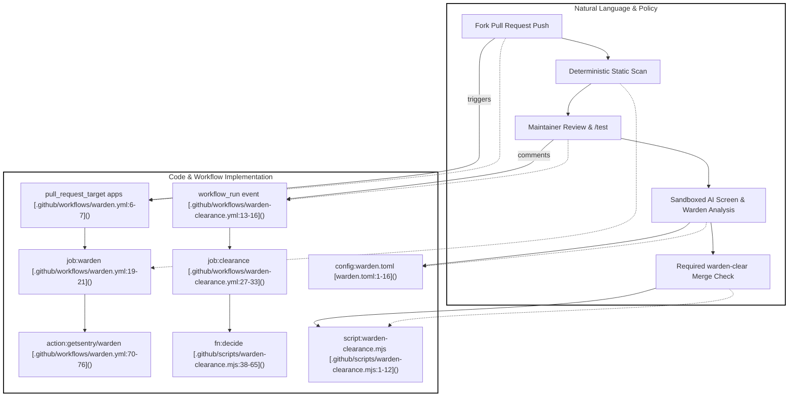
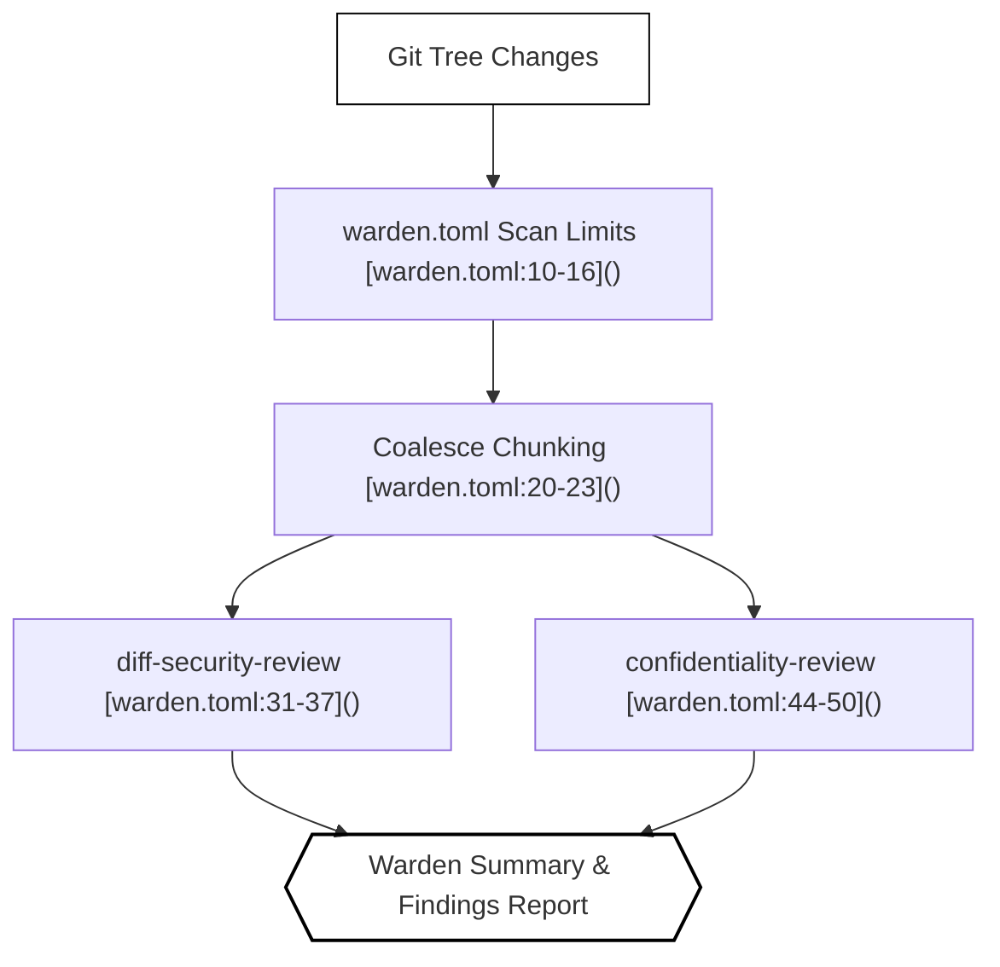
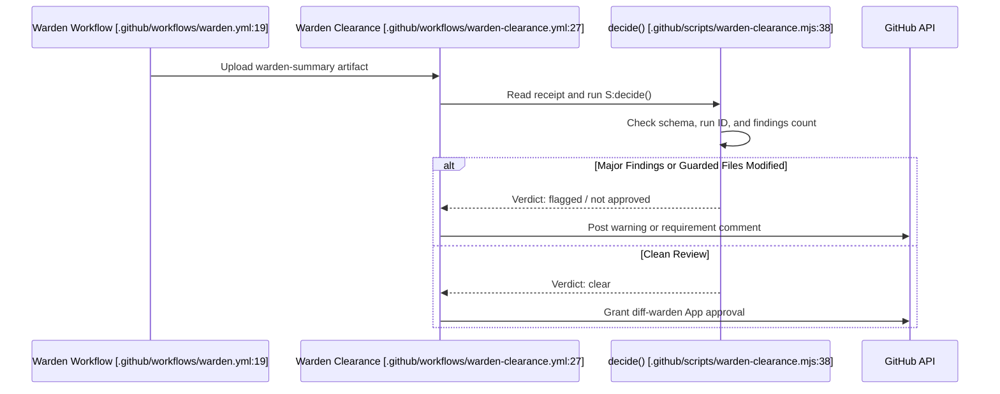
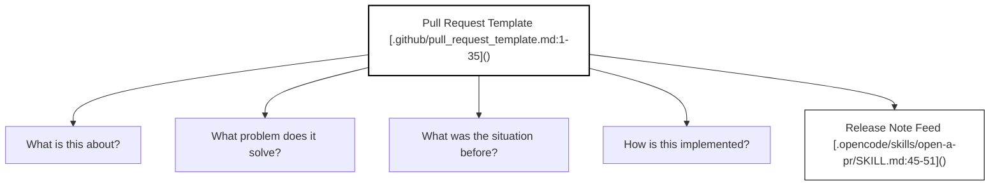

<!-- source: DeepWiki mcp.deepwiki.com · repo different-ai/openwork · extra page Contributor and Fork CI · fetched 2026-10-26 -->

# Contributor and Fork CI

Relevant source files

The following files were used as context for generating this wiki page:

- [.githooks/pre-push](.githooks/pre-push)
- [.github/pull_request_template.md](.github/pull_request_template.md)
- [.github/scripts/warden-clearance.mjs](.github/scripts/warden-clearance.mjs)
- [.github/scripts/warden-fast.mjs](.github/scripts/warden-fast.mjs)
- [.github/scripts/warden-fast.test.mjs](.github/scripts/warden-fast.test.mjs)
- [.github/scripts/warden-report.mjs](.github/scripts/warden-report.mjs)
- [.github/scripts/warden-report.test.mjs](.github/scripts/warden-report.test.mjs)
- [.github/workflows/changelog.yml](.github/workflows/changelog.yml)
- [.github/workflows/revert-fastlane.yml](.github/workflows/revert-fastlane.yml)
- [.github/workflows/update-models.yml](.github/workflows/update-models.yml)
- [.github/workflows/warden-clearance.yml](.github/workflows/warden-clearance.yml)
- [.github/workflows/warden-quick.yml](.github/workflows/warden-quick.yml)
- [.github/workflows/warden.yml](.github/workflows/warden.yml)
- [.gitignore](.gitignore)
- [.opencode/agents/changelog.md](.opencode/agents/changelog.md)
- [.opencode/skills/open-a-pr/SKILL.md](.opencode/skills/open-a-pr/SKILL.md)
- [.warden/README.md](.warden/README.md)
- [.warden/reporting.md](.warden/reporting.md)
- [.warden/scripts/measure-chunks.mjs](.warden/scripts/measure-chunks.mjs)
- [.warden/skills/confidentiality-review/SKILL.md](.warden/skills/confidentiality-review/SKILL.md)
- [.warden/skills/desktop-den-sync-review/SKILL.md](.warden/skills/desktop-den-sync-review/SKILL.md)
- [.warden/skills/diff-security-review/SKILL.md](.warden/skills/diff-security-review/SKILL.md)
- [.warden/skills/spec-provenance-review/SKILL.md](.warden/skills/spec-provenance-review/SKILL.md)
- [.warden/tests/chunking.test.mjs](.warden/tests/chunking.test.mjs)
- [scripts/check-changelog-output.mjs](scripts/check-changelog-output.mjs)
- [scripts/ci/verify-clean-revert.mjs](scripts/ci/verify-clean-revert.mjs)
- [scripts/install-git-hooks.mjs](scripts/install-git-hooks.mjs)
- [scripts/release/collect-release-prs.mjs](scripts/release/collect-release-prs.mjs)
- [scripts/release/release-notes-from-changelog.mjs](scripts/release/release-notes-from-changelog.mjs)
- [warden.toml](warden.toml)

## Purpose and Scope
This page details the Contributor and Fork CI architecture for OpenWork (`https://github.com/different-ai/openwork`). The subsystem ensures that pull requests from external forks cannot execute arbitrary code or exfiltrate secrets during the un-vetted push phase, while providing robust automated validation through static scans, maintainer-gated workflows, AI screening, and mandatory Warden security reviews (`[CONTRIBUTING.md]()`). It integrates `.github/workflows/warden.yml`, `.github/workflows/warden-clearance.yml`, `.github/scripts/warden-clearance.mjs`, `warden.toml`, `.warden/README.md`, `.opencode/skills/open-a-pr/SKILL.md`, and `.github/pull_request_template.md`.

---

## 1. Security Architecture and Policy Boundaries

OpenWork enforces strict boundaries for contributions originating from forks (`[docs/fork-contributor-ci.md]()`). Because fork pull requests run under `pull_request_target` (`[.github/workflows/warden.yml:6-7]()`), they load trusted scripts from the default branch (`dev`) but must never execute code contained within the untrusted PR branch during the screening phase (`[.github/workflows/warden.yml:36-37]`).

### Licensing and Provenance
- **DCO (Root Directory):** Code contributions outside `ee/` are covered by the Developer Certificate of Origin (`[CONTRIBUTING.md]()`).
- **CLA (`ee/` Directory):** Contributions to `ee/` (OpenWork Den control plane) fall under the Individual or Corporate Contributor License Agreement (`[CONTRIBUTING.md]()`).

### Machinery Protection
Pull requests cannot modify CI configurations, workflow files, or agent definitions without triggering guard restrictions (`[.github/scripts/warden-clearance.mjs:16-21]`). Any file changes matching guarded paths (such as `.github/workflows/warden.yml`, `warden.toml`, or `.warden/`) are excluded from automated clearance (`[.github/scripts/warden-clearance.mjs:21-27]`).

*Sources: [.github/workflows/warden.yml:6-7](), [.github/workflows/warden.yml:19-76](), [.github/workflows/warden-clearance.yml:13-33](), [.github/scripts/warden-clearance.mjs:16-65](), [warden.toml:1-16]()*

---

## 2. Deterministic Screening and Warden Security Reviews

The initial layer of protection executes without invoking LLMs or exposing secrets (`[.github/workflows/warden.yml:10-13]()`). It runs on every push using configured skill triggers (`[warden.toml:31-42]()`).

### Key Validation Checks in `warden.toml`
1. **Scope and Limits:** Limits scan files to 400 files and 60,000 changed lines (`[warden.toml:15-16]()`). PRs exceeding these limits are flagged as incomplete (`[.warden/README.md:52-60]()`).
2. **Chunking Coalesce:** Enables chunk coalescing with a maximum gap of 30 lines and maximum chunk size of 12,000 bytes (`[warden.toml:20-23]()`).
3. **Skills Execution:** Triggers `diff-security-review` and `confidentiality-review` on pull request openings, synchronizations, and reopenings (`[warden.toml:31-54]()`).

*Sources: [warden.toml:10-54](), [.warden/README.md:52-60]()*

---

## 3. Reviewer Workflow and Clearance Automation

Warden runs security and confidentiality checks, producing a summary receipt read by `.github/workflows/warden-clearance.yml` (`[.warden/README.md:13-21]()`).

### Decision Logic (`decide`)
The clearance decision engine (`[.github/scripts/warden-clearance.mjs:38-65]()`) evaluates:
- **Receipt Integrity:** Validates schema version, repository, run ID, attempt, and head SHA (`[.github/scripts/warden-clearance.mjs:33-48]()`).
- **Findings Count:** Checks that security findings and confidentiality counts are fully resolved (`[.github/scripts/warden-clearance.mjs:49-65]()`).
- **Guarded Files:** Refuses automated clearance if guarded configuration files or scripts are altered (`[.github/scripts/warden-clearance.mjs:16-27]()`).

*Sources: [.github/workflows/warden.yml:19](), [.github/workflows/warden-clearance.yml:27](), [.github/scripts/warden-clearance.mjs:16-65]()*

---

## 4. PR Template, `open-a-pr` Skill, and Contribution Governance

OpenWork enforces standardized pull request bodies and clean conventional commit practices through template structures and automated agent skills (`[.opencode/skills/open-a-pr/SKILL.md:1-15]()`).

### PR Body Structure
Every pull request adheres strictly to `.github/pull_request_template.md`:
- **What is this about?** One or two sentences describing the surface and change (`[.github/pull_request_template.md:5-7]()`).
- **What problem does it solve?** The user pain or risk mitigated (`[.github/pull_request_template.md:8-10]()`).
- **What was the situation before?** Concrete visual or functional state before the change (`[.github/pull_request_template.md:11-13]()`).
- **How is this implemented?** Bullet points detailing modified paths, tools, and flags (`[.github/pull_request_template.md:14-19]()`).
- **Release note:** Single sentence summarizing user-facing changes for downstream changelog collection (`[.github/pull_request_template.md:26-30]()`).

*Sources: [.github/pull_request_template.md:1-35](), [.opencode/skills/open-a-pr/SKILL.md:45-51]()*

---
Sources: `[.github/workflows/warden.yml:1-116]()`, `[warden.toml:1-55]`, `[.warden/README.md:1-133]()`, `[.github/workflows/warden-clearance.yml:1-84]()`, `[.github/scripts/warden-clearance.mjs:1-113]()`, `[.opencode/skills/open-a-pr/SKILL.md:1-96]()`, `[.github/pull_request_template.md:1-35]()`

---

