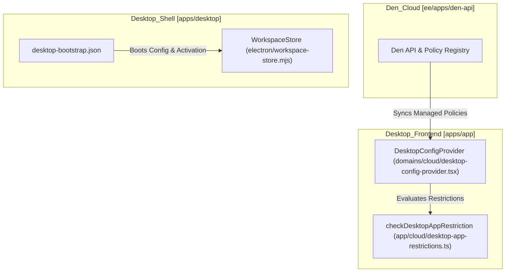
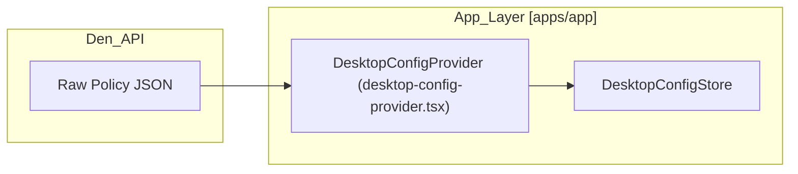
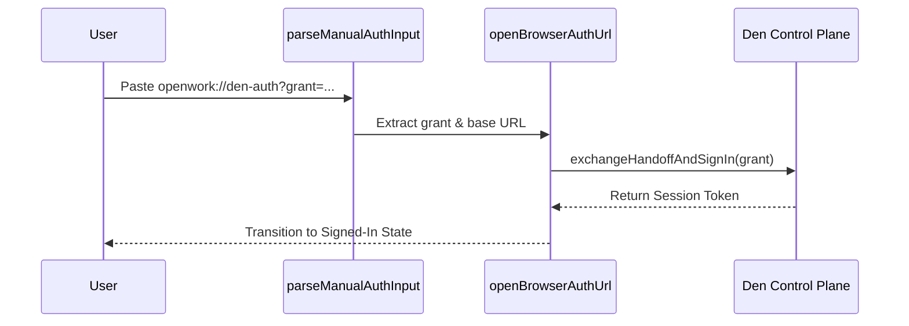

<!-- source: DeepWiki mcp.deepwiki.com · repo different-ai/openwork · extra page Desktop Policy and Security Model · fetched 2026-10-26 -->

# Desktop Policy and Security Model

Relevant source files

The following files were used as context for generating this wiki page:

- [apps/app/src/app/cloud/desktop-app-restrictions.ts](apps/app/src/app/cloud/desktop-app-restrictions.ts)
- [apps/app/src/app/lib/manual-auth-input.ts](apps/app/src/app/lib/manual-auth-input.ts)
- [apps/app/src/react-app/domains/cloud/desktop-config-provider.tsx](apps/app/src/react-app/domains/cloud/desktop-config-provider.tsx)
- [apps/app/src/react-app/domains/cloud/enterprise-activation-gate.tsx](apps/app/src/react-app/domains/cloud/enterprise-activation-gate.tsx)
- [apps/app/src/react-app/domains/cloud/open-browser-auth.ts](apps/app/src/react-app/domains/cloud/open-browser-auth.ts)
- [apps/app/src/react-app/shell/loading-overlay.tsx](apps/app/src/react-app/shell/loading-overlay.tsx)
- [apps/app/src/react-app/shell/org-onboarding-visibility.ts](apps/app/src/react-app/shell/org-onboarding-visibility.ts)
- [apps/app/tests/opencode-zen-removal.test.ts](apps/app/tests/opencode-zen-removal.test.ts)
- [apps/desktop/electron/open-external.mjs](apps/desktop/electron/open-external.mjs)
- [apps/desktop/test/open-external.test.mjs](apps/desktop/test/open-external.test.mjs)
- [ee/apps/den-api/src/automations/authority.ts](ee/apps/den-api/src/automations/authority.ts)
- [ee/apps/den-api/src/routes/me/index.ts](ee/apps/den-api/src/routes/me/index.ts)
- [packages/types/src/den/desktop-policies.ts](packages/types/src/den/desktop-policies.ts)

This page documents the internal architecture of the OpenWork desktop policy and security model (Section 3.5.4). It covers the desktop configuration provider, managed enterprise policies synchronized from Den, app restrictions, token and credential handling, telemetry, and enterprise activation gating.

---

## 1. Overview and Scope

OpenWork implements a defense-in-depth security model across its desktop client (`apps/app` and `apps/desktop`), local server (`apps/server`), and enterprise control plane (`ee/apps/den-api`). The system relies on a predictable, configuration-driven security posture where organizational policies flow from Den down to the local runtime via authenticated control channels.

**Sources:** [apps/app/src/react-app/domains/cloud/desktop-config-provider.tsx:55-73](), [apps/app/src/app/cloud/desktop-app-restrictions.ts:17-31]()

---

## 2. Desktop Config Provider and Managed Policies

The desktop React application consumes enterprise configuration through `DesktopConfigProvider`, defined in `apps/app/src/react-app/domains/cloud/desktop-config-provider.tsx` [apps/app/src/react-app/domains/cloud/desktop-config-provider.tsx:55-73]().

### Policy Definitions and Normalization
Policies are cataloged in `packages/types/src/den/desktop-policies.ts`, which defines canonical feature flags such as `allowCustomProviders`, `allowZenModel`, `allowMultipleWorkspaces`, `allowControlSettings`, `allowManageExtensions`, `allowBuiltInExtensions`, and `allowAlphaUpdates` [packages/types/src/den/desktop-policies.ts:78-170]().

- **Feature Enforcement Flag**: `DESKTOP_POLICY_ENFORCEMENT_ENABLED` controls whether broad feature restrictions are actively locked out locally [packages/types/src/den/desktop-policies.ts:3-15](). Regardless of this toggle, model access policies (`MODEL_ACCESS_POLICY_KEYS`) remain strictly enforced [packages/types/src/den/desktop-policies.ts:27-35]().
- **Normalization**: Control-plane configurations are processed to ensure types match the expected schema before they are exposed to UI components [ee/apps/den-api/src/routes/me/index.ts:52-54]().

**Sources:** [packages/types/src/den/desktop-policies.ts:1-46](), [apps/app/src/react-app/domains/cloud/desktop-config-provider.tsx:55-73](), [ee/apps/den-api/src/routes/me/index.ts:52-54]()

---

## 3. App Restrictions and Policy Enforcement

App restrictions are evaluated against cached desktop configuration to prevent unauthorized feature usage in enterprise deployments.

- **Restriction Checkers**: The `checkDesktopAppRestriction` function evaluates specific app capabilities against the active `DenDesktopConfig`, explicitly managing special rollout flags like `removeOpencodeZen` [apps/app/src/app/cloud/desktop-app-restrictions.ts:17-31]().
- **Connect State Reconcile**: `createConnectPolicyReconciler` and `resolveConnectPolicyTarget` synchronize the organization's Connect policy state with the local OpenWork server runtime instance [apps/app/src/react-app/domains/cloud/desktop-config-provider.tsx:43-53](), [apps/app/src/react-app/domains/cloud/desktop-config-provider.tsx:133-150]().

**Sources:** [apps/app/src/react-app/domains/cloud/desktop-config-provider.tsx:43-53](), [apps/app/src/react-app/domains/cloud/desktop-config-provider.tsx:133-150](), [apps/app/src/app/cloud/desktop-app-restrictions.ts:17-31]()

---

## 4. Token Handling and Authentication Flows

Authentication with the Den control plane is managed via deep links and secure handoff mechanics [apps/app/src/app/lib/manual-auth-input.ts:9-40]().

- **Handoff Grants**: Authentication frequently initiates via deep links (`openwork://den-auth?grant=...`). The `parseManualAuthInput` utility safely extracts authentication grants and server base URLs from raw text or URI schemes [apps/app/src/app/lib/manual-auth-input.ts:9-40]().
- **Browser Open Safety**: When opening authentication URLs, `openBrowserAuthUrl` handles tracking whether the external browser process successfully launched, falling back gracefully on platforms like Windows (`rundll32` helper support in `apps/desktop/electron/open-external.mjs`) [apps/app/src/react-app/domains/cloud/open-browser-auth.ts:7-18](), [apps/desktop/electron/open-external.mjs:89-101]().

**Sources:** [apps/app/src/app/lib/manual-auth-input.ts:9-40](), [apps/app/src/react-app/domains/cloud/open-browser-auth.ts:7-18](), [apps/desktop/electron/open-external.mjs:89-101]()

---

## 5. Enterprise Activation Gating and Bootstrap Config

For enterprise builds, the application enforces an activation gate prior to rendering workspace UI [apps/app/src/react-app/domains/cloud/enterprise-activation-gate.tsx:33-40]().

- **Enterprise Activation Hook**: `useEnterpriseActivationRequired` monitors distribution info and bootstrap configuration to determine if mandatory organizational sign-in must block access [apps/app/src/react-app/domains/cloud/enterprise-activation-gate.tsx:33-40]().
- **Grant Exchange Atomicity**: The function `exchangeConfirmedGrant` commits the confirmed server, session, and activation stamp in a single handoff transaction, ensuring the bootstrap configuration and active session always point to the same authorized enterprise host [apps/app/src/react-app/domains/cloud/enterprise-activation-gate.tsx:85-119]().

**Sources:** [apps/app/src/react-app/domains/cloud/enterprise-activation-gate.tsx:33-40](), [apps/app/src/react-app/domains/cloud/enterprise-activation-gate.tsx:85-119]()

---

## 6. Telemetry and Error Reporting

Error handling, recovery, and diagnostic verification are embedded directly into the boot sequence and desktop shell.

- **Recovery Policies**: The loading shell (`LoadingOverlay`) retrieves verified release metadata and desktop policy rules to allow users to safely restore previous versions if an update violates enterprise restrictions [apps/app/src/react-app/shell/loading-overlay.tsx:13-23](), [apps/app/src/react-app/shell/loading-overlay.tsx:50-82]().
- **External Open Diagnostics**: External URL navigations from the desktop shell are audited and optionally captured during development and evaluation modes (`shouldCaptureExternalOpens` in `apps/desktop/electron/open-external.mjs`) [apps/desktop/electron/open-external.mjs:8-12]().

**Sources:** [apps/app/src/react-app/shell/loading-overlay.tsx:13-82](), [apps/desktop/electron/open-external.mjs:8-12]()

---

