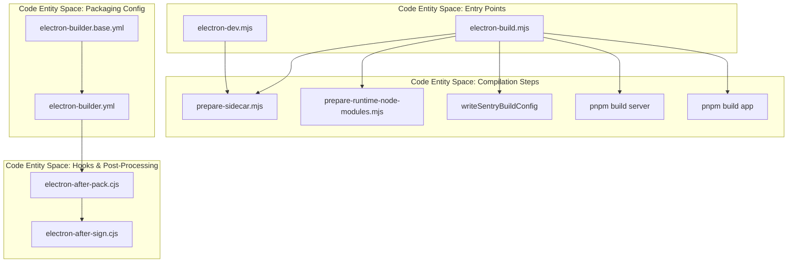
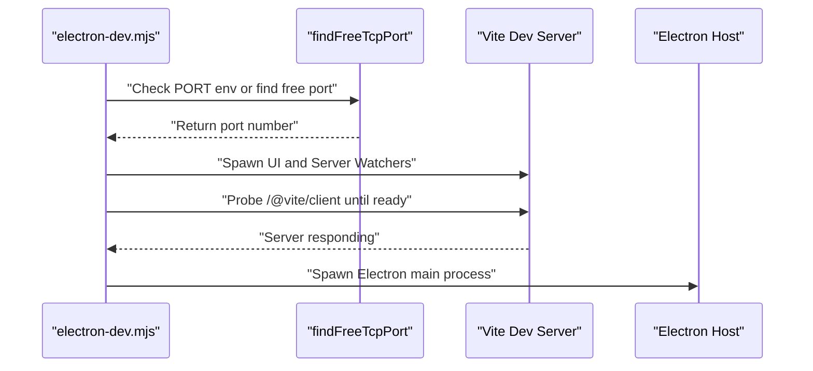

<!-- source: DeepWiki mcp.deepwiki.com · repo different-ai/openwork · extra page Electron Desktop Build · fetched 2026-10-26 -->

# Electron Desktop Build

Relevant source files

The following files were used as context for generating this wiki page:

- [.github/actions/windows-signing/action.yml](.github/actions/windows-signing/action.yml)
- [apps/app/src/app/lib/desktop-types.ts](apps/app/src/app/lib/desktop-types.ts)
- [apps/app/src/app/lib/desktop.ts](apps/app/src/app/lib/desktop.ts)
- [apps/app/src/react-app/domains/session/panel/agent-viewport.ts](apps/app/src/react-app/domains/session/panel/agent-viewport.ts)
- [apps/app/src/react-app/domains/session/panel/panel-tab-store.ts](apps/app/src/react-app/domains/session/panel/panel-tab-store.ts)
- [apps/app/src/react-app/domains/session/panel/side-panel.tsx](apps/app/src/react-app/domains/session/panel/side-panel.tsx)
- [apps/desktop/electron-builder.base.yml](apps/desktop/electron-builder.base.yml)
- [apps/desktop/electron-builder.yml](apps/desktop/electron-builder.yml)
- [apps/desktop/electron/browser-panel.mjs](apps/desktop/electron/browser-panel.mjs)
- [apps/desktop/electron/main.mjs](apps/desktop/electron/main.mjs)
- [apps/desktop/electron/preload.mjs](apps/desktop/electron/preload.mjs)
- [apps/desktop/scripts/electron-after-pack.cjs](apps/desktop/scripts/electron-after-pack.cjs)
- [apps/desktop/scripts/electron-build.mjs](apps/desktop/scripts/electron-build.mjs)
- [apps/desktop/scripts/electron-dev.mjs](apps/desktop/scripts/electron-dev.mjs)
- [apps/desktop/scripts/prepare-runtime-node-modules.mjs](apps/desktop/scripts/prepare-runtime-node-modules.mjs)
- [apps/desktop/scripts/prepare-sidecar.mjs](apps/desktop/scripts/prepare-sidecar.mjs)
- [apps/desktop/scripts/windows-sign.cjs](apps/desktop/scripts/windows-sign.cjs)
- [apps/desktop/test/sidecar-layout.test.mjs](apps/desktop/test/sidecar-layout.test.mjs)
- [apps/desktop/test/windows-sign.test.cjs](apps/desktop/test/windows-sign.test.cjs)
- [evals/proofs/browser-agent-viewport.proof.test.ts](evals/proofs/browser-agent-viewport.proof.test.ts)
- [packages/browser-tabs/index.d.ts](packages/browser-tabs/index.d.ts)
- [packages/browser-tabs/index.mjs](packages/browser-tabs/index.mjs)
- [packages/computer-use/browser-task-takeover.test.mjs](packages/computer-use/browser-task-takeover.test.mjs)
- [packages/computer-use/browser-task.mjs](packages/computer-use/browser-task.mjs)
- [packages/types/src/desktop-ipc.ts](packages/types/src/desktop-ipc.ts)
- [scripts/release/windows-signatures.ps1](scripts/release/windows-signatures.ps1)
- [scripts/release/windows-signatures.test.ps1](scripts/release/windows-signatures.test.ps1)

This page documents the Electron-based build and packaging architecture for the OpenWork desktop application (`apps/desktop`). It covers local development orchestration via `electron-dev.mjs` [apps/desktop/scripts/electron-dev.mjs:1-222](), production compilation through `electron-build.mjs` [apps/desktop/scripts/electron-build.mjs:1-92](), configuration via `electron-builder.yml` [apps/desktop/electron-builder.yml:1-10]() and `electron-builder.base.yml` [apps/desktop/electron-builder.base.yml:1-109](), post-processing steps implemented in `electron-after-pack.cjs` [apps/desktop/scripts/electron-after-pack.cjs:1-150](), and code signing routines.

---

## 1. Build Architecture and Pipeline Overview

The OpenWork desktop build compiles the React frontend (`apps/app`), packages the embedded Node.js server (`apps/server`), resolves platform-specific sidecar binaries (`opencode` / `opencode2`), and assembles them into an Electron app bundle using `electron-builder` [apps/desktop/scripts/electron-build.mjs:48-69](), [apps/desktop/electron-builder.base.yml:1-109]().

### Build Pipeline Entity Mapping

Sources: [apps/desktop/scripts/electron-dev.mjs:1-222](), [apps/desktop/scripts/electron-build.mjs:1-92](), [apps/desktop/electron-builder.base.yml:1-34]()

---

## 2. Local Development Orchestration (`electron-dev.mjs`)

The `electron-dev.mjs` script manages the local developer loop, coordinating the Vite development server, free port allocation, sidecar binary preparation, and process tree termination [apps/desktop/scripts/electron-dev.mjs:1-222]().

### Key Functions and Control Flow

- **`findFreeTcpPort()`**: Binds a temporary TCP server to port `0` on `127.0.0.1` to dynamically acquire an available port when `PORT=0` [apps/desktop/scripts/electron-dev.mjs:19-34]().
- **`waitForVite()`**: Probes candidate endpoints (`http://127.0.0.1`, `http://localhost`) and verifies active Vite client assets via `/@vite/client` before launching the Electron host [apps/desktop/scripts/electron-dev.mjs:102-141]().
- **`signalTree()`**: Ensures clean process cleanup across platforms by dispatching `SIGINT`/`SIGTERM` or invoking `taskkill /T /F` on Windows [apps/desktop/scripts/electron-dev.mjs:143-163]().

### Dev Boot Flow

Sources: [apps/desktop/scripts/electron-dev.mjs:19-141]()

---

## 3. Production Build Compilation (`electron-build.mjs`)

The production build script sequences dependency generation, telemetry provisioning, and asset compilation prior to `electron-builder` invocation [apps/desktop/scripts/electron-build.mjs:1-92]().

### Compilation Stages

1. **Sidecar Resolution**: Invokes `prepare-sidecar.mjs` to stage platform-specific binaries into `resources/sidecars` [apps/desktop/scripts/electron-build.mjs:48]().
2. **Runtime Node Modules**: Runs `prepare-runtime-node-modules.mjs` to bundle required dependencies into `.electron-runtime/node_modules` [apps/desktop/scripts/electron-build.mjs:49]().
3. **Sentry Configuration**: Generates `openwork-sentry.json` containing the configured DSN and traces sample rate [apps/desktop/scripts/electron-build.mjs:35-46]().
4. **App and Server Bundling**: 
   - Compiles `@openwork/free-auto` and `@openwork/headless-threads` [apps/desktop/scripts/electron-build.mjs:52-63]().
   - Builds `@openwork/app` with `OPENWORK_ELECTRON_BUILD=1` to enforce relative asset URLs for `file://` loading [apps/desktop/scripts/electron-build.mjs:67-69]().
   - Compiles `openwork-server` and relocates repository constants [apps/desktop/scripts/electron-build.mjs:57-75]().

Sources: [apps/desktop/scripts/electron-build.mjs:1-92]()

---

## 4. Electron Builder Configuration & Packaging Hooks

The packaging specifications are split between `electron-builder.base.yml` [apps/desktop/electron-builder.base.yml:1-109]() and `electron-builder.yml` [apps/desktop/electron-builder.yml:1-10]().

### Configuration Breakdown

- **`directories.output`**: Set to `dist-electron` [apps/desktop/electron-builder.base.yml:1-2]().
- **`asar`**: Enabled, with explicit `asarUnpack` rules for native modules like `node-pty` [apps/desktop/electron-builder.base.yml:28-31]().
- **`extraResources`**: Stitches in compiled Sentry configs, frontend web assets (`app-dist`), compiled server plugins, and documentation references [apps/desktop/electron-builder.base.yml:12-27]().

### Packaging Hook: `afterPack` (`electron-after-pack.cjs`)

Executed after the application files are copied into the staging directory [apps/desktop/scripts/electron-after-pack.cjs:1-150]():
- **`verifyRuntimeDependencies()`**: Inspects the packaged `app.asar` archive to guarantee that all required runtime node modules are present [apps/desktop/scripts/electron-after-pack.cjs:58-97]().
- **Sidecar Target Mapping**: Maps architecture-specific sidecar binaries (e.g., `opencode-aarch64-apple-darwin`) to canonical runtime names (`opencode`) based on the active target triple, pruning unused binaries [apps/desktop/scripts/electron-after-pack.cjs:10-149]().

Sources: [apps/desktop/electron-builder.base.yml:1-109](), [apps/desktop/scripts/electron-after-pack.cjs:1-150]()

---

## 5. Code Signing, Notarization and Windows Signing

Production builds for macOS and Windows undergo automated signing and verification routines [apps/desktop/scripts/electron-after-sign.cjs:1-89](), [apps/desktop/electron-builder.base.yml:104-109]().

### macOS Notarization (`electron-after-sign.cjs`)

When `MACOS_NOTARIZE=true`, the `afterSign` hook performs the following operations:
1. **Archive**: Compresses the `.app` bundle into a temporary zip file using `ditto`.
2. **Submit**: Submits the archive to Apple's notarization service via `xcrun notarytool submit` using API key credentials.
3. **Staple & Verify**: Applies the notarization ticket using `xcrun stapler staple` (with retry handling) and verifies code signature validity via `codesign`, `spctl`, and `stapler validate`.

### Windows Signing (`windows-sign.cjs` & `electron-builder.base.yml`)

Windows configurations define `signtoolOptions` pointing to `scripts/windows-sign.cjs` with SHA-256 signing hash algorithms [apps/desktop/electron-builder.base.yml:104-109](). The builder explicitly signs file extensions like `.dll` and `.node` to comply with Windows security and ASAR unpack requirements.

Sources: [apps/desktop/scripts/electron-after-sign.cjs:1-89](), [apps/desktop/electron-builder.base.yml:104-109]()

---

