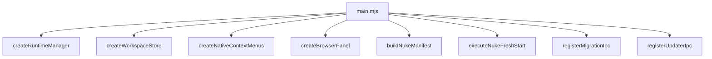
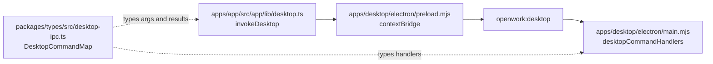
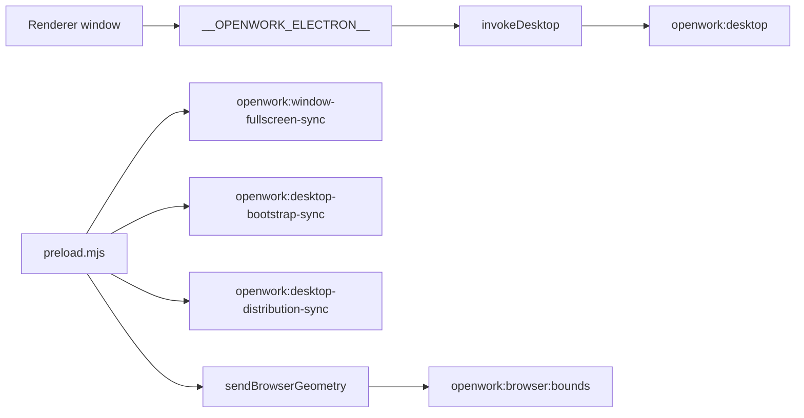
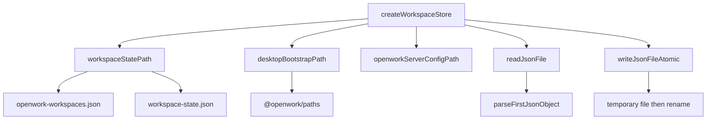
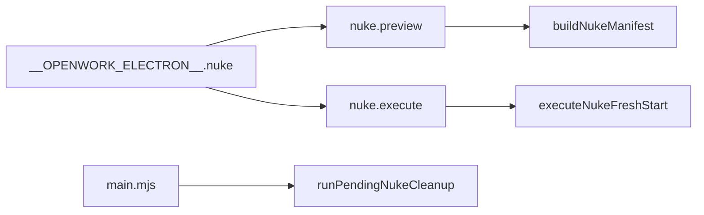
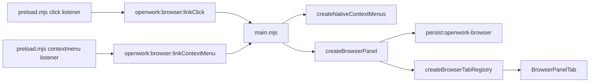

<!-- source: DeepWiki mcp.deepwiki.com · repo different-ai/openwork · extra page Electron Main Process and IPC Bridge · fetched 2026-10-26 -->

# Electron Main Process and IPC Bridge

Relevant source files

The following files were used as context for generating this wiki page:

- [apps/app/src/app/lib/desktop-types.ts](apps/app/src/app/lib/desktop-types.ts)
- [apps/app/src/app/lib/desktop.ts](apps/app/src/app/lib/desktop.ts)
- [apps/app/src/react-app/domains/session/panel/agent-viewport.ts](apps/app/src/react-app/domains/session/panel/agent-viewport.ts)
- [apps/app/src/react-app/domains/session/panel/panel-tab-store.ts](apps/app/src/react-app/domains/session/panel/panel-tab-store.ts)
- [apps/app/src/react-app/domains/session/panel/side-panel.tsx](apps/app/src/react-app/domains/session/panel/side-panel.tsx)
- [apps/desktop/electron-builder.base.yml](apps/desktop/electron-builder.base.yml)
- [apps/desktop/electron/browser-panel.mjs](apps/desktop/electron/browser-panel.mjs)
- [apps/desktop/electron/main.mjs](apps/desktop/electron/main.mjs)
- [apps/desktop/electron/preload.mjs](apps/desktop/electron/preload.mjs)
- [apps/desktop/electron/workspace-store.mjs](apps/desktop/electron/workspace-store.mjs)
- [apps/desktop/scripts/electron-build.mjs](apps/desktop/scripts/electron-build.mjs)
- [apps/desktop/scripts/electron-dev.mjs](apps/desktop/scripts/electron-dev.mjs)
- [evals/proofs/browser-agent-viewport.proof.test.ts](evals/proofs/browser-agent-viewport.proof.test.ts)
- [packages/browser-tabs/index.d.ts](packages/browser-tabs/index.d.ts)
- [packages/browser-tabs/index.mjs](packages/browser-tabs/index.mjs)
- [packages/computer-use/browser-task-takeover.test.mjs](packages/computer-use/browser-task-takeover.test.mjs)
- [packages/computer-use/browser-task.mjs](packages/computer-use/browser-task.mjs)
- [packages/types/src/desktop-ipc.ts](packages/types/src/desktop-ipc.ts)

## Purpose and Scope

`apps/desktop/electron/main.mjs` is the Electron main-process entry point. It imports and coordinates desktop subsystems, including runtime management, workspace persistence, native context menus, browser panels, computer control, and reset operations.[apps/desktop/electron/main.mjs:23-43]() This page covers the main process, the preload bridge and its typed command contract, workspace-store responsibilities, and the terminal, nuke, and context-menu surfaces that can be verified from the cited files.[apps/desktop/electron/main.mjs:23-43]()

Sources: [apps/desktop/electron/main.mjs:23-43]()

---

## 1. Main Process Initialization and Lifecycle (`main.mjs`)

The main process imports Electron APIs through `createRequire` and initializes desktop collaborators from separate modules. Its imports include handlers for migration and updates, a runtime manager, workspace-store creation, context menus, browser panels, and nuke operations.[apps/desktop/electron/main.mjs:17-43]() It also creates startup timing state: `processStartedAt` is resolved from the process creation time when available, while the window and engine milestones initially remain unset.[apps/desktop/electron/main.mjs:100-117]()

The entry point’s imports show the system boundaries: `main.mjs` owns the Electron-facing orchestration, while feature-specific modules provide subsystem factories or operations.[apps/desktop/electron/main.mjs:23-43]() The available excerpt does not show the subsequent startup calls or window-creation sequence, so the diagram below represents the verified module relationships rather than a complete chronological boot sequence.[apps/desktop/electron/main.mjs:23-43]()

**Diagram: Main-process subsystem map**

Sources: [apps/desktop/electron/main.mjs:23-43]()

Sources: [apps/desktop/electron/main.mjs:23-43]()

---

## 2. IPC Bridge and Type-Safe Command Mapping

The renderer-to-main bridge has three identifiable layers: the renderer-facing desktop API, the preload script, and the main process. The shared contract specifies that commands sent on `openwork:desktop` have entries in `DesktopCommandMap`, with each entry describing the argument tuple and result type.[packages/types/src/desktop-ipc.ts:1-14]() The same contract identifies `main.mjs` as the producer and `apps/app/src/app/lib/desktop.ts` as the consumer.[packages/types/src/desktop-ipc.ts:1-14]()

### Type Definitions (`DesktopCommandMap`)

`packages/types/src/desktop-ipc.ts` documents `DesktopCommandMap` as the source for per-command argument and result types.[packages/types/src/desktop-ipc.ts:1-14]() The app-side desktop module declares `window.__OPENWORK_ELECTRON__` and types its `invokeDesktop` method in terms of `DesktopCommandName`, `DesktopCommandArgs`, and `DesktopCommandResult`.[apps/app/src/app/lib/desktop.ts:93-108]() The main-process handlers are described by the shared contract as `desktopCommandHandlers`, typed against `DesktopCommandHandlers`.[packages/types/src/desktop-ipc.ts:1-8]()

This is a compile-time contract: the shared type file says missing, extra, or renamed commands should fail `typecheck:electron`, and advises tightening `unknown` results rather than widening call sites.[packages/types/src/desktop-ipc.ts:1-14]()

**Diagram: Desktop command contract across code entities**

Sources: [apps/app/src/app/lib/desktop.ts:93-108](), [packages/types/src/desktop-ipc.ts:1-14]()

### Preload Bridge (`preload.mjs`)

The preload imports `contextBridge` and `ipcRenderer` from Electron.[apps/desktop/electron/preload.mjs:1-1]() It exposes `__OPENWORK_ELECTRON__` through `contextBridge.exposeInMainWorld`; the exposure begins at line 158.[apps/desktop/electron/preload.mjs:148-158]() On the app side, the corresponding global declaration includes `invokeDesktop` and several optional feature namespaces, including `computer`, `dictation`, `nuke`, `updater`, and `browser`.[apps/app/src/app/lib/desktop.ts:97-108]()[apps/app/src/app/lib/desktop.ts:109-123]()[apps/app/src/app/lib/desktop.ts:148-162]()[apps/app/src/app/lib/desktop.ts:163-187]()[apps/app/src/app/lib/desktop.ts:199-206]()

The preload also uses both synchronous and asynchronous IPC for specific bridge behaviors. At module initialization it synchronously reads window-fullscreen state; it later synchronously requests desktop bootstrap and distribution data.[apps/desktop/electron/preload.mjs:12-13]()[apps/desktop/electron/preload.mjs:148-156]() `sendBrowserGeometry` invokes its supplied channel with measured bounds and the current zoom factor, skips unchanged browser bounds, and clears its cached geometry if the invocation fails or is rejected.[apps/desktop/electron/preload.mjs:15-30]()

**Diagram: Preload IPC paths and associated code entities**

Sources: [apps/desktop/electron/preload.mjs:12-30](), [apps/desktop/electron/preload.mjs:148-158](), [apps/app/src/app/lib/desktop.ts:97-108](), [packages/types/src/desktop-ipc.ts:1-14]()

### Renderer Types (`__OPENWORK_ELECTRON__`)

The app-side global declaration makes `__OPENWORK_ELECTRON__` optional and defines `invokeDesktop` as a generic function whose command determines the argument tuple and result type.[apps/app/src/app/lib/desktop.ts:97-108]() Additional optional APIs include shell operations, system information, migration, brand-icon actions, development relaunch, nuke preview and execution, and updater actions.[apps/app/src/app/lib/desktop.ts:120-123]()[apps/app/src/app/lib/desktop.ts:124-151]()[apps/app/src/app/lib/desktop.ts:152-162]()[apps/app/src/app/lib/desktop.ts:163-187]()

The shared IPC types include payloads for engine and server status, workspace lists, startup timings, and desktop distribution information.[packages/types/src/desktop-ipc.ts:36-52]()[packages/types/src/desktop-ipc.ts:88-112]()[packages/types/src/desktop-ipc.ts:127-132]()[packages/types/src/desktop-ipc.ts:176-192]() These types define data shapes; they should not be interpreted as proof that every payload is returned by a particular command.[packages/types/src/desktop-ipc.ts:1-14]()

Sources: [apps/app/src/app/lib/desktop.ts:97-108](), [apps/app/src/app/lib/desktop.ts:120-187](), [packages/types/src/desktop-ipc.ts:36-52](), [packages/types/src/desktop-ipc.ts:88-112](), [packages/types/src/desktop-ipc.ts:127-132](), [packages/types/src/desktop-ipc.ts:176-192]()

---

## 3. Workspace Persistence and Store (`workspace-store.mjs`)

`createWorkspaceStore` is the workspace persistence and bootstrap-configuration factory. Its module describes its responsibilities as owning on-disk workspace state, per-workspace `openwork.json` files, and workspace-facing command operations.[apps/desktop/electron/workspace-store.mjs:1-3]() The main process imports this factory.[apps/desktop/electron/main.mjs:38-38]()

### Key Capabilities

- **Atomic JSON writes:** `writeJsonFileAtomic` serializes and validates JSON, creates the parent directory, writes to a uniquely named temporary file, and renames the temporary file to the target path.[apps/desktop/electron/workspace-store.mjs:81-88]()
- **JSON recovery and fallback:** `readJsonFile` first attempts ordinary JSON parsing. If that fails, it attempts to recover the first complete JSON object, rewrites the recovered value atomically, and otherwise returns the supplied fallback.[apps/desktop/electron/workspace-store.mjs:90-107]()
- **Workspace-state path:** `workspaceStatePath` uses `OPENWORK_DESKTOP_WORKSPACE_STATE_PATH` when set; otherwise it uses `openwork-workspaces.json` in Electron’s `userData` directory.[apps/desktop/electron/workspace-store.mjs:167-171]()
- **Bootstrap path selection:** `desktopBootstrapPath` supports an explicit environment override and a dev-mode resolution path, with a pre-resolved canonical path as the default.[apps/desktop/electron/workspace-store.mjs:141-153]()
- **Legacy compatibility:** the store can resolve a legacy bootstrap path when the canonical path is in use and no explicit bootstrap path overrides it.[apps/desktop/electron/workspace-store.mjs:155-165]() It also defines a legacy Electron workspace-state path and a migration function for that state.[apps/desktop/electron/workspace-store.mjs:183-191]()

**Diagram: Workspace-store persistence paths**

Sources: [apps/desktop/electron/workspace-store.mjs:81-107](), [apps/desktop/electron/workspace-store.mjs:135-191]()

Sources: [apps/desktop/electron/workspace-store.mjs:81-107](), [apps/desktop/electron/workspace-store.mjs:135-191]()

---

## 4. Terminal and PTY Management

The visible main-process excerpt loads the `node-pty` package into the `pty` binding.[apps/desktop/electron/main.mjs:152-152]() The provided lines do not show terminal command handlers, process tracking, output events, or cleanup behavior; those behaviors therefore cannot be specified here from the available source excerpts.[apps/desktop/electron/main.mjs:152-152]()

Sources: [apps/desktop/electron/main.mjs:152-152]()

---

## 5. State Reset and Nuke Subsystem (`nuke.mjs` and worker)

The main process imports `buildNukeManifest`, `executeNukeFreshStart`, and `runPendingNukeCleanup` from `nuke.mjs`.[apps/desktop/electron/main.mjs:39-43]() The app-side bridge declaration exposes optional `nuke.preview` and `nuke.execute` methods, both typed with `NukeOptions`; preview returns `NukeManifestPreview`, while execution returns `NukeReceipt`.[apps/app/src/app/lib/desktop.ts:159-162]()

These names establish the visible division between a manifest-building operation, a fresh-start operation, and pending cleanup.[apps/desktop/electron/main.mjs:39-43]() The supplied excerpts do not show the implementation of `nuke.mjs` or a nuke worker, so they do not establish cleanup targets, worker lifecycle, or the exact relationship between `runPendingNukeCleanup` and a worker.[apps/desktop/electron/main.mjs:39-43]()

**Diagram: Nuke-related code surface**

Sources: [apps/app/src/app/lib/desktop.ts:159-162](), [apps/desktop/electron/main.mjs:39-43]()

Sources: [apps/app/src/app/lib/desktop.ts:159-162](), [apps/desktop/electron/main.mjs:39-43]()

---

## 6. Context Menus and Browser Panel Integration

The main process imports `createNativeContextMenus` from `context-menu.mjs` and `createBrowserPanel` from `browser-panel.mjs`.[apps/desktop/electron/main.mjs:28-29]()[apps/desktop/electron/main.mjs:32-32]() The browser-panel module describes its responsibilities as browser tab state, native browser-view lifecycle, native context menus, proxy configuration, and browser IPC registrations.[apps/desktop/electron/browser-panel.mjs:1-3]()

### Renderer Context-Menu Routing

The preload handles `contextmenu` events in the renderer. It preserves Chromium’s native behavior for editable elements and selected text, leaves explicitly composed editor menus alone, and preserves native image handling.[apps/desktop/electron/preload.mjs:110-130]() For eligible external HTTP(S) links, it prevents the default event and sends `openwork:browser:linkContextMenu` with the URL, pointer coordinates, and an optional session ID.[apps/desktop/electron/preload.mjs:131-146]()

The preload also intercepts eligible ordinary left-clicks on external HTTP(S) links and sends `openwork:browser:linkClick`. It includes link-opening preferences read from renderer `localStorage` and the closest session-surface identifier when available.[apps/desktop/electron/preload.mjs:76-89]()[apps/desktop/electron/preload.mjs:91-107]()

### Browser Panel Boundaries

The browser panel uses the persistent Electron session partition `persist:openwork-browser` and configures browser security preferences including sandboxing, context isolation, disabled Node integration, and web security.[apps/desktop/electron/browser-panel.mjs:26-49]() Its `createBrowserPanel` factory accepts window access and callbacks for policy, website rules, and native context-menu display and closure.[apps/desktop/electron/browser-panel.mjs:51-51]()

The browser-tab contract includes tab identity, URL, load status, owner session, navigation capabilities, and optional browser-task and viewport state.[packages/browser-tabs/index.d.ts:20-39]() The shared browser state payload can carry active-tab state and native-view attachment and bounds information.[packages/browser-tabs/index.d.ts:59-69]()

**Diagram: Renderer link and browser-panel code path**

Sources: [apps/desktop/electron/preload.mjs:76-107](), [apps/desktop/electron/preload.mjs:110-146](), [apps/desktop/electron/main.mjs:28-32](), [apps/desktop/electron/browser-panel.mjs:26-51](), [apps/desktop/electron/browser-panel.mjs:8-18](), [packages/browser-tabs/index.d.ts:20-39]()

Sources: [apps/desktop/electron/preload.mjs:76-107](), [apps/desktop/electron/preload.mjs:110-146](), [apps/desktop/electron/main.mjs:28-32](), [apps/desktop/electron/browser-panel.mjs:26-51](), [apps/desktop/electron/browser-panel.mjs:8-18](), [packages/browser-tabs/index.d.ts:20-39]()

---

