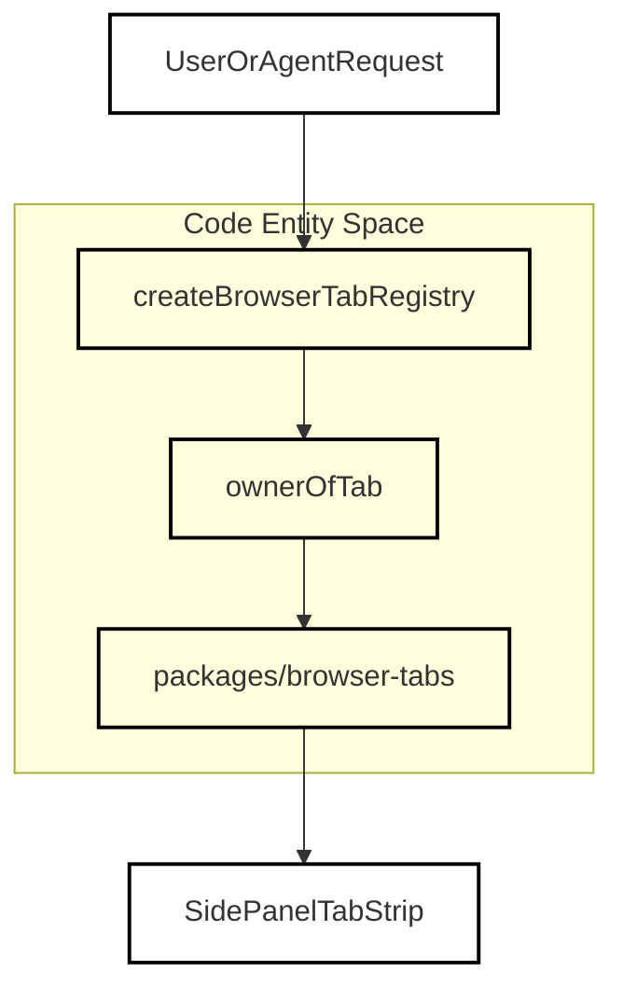
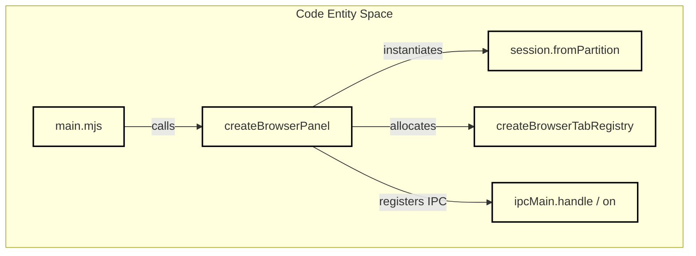

<!-- source: DeepWiki mcp.deepwiki.com · repo different-ai/openwork · extra page Embedded Browser Panel · fetched 2026-10-26 -->

# Embedded Browser Panel

<details>
<summary>Relevant source files</summary>

The following files were used as context for generating this wiki page:

- [apps/app/src/app/lib/desktop-types.ts](apps/app/src/app/lib/desktop-types.ts)
- [apps/app/src/app/lib/desktop.ts](apps/app/src/app/lib/desktop.ts)
- [apps/app/src/react-app/domains/session/panel/agent-viewport.ts](apps/app/src/react-app/domains/session/panel/agent-viewport.ts)
- [apps/app/src/react-app/domains/session/panel/panel-tab-store.ts](apps/app/src/react-app/domains/session/panel/panel-tab-store.ts)
- [apps/app/src/react-app/domains/session/panel/side-panel.tsx](apps/app/src/react-app/domains/session/panel/side-panel.tsx)
- [apps/desktop/electron-builder.base.yml](apps/desktop/electron-builder.base.yml)
- [apps/desktop/electron/browser-panel.mjs](apps/desktop/electron/browser-panel.mjs)
- [apps/desktop/electron/main.mjs](apps/desktop/electron/main.mjs)
- [apps/desktop/electron/preload.mjs](apps/desktop/electron/preload.mjs)
- [apps/desktop/scripts/electron-build.mjs](apps/desktop/scripts/electron-build.mjs)
- [apps/desktop/scripts/electron-dev.mjs](apps/desktop/scripts/electron-dev.mjs)
- [evals/proofs/browser-agent-viewport.proof.test.ts](evals/proofs/browser-agent-viewport.proof.test.ts)
- [packages/browser-tabs/index.d.ts](packages/browser-tabs/index.d.ts)
- [packages/browser-tabs/index.mjs](packages/browser-tabs/index.mjs)
- [packages/computer-use/browser-task-takeover.test.mjs](packages/computer-use/browser-task-takeover.test.mjs)
- [packages/computer-use/browser-task.mjs](packages/computer-use/browser-task.mjs)
- [packages/types/src/desktop-ipc.ts](packages/types/src/desktop-ipc.ts)

</details>


The embedded browser panel subsystem provides secure, thread-scoped browser instances inside OpenWork Desktop. It bridges Electron’s native `WebContentsView` instances with the React side-panel UI [apps/app/src/react-app/domains/session/panel/side-panel.tsx:169-194](), managing tab ownership, view bounds synchronization, background tab emulation, network policies, and proxy configurations via `packages/browser-tabs` and `apps/desktop/electron/browser-panel.mjs` [apps/desktop/electron/browser-panel.mjs:1-44]().

---

### 1. Ownership Registry (`packages/browser-tabs`)

The browser tabs ownership registry coordinates tab creation, active tab selection per conversation, and thread isolation. Tabs are assigned an owner session ID so that conversations only control their own allocated tabs, while a global tab limit (`MAX_BROWSER_TABS = 12`) prevents resource exhaustion across threads [apps/desktop/electron/browser-panel.mjs:26-29]().


*Figure 1: Natural Language Space to Code Entity Space mapping for tab ownership and registration.*

Sources: `apps/desktop/electron/browser-panel.mjs` [apps/desktop/electron/browser-panel.mjs:11-19](), `packages/browser-tabs` [packages/browser-tabs/index.d.ts:1-55]().

---

### 2. Electron BrowserView & Lifecycle Management (`browser-panel.mjs`)

The native browser integration is encapsulated within `createBrowserPanel` in `apps/desktop/electron/browser-panel.mjs` [apps/desktop/electron/browser-panel.mjs:45-145](). It manages Chromium views under the partition `persist:openwork-browser` [apps/desktop/electron/browser-panel.mjs:21]().


*Figure 2: Component mapping from Electron initialization to the browser panel module.*

The lifecycle covers tab creation, suspension, restoration, and cleanup. When tabs exceed `MAX_BROWSER_TABS`, allocation requests are rejected with a capacity error, instructing the user to close unused tabs [evals/specs/browser-tabs-owned-by-thread.e2e.test.ts:47-50]().

Sources: `apps/desktop/electron/browser-panel.mjs` [apps/desktop/electron/browser-panel.mjs:21-44](), `evals/specs/browser-tabs-owned-by-thread.e2e.test.ts` [evals/specs/browser-tabs-owned-by-thread.e2e.test.ts:35-58]().

---

### 3. Side-Panel UI & Bounds Synchronization

The React interface renders browser tabs inside `BrowserPanelContent` and the `SidePanelTab` components [apps/app/src/react-app/domains/session/panel/side-panel.tsx:90-194](). Bounds synchronization ensures the native Electron `WebContentsView` exactly tracks the DOM element bounding rectangle in the renderer window.

When HMR disposes of the panel module, an automatic cleanup hook hides the native browser overlay to prevent dangling views [apps/app/src/react-app/domains/session/panel/side-panel.tsx:58-64]().

```typescript
// apps/app/src/react-app/domains/session/panel/side-panel.tsx
if (import.meta.hot) {
  import.meta.hot.dispose(() => {
    getElectronBrowser()?.hide?.();
  });
}
```

Sources: `apps/app/src/react-app/domains/session/panel/side-panel.tsx` [apps/app/src/react-app/domains/session/panel/side-panel.tsx:58-64](), `apps/app/src/react-app/domains/session/panel/browser-bounds-sync.ts` [apps/app/src/react-app/domains/session/panel/browser-bounds-sync.ts:1-47]().

---

### 4. Agent Viewport

The agent viewport feature allows the agent to interact with web pages as if they were viewed on specific device sizes (e.g., desktop, tablet, phone). This is managed by `AGENT_VIEWPORTS` [packages/browser-tabs/index.d.ts:126-128]() and `agentViewportFor` [packages/browser-tabs/index.d.ts:130](). The `AgentViewportMenu` component in the UI allows users to select the desired viewport [apps/app/src/react-app/domains/session/panel/side-panel.tsx:85-113]().

When an agent controls a tab, the `agentViewport` property of `BrowserPanelTab` [packages/browser-tabs/index.d.ts:38]() specifies the fixed size and scale at which the page lays out. The `fitAgentViewport` function [packages/browser-tabs/index.d.ts:131]() calculates the appropriate scale to fit the viewport within the available bounds.

Sources: `packages/browser-tabs/index.d.ts` [packages/browser-tabs/index.d.ts:38-39, 126-131](), `apps/app/src/react-app/domains/session/panel/side-panel.tsx` [apps/app/src/react-app/domains/session/panel/side-panel.tsx:85-113](), `apps/app/src/react-app/domains/session/panel/agent-viewport.ts` [apps/app/src/react-app/domains/session/panel/agent-viewport.ts:1-20]().

---

### 5. Background Tab Emulation & Resource Bounds

Tabs that are not currently active in the visible thread or window are placed into background emulation mode using `BACKGROUND_TAB_VIEWPORT` settings [apps/desktop/electron/browser-panel.mjs:8-13](). Background tabs preserve their DOM states and WebMCP bindings while throttling expensive repaints until restored to the foreground.

Sources: `apps/desktop/electron/browser-panel.mjs` [apps/desktop/electron/browser-panel.mjs:8-13](), `packages/browser-tabs` [packages/browser-tabs/index.mjs:1-120]().

---

### 6. Proxy Configuration & Security Policy Integration

The browser session enforces strict security defaults via `BROWSER_SECURITY_PREFERENCES`, disabling node integration in web pages (`nodeIntegration: false`) while enabling sandboxing (`sandbox: true`) [apps/desktop/electron/browser-panel.mjs:32-43]().

Furthermore, network requests pass through `browserSession.webRequest.onBeforeRequest`, validating URLs against organizational security policies and proxy rules before allowing navigation or frame embedding [apps/desktop/electron/browser-panel.mjs:62-98](). The `websiteRules` and `websiteDecision` functions [apps/desktop/electron/browser-panel.mjs:60-97]() implement the agent permission checks, potentially denying access or requiring user approval for certain sites.

Sources: `apps/desktop/electron/browser-panel.mjs` [apps/desktop/electron/browser-panel.mjs:32-98](), `apps/app/src/app/lib/desktop.ts` [apps/app/src/app/lib/desktop.ts:56-59]().

---

