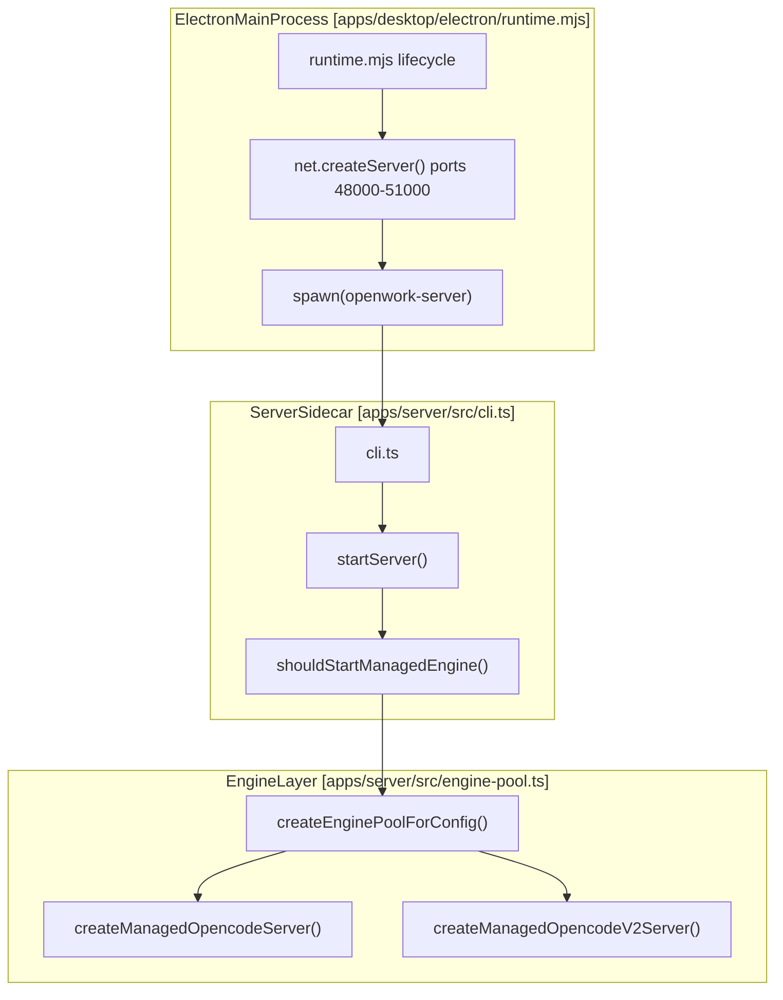
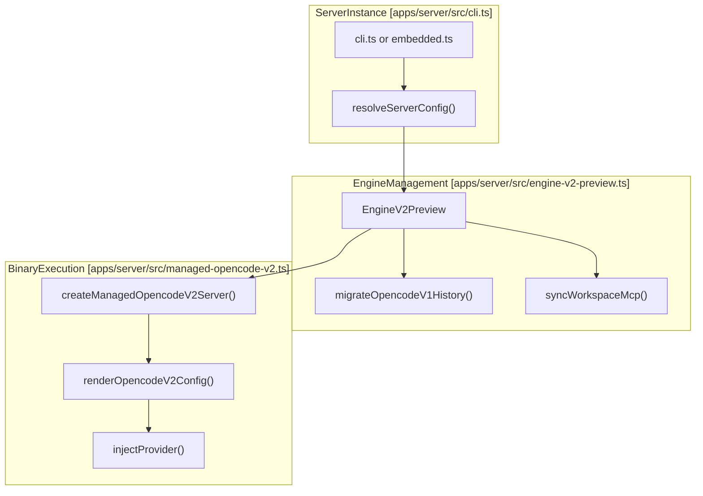

<!-- source: DeepWiki mcp.deepwiki.com · repo different-ai/openwork · extra page Engine Runtimes and the Server Sidecar · fetched 2026-10-26 -->

# Engine Runtimes and the Server Sidecar

Relevant source files

The following files were used as context for generating this wiki page:

- [apps/app/src/app/lib/diagnostics-bundle.ts](apps/app/src/app/lib/diagnostics-bundle.ts)
- [apps/app/src/react-app/domains/connections/openwork-server-store.ts](apps/app/src/react-app/domains/connections/openwork-server-store.ts)
- [apps/app/src/react-app/shell/desktop-runtime-boot.ts](apps/app/src/react-app/shell/desktop-runtime-boot.ts)
- [apps/app/src/react-app/shell/engine-reload-escalation.ts](apps/app/src/react-app/shell/engine-reload-escalation.ts)
- [apps/desktop/electron/engine-force-policy.mjs](apps/desktop/electron/engine-force-policy.mjs)
- [apps/desktop/electron/runtime.mjs](apps/desktop/electron/runtime.mjs)
- [apps/desktop/electron/startup-log.mjs](apps/desktop/electron/startup-log.mjs)
- [apps/desktop/electron/windows-shortcut.mjs](apps/desktop/electron/windows-shortcut.mjs)
- [apps/desktop/test/engine-force-policy.test.mjs](apps/desktop/test/engine-force-policy.test.mjs)
- [apps/server/src/cli.ts](apps/server/src/cli.ts)
- [apps/server/src/config.ts](apps/server/src/config.ts)
- [apps/server/src/embedded.ts](apps/server/src/embedded.ts)
- [apps/server/src/managed-opencode.ts](apps/server/src/managed-opencode.ts)
- [apps/server/src/openwork-extensions-plugin-path.ts](apps/server/src/openwork-extensions-plugin-path.ts)
- [apps/server/src/openwork-runtime-config.ts](apps/server/src/openwork-runtime-config.ts)
- [apps/server/src/selfhost-web.ts](apps/server/src/selfhost-web.ts)
- [apps/server/src/types.ts](apps/server/src/types.ts)
- [apps/server/src/workspace-init.ts](apps/server/src/workspace-init.ts)
- [apps/server/test/archive-extraction.test.ts](apps/server/test/archive-extraction.test.ts)
- [apps/server/test/engine-auto-upgrade-safety.test.ts](apps/server/test/engine-auto-upgrade-safety.test.ts)
- [apps/server/test/engine-fresh-forced-start-failure.test.ts](apps/server/test/engine-fresh-forced-start-failure.test.ts)
- [apps/server/test/engine-fresh-install-default.test.ts](apps/server/test/engine-fresh-install-default.test.ts)
- [apps/server/test/opencode-plugin-deps.test.ts](apps/server/test/opencode-plugin-deps.test.ts)
- [ee/apps/den-worker-runtime/Dockerfile.daytona-snapshot](ee/apps/den-worker-runtime/Dockerfile.daytona-snapshot)
- [packaging/docker/Dockerfile.microsandbox](packaging/docker/Dockerfile.microsandbox)

This page details the engine runtime modes, process lifecycles, and sidecar integration within the OpenWork desktop application and standalone server packages. It covers the Electron main process runtime management (`apps/desktop/electron/runtime.mjs`), the embedded `openwork-server` (`apps/server/src/embedded.ts`), the engine pool, managed OpenCode v1 and v2 runtimes, workspace initialization, and runtime configuration injection.

---

## 1. Desktop Runtime Lifecycle and Process Management (`runtime.mjs`)

The OpenWork desktop application manages its core server and engine instances through a runtime layer defined in `apps/desktop/electron/runtime.mjs` [apps/desktop/electron/runtime.mjs:1-179](). The primary local execution mode is the **Direct** (`direct`) runtime, where the Electron main process spawns and supervises `openwork-server` and the `opencode` engine as direct child processes [apps/desktop/electron/runtime.mjs:2-2](), [apps/desktop/electron/runtime.mjs:27-27]().

### Port Allocation and Security Tokens
The runtime selects ports dynamically within a designated range (`48_000` to `51_000`) using `node:net` to probe for available ports [apps/desktop/electron/runtime.mjs:5-5](), [apps/desktop/electron/runtime.mjs:28-29](). It establishes cryptographically secure tokens (`clientToken`, `hostToken`, and optional `ownerToken`) to authenticate requests between the Electron renderer/client and the local `openwork-server` instance [apps/desktop/electron/runtime.mjs:1-1](), [apps/desktop/electron/runtime.mjs:164-179]().

### Certificate Trust and AIA Repair
To support enterprise setups and custom proxies, the runtime provides TLS chain repair via `createSystemCaCertificateVerifyProc` [apps/desktop/electron/runtime.mjs:128-141](). If a server presents an incomplete certificate chain, the module inspects Authority Information Access (AIA) extensions, queries trusted system anchor certificates from OS keychains, and validates the chain without disabling underlying Chromium verification [apps/desktop/electron/runtime.mjs:107-141]().

### Diagram: Desktop Runtime Initialization and Process Flow

Sources: [apps/desktop/electron/runtime.mjs:1-141](), [apps/server/src/cli.ts:1-135](), [apps/server/src/embedded.ts:1-90]()

---

## 2. Embedded Server Sidecar (`openwork-server`)

The `openwork-server` package (`apps/server`) operates either as a standalone CLI application (`apps/server/src/cli.ts`) [apps/server/src/cli.ts:1-148]() or as an in-process embedded server (`apps/server/src/embedded.ts`) [apps/server/src/embedded.ts:1-186]().

### In-Process Embedding (`startEmbeddedServer`)
When embedded in hosting environments like OpenWork Desktop, `startEmbeddedServer` parses server configuration via `resolveServerConfig`, injects secure vault key providers, and coordinates cleanup through a unified `stop()` handle [apps/server/src/embedded.ts:44-73](), [apps/server/src/embedded.ts:74-163](). 

The resource release lifecycle (`releaseResources`) cleanly tears down task recovery workers, engine pools, managed OpenCode processes, and HTTP listeners, throwing an `AggregateError` if multiple cleanup steps fail [apps/server/src/embedded.ts:91-158]().

### Desktop Task Recovery
Desktop-embedded servers enable `resumeInterruptedTasks`, tracking task identities, workspace paths, and recovery phases in a runtime SQLite database (`desktop_task_recovery`) [apps/server/README.md:58-67](). On startup, a throttled coordinator inspects unfinished tasks and safely queues continuations without blindly retrying lost acknowledgements [apps/server/README.md:68-87]().

Sources: [apps/server/src/cli.ts:1-148](), [apps/server/src/embedded.ts:44-186](), [apps/server/README.md:58-87]()

---

## 3. Engine Pool and Managed OpenCode (v1 & v2)

The server manages instances of the OpenCode engine through an engine pool (`apps/server/src/engine-pool.ts`) and managed server adapters [apps/server/src/cli.ts:15-23]().

### Managed OpenCode v1 (`managed-opencode.ts`)
For OpenCode v1, `createManagedProcessClose` wraps spawned child processes to handle graceful termination (`SIGTERM`) followed by forced termination (`SIGKILL`) if the process fails to exit within configured timeouts [apps/server/src/managed-opencode.ts:42-90](). Spawning configures authentication credentials (`OPENCODE_SERVER_USERNAME` and `OPENCODE_SERVER_PASSWORD`) and strips sensitive variables like `OPENWORK_ENCRYPTION_KEY` from the engine environment [apps/server/src/managed-opencode.ts:150-191]().

### OpenCode v2 Preview (`engine-v2-preview.ts` & `managed-opencode-v2.ts`)
The v2 engine architecture introduces parallel provider injection via watched configuration files, v1 history migration (`migrateOpencodeV1History`), MCP readiness RPC checks (`MCP_READINESS_RPC_ID`), and background upkeep loops (`ENGINE_V2_UPKEEP_WAITS`) [apps/server/src/engine-v2-preview.ts:1-64](). `renderOpencodeV2Config` produces complete configuration payloads mapping model capabilities, tool settings, and context limits for the native v2 binary [apps/server/src/managed-opencode-v2.ts:102-159]().

### Diagram: Engine Pool and Managed Execution Flow

Sources: [apps/server/src/cli.ts:1-148](), [apps/server/src/engine-v2-preview.ts:1-129](), [apps/server/src/managed-opencode-v2.ts:37-159]()

---

## 4. Workspace Initialization and Runtime Configuration

Before accepting requests, the server validates and provisions workspace directories and dynamic runtime configurations [apps/server/src/cli.ts:117-121]().

### Workspace Initialization (`workspace-init.ts`)
`ensureWorkspaceFiles` verifies that workspace roots exist and are accessible, throwing typed `ApiError` instances if access fails [apps/server/src/workspace-init.ts:69-83](). It provisions default configuration and `.opencode/` structures, while `ensureLocalWorkspaceFiles` iterates through all configured workspaces during server boot, catching and logging path errors to prevent single-workspace failures from aborting startup [apps/server/src/workspace-init.ts:61-116]().

### Runtime Configuration Store (`openwork-runtime-config.ts`)
Instead of writing static configuration files to user directories, the server maintains dynamic runtime configuration in the runtime SQLite database (`runtime-opencode-config-store.ts`) [apps/server/src/openwork-runtime-config.ts:6-18](). 

`buildOpenworkRuntimeConfigObject` aggregates global runtime configurations, permission rules, disabled providers, and built-in plugin paths (such as `openworkCapabilitiesKnowledgePluginPath` and `openworkExtensionsPreviewPluginPath`), serializing them into an `OPENCODE_CONFIG` file via `writeOpenworkRuntimeConfigFile` [apps/server/src/openwork-runtime-config.ts:49-124](), [apps/server/src/openwork-extensions-plugin-path.ts:34-48](). `keepOpenworkRuntimeConfigFileFresh` keeps this file synchronized on every database write so that engine instance disposals and re-reads pick up current states [apps/server/src/cli.ts:143-144](), [apps/server/src/openwork-runtime-config.ts:14-18]().

Sources: [apps/server/src/cli.ts:117-144](), [apps/server/src/workspace-init.ts:69-116](), [apps/server/src/openwork-runtime-config.ts:6-154](), [apps/server/src/openwork-extensions-plugin-path.ts:34-48]()

---

## 5. Binary Resolution and Self-Hosted Distribution

Standalone and npm-distributed servers (`apps/server`) bundle web assets, plugins, and pre-resolved plugin dependencies for execution across multiple platforms without requiring Bun at runtime [apps/server/README.md:5-12](), [apps/server/scripts/publish-npm.mjs:1-21]().

### Binary Resolution and Packaging (`selfhost-web.ts`)
The server self-host layer resolves its root package directory via `resolvePackageRoot`, locates bundled web static outputs through `resolveWebRoot`, and manages version probing via `readBinaryVersion` [apps/server/src/selfhost-web.ts:34-101](). Archives are extracted safely using platform-aware tar/unzip commands in `extractArchive` [apps/server/src/selfhost-web.ts:133-167]().

### Containerized Execution (`Dockerfile.daytona-snapshot`)
Container images such as those built for Daytona sandboxes compile the server binary via Bun target architectures (`bun-linux-x64`, `bun-linux-arm64`) and bundle pre-pinned OpenCode v1 and v2 binaries with strict integrity hashing [ee/apps/den-worker-runtime/Dockerfile.daytona-snapshot:23-118]().

Sources: [apps/server/src/selfhost-web.ts:1-167](), [ee/apps/den-worker-runtime/Dockerfile.daytona-snapshot:1-120]()

---

