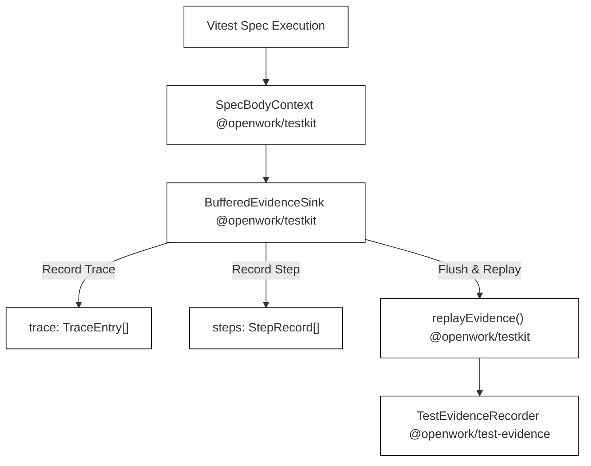
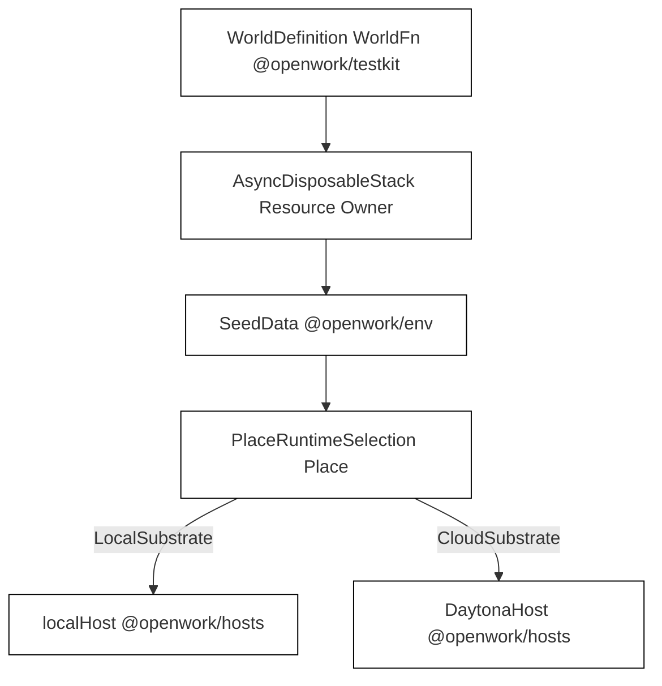

<!-- source: DeepWiki mcp.deepwiki.com · repo different-ai/openwork · extra page Evals Testkit and Hosts · fetched 2026-10-26 -->

# Evals Testkit and Hosts

Relevant source files

The following files were used as context for generating this wiki page:

- [.devcontainer/Dockerfile](.devcontainer/Dockerfile)
- [.devcontainer/Dockerfile.daytona-server](.devcontainer/Dockerfile.daytona-server)
- [.devcontainer/create-daytona-openwork-server-snapshot.sh](.devcontainer/create-daytona-openwork-server-snapshot.sh)
- [.devcontainer/devcontainer.json](.devcontainer/devcontainer.json)
- [.devcontainer/docker-compose.yml](.devcontainer/docker-compose.yml)
- [.devcontainer/start-daytona-server.sh](.devcontainer/start-daytona-server.sh)
- [.devcontainer/test-server-on-daytona.sh](.devcontainer/test-server-on-daytona.sh)
- [apps/app/src/react-app/domains/session/artifacts/preview.tsx](apps/app/src/react-app/domains/session/artifacts/preview.tsx)
- [apps/desktop/electron/quit-sequence.mjs](apps/desktop/electron/quit-sequence.mjs)
- [apps/desktop/scripts/engine-diagnosis.mjs](apps/desktop/scripts/engine-diagnosis.mjs)
- [apps/desktop/scripts/packaged-smoke.mjs](apps/desktop/scripts/packaged-smoke.mjs)
- [apps/desktop/test/engine-cold-start.test.mjs](apps/desktop/test/engine-cold-start.test.mjs)
- [apps/desktop/test/engine-diagnosis.test.mjs](apps/desktop/test/engine-diagnosis.test.mjs)
- [evals/packages/behaviors/src/composer.ts](evals/packages/behaviors/src/composer.ts)
- [evals/packages/behaviors/src/den.ts](evals/packages/behaviors/src/den.ts)
- [evals/packages/behaviors/src/desktop-boot.ts](evals/packages/behaviors/src/desktop-boot.ts)
- [evals/packages/behaviors/src/desktop.ts](evals/packages/behaviors/src/desktop.ts)
- [evals/packages/behaviors/src/onboarding.ts](evals/packages/behaviors/src/onboarding.ts)
- [evals/packages/cdp/src/app-state.ts](evals/packages/cdp/src/app-state.ts)
- [evals/packages/cdp/src/cdp.ts](evals/packages/cdp/src/cdp.ts)
- [evals/packages/cdp/src/index.ts](evals/packages/cdp/src/index.ts)
- [evals/packages/cdp/src/input.ts](evals/packages/cdp/src/input.ts)
- [evals/packages/cdp/src/surface.ts](evals/packages/cdp/src/surface.ts)
- [evals/packages/env/src/den.ts](evals/packages/env/src/den.ts)
- [evals/packages/env/src/place.ts](evals/packages/env/src/place.ts)
- [evals/packages/env/src/seed.ts](evals/packages/env/src/seed.ts)
- [evals/packages/hosts/src/daytona.ts](evals/packages/hosts/src/daytona.ts)
- [evals/packages/hosts/src/desktop.ts](evals/packages/hosts/src/desktop.ts)
- [evals/packages/hosts/src/local-surface-log.test.ts](evals/packages/hosts/src/local-surface-log.test.ts)
- [evals/packages/hosts/src/local.ts](evals/packages/hosts/src/local.ts)
- [evals/packages/hosts/src/provision.ts](evals/packages/hosts/src/provision.ts)
- [evals/packages/hosts/src/types.ts](evals/packages/hosts/src/types.ts)
- [evals/packages/testkit/src/index.ts](evals/packages/testkit/src/index.ts)
- [evals/packages/testkit/src/spec/runtime.ts](evals/packages/testkit/src/spec/runtime.ts)
- [evals/packages/testkit/src/spec/types.ts](evals/packages/testkit/src/spec/types.ts)
- [evals/packages/testkit/src/transcript-observer.ts](evals/packages/testkit/src/transcript-observer.ts)
- [evals/worlds/first-run.ts](evals/worlds/first-run.ts)

## Purpose and Scope

The `evals/` package tree houses OpenWork's executable specification framework, end-to-end test runner, Chrome DevTools Protocol (CDP) drivers, host environments, interactive behaviors, and evidentiary verification pipelines. This architecture enables local and cloud-managed validation of user journeys across desktop (Electron), web, and server runtimes without polluting product package builds `[evals/README.md:120-122]()`.

Sources: `[evals/README.md:120-122]()`

---

## Testkit Spec Runtime

The testkit spec runtime provides the execution context for journeys defined in `evals/specs/` and `scenarios/`. The runtime coordinates test bodies through `SpecBodyContext`, which injects `user`, `agent`, `probe`, `step`, and `evidence` primitives into Vitest tests `[evals/packages/testkit/src/spec/types.ts:124-133]()`.

Evidence and step synchronization are managed by `BufferedEvidenceSink`, which buffers trace entries and step records during test execution before flushing them to the `@openwork/test-evidence` recorder `[evals/packages/testkit/src/spec/runtime.ts:93-124]()`. The function `replayEvidence` transfers buffered trace entries and outcomes onto a `TestEvidenceRecorder` instance `[evals/packages/testkit/src/spec/runtime.ts:126-139]()`.

*Figure 1: Natural Language Space to Code Entity Space mapping for test execution and evidence collection.*

Sources: `[evals/packages/testkit/src/spec/runtime.ts:93-139]`, `[evals/packages/testkit/src/spec/types.ts:124-133]()`

---

## CDP Driver and Input Abstractions

Low-level browser and desktop automation rely on `@openwork/cdp`, exposing DOM queries, target selectors, and key mappings `[evals/packages/cdp/src/input.ts]()`. The `readDom` function extracts read-only DOM geometry, focus, and fixed layout styles from a target surface `[evals/packages/cdp/src/input.ts:38-68]()`.

Targets are parsed via `parseTarget`, which normalizes strings, roles, text matchers, labels, placeholders, and test IDs into a structured `ParsedTarget` object `[evals/packages/cdp/src/input.ts:100-117]()`. Keyboard input translation is handled by converting key combination strings into `KeyDescriptor` payloads containing virtual key codes and bitmasked modifiers `[evals/packages/cdp/src/input.ts:144-160]()`. File selection operations use `attachFiles` to bind test file payloads directly through `DOM.setFileInputFiles` without raising OS dialogs `[evals/packages/cdp/src/input.ts:71-92]()`.

Sources: `[evals/packages/cdp/src/input.ts:38-160]()`

---

## Environment, Seed, and Place (`env/seed/place`)

Test execution relies on three foundational resource concepts managed by `@openwork/env` and `@openwork/testkit`:
* **World**: An executable TypeScript script establishing concrete resources (web app, server, Den control plane, databases) inside an `AsyncDisposableStack` `[evals/README.md:85-102]()`. Resource cleanup follows reverse-order disposal semantics.
* **Seed**: Deterministic initial data and configuration applied to the world before spec execution `[evals/packages/testkit/src/spec/types.ts:122-123]()`.
* **Place**: The operational execution substrate where resources run, strictly categorized as either `local` or `daytona` `[evals/README.md:87]()`.

*Figure 2: Natural Language Space to Code Entity Space mapping for environment initialization and placement.*

Sources: `[evals/README.md:85-102]`, `[evals/packages/testkit/src/spec/types.ts:122-123]()`

---

## Hosts (`local`, `daytona`, `desktop`, `provision`)

Hosts implement the lifecycle management of surfaces, sidecars, and backend services.
* **Local Host (`@openwork/hosts/local`)**: Manages local process spawns, port allocations, and process group signaling (`signalProcessGroup`, `pidIsAlive`) `[evals/packages/hosts/src/local.ts:173-211]()`. It tracks live profile directories via `registerLiveProfileRoot` `[evals/packages/hosts/src/local.ts:87-93]()`.
* **Daytona Host (`@openwork/hosts/daytona`)**: Manages remote execution inside Daytona sandboxes using `defaultDaytonaExec` for command orchestration, port forwarding, and remote preview URL generation `[evals/packages/hosts/src/daytona.ts:104-154]()`.
* **Desktop Host (`@openwork/hosts/desktop`)**: Coordinates Electron app launching, attachment via CDP, and state readiness probes (`waitForReadiness`, `probeAppStateOnSurface`) `[evals/packages/hosts/src/desktop.ts:130-149]()`. Retained desktop instances are handled via `retainedDesktop` for post-crash inspection `[evals/packages/hosts/src/desktop.ts:102-128]()`.
* **Provisioner (`@openwork/hosts/provision`)**: Handles publishing artifacts, sandbox provisioning, and archive extraction scripts such as `DESKTOP_RELEASE_ARCHIVE_INSTALLER` for validating release builds `[evals/packages/hosts/src/provision.ts:35-102]()`.

Sources: `[evals/packages/hosts/src/local.ts:87-211]`, `[evals/packages/hosts/src/daytona.ts:104-154]`, `[evals/packages/hosts/src/desktop.ts:102-149]`, `[evals/packages/hosts/src/provision.ts:35-102]()`

---

## Behaviors and Matchers

Behaviors codify multi-step user and agent interactions into reusable asynchronous routines under `@openwork/behaviors`. Key behavioral modules include:
* **Desktop Boot & Authentication**: Exchanges handoff grants with Den, persists auth tokens into `localStorage`, and waits for the active organization or workspace route to resolve `[evals/packages/behaviors/src/desktop-boot.ts:40-68]()`.
* **Workspace Provisioning**: Navigates product onboarding through the UI, handles local workspace creation prompts, and verifies active workspace state `[evals/packages/behaviors/src/desktop-boot.ts:129-151]()`.
* **Matchers (`@openwork/matchers`)**: Validates verdicts against expectations, checking outcomes, trace invariants, and error signatures `[evals/worlds/first-run.ts:16]()`.

Sources: `[evals/packages/behaviors/src/desktop-boot.ts:40-151]`, `[evals/worlds/first-run.ts:16]()`

---

## Test Artifacts and Evidence

Test runs record step outcomes, trace entries, and screenshot artifacts using `@openwork/test-evidence` and `@openwork/test-artifacts`. 

When execution includes verification checks on supported environments, checkpoint capabilities record state snapshots to enable review workflows and diagnostic capture `[evals/packages/testkit/src/spec/runtime.ts:56-66]()`. Test reporting formats run metrics and render JUnit/Markdown reports via helpers such as `renderPrMarkdown` `[evals/packages/testkit/src/index.ts:18-20]()`.

Sources: `[evals/packages/testkit/src/index.ts:18-20]`, `[evals/packages/testkit/src/spec/runtime.ts:56-66]()`

---

