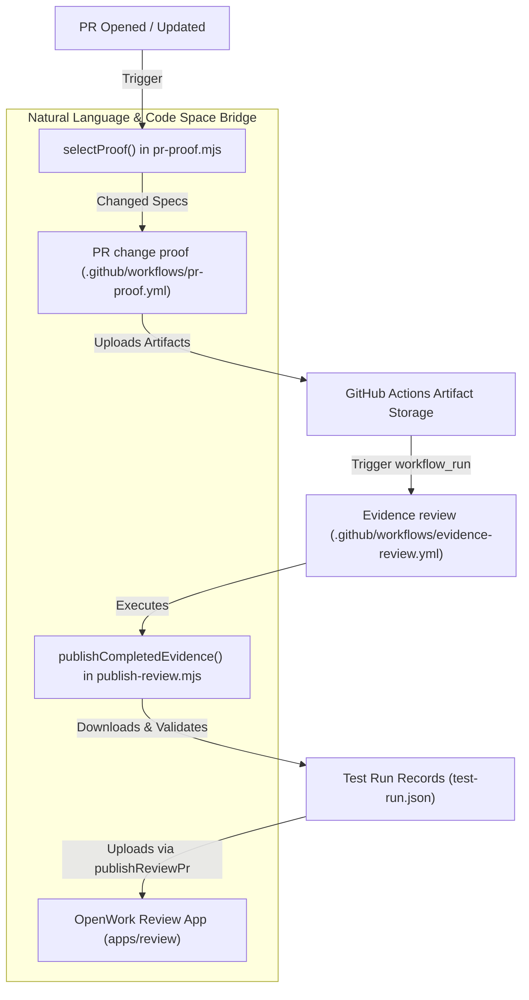
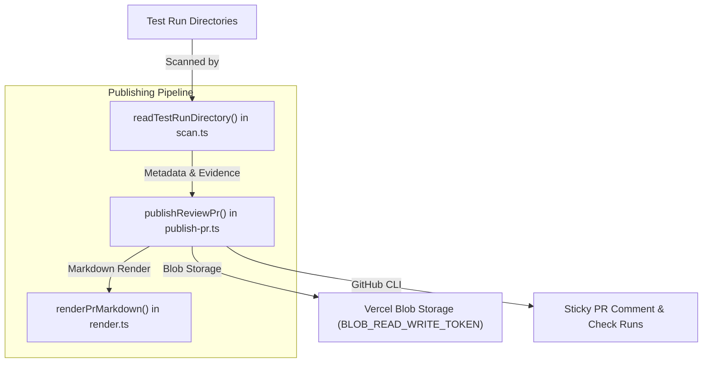

<!-- source: DeepWiki mcp.deepwiki.com · repo different-ai/openwork · extra page Evidence Review and Design Review · fetched 2026-10-26 -->

# Evidence Review and Design Review

Relevant source files

The following files were used as context for generating this wiki page:

- [.github/actions/den-deps/action.yml](.github/actions/den-deps/action.yml)
- [.github/scripts/evidence-presentation.md](.github/scripts/evidence-presentation.md)
- [.github/scripts/evidence-presentation.mjs](.github/scripts/evidence-presentation.mjs)
- [.github/scripts/evidence-presentation.test.mjs](.github/scripts/evidence-presentation.test.mjs)
- [.github/scripts/evidence-preview-card.mjs](.github/scripts/evidence-preview-card.mjs)
- [.github/scripts/evidence-preview-card.test.mjs](.github/scripts/evidence-preview-card.test.mjs)
- [.github/scripts/pr-proof-controller.mjs](.github/scripts/pr-proof-controller.mjs)
- [.github/scripts/pr-proof.mjs](.github/scripts/pr-proof.mjs)
- [.github/workflows/core-journeys.yml](.github/workflows/core-journeys.yml)
- [.github/workflows/evidence-review-checks.yml](.github/workflows/evidence-review-checks.yml)
- [.github/workflows/evidence-review.yml](.github/workflows/evidence-review.yml)
- [.github/workflows/pr-proof.yml](.github/workflows/pr-proof.yml)
- [apps/review/README.md](apps/review/README.md)
- [evals/packages/test-artifacts/src/publish-pr.ts](evals/packages/test-artifacts/src/publish-pr.ts)
- [evals/packages/test-evidence/src/vitest.ts](evals/packages/test-evidence/src/vitest.ts)
- [evals/scripts/publish-review.mjs](evals/scripts/publish-review.mjs)

This page details the implementation of the evidence review and design review systems within OpenWork. Its primary purpose is to provide a mechanism for automated and human-assisted review of changes, focusing on the visual and behavioral aspects of the application through the `apps/review` evidence viewer, `publish-review` workflows, evidence review orchestrations, vision judging of screenshots, and the `docs-shots` capture pipeline.

## Evidence Review Workflow and Orchestration

The evidence review workflow governs how changes introduced in pull requests (PRs) are verified using end-to-end (E2E) tests. It captures "proof evidence" and publishes structured review reports [apps/review/README.md:3-6]().

### PR Change Proofs and Selection

The `PR change proof` workflow (`.github/workflows/pr-proof.yml`) automatically executes E2E specs added or modified in a PR [apps/review/README.md:90-96](). The selection logic is managed by `.github/scripts/pr-proof.mjs` via `selectProof()`, which scans changed files against E2E path patterns and bundles core journeys unless the PR is documentation-only [.github/scripts/pr-proof.mjs:59-69]().

Each job uploads a hashed artifact containing test records (`test-run.json`) and captured artifacts [apps/review/README.md:98-100](). 

### Trusted Evidence Publication Pipeline

The `Evidence review` workflow (`.github/workflows/evidence-review.yml`) runs on trusted default-branch code once PR change proofs complete [apps/review/README.md:103-104]()]. It executes `evals/scripts/publish-review.mjs`, where `publishCompletedEvidence()` validates the PR association, resolves changed files, downloads proof artifacts, and uploads the compiled evidence to the review app [evals/scripts/publish-review.mjs:50-117]().

Sources:
- [.github/workflows/pr-proof.yml:1-77]()
- [.github/scripts/pr-proof.mjs:59-69]()
- [.github/workflows/evidence-review.yml:1-103]()
- [evals/scripts/publish-review.mjs:50-117]()

## OpenWork Review App (`apps/review`)

The `apps/review` package is an immutable, private web application built to render test run records and DocShot receipts [apps/review/README.md:3](). It does not run tests, capture screenshots, or make model calls at runtime; it purely consumes immutable evaluation outputs [apps/review/README.md:3-6]().

### Publishing and Vercel Integration

Publication is driven by `publishReviewPr` located in `evals/packages/test-artifacts/src/publish-pr.ts`, which posts sticky review summaries on GitHub pull requests and coordinates with private Vercel Blob storage [apps/review/README.md:33-36](). Security relies on Vercel Authentication (Standard Protection) so that anonymous requests are intercepted before reaching report, JSON, or image routes [apps/review/README.md:33-52]().

Sources:
- [apps/review/README.md:3-6]()
- [apps/review/README.md:33-52]()
- [evals/packages/test-artifacts/src/publish-pr.ts:1-183]()

## Vision Judging of Screenshots

The evaluation suite supports "vision judging", allowing verification of visual correctness for UI states captured during E2E executions [apps/review/README.md:88-89](). 

- **Execution**: Triggered via `pnpm --dir evals evidence:judge -- --test-run <run>` [apps/review/README.md:88-89]().
- **Fixtures & State**: Test records capture metrics such as `clientWidth`, `hiddenEdges`, `maskImage`, and `scrollWidth` alongside visual screenshots to feed human or automated evaluation workflows [evals/specs/sidebar-title-overflow-fade.e2e.test.ts:78-92]().

Sources:
- [apps/review/README.md:88-89]()
- [evals/specs/sidebar-title-overflow-fade.e2e.test.ts:78-92]()

## Docs-Shots Capture Pipeline

The `docs-shots` capture pipeline produces documentation screenshots that are integrated directly into the evaluation and evidence review flow. 

- **Integration**: The publishing scripts accept DocShot receipts via flags (e.g., `--docshot <image.png.review.json>`), associating documentation assets directly with the corresponding commit SHA and PR evidence bundle [apps/review/README.md:75-76]().
- **Validation**: Every attached DocShot must pass strict path and commit-hash validation before being rendered in the review app [apps/review/README.md:78-83]().

Sources:
- [apps/review/README.md:75-83]()

---

