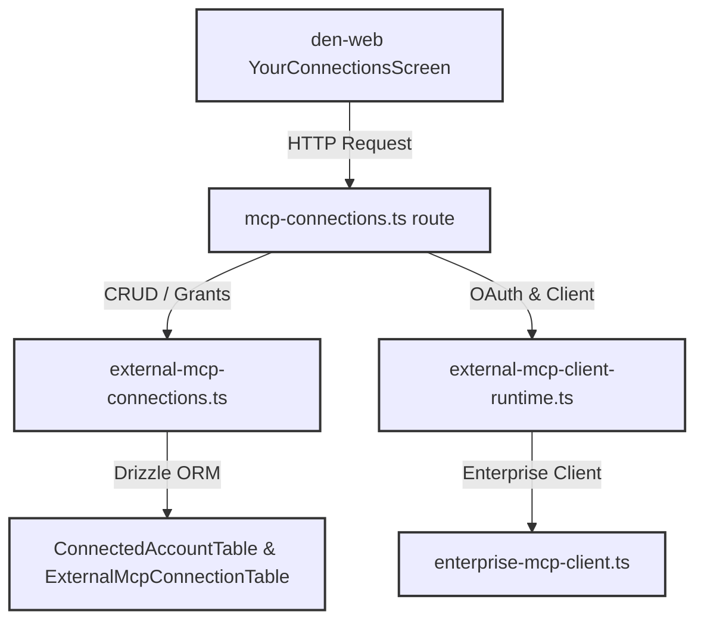
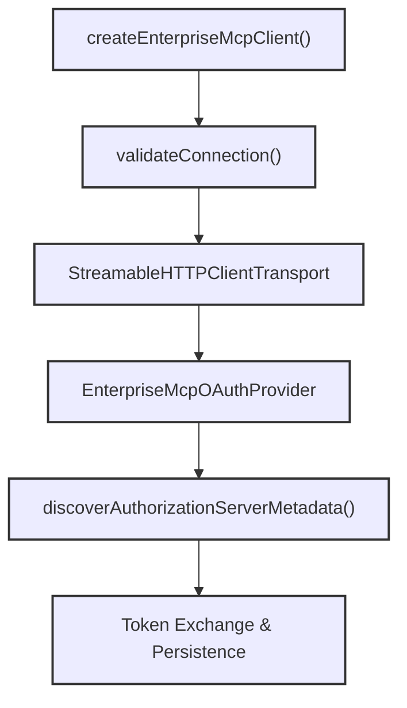

<!-- source: DeepWiki mcp.deepwiki.com · repo different-ai/openwork · extra page External MCP Connections and OAuth · fetched 2026-10-26 -->

# External MCP Connections and OAuth

Relevant source files

The following files were used as context for generating this wiki page:

- [ee/apps/den-api/src/capability-sources/binary-content.ts](ee/apps/den-api/src/capability-sources/binary-content.ts)
- [ee/apps/den-api/src/capability-sources/enterprise-mcp-client-adapter.ts](ee/apps/den-api/src/capability-sources/enterprise-mcp-client-adapter.ts)
- [ee/apps/den-api/src/capability-sources/enterprise-mcp-oauth-persistence.ts](ee/apps/den-api/src/capability-sources/enterprise-mcp-oauth-persistence.ts)
- [ee/apps/den-api/src/capability-sources/external-mcp-client-runtime.ts](ee/apps/den-api/src/capability-sources/external-mcp-client-runtime.ts)
- [ee/apps/den-api/src/capability-sources/external-mcp-client.ts](ee/apps/den-api/src/capability-sources/external-mcp-client.ts)
- [ee/apps/den-api/src/capability-sources/external-mcp-connections.ts](ee/apps/den-api/src/capability-sources/external-mcp-connections.ts)
- [ee/apps/den-api/src/capability-sources/external-mcp-diagnostics.ts](ee/apps/den-api/src/capability-sources/external-mcp-diagnostics.ts)
- [ee/apps/den-api/src/capability-sources/generic-oauth.ts](ee/apps/den-api/src/capability-sources/generic-oauth.ts)
- [ee/apps/den-api/src/capability-sources/native-provider-connections.ts](ee/apps/den-api/src/capability-sources/native-provider-connections.ts)
- [ee/apps/den-api/src/capability-sources/oauth-credentials.ts](ee/apps/den-api/src/capability-sources/oauth-credentials.ts)
- [ee/apps/den-api/src/capability-sources/provider-registry.ts](ee/apps/den-api/src/capability-sources/provider-registry.ts)
- [ee/apps/den-api/src/capability-sources/url-guard.ts](ee/apps/den-api/src/capability-sources/url-guard.ts)
- [ee/apps/den-api/src/mcp-apps.ts](ee/apps/den-api/src/mcp-apps.ts)
- [ee/apps/den-api/src/mcp/external-tool-catalog-cache.ts](ee/apps/den-api/src/mcp/external-tool-catalog-cache.ts)
- [ee/apps/den-api/src/mcp/marketplace-capabilities.ts](ee/apps/den-api/src/mcp/marketplace-capabilities.ts)
- [ee/apps/den-api/src/middleware/route-access.ts](ee/apps/den-api/src/middleware/route-access.ts)
- [ee/apps/den-api/src/routes/org/google-drive-uploads.ts](ee/apps/den-api/src/routes/org/google-drive-uploads.ts)
- [ee/apps/den-api/src/routes/org/mcp-connections.ts](ee/apps/den-api/src/routes/org/mcp-connections.ts)
- [ee/apps/den-api/src/routes/org/oauth-providers.ts](ee/apps/den-api/src/routes/org/oauth-providers.ts)
- [ee/apps/den-api/test/mcp-login-discovery.test.ts](ee/apps/den-api/test/mcp-login-discovery.test.ts)
- [ee/apps/den-api/test/url-guard-redirect.test.ts](ee/apps/den-api/test/url-guard-redirect.test.ts)
- [ee/apps/den-web/app/(den)/dashboard/_components/mcp-connections-data.tsx](ee/apps/den-web/app/(den)/dashboard/_components/mcp-connections-data.tsx)
- [ee/apps/den-web/app/(den)/dashboard/_components/your-connections-screen.tsx](ee/apps/den-web/app/(den)/dashboard/_components/your-connections-screen.tsx)
- [ee/packages/den-db/src/schema/sharables/capability-credentials.ts](ee/packages/den-db/src/schema/sharables/capability-credentials.ts)
- [evals/packages/labs/src/mock-google-drive.ts](evals/packages/labs/src/mock-google-drive.ts)
- [evals/packages/labs/src/mock-google-server.ts](evals/packages/labs/src/mock-google-server.ts)
- [evals/packages/labs/src/mock-google.ts](evals/packages/labs/src/mock-google.ts)
- [packages/enterprise-mcp-client/src/authorization-response.ts](packages/enterprise-mcp-client/src/authorization-response.ts)
- [packages/enterprise-mcp-client/src/contracts.ts](packages/enterprise-mcp-client/src/contracts.ts)
- [packages/enterprise-mcp-client/src/enterprise-mcp-client.ts](packages/enterprise-mcp-client/src/enterprise-mcp-client.ts)
- [packages/enterprise-mcp-client/src/errors.ts](packages/enterprise-mcp-client/src/errors.ts)
- [packages/enterprise-mcp-client/src/oauth-login-discovery.ts](packages/enterprise-mcp-client/src/oauth-login-discovery.ts)
- [packages/enterprise-mcp-client/src/oauth-provider.ts](packages/enterprise-mcp-client/src/oauth-provider.ts)
- [packages/types/src/google-drive-upload.ts](packages/types/src/google-drive-upload.ts)

## Purpose and Scope
This document covers the technical architecture and implementation details of external Model Context Protocol (MCP) server connections and OAuth authentication within the OpenWork Den control plane. It details the HTTP routes `ee/apps/den-api/src/routes/org/mcp-connections.ts`, the enterprise MCP client package `packages/enterprise-mcp-client/src/enterprise-mcp-client.ts`, credential persistence layers `ee/apps/den-api/src/capability-sources/enterprise-mcp-oauth-persistence.ts`, diagnostic tracking systems `ee/apps/den-api/src/capability-sources/external-mcp-diagnostics.ts`, and SSRF security enforcement via URL guards `ee/apps/den-api/src/capability-sources/url-guard.ts`.

---

## 1. Organization MCP Connections API
The Den API provides administrative and member-facing endpoints under `ee/apps/den-api/src/routes/org/mcp-connections.ts` for registering, updating, managing access grants, and connecting external MCP servers [ee/apps/den-api/src/routes/org/mcp-connections.ts:1-160](). 

Key responsibilities of this module include:
- **Connection CRUD Operations**: Creating, reading, updating, and deleting records in `ExternalMcpConnectionTable` [ee/apps/den-api/src/capability-sources/external-mcp-connections.ts:58]().
- **Access Control & Grants**: Managing org-wide or team/member-specific access grants via `ExternalMcpConnectionAccessGrantTable` [ee/apps/den-api/src/capability-sources/external-mcp-connections.ts:15]().
- **Credential Modes**: Supporting both `shared` credential mode (one organization-wide account) and `per_member` credential mode (each member links their own OAuth or API key account).

*Figure 1: Organization MCP Connection Request Flow from UI to Database Layer.*

Sources: `ee/apps/den-api/src/routes/org/mcp-connections.ts`, `ee/apps/den-api/src/capability-sources/external-mcp-connections.ts`

---

## 2. Enterprise MCP Client and OAuth Provider
The `@openwork/enterprise-mcp-client` package provides a robust MCP client implementation capable of negotiating dynamic client registration, PKCE OAuth flows, and streaming HTTP transports [packages/enterprise-mcp-client/src/enterprise-mcp-client.ts:1-168]().

### Core Components
- `createEnterpriseMcpClient`: Factory function validating connection parameters, client options, and timeout constraints [packages/enterprise-mcp-client/src/enterprise-mcp-client.ts:157]().
- `EnterpriseMcpOAuthProvider`: Implements the OAuth client provider interface from `@modelcontextprotocol/client`, handling authorization metadata discovery, code exchange, and token refresh logic [packages/enterprise-mcp-client/src/oauth-provider.ts:68]().

*Figure 2: Enterprise MCP Client Initialization and OAuth Resolution.*

Sources: `packages/enterprise-mcp-client/src/enterprise-mcp-client.ts`, `packages/enterprise-mcp-client/src/oauth-provider.ts`

---

## 3. Credential Persistence and OAuth Storage
External MCP credentials and OAuth tokens are stored securely and associated with organizations, connections, and individual members using Drizzle ORM schemas [ee/packages/den-db/src/schema/sharables/capability-credentials.ts]().

The persistence adapter `ee/apps/den-api/src/capability-sources/enterprise-mcp-oauth-persistence.ts` implements the `EnterpriseMcpOAuthPersistence` interface [ee/apps/den-api/src/capability-sources/enterprise-mcp-oauth-persistence.ts:9](). It maps MCP SDK storage operations directly to database tables like `ConnectedAccountTable` and `OrgOAuthClientTable` [ee/apps/den-api/src/capability-sources/enterprise-mcp-oauth-persistence.ts:17]().

Key data persistence patterns:
- **Token Storage**: Encrypted storage of access tokens, refresh tokens, and calculated expiration timestamps.
- **Client Registration State**: Caching dynamic client registrations or pre-registered client metadata securely per organization scope.
- **Credential Health Evaluation**: Tracking statuses such as `ready`, `expired`, `reconnect_required`, or `authorization_rejected` [ee/apps/den-api/src/capability-sources/enterprise-mcp-oauth-persistence.ts:50]().

Sources: `ee/apps/den-api/src/capability-sources/enterprise-mcp-oauth-persistence.ts`, `ee/packages/den-db/src/schema/sharables/capability-credentials.ts`

---

## 4. Diagnostics, Tool Inspection, and Security
External MCP connections undergo strict lifecycle checks and security boundaries to protect against server-side request forgery (SSRF) and malformed payloads.

### Diagnostic Phases
The diagnostic engine tracks connection states through a precise sequence of phases defined in `EXTERNAL_MCP_DIAGNOSTIC_PHASES` [ee/apps/den-api/src/capability-sources/external-mcp-diagnostics.ts:5]():
- `CONFIGURATION` -> `NETWORK_DNS` -> `NETWORK_TCP` -> `NETWORK_TLS` -> `HTTP_ROUTING` -> `AUTH_RESOURCE_DISCOVERY` -> `AUTH_ISSUER_DISCOVERY` -> `AUTH_CLIENT_REGISTRATION` -> `AUTH_USER_OR_WORKLOAD` -> `AUTH_TOKEN_ACQUISITION` -> `MCP_TRANSPORT` -> `MCP_INITIALIZE` -> `MCP_TOOL_DISCOVERY`.

### URL Guard Enforcement
To prevent SSRF attacks against internal network resources or loopback addresses, all external MCP endpoint URLs are validated using the `url-guard` utility before any HTTP or transport connection is established [ee/apps/den-api/src/capability-sources/url-guard.ts]().

Sources: `ee/apps/den-api/src/capability-sources/external-mcp-diagnostics.ts`, `ee/apps/den-api/src/capability-sources/url-guard.ts`

---

