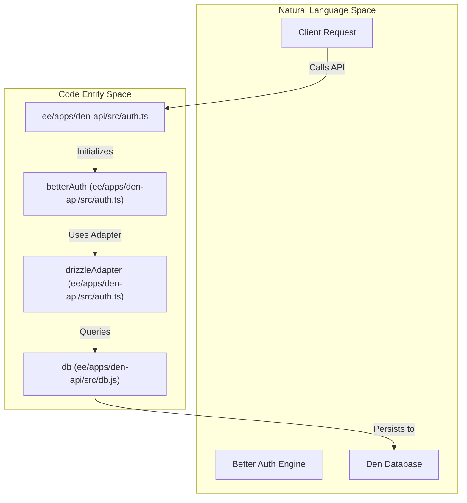
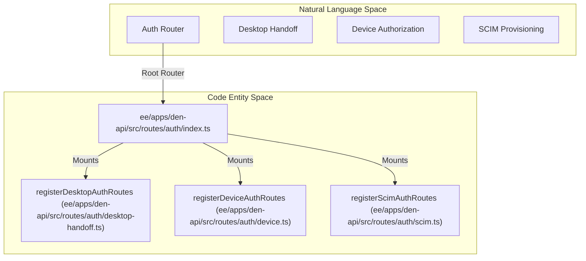
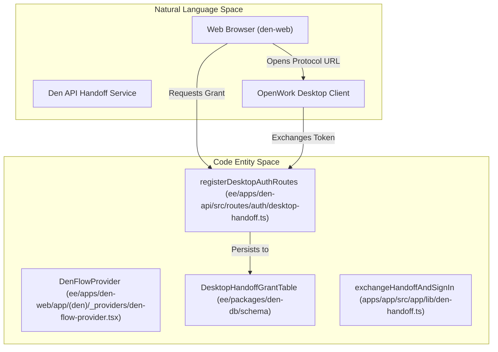

<!-- source: DeepWiki mcp.deepwiki.com · repo different-ai/openwork · extra page Authentication and Sessions · fetched 2026-10-26 -->

# Authentication and Sessions

Relevant source files

The following files were used as context for generating this wiki page:

- [apps/app/src/app/lib/den-handoff.ts](apps/app/src/app/lib/den-handoff.ts)
- [apps/app/src/app/lib/den.ts](apps/app/src/app/lib/den.ts)
- [apps/app/src/react-app/domains/cloud/den-auth-provider.tsx](apps/app/src/react-app/domains/cloud/den-auth-provider.tsx)
- [apps/app/src/react-app/domains/cloud/forced-signin-page.tsx](apps/app/src/react-app/domains/cloud/forced-signin-page.tsx)
- [apps/app/src/react-app/domains/cloud/org-onboarding-page.tsx](apps/app/src/react-app/domains/cloud/org-onboarding-page.tsx)
- [apps/app/src/react-app/domains/session/sidebar/account-status-menu.tsx](apps/app/src/react-app/domains/session/sidebar/account-status-menu.tsx)
- [apps/app/src/react-app/domains/settings/cloud/use-den-session.tsx](apps/app/src/react-app/domains/settings/cloud/use-den-session.tsx)
- [apps/app/src/react-app/shell/app-root.tsx](apps/app/src/react-app/shell/app-root.tsx)
- [ee/apps/den-api/src/auth-protection.ts](ee/apps/den-api/src/auth-protection.ts)
- [ee/apps/den-api/src/auth.ts](ee/apps/den-api/src/auth.ts)
- [ee/apps/den-api/src/orgs.ts](ee/apps/den-api/src/orgs.ts)
- [ee/apps/den-api/src/routes/admin/index.ts](ee/apps/den-api/src/routes/admin/index.ts)
- [ee/apps/den-api/src/routes/auth/index.ts](ee/apps/den-api/src/routes/auth/index.ts)
- [ee/apps/den-api/src/routes/org/core.ts](ee/apps/den-api/src/routes/org/core.ts)
- [ee/apps/den-api/src/routes/org/invitations.ts](ee/apps/den-api/src/routes/org/invitations.ts)
- [ee/apps/den-web/app/(den)/_components/install-screen.tsx](ee/apps/den-web/app/(den)/_components/install-screen.tsx)
- [ee/apps/den-web/app/(den)/_components/onboarding-shell.tsx](ee/apps/den-web/app/(den)/_components/onboarding-shell.tsx)
- [ee/apps/den-web/app/(den)/_lib/den-org.ts](ee/apps/den-web/app/(den)/_lib/den-org.ts)
- [ee/apps/den-web/app/(den)/_lib/install-download.ts](ee/apps/den-web/app/(den)/_lib/install-download.ts)
- [ee/apps/den-web/app/(den)/_lib/install-guide.ts](ee/apps/den-web/app/(den)/_lib/install-guide.ts)
- [ee/apps/den-web/app/(den)/_providers/den-flow-provider.tsx](ee/apps/den-web/app/(den)/_providers/den-flow-provider.tsx)
- [ee/apps/den-web/app/(den)/dashboard/_components/command-palette/den-command-palette.tsx](ee/apps/den-web/app/(den)/dashboard/_components/command-palette/den-command-palette.tsx)
- [ee/apps/den-web/app/(den)/dashboard/_components/manage-members-screen.tsx](ee/apps/den-web/app/(den)/dashboard/_components/manage-members-screen.tsx)
- [ee/apps/den-web/app/(den)/dashboard/_components/org-dashboard-shell.tsx](ee/apps/den-web/app/(den)/dashboard/_components/org-dashboard-shell.tsx)
- [ee/apps/den-web/app/(den)/dashboard/_lib/dashboard-navigation.ts](ee/apps/den-web/app/(den)/dashboard/_lib/dashboard-navigation.ts)
- [ee/apps/den-web/app/(den)/dashboard/_providers/org-dashboard-provider.tsx](ee/apps/den-web/app/(den)/dashboard/_providers/org-dashboard-provider.tsx)
- [ee/apps/den-web/components/den-admin-panel.tsx](ee/apps/den-web/components/den-admin-panel.tsx)
- [ee/apps/den-web/package.json](ee/apps/den-web/package.json)
- [packages/ui/src/react/download-card.tsx](packages/ui/src/react/download-card.tsx)

## Purpose and Scope

This page details the authentication, session management, and credential lifecycle systems implemented in the Den control plane (`ee/apps/den-api` and `ee/apps/den-web`). It covers the **Better Auth** integration, core authentication routes, API keys, bearer session validation, desktop handoff grants, authentication protection policies, login options resolution, and reauthentication requirements.

---

## Better Auth Integration and Core Setup

The Den platform uses **Better Auth** as its core identity framework, configured within `ee/apps/den-api/src/auth.ts`. It pairs the `betterAuth` engine with a Drizzle ORM database adapter (`drizzleAdapter`) to persist users, accounts, and sessions [ee/apps/den-api/src/auth.ts:107-116]().

Title: Better Auth Engine Initialization Flow

*   **Plugins**: The instance is extended with plugins including `organization`, `apiKey`, `sso`, `scim`, `jwt`, `emailOTP`, and `deviceAuthorization` [ee/apps/den-api/src/auth.ts:109-119]().
*   **Account Linking & Policy**: Account behavior and linking constraints are governed by configuration modules such as `DEN_ACCOUNT_CONFIG` [ee/apps/den-api/src/auth.ts:47]().

Sources: [ee/apps/den-api/src/auth.ts:47](), [ee/apps/den-api/src/auth.ts:107-119]()

---

## Auth Routes and Route Registry

Authentication endpoints are mounted under `ee/apps/den-api/src/routes/auth/index.ts`. This module coordinates standard authentication endpoints and registers specialized sub-routers.

Title: Auth Routing Architecture

*   **Desktop Handoff Sub-routes**: Handled via `registerDesktopAuthRoutes` for bridging browser sign-ins to local Electron clients [ee/apps/den-api/src/routes/auth/index.ts:49]().
*   **Device Authorization**: Registered via `registerDeviceAuthRoutes` [ee/apps/den-api/src/routes/auth/index.ts:52]().
*   **SCIM Endpoints**: Mounted via `registerScimAuthRoutes` to support enterprise user provisioning [ee/apps/den-api/src/routes/auth/index.ts:55]().

Sources: [ee/apps/den-api/src/routes/auth/index.ts:49-55]()

---

## Bearer Sessions and Token Validation

Sessions are managed through cryptographically signed cookies and bearer tokens. The session middleware resolves the active user and session context for incoming API requests.

*   **Session Resolution**: `getRequestSession` and `readSignedSessionCookieToken` parse and validate session credentials from incoming requests [ee/apps/den-api/src/routes/auth/index.ts:45]().
*   **Revocation**: `revokeBearerSession` and `revokeMembershipSessionCredentials` invalidate active sessions upon logout or security events [ee/apps/den-api/src/routes/auth/index.ts:45](), [ee/apps/den-api/src/auth.ts:66]().
*   **Lifetimes**: Default session lifetimes and rolling update windows are configured via `DEN_SESSION_EXPIRES_IN_SECONDS` and `DEN_SESSION_UPDATE_AGE_IN_SECONDS` [ee/apps/den-api/src/auth.ts:44-46]().

Sources: [ee/apps/den-api/src/routes/auth/index.ts:45](), [ee/apps/den-api/src/auth.ts:44-46](), [ee/apps/den-api/src/auth.ts:66]()

---

## API Keys

API keys provide programmatic access to Den APIs for integrations, CI/CD runners, and headless agents.

*   **Generation and Prefixes**: Keys utilize defaults defined by `DEN_API_KEY_DEFAULT_PREFIX` [ee/apps/den-api/src/auth.ts:59]() and have bounded validity (`DEN_API_KEY_EXPIRES_IN_DAYS` / `DEN_API_KEY_EXPIRES_IN_SECONDS`) [ee/apps/den-api/src/auth.ts:60-61]().
*   **Rate Limiting**: API key execution is governed by rate limit constants (`DEN_API_KEY_RATE_LIMIT_MAX` and `DEN_API_KEY_RATE_LIMIT_TIME_WINDOW_MS`) [ee/apps/den-api/src/auth.ts:62-63]().
*   **Revocation**: Organization keys associated with members can be systematically revoked via `revokeOrganizationApiKeysForMember` [ee/apps/den-api/src/auth.ts:64]().

Sources: [ee/apps/den-api/src/auth.ts:59-64]()

---

## Desktop Handoff Grants

The desktop handoff mechanism allows users signing in via a web browser to securely transfer their authenticated session to the OpenWork Desktop Electron client using deep links (`openwork://`).

Title: Desktop Handoff Data Flow

*   **Grant Creation & Exchange**: Implemented in `ee/apps/den-api/src/routes/auth/desktop-handoff.ts`, managing temporary grants stored in `DesktopHandoffGrantTable`.
*   **Client Handoff Integration**: Handled on the client side via state providers and handoff handlers in `ee/apps/den-web/app/(den)/_providers/den-flow-provider.tsx` [ee/apps/den-web/app/(den)/_providers/den-flow-provider.tsx:31-34]().

Sources: [ee/apps/den-web/app/(den)/_providers/den-flow-provider.tsx:31-34]()

---

## Auth-Protection, Login Options, and Reauth

### Auth Protection
The backend provides hardening features against brute-force attacks and credential stuffing, managed via `ee/apps/den-api/src/auth-protection.ts` (exposed through `ee/apps/den-api/src/routes/auth/index.ts`) [ee/apps/den-api/src/routes/auth/index.ts:12-20](). This includes rate-limiting email sign-in attempts, evaluating password complexity, and enforcing lockout responses.

### Login Options
Login options and email normalization logic are managed in `ee/apps/den-api/src/auth-login-options.ts` [ee/apps/den-api/src/auth.ts:104](). This module resolves whether a user should authenticate via standard password, external SSO, or specific identity providers based on their email domain and organization configuration.

### Reauthentication
When sensitive operations occur (such as updating organization or workspace security settings), the frontend enforces reauthentication. If a session requires step-up verification or has expired, a `ReauthRequiredError` is thrown by `ee/apps/den-web/app/(den)/_providers/den-flow-provider.tsx`, prompting the user to confirm their credentials.

Sources: [ee/apps/den-api/src/routes/auth/index.ts:12-20](), [ee/apps/den-api/src/auth.ts:104](), [ee/apps/den-web/app/(den)/_providers/den-flow-provider.tsx]()

---

