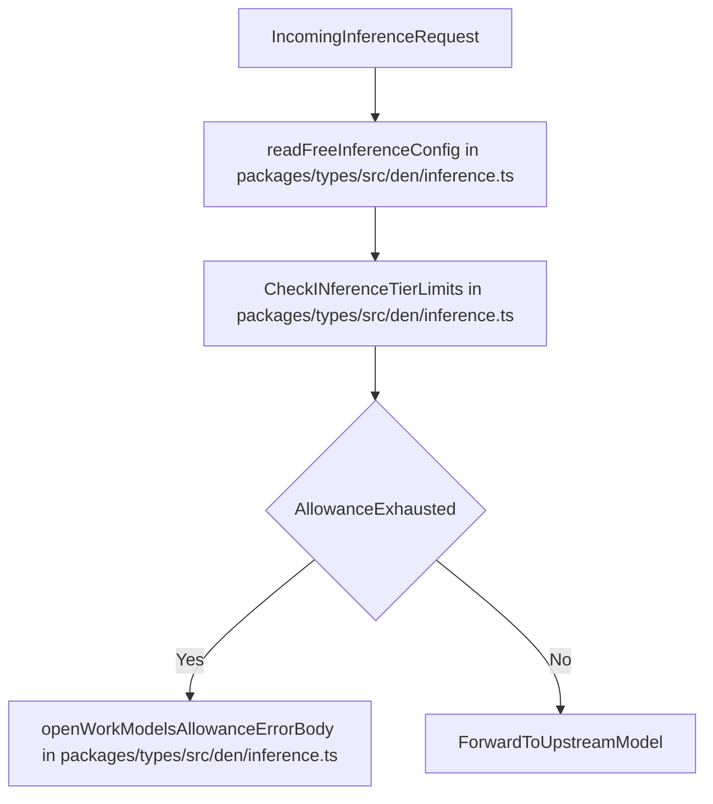
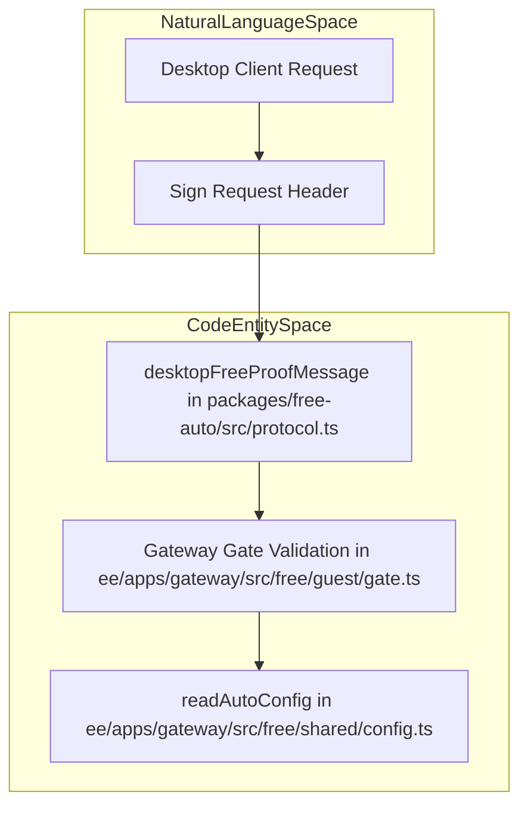
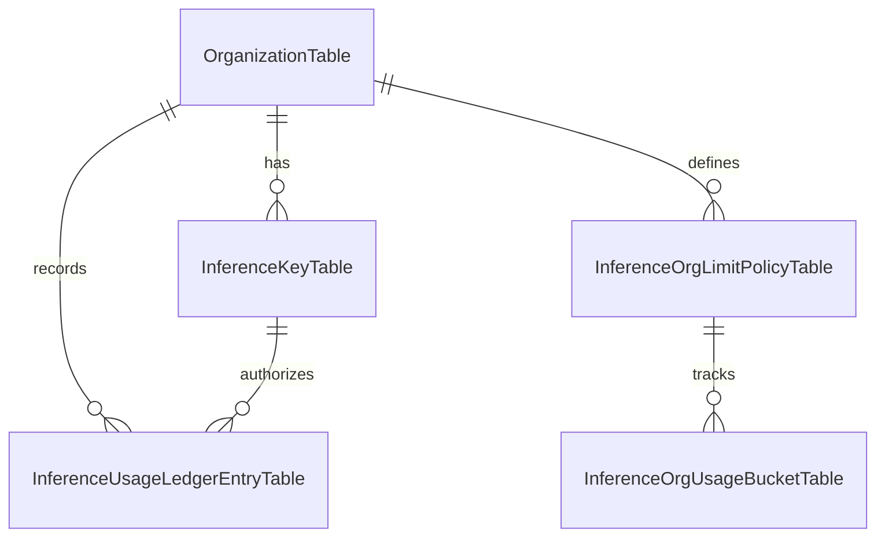
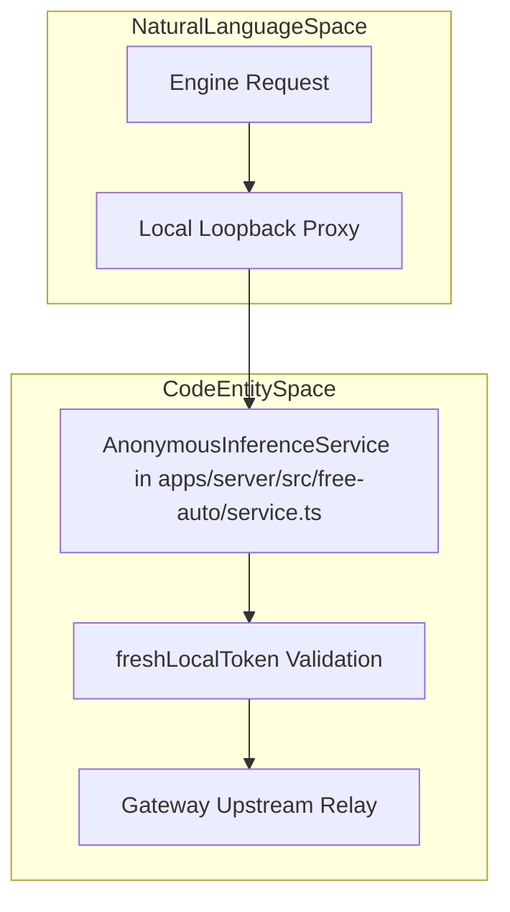

<!-- source: DeepWiki mcp.deepwiki.com · repo different-ai/openwork · extra page Free Auto Accounting and Admin · fetched 2026-10-26 -->

# Free Auto Accounting and Admin

<details>
<summary>Relevant source files</summary>

The following files were used as context for generating this wiki page:

- [apps/app/src/react-app/domains/cloud/auto-access-ui.tsx](apps/app/src/react-app/domains/cloud/auto-access-ui.tsx)
- [apps/app/src/react-app/domains/cloud/gateway-usage-panel.tsx](apps/app/src/react-app/domains/cloud/gateway-usage-panel.tsx)
- [ee/apps/den-api/src/audit/routes/platform.ts](ee/apps/den-api/src/audit/routes/platform.ts)
- [ee/apps/den-api/src/llm/inference-provider-config.ts](ee/apps/den-api/src/llm/inference-provider-config.ts)
- [ee/apps/den-api/src/routes/admin/README.md](ee/apps/den-api/src/routes/admin/README.md)
- [ee/apps/den-api/src/routes/admin/opportunities.ts](ee/apps/den-api/src/routes/admin/opportunities.ts)
- [ee/apps/den-api/src/routes/admin/opportunity-companies.ts](ee/apps/den-api/src/routes/admin/opportunity-companies.ts)
- [ee/apps/den-api/src/routes/admin/opportunity-signals.ts](ee/apps/den-api/src/routes/admin/opportunity-signals.ts)
- [ee/apps/den-api/test/api/admin-opportunities.api.test.ts](ee/apps/den-api/test/api/admin-opportunities.api.test.ts)
- [ee/apps/den-web/app/(den)/dashboard/_components/inference-provider-request.ts](ee/apps/den-web/app/(den)/dashboard/_components/inference-provider-request.ts)
- [ee/apps/den-web/app/admin/opportunities/companies/page.tsx](ee/apps/den-web/app/admin/opportunities/companies/page.tsx)
- [ee/apps/den-web/app/admin/opportunities/page.tsx](ee/apps/den-web/app/admin/opportunities/page.tsx)
- [ee/apps/den-web/components/admin/admin-opportunities-page.tsx](ee/apps/den-web/components/admin/admin-opportunities-page.tsx)
- [ee/apps/den-web/components/admin/admin-opportunity-labels.tsx](ee/apps/den-web/components/admin/admin-opportunity-labels.tsx)
- [ee/apps/den-web/components/admin/admin-opportunity-nav.tsx](ee/apps/den-web/components/admin/admin-opportunity-nav.tsx)
- [ee/apps/gateway/README.md](ee/apps/gateway/README.md)
- [ee/apps/gateway/src/early-response.ts](ee/apps/gateway/src/early-response.ts)
- [ee/apps/gateway/src/env.ts](ee/apps/gateway/src/env.ts)
- [ee/apps/gateway/src/free/shared/dispatch.ts](ee/apps/gateway/src/free/shared/dispatch.ts)
- [ee/apps/gateway/src/gateway.ts](ee/apps/gateway/src/gateway.ts)
- [ee/apps/gateway/src/http-server.ts](ee/apps/gateway/src/http-server.ts)
- [ee/apps/gateway/src/protocols.ts](ee/apps/gateway/src/protocols.ts)
- [ee/apps/gateway/src/provider-access.ts](ee/apps/gateway/src/provider-access.ts)
- [ee/apps/gateway/src/proxy.ts](ee/apps/gateway/src/proxy.ts)
- [ee/apps/gateway/src/request-log.ts](ee/apps/gateway/src/request-log.ts)
- [ee/apps/gateway/src/server.ts](ee/apps/gateway/src/server.ts)
- [ee/apps/gateway/src/shutdown.ts](ee/apps/gateway/src/shutdown.ts)
- [evals/packages/env/src/inference.ts](evals/packages/env/src/inference.ts)
- [evals/packages/labs/src/mock-inference.ts](evals/packages/labs/src/mock-inference.ts)
- [packages/types/src/den/admin-organization.ts](packages/types/src/den/admin-organization.ts)
- [packages/types/src/den/inference.ts](packages/types/src/den/inference.ts)

</details>


## Purpose and Scope
This page details the implementation of OpenWork's **Free Auto** inference capabilities, covering gateway configuration, allowance ramping, client proof-of-work guest sessions, inference schema tables, the server-side local relay service, and the admin usage dashboard.

---

## 1. Gateway Configuration and Allowance Ramping

The Gateway enforces configuration limits and dynamic allowance scaling via `readFreeInferenceConfig` [packages/types/src/den/inference.ts:184-193]() and associated window policies. It parses environment variables such as `INFERENCE_FREE_ENABLED`, `INFERENCE_FREE_WEEKLY_BUDGET_USD`, and `INFERENCE_FREE_MODEL_ID` [packages/types/src/den/inference.ts:171-175]().

Sliding window limits are defined across tiers (`tier1` and `tier2`) and window types (`five_hour`, `weekly`, `monthly`) [packages/types/src/den/inference.ts:14-38]():

```typescript
export const INFERENCE_TIER_LIMITS: Record<
  InferenceTier,
  Record<InferenceWindowType, number>
> = {
  tier1: {
    five_hour: 100_000_000,
    weekly: 500_000_000,
    monthly: 1_000_000_000,
  },
  tier2: {
    five_hour: 150_000_000,
    weekly: 750_000_000,
    monthly: 1_500_000_000,
  },
} as const;
```

When an allowance is exhausted, the gateway responds with a `429` status code and structured headers using `openWorkModelsAllowanceErrorBody` [packages/types/src/den/inference.ts:79-89]() to prevent recursive engine retries.

Title: Gateway Allowance Evaluation and Configuration Flow

Sources: [packages/types/src/den/inference.ts:14-193]()

---

## 2. Proof-of-Work Guest Sessions & Desktop Signing Protocol

Signed-out desktop clients and official builds interact with the Gateway using cryptographically signed headers defined in `packages/free-auto/src/protocol.ts` [packages/free-auto/src/protocol.ts:8-66]().

### Protocol Constants and Headers
- `DESKTOP_FREE_PROOF_HEADER`: `"x-openwork-desktop-proof"` [packages/free-auto/src/protocol.ts:8-8]()
- `DESKTOP_FREE_TOKEN_HEADER`: `"x-openwork-desktop-token"` [packages/free-auto/src/protocol.ts:9-9]()
- `DESKTOP_FREE_PROVIDER_ID`: `"openwork-free"` [packages/free-auto/src/protocol.ts:10-10]()
- `DESKTOP_FREE_MODEL_ID`: `"openai/gpt-6-luna"` [packages/free-auto/src/protocol.ts:11-11]()

Version 3 of the proof claims includes a `releaseTag` computed via an HMAC over request payloads, allowing the Gateway to enforce minimum version requirements and block unsupported binaries:

```typescript
export type DesktopFreeProofClaims = 
  | (DesktopFreeProofBase & { version: 2 }) 
  | (DesktopFreeProofBase & { version: 3; releaseTag: string });
```

Title: Free Auto Request Verification Architecture

Sources: [packages/free-auto/src/protocol.ts:8-66](), [ee/apps/gateway/src/free/shared/config.ts:9-86]()

---

## 3. Inference Database Schema Tables

Inference tracking, quota limits, usage buckets, and cost ledgers are modeled using Drizzle ORM schemas.

| Table Name | Code Symbol | Role |
| :--- | :--- | :--- |
| `inference_keys` | `InferenceKeyTable` | Stores API keys (`ow_inf_`) issued to organization members [ee/packages/den-db/src/schema/inference.ts:40-62]() |
| `inference_org_limit_policies` | `InferenceOrgLimitPolicyTable` | Configures sliding window limits and reset strategies per organization [ee/packages/den-db/src/schema/inference.ts:64-82]() |
| `inference_org_usage_buckets` | `InferenceOrgUsageBucketTable` | Tracks current consumption amounts within active time windows [ee/packages/den-db/src/schema/inference.ts:84-108]() |
| `inference_org_upstream_provider_keys` | `InferenceOrgUpstreamProviderKeyTable` | Encrypted upstream credentials (e.g., OpenRouter, OpenAI) [ee/packages/den-db/src/schema/inference.ts:111-133]() |
| `inference_usage_ledger_entries` | `InferenceUsageLedgerEntryTable` | Granular ledger recording token counts, costs, and request metadata [ee/packages/den-db/src/schema/inference.ts:135-166]() |

Title: Inference Database Schema Entity Relationships

Sources: [ee/packages/den-db/src/schema/inference.ts:40-166]()

---

## 4. Server-Side Local Relay & Identity Management

The local sidecar exposes `AnonymousInferenceService` to proxy engine requests securely over loopback.

```typescript
export class AnonymousInferenceService {
  private localAccessToken = freshLocalToken();
  private relayPrincipal: string | null = null;
  // ... manages token rotation, member sessions, and active task activation
}
```

The service coordinates between local engine calls authenticated via `owf_local_` tokens and remote Gateway requests authenticated via Den-issued `ow_inf_` credentials or anonymous proof-of-work sessions [apps/server/src/free-auto/service.ts:35-40]().

Title: Local Relay and Inference Dispatch Architecture

Sources: [apps/server/src/free-auto/service.ts:35-119]()

---

## 5. Admin Free-Auto Usage Dashboard

Enterprise administrators monitor consumption patterns through the admin panel implemented in `ee/apps/den-web/components/admin/admin-opportunities-page.tsx` [ee/apps/den-web/components/admin/admin-opportunities-page.tsx:30-102]() and backend endpoints under `ee/apps/den-api/src/routes/admin/opportunities.ts` [ee/apps/den-api/src/routes/admin/opportunities.ts:49-92]().

The dashboard aggregates organization metrics, including active users, token ratios, spend per person, and weekly limit saturation as defined by `adminOrganizationUsageSchema` [packages/types/src/den/admin-organization.ts:22-27]() and `adminDashboardSchema` [packages/types/src/den/admin-organization.ts:33-40]().

### Key Data Structures and Endpoints
- `GET /v1/admin/opportunities`: Organization adoption signals and usage metrics [ee/apps/den-api/src/routes/admin/README.md:9-9]()
- `GET /v1/admin/free-auto/usage`: Free Auto aggregate consumption reporting across all organizations [ee/apps/den-api/src/routes/admin/README.md:8-8]()

Sources: [packages/types/src/den/admin-organization.ts:17-40](), [ee/apps/den-api/src/routes/admin/opportunities.ts:49-92](), [ee/apps/den-web/components/admin/admin-opportunities-page.tsx:30-102]()

---

