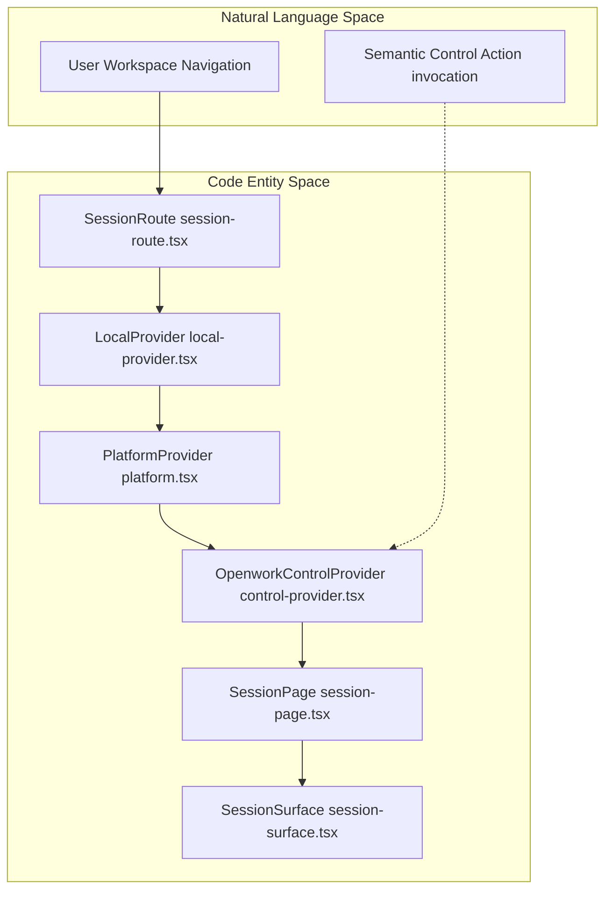
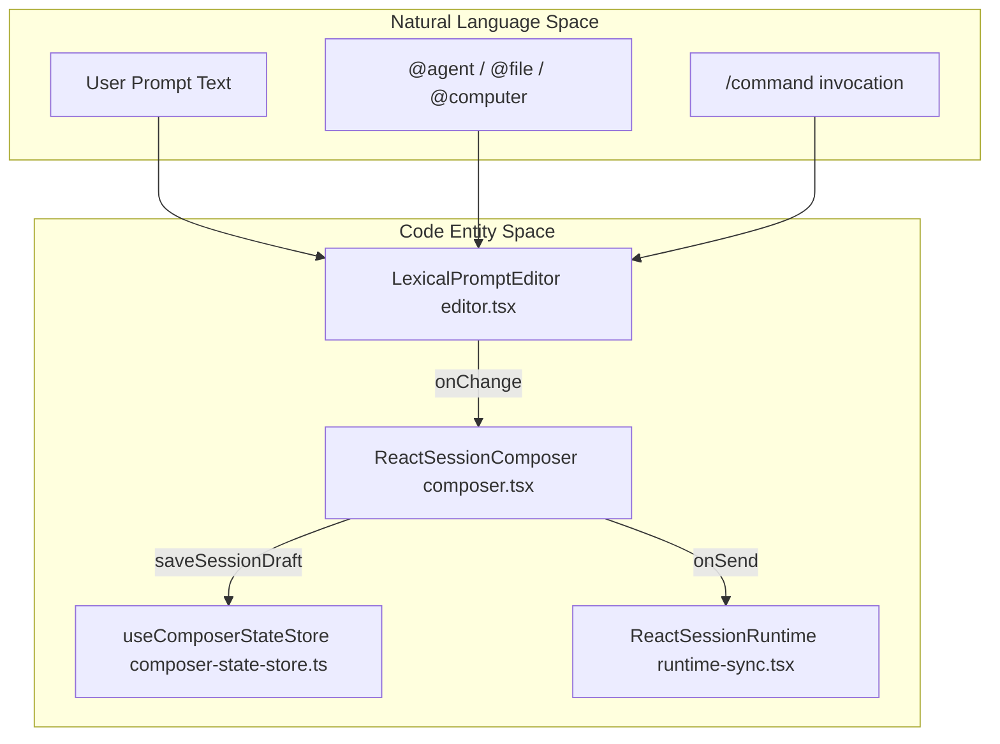

<!-- source: DeepWiki mcp.deepwiki.com · repo different-ai/openwork · extra page Frontend Architecture · fetched 2026-10-26 -->

# Frontend Architecture

Relevant source files

The following files were used as context for generating this wiki page:

- [apps/app/dev-den-proxy.ts](apps/app/dev-den-proxy.ts)
- [apps/app/src/app/lib/feedback.ts](apps/app/src/app/lib/feedback.ts)
- [apps/app/src/app/lib/manual-auth-input.ts](apps/app/src/app/lib/manual-auth-input.ts)
- [apps/app/src/app/utils/index.ts](apps/app/src/app/utils/index.ts)
- [apps/app/src/react-app/domains/cloud/enterprise-activation-gate.tsx](apps/app/src/react-app/domains/cloud/enterprise-activation-gate.tsx)
- [apps/app/src/react-app/domains/cloud/open-browser-auth.ts](apps/app/src/react-app/domains/cloud/open-browser-auth.ts)
- [apps/app/src/react-app/shell/loading-overlay.tsx](apps/app/src/react-app/shell/loading-overlay.tsx)
- [apps/app/src/react-app/shell/org-onboarding-visibility.ts](apps/app/src/react-app/shell/org-onboarding-visibility.ts)
- [apps/app/vite.config.ts](apps/app/vite.config.ts)
- [apps/desktop/electron/open-external.mjs](apps/desktop/electron/open-external.mjs)
- [apps/desktop/test/open-external.test.mjs](apps/desktop/test/open-external.test.mjs)
- [ee/apps/landing/README.md](ee/apps/landing/README.md)
- [ee/apps/landing/app/api/_lib/security.ts](ee/apps/landing/app/api/_lib/security.ts)
- [ee/apps/landing/app/api/app-feedback/route.ts](ee/apps/landing/app/api/app-feedback/route.ts)
- [ee/apps/landing/app/api/enterprise-contact/route.ts](ee/apps/landing/app/api/enterprise-contact/route.ts)
- [ee/apps/landing/app/feedback/page.tsx](ee/apps/landing/app/feedback/page.tsx)
- [ee/apps/landing/components/app-feedback-form.tsx](ee/apps/landing/components/app-feedback-form.tsx)
- [ee/apps/landing/package.json](ee/apps/landing/package.json)
- [packages/email/src/templates/feedback.tsx](packages/email/src/templates/feedback.tsx)
- [packages/email/src/templates/password-reset.tsx](packages/email/src/templates/password-reset.tsx)
- [packages/email/src/templates/verification.tsx](packages/email/src/templates/verification.tsx)
- [scripts/create-daytona-openwork-snapshot.sh](scripts/create-daytona-openwork-snapshot.sh)

## Purpose and Scope

This document describes the internal architecture of OpenWork's desktop client frontend (`apps/app`), which is built on **React** and bundled using **Vite**. It details the structural division between shell, domains, and kernel layers, context providers, control actions, Zustand stores, client-side routing, and the input composer.

**Sources:** [apps/app/src/react-app/shell/session-route.tsx:1-9](), [apps/app/src/react-app/kernel/local-provider.tsx:1-50]()

---

## Technology Stack

The frontend relies on a modern React ecosystem tailored for local-first desktop integration:

| Technology | Purpose | Key Files |
|------------|---------|-----------|
| **React** | UI Component Framework (`react-jsx`) | [apps/app/src/react-app/shell/session-route.tsx:1-3]() |
| **Zustand** | Granular state management for sidebar, sessions, and stores | [apps/app/src/react-app/domains/session/sidebar/session-management-store.ts:130-136]() |
| **React Router** | Client-side routing and navigation | [apps/app/src/react-app/shell/session-route.tsx:9-9]() |
| **Tailwind CSS** | Styling and design tokens | [apps/app/vite.config.ts:118-118]() |
| **Lexical** | Rich text editor framework for the prompt composer | [apps/app/src/react-app/domains/session/surface/composer/composer.tsx:24-24]() |
| **OpenCode SDK** | Communication layer with the local/remote engine | [apps/app/src/app/utils/index.ts:1-7]() |
| **Vite** | Fast frontend build and bundling system | [apps/app/vite.config.ts:1-30]() |

**Sources:** [apps/app/src/react-app/domains/session/sidebar/session-management-store.ts:130-151](), [apps/app/src/react-app/domains/session/surface/composer/composer.tsx:24-35](), [apps/app/vite.config.ts:1-25]()

---

## Structural Layers: Shell vs Domains vs Kernel

The `apps/app/src/react-app` codebase is divided into three distinct architectural layers to separate global chrome, business features, and platform primitives:

1. **Shell (`apps/app/src/react-app/shell/`)**: Manages the application frame, routing entry points (`session-route.tsx`), top-level layout, control action registrations, and global bootstrap state.
2. **Domains (`apps/app/src/react-app/domains/`)**: Encapsulates self-contained functional feature areas (e.g., session handling, cloud integration, enterprise activation), containing their own UI components, state stores, and hooks.
3. **Kernel (`apps/app/src/react-app/kernel/`)**: Provides low-level platform bridges, local-provider context, runtime environment checks, and model/storage configuration utilities.

**Sources:** [apps/app/src/react-app/shell/session-route.tsx:90-110](), [apps/app/src/react-app/kernel/local-provider.tsx:1-30](), [apps/app/src/react-app/domains/cloud/enterprise-activation-gate.tsx:33-40]()

---

## Providers, Control Actions, and Routing

### Application Entry Point and Shell

The application wraps its component tree in a hierarchy of context providers that inject local server clients, platform interfaces, and control action registries.

**Diagram: Shell Provider Hierarchy and Control Bridge**

**Key Providers and Actions:**
- **`LocalProvider`**: Supplies local runtime capabilities and backend bindings [apps/app/src/react-app/kernel/local-provider.tsx:1-40]().
- **`PlatformProvider`**: Exposes desktop vs. web platform abstractions [apps/app/src/react-app/kernel/platform.tsx:1-30]().
- **`OpenworkControlProvider`**: Registers and dispatches `OpenworkControlAction` commands across the shell [apps/app/src/react-app/shell/loading-overlay.tsx:30-45]().

**Sources:** [apps/app/src/react-app/shell/session-route.tsx:90-110](), [apps/app/src/react-app/shell/loading-overlay.tsx:30-45](), [apps/app/src/react-app/kernel/local-provider.tsx:1-40]()

---

## State Management Architecture (Zustand Stores)

OpenWork avoids prop-drilling by utilizing localized Zustand stores for high-frequency or asynchronous UI state across domains.

### Key Stores
- **`sessionManagementStore`**: Manages session sidebar lists, grouping definitions, pinning, and ordering state [apps/app/src/react-app/domains/session/sidebar/session-management-store.ts:130-136]().
- **`useComposerStateStore`**: Persists draft content, active mentions, and attachments across route switches [apps/app/src/react-app/domains/session/surface/composer-state-store.ts:1-30]().
- **`createConnectionsStore` & `createProviderAuthStore`**: Handles model provider authentication, API keys, and external MCP status [apps/app/src/app/utils/index.ts:26-40]().

**Sources:** [apps/app/src/react-app/domains/session/sidebar/session-management-store.ts:130-148](), [apps/app/src/react-app/domains/session/surface/composer-state-store.ts:1-40](), [apps/app/src/app/utils/index.ts:26-40]()

---

## Composer and Input Architecture

The Message Composer is built on the Lexical text editor framework, supporting rich tokenization for mentions (`@agent`, `@file`, `@computer`), slash commands, and file attachments.

**Diagram: Input Data Flow from Composer to Runtime**

### Implementation Details
- **Mention Encoding**: Mentions are serialized and deserialized using helper utilities and model reference parsers [apps/app/src/app/utils/index.ts:9-20]().
- **Editor Commands**: Custom Lexical nodes manage specialized inline badges and structured tokens within prompt editing contexts [apps/app/src/react-app/domains/session/surface/composer/composer.tsx:24-35]().

**Sources:** [apps/app/src/react-app/domains/session/surface/composer/composer.tsx:24-35](), [apps/app/src/app/utils/index.ts:9-20]()

---

## Vite Build System Configuration

The `apps/app` package builds via Vite, producing static assets embedded within the Electron main process or served by the OpenWork server sidecar.

- **Config File**: Located at `apps/app/vite.config.ts`, configuring React plugins, path aliases (`@/`), and output targets [apps/app/vite.config.ts:98-150]().
- **Asset Pipeline**: Bundles all React components, CSS modules, and localization dictionaries into optimized distribution chunks with React compiler integration [apps/app/vite.config.ts:107-124]().

**Sources:** [apps/app/vite.config.ts:98-150]()

---

