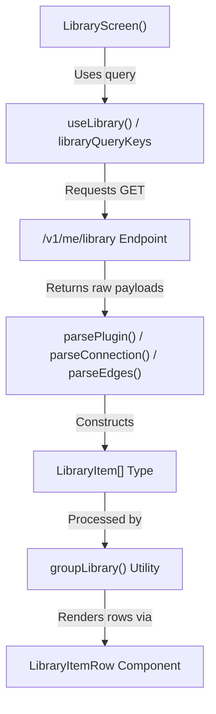
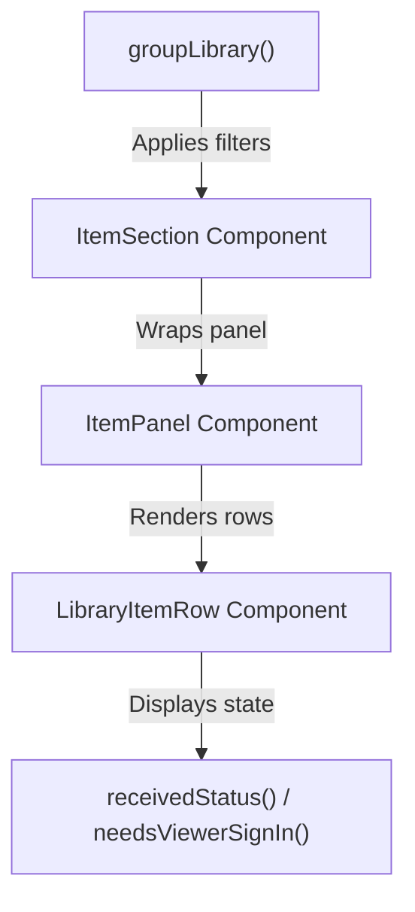
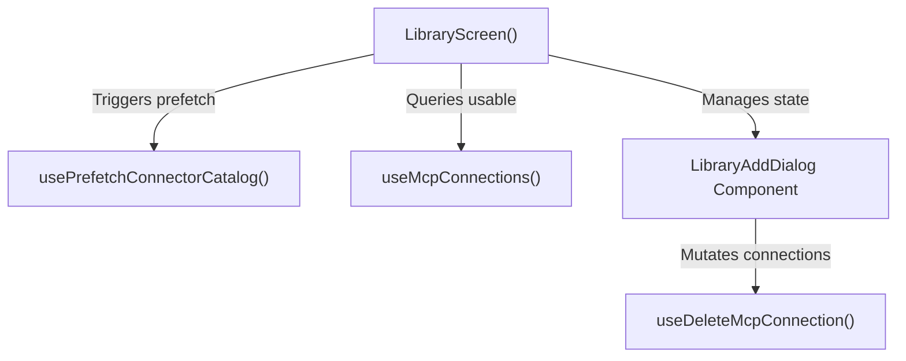

<!-- source: DeepWiki mcp.deepwiki.com · repo different-ai/openwork · extra page Library and Sharing Screens · fetched 2026-10-26 -->

# Library and Sharing Screens

Relevant source files

The following files were used as context for generating this wiki page:

- [ee/apps/den-web/app/(den)/_components/setup-frame.module.css](ee/apps/den-web/app/(den)/_components/setup-frame.module.css)
- [ee/apps/den-web/app/(den)/_components/setup-frame.tsx](ee/apps/den-web/app/(den)/_components/setup-frame.tsx)
- [ee/apps/den-web/app/(den)/_components/ui/badge.tsx](ee/apps/den-web/app/(den)/_components/ui/badge.tsx)
- [ee/apps/den-web/app/(den)/_components/ui/brand-mark.tsx](ee/apps/den-web/app/(den)/_components/ui/brand-mark.tsx)
- [ee/apps/den-web/app/(den)/_components/ui/dashboard-page-template.tsx](ee/apps/den-web/app/(den)/_components/ui/dashboard-page-template.tsx)
- [ee/apps/den-web/app/(den)/_components/ui/option-card.tsx](ee/apps/den-web/app/(den)/_components/ui/option-card.tsx)
- [ee/apps/den-web/app/(den)/_components/ui/section-header.tsx](ee/apps/den-web/app/(den)/_components/ui/section-header.tsx)
- [ee/apps/den-web/app/(den)/_components/ui/table.tsx](ee/apps/den-web/app/(den)/_components/ui/table.tsx)
- [ee/apps/den-web/app/(den)/_lib/brand-icon.ts](ee/apps/den-web/app/(den)/_lib/brand-icon.ts)
- [ee/apps/den-web/app/(den)/dashboard/_components/dashboard-overview-screen.tsx](ee/apps/den-web/app/(den)/dashboard/_components/dashboard-overview-screen.tsx)
- [ee/apps/den-web/app/(den)/dashboard/_components/integration-icon.tsx](ee/apps/den-web/app/(den)/dashboard/_components/integration-icon.tsx)
- [ee/apps/den-web/app/(den)/dashboard/_components/library-data.tsx](ee/apps/den-web/app/(den)/dashboard/_components/library-data.tsx)
- [ee/apps/den-web/app/(den)/dashboard/_components/library-models-ui.tsx](ee/apps/den-web/app/(den)/dashboard/_components/library-models-ui.tsx)
- [ee/apps/den-web/app/(den)/dashboard/_components/library-screen.tsx](ee/apps/den-web/app/(den)/dashboard/_components/library-screen.tsx)
- [ee/apps/den-web/app/(den)/dashboard/_components/library-view.ts](ee/apps/den-web/app/(den)/dashboard/_components/library-view.ts)
- [ee/apps/den-web/app/(den)/dashboard/_components/marketplace-onboarding-screen.tsx](ee/apps/den-web/app/(den)/dashboard/_components/marketplace-onboarding-screen.tsx)
- [ee/apps/den-web/app/(den)/dashboard/_components/member-dashboard-screen.tsx](ee/apps/den-web/app/(den)/dashboard/_components/member-dashboard-screen.tsx)
- [ee/apps/den-web/app/(den)/dashboard/_components/onboarding-teammates-screen.tsx](ee/apps/den-web/app/(den)/dashboard/_components/onboarding-teammates-screen.tsx)
- [ee/apps/den-web/app/(den)/dashboard/_components/onboarding-tools-screen.tsx](ee/apps/den-web/app/(den)/dashboard/_components/onboarding-tools-screen.tsx)
- [evals/worlds/signup-workspace.ts](evals/worlds/signup-workspace.ts)

## Purpose and Scope

This page documents the technical implementation of the Library and Sharing screens within the Den enterprise control plane (`ee/apps/den-web`). These screens provide the web interface for managing AI connectors, skills, plugins, workflows, and model preferences. They handle item listing, grouping, real-time synchronization, connector catalog browsing, and enterprise resource sharing across organization members and teams.

Sources: [ee/apps/den-web/app/(den)/dashboard/_components/library-screen.tsx:1-151](), [ee/apps/den-web/app/(den)/dashboard/_components/library-data.tsx:70-72]()

---

## Library Screen Architecture and Data Flow

The library architecture centers around `LibraryScreen` (`ee/apps/den-web/app/(den)/dashboard/_components/library-screen.tsx`), which orchestrates data fetching via TanStack Query, state filtering, grouping, and item action dispatches. The client consumes organization library items from the backend using the query key defined in `libraryQueryKeys` (`ee/apps/den-web/app/(den)/dashboard/_components/library-data.tsx`).

*Figure 5.3.1-1: Library data fetching, parsing, and rendering pipeline bridging natural language domain concepts to code entities.*

Sources: [ee/apps/den-web/app/(den)/dashboard/_components/library-screen.tsx:25-50](), [ee/apps/den-web/app/(den)/dashboard/_components/library-data.tsx:70-209](), [ee/apps/den-web/app/(den)/dashboard/_components/library-view.ts:66-96]()

---

## Item Lists and Presentation Components

The presentation layer utilizes a modular set of list primitives defined in `ee/apps/den-web/app/(den)/dashboard/_components/item-list.tsx` and utility functions in `ee/apps/den-web/app/(den)/dashboard/_components/library-view.ts`.

*Figure 5.3.1-2: Item list component hierarchy and data flow mapping display components to logic handlers.*

### Key Presentation Modules
- `ItemSection`: Renders sections with optional metadata headers and rule or card variants.
- `ItemPanel`: Provides container styling with divided or inset padding options.
- `LibraryItemRow`: Standardized row layout consisting of a logo tile, fixed-width name and readiness indicator, kind label, status lane, and action button [ee/apps/den-web/app/(den)/dashboard/_components/library-screen.tsx:58-118]().
- `groupLibrary`: Pure function that filters items by search query, type filter, and sign-in status, then splits results into `mine` and `received` groups sorted alphabetically [ee/apps/den-web/app/(den)/dashboard/_components/library-view.ts:72-96]().

Sources: [ee/apps/den-web/app/(den)/dashboard/_components/library-screen.tsx:58-131](), [ee/apps/den-web/app/(den)/dashboard/_components/library-view.ts:72-96]()

---

## Connector Catalog and Picker

The connector catalog subsystem allows members and administrators to explore available Model Context Protocol (MCP) servers, native provider integrations (e.g., Google Workspace, Microsoft 365), and custom endpoints.

*Figure 5.3.1-3: Connector catalog and connection management lifecycle.*

### Catalog and Workflow
- `LibraryScreen`: Manages dialog states for adding connectors or plugins and coordinates prefetching through `usePrefetchConnectorCatalog` [ee/apps/den-web/app/(den)/dashboard/_components/library-screen.tsx:144-155]().
- `useMcpConnections`: Fetches and tracks the active MCP connection states (`usable`, `needs_signin`, etc.) [ee/apps/den-web/app/(den)/dashboard/_components/library-screen.tsx:149]().

Sources: [ee/apps/den-web/app/(den)/dashboard/_components/library-screen.tsx:144-155](), [ee/apps/den-web/app/(den)/dashboard/_components/library-data.tsx:38-49]()

---

## Sharing Items and Access Model

Library items can be owned by the viewer or received via organization-wide, team, or direct person grants. The access classification and ownership logic reside in `ee/apps/den-web/app/(den)/dashboard/_components/library-view.ts`.

- `isOwnedByViewer`: Evaluates whether an item contains an explicit `"mine"` edge, matches an owned connection ID, or was shared by the viewer [ee/apps/den-web/app/(den)/dashboard/_components/library-view.ts:49-54]().
- `receivedStatus`: Formats human-readable provenance strings for received items (e.g., `"Everyone"`, team names, or `"From [Name]"`) [ee/apps/den-web/app/(den)/dashboard/_components/library-view.ts:57-64]().

Sources: [ee/apps/den-web/app/(den)/dashboard/_components/library-view.ts:49-64]()

---

## Library Models UI Integration

The marketplace onboarding and model configuration screens (`MarketplaceOnboardingScreen`) integrate with the library subsystem to let organizations manage inference providers (OpenWork Models vs. Bring Your Own Keys) [ee/apps/den-web/app/(den)/dashboard/_components/marketplace-onboarding-screen.tsx:17-50]().

- `MarketplaceOnboardingScreen`: Queries `/v1/inference` with organization context headers to verify model status and allows users to transition between managed models and custom provider keys [ee/apps/den-web/app/(den)/dashboard/_components/marketplace-onboarding-screen.tsx:28-40]().

Sources: [ee/apps/den-web/app/(den)/dashboard/_components/marketplace-onboarding-screen.tsx:17-104]()

---

