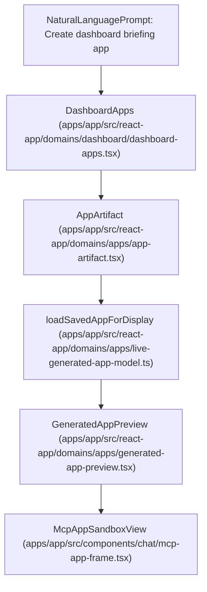
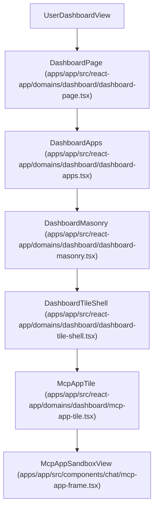

<!-- source: DeepWiki mcp.deepwiki.com · repo different-ai/openwork · extra page MCP Apps and Dashboards · fetched 2026-10-26 -->

# MCP Apps and Dashboards

<details>
<summary>Relevant source files</summary>

The following files were used as context for generating this wiki page:

- [apps/app/src/app/lib/built-mcp-app-catalog.ts](apps/app/src/app/lib/built-mcp-app-catalog.ts)
- [apps/app/src/app/lib/mcp-app-open-loads.ts](apps/app/src/app/lib/mcp-app-open-loads.ts)
- [apps/app/src/app/lib/mcp-app-result-cache.ts](apps/app/src/app/lib/mcp-app-result-cache.ts)
- [apps/app/src/app/lib/model-behavior.ts](apps/app/src/app/lib/model-behavior.ts)
- [apps/app/src/components/chat/app-builder-step.tsx](apps/app/src/components/chat/app-builder-step.tsx)
- [apps/app/src/components/chat/current-tool-lifecycle-context.tsx](apps/app/src/components/chat/current-tool-lifecycle-context.tsx)
- [apps/app/src/components/chat/mcp-app-frame.tsx](apps/app/src/components/chat/mcp-app-frame.tsx)
- [apps/app/src/components/chat/mcp-app-loading.tsx](apps/app/src/components/chat/mcp-app-loading.tsx)
- [apps/app/src/components/chat/mcp-app-origin.ts](apps/app/src/components/chat/mcp-app-origin.ts)
- [apps/app/src/react-app/domains/apps/app-actions-menu.tsx](apps/app/src/react-app/domains/apps/app-actions-menu.tsx)
- [apps/app/src/react-app/domains/apps/app-artifact.tsx](apps/app/src/react-app/domains/apps/app-artifact.tsx)
- [apps/app/src/react-app/domains/apps/app-creation-progress.ts](apps/app/src/react-app/domains/apps/app-creation-progress.ts)
- [apps/app/src/react-app/domains/apps/built-app-chat-preview.tsx](apps/app/src/react-app/domains/apps/built-app-chat-preview.tsx)
- [apps/app/src/react-app/domains/apps/built-mcp-app-model.ts](apps/app/src/react-app/domains/apps/built-mcp-app-model.ts)
- [apps/app/src/react-app/domains/apps/built-mcp-app-panel.tsx](apps/app/src/react-app/domains/apps/built-mcp-app-panel.tsx)
- [apps/app/src/react-app/domains/apps/generated-app-preview.tsx](apps/app/src/react-app/domains/apps/generated-app-preview.tsx)
- [apps/app/src/react-app/domains/apps/use-apps.ts](apps/app/src/react-app/domains/apps/use-apps.ts)
- [apps/app/src/react-app/domains/dashboard/dashboard-apps.tsx](apps/app/src/react-app/domains/dashboard/dashboard-apps.tsx)
- [apps/app/src/react-app/domains/dashboard/dashboard-page.tsx](apps/app/src/react-app/domains/dashboard/dashboard-page.tsx)
- [apps/app/src/react-app/domains/dashboard/dashboard-tile-cache.ts](apps/app/src/react-app/domains/dashboard/dashboard-tile-cache.ts)
- [apps/app/src/react-app/domains/dashboard/dashboard-tile-shell.tsx](apps/app/src/react-app/domains/dashboard/dashboard-tile-shell.tsx)
- [apps/app/src/react-app/domains/dashboard/mcp-app-tile.tsx](apps/app/src/react-app/domains/dashboard/mcp-app-tile.tsx)
- [apps/app/src/react-app/domains/dashboard/share-dashboard-button.tsx](apps/app/src/react-app/domains/dashboard/share-dashboard-button.tsx)
- [apps/app/src/react-app/domains/session/surface/use-model-behavior.ts](apps/app/src/react-app/domains/session/surface/use-model-behavior.ts)
- [apps/app/tests/global-default-model-variant.test.tsx](apps/app/tests/global-default-model-variant.test.tsx)
- [apps/app/tests/mcp-app-frame.test.ts](apps/app/tests/mcp-app-frame.test.ts)
- [apps/server/src/connect-mcp-server-catalog.ts](apps/server/src/connect-mcp-server-catalog.ts)
- [apps/server/src/mcp-app-host.ts](apps/server/src/mcp-app-host.ts)
- [apps/server/src/mcp-app-sandbox.ts](apps/server/src/mcp-app-sandbox.ts)
- [ee/apps/den-api/src/generated-artifact-view-builder.ts](ee/apps/den-api/src/generated-artifact-view-builder.ts)
- [ee/apps/den-api/src/generated-mcp-app-runtime.ts](ee/apps/den-api/src/generated-mcp-app-runtime.ts)
- [ee/apps/den-api/src/mcp/app-authoring-starter.ts](ee/apps/den-api/src/mcp/app-authoring-starter.ts)
- [ee/apps/den-api/src/mcp/build-an-app-skill.ts](ee/apps/den-api/src/mcp/build-an-app-skill.ts)
- [evals/fixtures/generated-app-theme-host.ts](evals/fixtures/generated-app-theme-host.ts)
- [evals/packages/labs/src/mock-mcp-catalog.ts](evals/packages/labs/src/mock-mcp-catalog.ts)
- [evals/proofs/generated-app-theme.proof.test.ts](evals/proofs/generated-app-theme.proof.test.ts)
- [evals/worlds/generated-app-theme.ts](evals/worlds/generated-app-theme.ts)

</details>


This page documents the architecture and implementation of Model Context Protocol (MCP) Applications and Dashboards within OpenWork. It covers client-side frame isolation and sandbox execution (`mcp-app-frame.tsx`), server-side hosting and proxy coordination (`mcp-app-host.ts`), saved apps, artifact views, opinionated app starters (`app-authoring-starter.ts`), and dashboard tiles (`mcp-app-tile.tsx`, `dashboard-apps.tsx`) with caching and sharing mechanics.

---

## 1. MCP App Frame and Sandbox Architecture

The MCP App system provides secure execution and rendering of interactive UI components returned by MCP tools. The frontend container components `McpAppSandboxView` and `McpAppFrame` utilize `@modelcontextprotocol/ext-apps` bridge abstractions (`AppBridge`, `PostMessageTransport`) to communicate via `postMessage` transports under restrictive Content Security Policies (CSP) [apps/app/src/components/chat/mcp-app-frame.tsx:1-39]().

Startup concurrency is managed globally via queue helpers (`enqueueAppStartup`, `MAX_CONCURRENT_APP_STARTUPS`) to prevent resource exhaustion during heavy rendering sequences [apps/app/src/components/chat/mcp-app-frame.tsx:48-79](). Result preservation functions (`preservedResult`, `hasPreservedMcpAppResult`, `builtMcpAppId`, `gatewayMcpAppLaunch`) extract and validate structured content payloads and metadata from tool execution parts [apps/app/src/components/chat/mcp-app-frame.tsx:101-164]().

The server component `mcp-app-host.ts` acts as the coordinator between underlying MCP tools and the UI client, managing tool results, CSP domain generation, token fingerprinting, and secure asset caching [apps/server/src/mcp-app-host.ts:1-130]().

```
+-------------------------------------------------------+
|                 McpAppSandboxView                     |
|  (apps/app/src/components/chat/mcp-app-frame.tsx)     |
+---------------------------+---------------------------+
                            | postMessage transport
                            v
+-------------------------------------------------------+
|                      AppBridge                        |
|        (@modelcontextprotocol/ext-apps/app-bridge)    |
+---------------------------+---------------------------+
                            |
                            v
+-------------------------------------------------------+
|                    McpAppHost                         |
|           (apps/server/src/mcp-app-host.ts)           |
+-------------------------------------------------------+
```

Sources: `apps/app/src/components/chat/mcp-app-frame.tsx:1-79]`, `apps/server/src/mcp-app-host.ts:1-130`

---

## 2. Natural Language Space to Code Entity Space: App Generation and Preview

This diagram maps natural language user intents to concrete code entities in OpenWork during app generation and preview rendering.



Sources: `apps/app/src/react-app/domains/dashboard/dashboard-apps.tsx:23-68]`, `apps/app/src/react-app/domains/apps/app-artifact.tsx:19-50]`, `apps/app/src/react-app/domains/apps/generated-app-preview.tsx:1-40`

---

## 3. Saved Apps, Artifact Views, and Starters

Saved apps allow users to persist generated artifact revisions and pin them to their dashboards or workspaces. 

- **App References (`AppReference`)**: Defined in `app-artifact.tsx`, containing `appId`, optional `revisionId`, and optional `receiptId`.
- **Querying & Display**: `AppArtifact` fetches saved app details using TanStack Query via `loadSavedAppForDisplay`, resolving active revisions, CSP policies, and workflow artifact payloads.
- **App Authoring Starters**: Implemented in `ee/apps/den-api/src/mcp/app-authoring-starter.ts`, `appAuthoringStarter` and `appStarterPattern` provide opinionated starters (`lookup`, `action`, `standalone`) that standardize theme usage, read-on-open mechanics, action constraints, and state components [ee/apps/den-api/src/mcp/app-authoring-starter.ts:1-93]().

Sources: `apps/app/src/react-app/domains/apps/app-artifact.tsx:19-71]`, `ee/apps/den-api/src/mcp/app-authoring-starter.ts:1-93`

---

## 4. Dashboard Tiles, Sharing, and Caching

The dashboard page hosts interactive app tiles and layout grids (`DashboardApps`, `DashboardMasonry`, `DashboardTileShell`).

- **Dashboard Page (`DashboardPage`)**: Validates authentication via `useDenAuth()`, tracks organization scoping through settings changes (`readDenSettings()`), and initializes the active deployment scope key [apps/app/src/react-app/domains/dashboard/dashboard-page.tsx:17-70]().
- **Tiles (`McpAppTile`)**: Encapsulates saved app instances, managing argument signatures (`launchArgumentsSignature`), automatic background refreshes (`DASHBOARD_AUTO_REFRESH_INTERVAL_MS`), error handling, and connection state resolution [apps/app/src/react-app/domains/dashboard/mcp-app-tile.tsx:36-155]().
- **Shell (`DashboardTileShell`)**: Provides standard headers, collapse/expand geometry, refresh triggers, and action drop-downs for individual tiles [apps/app/src/react-app/domains/dashboard/dashboard-tile-shell.tsx:1-50]().
- **Sharing**: Integrates `ShareDashboardButton` to let team members expose and share personal dashboard apps across the active organization [apps/app/src/react-app/domains/dashboard/dashboard-apps.tsx:21-68]().

Sources: `apps/app/src/react-app/domains/dashboard/dashboard-page.tsx:17-70]`, `apps/app/src/react-app/domains/dashboard/dashboard-apps.tsx:21-68]`, `apps/app/src/react-app/domains/dashboard/dashboard-tile-shell.tsx:1-50]`, `apps/app/src/react-app/domains/dashboard/mcp-app-tile.tsx:36-155`

---

## 5. Natural Language Space to Code Entity Space: Dashboard Tile Lifecycle

This diagram bridges the conceptual dashboard lifecycle to code entities involved in loading, rendering, and refreshing dashboard tiles.



Sources: `apps/app/src/react-app/domains/dashboard/dashboard-page.tsx:17-70]`, `apps/app/src/react-app/domains/dashboard/dashboard-apps.tsx:21-78]`, `apps/app/src/react-app/domains/dashboard/dashboard-tile-shell.tsx:1-50]`, `apps/app/src/react-app/domains/dashboard/mcp-app-tile.tsx:36-68`

---

