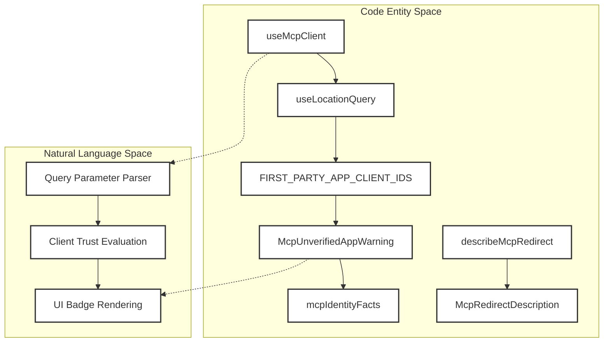
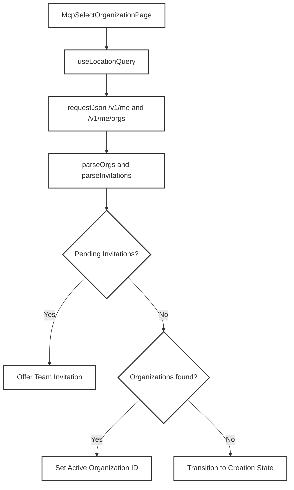

<!-- source: DeepWiki mcp.deepwiki.com · repo different-ai/openwork · extra page MCP Consent and Client Identity (den-web) · fetched 2026-10-26 -->

# MCP Consent and Client Identity (den-web)

Relevant source files

The following files were used as context for generating this wiki page:

- [ee/apps/den-api/src/sso-test-lifecycle.ts](ee/apps/den-api/src/sso-test-lifecycle.ts)
- [ee/apps/den-api/test/api/me-invitations.api.test.ts](ee/apps/den-api/test/api/me-invitations.api.test.ts)
- [ee/apps/den-web/app/api/browser/v1/[...path]/route.ts](ee/apps/den-web/app/api/browser/v1/[...path]/route.ts)
- [ee/apps/den-web/app/mcp/client-identity-model.ts](ee/apps/den-web/app/mcp/client-identity-model.ts)
- [ee/apps/den-web/app/mcp/client-identity.tsx](ee/apps/den-web/app/mcp/client-identity.tsx)
- [ee/apps/den-web/app/mcp/client-trust-constants.ts](ee/apps/den-web/app/mcp/client-trust-constants.ts)
- [ee/apps/den-web/app/mcp/consent-permissions.tsx](ee/apps/den-web/app/mcp/consent-permissions.tsx)
- [ee/apps/den-web/app/mcp/consent/page.tsx](ee/apps/den-web/app/mcp/consent/page.tsx)
- [ee/apps/den-web/app/mcp/select-organization/page.tsx](ee/apps/den-web/app/mcp/select-organization/page.tsx)
- [ee/apps/den-web/app/mcp/use-mcp-client.ts](ee/apps/den-web/app/mcp/use-mcp-client.ts)
- [ee/apps/den-web/app/sso/[orgSlug]/page.tsx](ee/apps/den-web/app/sso/[orgSlug]/page.tsx)
- [ee/apps/den-web/app/sso/test/complete/page.tsx](ee/apps/den-web/app/sso/test/complete/page.tsx)
- [ee/apps/den-web/app/sso/test/page.tsx](ee/apps/den-web/app/sso/test/page.tsx)
- [ee/apps/den-web/components/den-status-screen.tsx](ee/apps/den-web/components/den-status-screen.tsx)
- [evals/proofs/workbot-invited-teammate.proof.test.ts](evals/proofs/workbot-invited-teammate.proof.test.ts)
- [evals/worlds/workbot-invited-teammate.ts](evals/worlds/workbot-invited-teammate.ts)

## Purpose and Scope
This page details the Model Context Protocol (MCP) consent, organization selection, client trust/identity model, and OAuth client registration subsystems implemented within `ee/apps/den-web` and backed by `ee/apps/den-api`. The MCP consent architecture ensures that external MCP clients requesting access to OpenWork tools and resources undergo rigorous client verification, organization scoping, scope validation, and explicit user consent before any access tokens are minted.

Sources: `ee/apps/den-web/README.md:1-14` [ee/apps/den-web/README.md:1-14](), `ee/apps/den-web/app/mcp/select-organization/page.tsx:1-50` [ee/apps/den-web/app/mcp/select-organization/page.tsx:1-50]()

---

## Client Trust and Identity Model
When an external or first-party application initiates an MCP connection flow against the Den control plane, `ee/apps/den-web` inspects the OAuth query parameters to identify the connecting client. The client metadata—such as client name, redirect URIs, and trust status—is loaded via client hooks and constants defined in `ee/apps/den-web/app/mcp/client-trust-constants.ts` [ee/apps/den-web/app/mcp/client-trust-constants.ts:1-49]() and `ee/apps/den-web/app/mcp/client-identity-model.ts` [ee/apps/den-web/app/mcp/client-identity-model.ts:1-33]().

First-party applications (like Workbot) are distinguished from third-party tools using the `FIRST_PARTY_APP_CLIENT_IDS` registry (`ee/apps/den-web/app/mcp/client-trust-constants.ts:49-49`). For unverified or third-party clients, the UI renders explicit security warnings via `McpUnverifiedAppWarning` (`ee/apps/den-web/app/mcp/client-identity.tsx:29-57`) to notify the user of external tool invocation risks and verify redirect parameters via `describeMcpRedirect` (`ee/apps/den-web/app/mcp/client-identity-model.ts:21-33`).

*Figure 1: Client Trust and Identity resolution mapping natural language requirements to frontend hooks and constants.*

Sources: `ee/apps/den-web/app/mcp/select-organization/page.tsx:136-178` [ee/apps/den-web/app/mcp/select-organization/page.tsx:136-178](), `ee/apps/den-web/app/mcp/client-trust-constants.ts:1-49` [ee/apps/den-web/app/mcp/client-trust-constants.ts:1-49](), `ee/apps/den-web/app/mcp/client-identity.tsx:29-57` [ee/apps/den-web/app/mcp/client-identity.tsx:29-57]()

---

## Organization Selection Flow
Because MCP resources are scoped to specific organizations and workspaces within Den, any unauthenticated or organization-agnostic MCP OAuth request requires the user to select or provision an active organization context via `McpSelectOrganizationPage` (`ee/apps/den-web/app/mcp/select-organization/page.tsx:153-178`).

During the initial load of `/mcp/select-organization`, the client evaluates query parameters, parses pending invitations (`parseInvitations` at line 131), and fetches organization lists (`parseOrgs` at line 115) from `/v1/me` and `/v1/me/orgs`. If an unjoined invitation exists for the user's email, the UI presents the invitation option before prompting for a new workspace creation.

*Figure 2: Organization selection and verification flow for MCP authorization sessions.*

Sources: `ee/apps/den-web/app/mcp/select-organization/page.tsx:115-178` [ee/apps/den-web/app/mcp/select-organization/page.tsx:115-178]()

---

## Consent Granularity and Scopes
Once an organization is selected, the consent flow (`McpConsentPage` in `ee/apps/den-web/app/mcp/consent/page.tsx:55-104`) presents the requested permission scopes to the user. Better Auth and Den's custom scope normalizers govern what capabilities the client is granted.

- **Scopes:** Scopes such as `mcp:read`, `mcp:write`, and `offline_access` are parsed into plain sentences via `mcpPermissionLines` (`ee/apps/den-web/app/mcp/consent-permissions.tsx:5-13`) to dictate whether the client can query resources or execute tools.
- **Decision Handling:** The `decide` function (`ee/apps/den-web/app/mcp/consent/page.tsx:81-104`) submits the acceptance or denial status to `/api/auth/oauth2/consent` and handles resulting redirection flows.

| Scope Token | Plain Language Translation |
| :--- | :--- |
| `openid` / `profile` / `email` | See your name and email (`ee/apps/den-web/app/mcp/consent-permissions.tsx:8-8`) |
| `mcp:read` | Find and read what is in this workspace (`ee/apps/den-web/app/mcp/consent-permissions.tsx:9-9`) |
| `mcp:write` | Use your connected tools, including actions that create, change, or delete data (`ee/apps/den-web/app/mcp/consent-permissions.tsx:10-10`) |
| `offline_access` | Stay connected until you remove it (`ee/apps/den-web/app/mcp/consent-permissions.tsx:11-11`) |

Sources: `ee/apps/den-web/app/mcp/consent/page.tsx:55-154` [ee/apps/den-web/app/mcp/consent/page.tsx:55-154](), `ee/apps/den-web/app/mcp/consent-permissions.tsx:1-29` [ee/apps/den-web/app/mcp/consent-permissions.tsx:1-29]()

---

## OAuth Client Registration and Token Issuance
Registered clients in `OAuthClientTable` are checked for valid MCP scopes. The `den-api` authentication middleware verifies JWS access tokens against the issuer defined by `getDenAuthIssuer` and checks liveness claims through `getMcpGrantLiveness` and `getMcpSessionLiveness`.

Sources: `ee/apps/den-api/src/routes/auth/index.ts:109-117` [ee/apps/den-api/src/routes/auth/index.ts:109-117](), `ee/apps/den-api/src/mcp/auth.ts:25-92` [ee/apps/den-api/src/mcp/auth.ts:25-92]()

---

