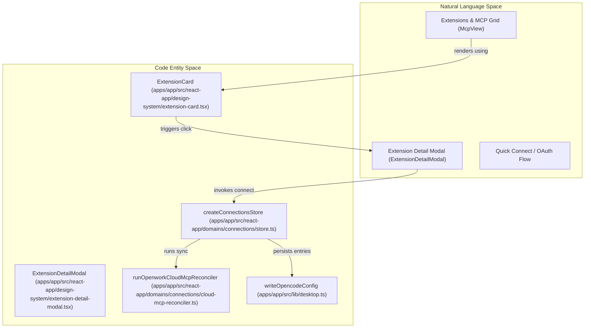
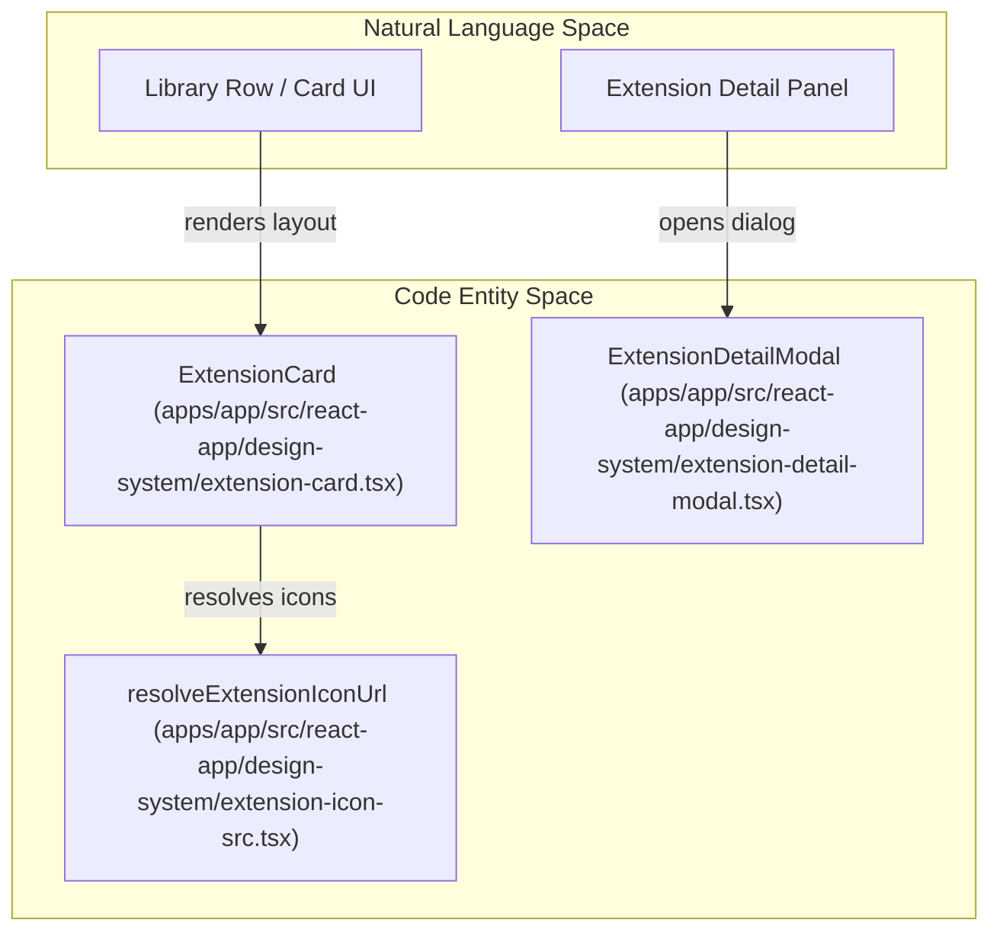

<!-- source: DeepWiki mcp.deepwiki.com · repo different-ai/openwork · extra page MCP Servers and Connections · fetched 2026-10-26 -->

# MCP Servers and Connections

<details>
<summary>Relevant source files</summary>

The following files were used as context for generating this wiki page:

- [apps/app/src/app/constants.ts](apps/app/src/app/constants.ts)
- [apps/app/src/app/extensions.ts](apps/app/src/app/extensions.ts)
- [apps/app/src/app/mcp.ts](apps/app/src/app/mcp.ts)
- [apps/app/src/app/types.ts](apps/app/src/app/types.ts)
- [apps/app/src/react-app/design-system/extension-card.tsx](apps/app/src/react-app/design-system/extension-card.tsx)
- [apps/app/src/react-app/design-system/extension-detail-modal.tsx](apps/app/src/react-app/design-system/extension-detail-modal.tsx)
- [apps/app/src/react-app/domains/connections/cloud-inventory-cache.ts](apps/app/src/react-app/domains/connections/cloud-inventory-cache.ts)
- [apps/app/src/react-app/domains/connections/cloud-mcp-reconciler.ts](apps/app/src/react-app/domains/connections/cloud-mcp-reconciler.ts)
- [apps/app/src/react-app/domains/connections/cloud-mcp-user-state.ts](apps/app/src/react-app/domains/connections/cloud-mcp-user-state.ts)
- [apps/app/src/react-app/domains/connections/mcp-auth-modal.tsx](apps/app/src/react-app/domains/connections/mcp-auth-modal.tsx)
- [apps/app/src/react-app/domains/connections/modals/add-mcp-modal.tsx](apps/app/src/react-app/domains/connections/modals/add-mcp-modal.tsx)
- [apps/app/src/react-app/domains/connections/store.ts](apps/app/src/react-app/domains/connections/store.ts)
- [apps/app/src/react-app/domains/connections/use-session-mcp-maintenance.ts](apps/app/src/react-app/domains/connections/use-session-mcp-maintenance.ts)
- [apps/app/src/react-app/domains/session/control/list-control-sessions.ts](apps/app/src/react-app/domains/session/control/list-control-sessions.ts)
- [apps/app/src/react-app/domains/session/control/session-control-actions.ts](apps/app/src/react-app/domains/session/control/session-control-actions.ts)
- [apps/app/src/react-app/domains/session/sidebar/use-session-archive.tsx](apps/app/src/react-app/domains/session/sidebar/use-session-archive.tsx)
- [apps/app/src/react-app/domains/settings/extension-registry.tsx](apps/app/src/react-app/domains/settings/extension-registry.tsx)
- [apps/app/src/react-app/domains/settings/extension-state.ts](apps/app/src/react-app/domains/settings/extension-state.ts)
- [apps/app/src/react-app/domains/settings/pages/extensions-view.tsx](apps/app/src/react-app/domains/settings/pages/extensions-view.tsx)
- [apps/app/src/react-app/domains/settings/pages/general-view.tsx](apps/app/src/react-app/domains/settings/pages/general-view.tsx)
- [apps/app/src/react-app/domains/settings/pages/mcp-view.tsx](apps/app/src/react-app/domains/settings/pages/mcp-view.tsx)
- [apps/app/src/react-app/domains/settings/settings-extension-controller.ts](apps/app/src/react-app/domains/settings/settings-extension-controller.ts)
- [apps/app/src/react-app/domains/settings/shell/settings-page.tsx](apps/app/src/react-app/domains/settings/shell/settings-page.tsx)
- [apps/app/tests/session-archive-agent-contract.test.tsx](apps/app/tests/session-archive-agent-contract.test.tsx)
- [apps/server/src/cloud-mcp-health.ts](apps/server/src/cloud-mcp-health.ts)
- [apps/server/src/connect-state.ts](apps/server/src/connect-state.ts)
- [apps/server/src/opencode-plugins/openwork-capabilities-knowledge.ts](apps/server/src/opencode-plugins/openwork-capabilities-knowledge.ts)
- [apps/server/src/opencode-plugins/openwork-extensions-preview-steering.ts](apps/server/src/opencode-plugins/openwork-extensions-preview-steering.ts)
- [apps/server/src/opencode-plugins/openwork-extensions-preview.ts](apps/server/src/opencode-plugins/openwork-extensions-preview.ts)
- [apps/server/src/opencode-plugins/openwork-provider-adapters.ts](apps/server/src/opencode-plugins/openwork-provider-adapters.ts)
- [apps/server/src/opencode-plugins/session-activity.ts](apps/server/src/opencode-plugins/session-activity.ts)
- [apps/server/src/routes/cloud-mcp.ts](apps/server/src/routes/cloud-mcp.ts)
- [apps/server/src/runtime-opencode-config-store.ts](apps/server/src/runtime-opencode-config-store.ts)
- [docs/mcp-ui-control-profile.md](docs/mcp-ui-control-profile.md)
- [ee/apps/den-api/src/mcp/builtin-skills.ts](ee/apps/den-api/src/mcp/builtin-skills.ts)
- [packages/docs/start-here/do-work-with-it/cross-chat-memory.mdx](packages/docs/start-here/do-work-with-it/cross-chat-memory.mdx)
- [packages/types/src/openwork-affordance.ts](packages/types/src/openwork-affordance.ts)

</details>


## Purpose and Scope

This page documents Model Context Protocol (MCP) server integration, local and organization-level registration, OAuth connection flows, cloud reconciliation, health monitoring, the connections store, and extension cards in OpenWork [apps/app/src/react-app/domains/connections/store.ts:115-130](). MCP servers provide external tools, resources, and context to the OpenCode engine.

- **Connections Store (`createConnectionsStore`)**: Manages real-time MCP server entries, status mappings, and synchronization with workspace configuration files [apps/app/src/react-app/domains/connections/store.ts:115-152]().
- **Extension Cards and Detail Modals (`ExtensionCard`)**: Renders items in the settings catalogs with clear status dots, taxonomies, and interactive control surfaces [apps/app/src/react-app/design-system/extension-card.tsx:70-112]().
- **OAuth Connect & Support**: Handles authenticating external providers via managed OAuth or direct token exchanges [apps/app/src/react-app/domains/connections/store.ts:103-104]().
- **Cloud MCP Reconciler**: Automatically registers and maintains cloud-managed capability endpoints when signed into OpenWork Cloud [apps/app/src/react-app/domains/connections/store.ts:58-68]().

**Sources:** [apps/app/src/react-app/domains/connections/store.ts:58-152](), [apps/app/src/react-app/design-system/extension-card.tsx:70-112]()

## Architecture: Natural Language to Code Entity Mapping

The UI components interact with state stores and configuration persistence layers to manage MCP registrations and runtime health.



**Sources:** [apps/app/src/react-app/domains/connections/store.ts:115-152](), [apps/app/src/react-app/design-system/extension-card.tsx:70-112](), [apps/app/src/react-app/design-system/extension-detail-modal.tsx:35-120]()

## Connections Store and State Management

The `createConnectionsStore` function located in `apps/app/src/react-app/domains/connections/store.ts` initializes the state container for all MCP connections, active statuses, and authentication handlers [apps/app/src/react-app/domains/connections/store.ts:115-130]().

### Snapshot Structure

The snapshot exposes the following immutable state fields to React consumers:

```typescript
export type ConnectionsStoreSnapshot = {
  mcpServers: McpServerEntry[];
  mcpStatus: string | null;
  mcpLastUpdatedAt: number | null;
  mcpStatuses: McpStatusMap;
  mcpConnectingName: string | null;
  selectedMcp: string | null;
  mcpAuthModalOpen: boolean;
  mcpAuthEntry: McpDirectoryInfo | null;
  mcpAuthNeedsReload: boolean;
  /** False when the server reports managed OAuth secure storage is unavailable. */
  managedOAuthAvailable: boolean;
};
```
*Reference: [apps/app/src/react-app/domains/connections/store.ts:93-105]()*

**Sources:** [apps/app/src/react-app/domains/connections/store.ts:93-152]()

## Extension Cards and UI Presentation

Catalog entries such as MCP servers, skills, and plugins are rendered using the `ExtensionCard` component (`apps/app/src/react-app/design-system/extension-card.tsx`) and managed via `McpView` (`apps/app/src/react-app/domains/settings/pages/mcp-view.tsx`) [apps/app/src/react-app/design-system/extension-card.tsx:70-112](), [apps/app/src/react-app/domains/settings/pages/mcp-view.tsx:1-188]().



**Key UI Behaviors:**
- **Readiness Badges**: Evaluation functions check enablement results to indicate whether an extension is fully ready, partially configured, or unconfigured [apps/app/src/react-app/design-system/extension-card.tsx:89-92]().
- **Action Slots**: Trailing buttons allow quick transitions to setup, OAuth authorization, or toggling [apps/app/src/react-app/design-system/extension-card.tsx:106-109]().

**Sources:** [apps/app/src/react-app/design-system/extension-card.tsx:70-112](), [apps/app/src/react-app/design-system/extension-detail-modal.tsx:35-120]()

## OAuth Connect Flow and Mock Services

Remote MCP servers requiring authentication implement standard OAuth 2.0 authorization code flows or direct token integration. 

- **Token Refresh Margin**: Cloud tokens are evaluated and re-minted when validity drops below `CLOUD_MCP_REFRESH_MARGIN_MS` (24 hours) [apps/app/src/react-app/domains/connections/store.ts:71-75]().
- **Silent Reauth**: Background recovery is attempted through `attemptSilentMcpReauth` when tokens expire unexpectedly [apps/app/src/react-app/domains/connections/store.ts:51]().

**Sources:** [apps/app/src/react-app/domains/connections/store.ts:51-75]()

## Cloud MCP Reconciler and Health

The cloud MCP reconciler (`runOpenworkCloudMcpReconciler`) automatically synchronizes organization-level capabilities when a user is signed into OpenWork Cloud [apps/app/src/react-app/domains/connections/store.ts:64-67]().

- **Health Monitoring**: `createMcpStatusSynchronizer` periodically probes server endpoints to maintain accurate status maps (`McpStatusMap`) containing states such as `connected`, `needs_auth`, `reconnect_required`, and `failed` [apps/app/src/react-app/domains/connections/store.ts:53-56](), [apps/app/src/react-app/domains/settings/pages/mcp-view.tsx:153-160]().
- **Config Persistence**: Validated MCP servers are written directly into configuration stores via `writeOpencodeConfig` [apps/app/src/react-app/domains/connections/store.ts:25]().

**Sources:** [apps/app/src/react-app/domains/connections/store.ts:25-68](), [apps/app/src/react-app/domains/settings/pages/mcp-view.tsx:153-160]()

---

