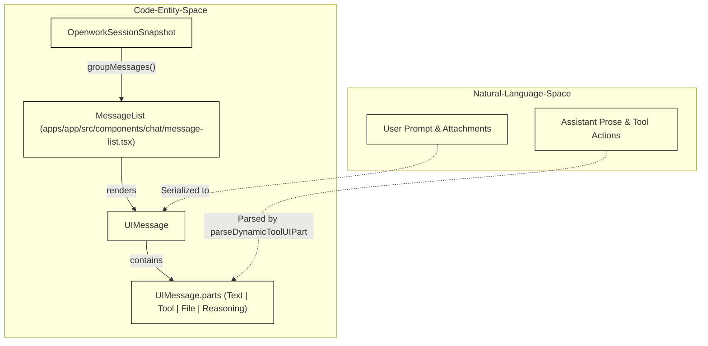
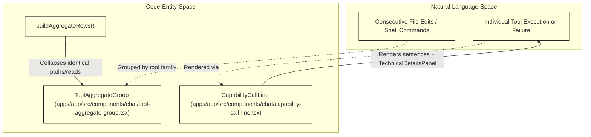
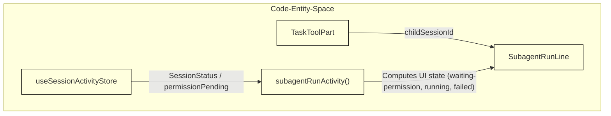
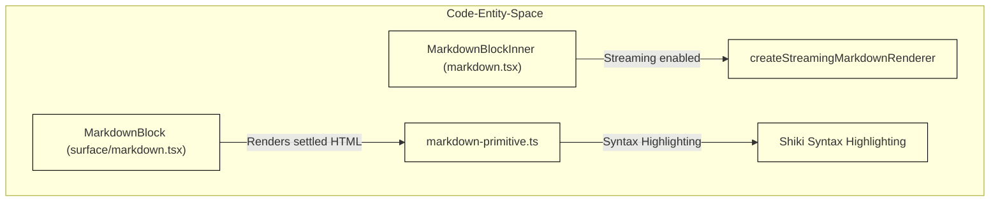

<!-- source: DeepWiki mcp.deepwiki.com · repo different-ai/openwork · extra page Messages, Parts and Rendering · fetched 2026-10-26 -->

# Messages, Parts and Rendering

Relevant source files

The following files were used as context for generating this wiki page:

- [apps/app/src/app/index.css](apps/app/src/app/index.css)
- [apps/app/src/app/lib/opencode-v2-adapter.ts](apps/app/src/app/lib/opencode-v2-adapter.ts)
- [apps/app/src/components/chat/capability-call-line.tsx](apps/app/src/components/chat/capability-call-line.tsx)
- [apps/app/src/components/chat/code-mode-tool.tsx](apps/app/src/components/chat/code-mode-tool.tsx)
- [apps/app/src/components/chat/image-attachment-badge.tsx](apps/app/src/components/chat/image-attachment-badge.tsx)
- [apps/app/src/components/chat/image-lightbox.tsx](apps/app/src/components/chat/image-lightbox.tsx)
- [apps/app/src/components/chat/subagent-run-line.tsx](apps/app/src/components/chat/subagent-run-line.tsx)
- [apps/app/src/components/chat/tool-aggregate-group.tsx](apps/app/src/components/chat/tool-aggregate-group.tsx)
- [apps/app/src/components/chat/utils.ts](apps/app/src/components/chat/utils.ts)
- [apps/app/src/components/markdown/link-action-menu.tsx](apps/app/src/components/markdown/link-action-menu.tsx)
- [apps/app/src/components/markdown/markdown-primitive.ts](apps/app/src/components/markdown/markdown-primitive.ts)
- [apps/app/src/components/markdown/markdown.tsx](apps/app/src/components/markdown/markdown.tsx)
- [apps/app/src/components/ui/image.tsx](apps/app/src/components/ui/image.tsx)
- [apps/app/src/lib/capability-call.ts](apps/app/src/lib/capability-call.ts)
- [apps/app/src/lib/code-mode-summary.ts](apps/app/src/lib/code-mode-summary.ts)
- [apps/app/src/lib/code-mode-tools.ts](apps/app/src/lib/code-mode-tools.ts)
- [apps/app/src/lib/target-provider.ts](apps/app/src/lib/target-provider.ts)
- [apps/app/src/lib/tool-aggregate.test.ts](apps/app/src/lib/tool-aggregate.test.ts)
- [apps/app/src/lib/tool-aggregate.ts](apps/app/src/lib/tool-aggregate.ts)
- [apps/app/src/react-app/domains/session/surface/markdown.tsx](apps/app/src/react-app/domains/session/surface/markdown.tsx)
- [apps/app/src/react-app/domains/session/sync/parse-tool-parts.test.ts](apps/app/src/react-app/domains/session/sync/parse-tool-parts.test.ts)
- [apps/app/src/react-app/domains/session/sync/parse-tool-parts.ts](apps/app/src/react-app/domains/session/sync/parse-tool-parts.ts)
- [apps/server/src/opencode-plugins/workspace-file-destinations.ts](apps/server/src/opencode-plugins/workspace-file-destinations.ts)
- [apps/server/test/workspace-file-destinations.test.ts](apps/server/test/workspace-file-destinations.test.ts)
- [ee/apps/den-api/src/mcp/capability-tool.ts](ee/apps/den-api/src/mcp/capability-tool.ts)
- [evals/packages/labs/src/mock-mcp.ts](evals/packages/labs/src/mock-mcp.ts)
- [evals/proofs/workspace-write-outcome.proof.test.ts](evals/proofs/workspace-write-outcome.proof.test.ts)
- [evals/scripts/journey-catalog.mjs](evals/scripts/journey-catalog.mjs)
- [evals/scripts/run-parity-proof.mjs](evals/scripts/run-parity-proof.mjs)
- [evals/scripts/run-parity-proof.test.mjs](evals/scripts/run-parity-proof.test.mjs)
- [evals/worlds/chat.ts](evals/worlds/chat.ts)
- [evals/worlds/library.ts](evals/worlds/library.ts)
- [evals/worlds/workspace-write-outcome.ts](evals/worlds/workspace-write-outcome.ts)
- [scripts/mock-oauth-mcp-server.mjs](scripts/mock-oauth-mcp-server.mjs)

## Purpose and Scope

This page documents the internal architecture of OpenWork's message list, content parts, and rendering pipelines (`apps/app/src/components/chat/message-list.tsx` [apps/app/src/components/chat/message-list.tsx:1-45]()). It covers how server-side snapshots and live streams are parsed into UI parts (`apps/app/src/react-app/domains/session/sync/parse-tool-parts.ts` [apps/app/src/react-app/domains/session/sync/parse-tool-parts.ts:1-20]()), how consecutive tool calls are aggregated into summaries (`apps/app/src/lib/tool-aggregate.ts` [apps/app/src/lib/tool-aggregate.ts:1-35]()), how capability-call and subagent-run lines are rendered, and how the markdown pipeline (`apps/app/src/components/markdown/markdown.tsx` [apps/app/src/components/markdown/markdown.tsx:1-40]()) handles streaming tokens and code-mode parts.

Sources: [apps/app/src/components/chat/message-list.tsx:1-45](), [apps/app/src/components/markdown/markdown.tsx:1-40](), [apps/app/src/react-app/domains/session/sync/parse-tool-parts.ts:1-20]()

---

## Message List and Transcript Architecture

The message list architecture reconciles authoritative server snapshots with live OpenCode engine streaming events into a list of `UIMessage` items.

**Natural Language to Code Entity Space: Transcript Mapping**

Sources: [apps/app/src/components/chat/message-list.tsx:1-45](), [apps/app/src/components/chat/utils.ts:140-168](), [apps/app/src/react-app/domains/session/sync/parse-tool-parts.ts:128-175]()

Messages are grouped consecutively by role via `groupMessages` (`apps/app/src/components/chat/utils.ts` [apps/app/src/components/chat/utils.ts:144-168]()). Assistant messages that consist solely of aggregatable tool parts are grouped into specialized UI aggregate containers.

Sources: [apps/app/src/components/chat/utils.ts:144-168](), [apps/app/src/lib/tool-aggregate.ts:28-34]()

---

## Part Types and Parsing Pipeline

Raw `ToolPart` entries emitted by the OpenCode engine v1/v2 are converted into `DynamicToolUIPart`, `TextUIPart`, or specialized tool parts by parsing utilities in `apps/app/src/react-app/domains/session/sync/parse-tool-parts.ts` [apps/app/src/react-app/domains/session/sync/parse-tool-parts.ts:1-20]().

### Part Type Mapping Reference

| Part Type | Detection / Function | Purpose | Implementation Source |
| :--- | :--- | :--- | :--- |
| **Text** | `part.type === "text"` | Natural language prose and markdown blocks | `apps/app/src/components/markdown/markdown.tsx` [apps/app/src/components/markdown/markdown.tsx:1-30]() |
| **Tool** | `isToolUIPart(part)` | Built-in tool invocations (bash, edit, read) | `apps/app/src/components/chat/message-list.tsx` [apps/app/src/components/chat/message-list.tsx:46-61]() |
| **Dynamic Tool** | `parseDynamicToolUIPart()` | MCP calls, external capabilities, code-mode | `apps/app/src/react-app/domains/session/sync/parse-tool-parts.ts` [apps/app/src/react-app/domains/session/sync/parse-tool-parts.ts:128-175]() |
| **Reasoning** | `isReasoningUIPart(part)` | Model thinking block / reasoning traces | `apps/app/src/components/chat/reasoning-block.tsx` [apps/app/src/components/chat/reasoning-block.tsx:1-10]() |
| **File** | `isFileUIPart(part)` | File attachments and asset references | `apps/app/src/components/chat/utils.ts` [apps/app/src/components/chat/utils.ts:40-96]() |

Sources: [apps/app/src/react-app/domains/session/sync/parse-tool-parts.ts:109-175](), [apps/app/src/components/chat/message-list.tsx:46-61]()

---

## Tool Aggregate Groups and Capability-Call Lines

### Tool Aggregation
To prevent vertical UI clutter when an agent executes multiple consecutive reads, writes, searches, or shell commands, `ToolAggregateGroup` merges them into a collapsible summary line (`apps/app/src/components/chat/tool-aggregate-group.tsx` [apps/app/src/components/chat/tool-aggregate-group.tsx:1-35]()).

Sources: [apps/app/src/components/chat/tool-aggregate-group.tsx:1-45](), [apps/app/src/lib/tool-aggregate.ts:1-40](), [apps/app/src/components/chat/capability-call-line.tsx:100-172]()

`buildAggregateRows` examines tool parts and interleaves model thoughts (`AggregateThought`) to maintain strict chronological order while grouping repeated file reads (`apps/app/src/components/chat/tool-aggregate-group.tsx` [apps/app/src/components/chat/tool-aggregate-group.tsx:161-182]()).

Sources: [apps/app/src/components/chat/tool-aggregate-group.tsx:161-182](), [apps/app/src/lib/tool-aggregate.ts:1-27]()

### Capability-Call Lines
External MCP tools and connectors are rendered as natural language sentences via `CapabilityCallLine` (`apps/app/src/components/chat/capability-call-line.tsx` [apps/app/src/components/chat/capability-call-line.tsx:156-172]()). Errors include actionable reconnection prompts and a collapsible `TechnicalDetailsPanel` showing raw inputs/outputs (`apps/app/src/components/chat/capability-call-line.tsx` [apps/app/src/components/chat/capability-call-line.tsx:99-120]()).

Sources: [apps/app/src/components/chat/capability-call-line.tsx:84-120](), [apps/app/src/components/chat/capability-call-line.tsx:156-172]()

---

## Subagent Run Lines and Tool Lifecycles

Subagent execution tasks spawned by the model are represented by `SubagentRunLine` (`apps/app/src/components/chat/subagent-run-line.tsx` [apps/app/src/components/chat/subagent-run-line.tsx:71-105]()).

Sources: [apps/app/src/components/chat/subagent-run-line.tsx:29-54](), [apps/app/src/components/chat/subagent-run-line.tsx:71-105]()

`subagentRunActivity` calculates the active presentation state based on permission requests, connection degradation, child failures, and liveness checks (`apps/app/src/components/chat/subagent-run-line.tsx` [apps/app/src/components/chat/subagent-run-line.tsx:29-54]()). Clicking the subagent card opens the child session directly in the main workspace chat surface.

Sources: [apps/app/src/components/chat/subagent-run-line.tsx:66-70](), [apps/app/src/components/chat/subagent-run-line.tsx:71-105]()

---

## Markdown Pipeline, Code-Mode Tool Parts, and Streaming

### Markdown Rendering Pipeline
Markdown blocks in chat messages and surfaces are processed by `MarkdownBlock` (`apps/app/src/react-app/domains/session/surface/markdown.tsx` [apps/app/src/react-app/domains/session/surface/markdown.tsx:13-74]()) and `MarkdownBlockInner` (`apps/app/src/components/markdown/markdown.tsx` [apps/app/src/components/markdown/markdown.tsx:84-118]()).

Sources: [apps/app/src/components/markdown/markdown.tsx:84-118](), [apps/app/src/components/markdown/markdown-primitive.ts:1-30](), [apps/app/src/react-app/domains/session/surface/markdown.tsx:13-74]()

During streaming, `createStreamingMarkdownRenderer` parses text block-by-block so incoming tokens only re-render the active top-level block, preventing UI thread starvation (`apps/app/src/components/markdown/markdown.tsx` [apps/app/src/components/markdown/markdown.tsx:75-111]()).

Sources: [apps/app/src/components/markdown/markdown.tsx:75-111](), [apps/app/src/components/markdown/markdown-primitive.ts:15-30]()

### Code-Mode Tool Parts
Code-mode tool parts generated by OpenCode v2 engines include nested tool calls and execution details stored within provider metadata (`apps/app/src/app/lib/opencode-v2-adapter.ts` [apps/app/src/app/lib/opencode-v2-adapter.ts:35-41]()). These are rendered via specialized components that support syntax-highlighted code execution traces and error attribution (`apps/app/src/components/chat/capability-call-line.tsx` [apps/app/src/components/chat/capability-call-line.tsx:100-120]()).

Sources: [apps/app/src/app/lib/opencode-v2-adapter.ts:35-41](), [apps/app/src/components/chat/capability-call-line.tsx:100-120]()

---

