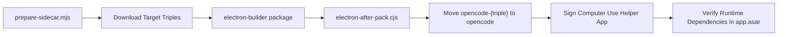

<!-- source: DeepWiki mcp.deepwiki.com · repo different-ai/openwork · extra page Multi-Platform Builds and Channels · fetched 2026-10-26 -->

# Multi-Platform Builds and Channels

<details>
<summary>Relevant source files</summary>

The following files were used as context for generating this wiki page:

- [.github/actionlint.yaml](.github/actionlint.yaml)
- [.github/actions/windows-signing/action.yml](.github/actions/windows-signing/action.yml)
- [.github/scripts/alpha-windows.test.mjs](.github/scripts/alpha-windows.test.mjs)
- [.github/workflows/alpha-macos-aarch64.yml](.github/workflows/alpha-macos-aarch64.yml)
- [.github/workflows/build-electron-desktop.yml](.github/workflows/build-electron-desktop.yml)
- [.github/workflows/release-macos-aarch64.yml](.github/workflows/release-macos-aarch64.yml)
- [.opencode/skills/browser-automation/SKILL.md](.opencode/skills/browser-automation/SKILL.md)
- [.opencode/skills/release/SKILL.md](.opencode/skills/release/SKILL.md)
- [.opencode/skills/validate-a-release/SKILL.md](.opencode/skills/validate-a-release/SKILL.md)
- [apps/desktop/electron-builder.yml](apps/desktop/electron-builder.yml)
- [apps/desktop/scripts/electron-after-pack.cjs](apps/desktop/scripts/electron-after-pack.cjs)
- [apps/desktop/scripts/prepare-runtime-node-modules.mjs](apps/desktop/scripts/prepare-runtime-node-modules.mjs)
- [apps/desktop/scripts/prepare-sidecar.mjs](apps/desktop/scripts/prepare-sidecar.mjs)
- [apps/desktop/scripts/windows-sign.cjs](apps/desktop/scripts/windows-sign.cjs)
- [apps/desktop/test/sidecar-layout.test.mjs](apps/desktop/test/sidecar-layout.test.mjs)
- [apps/desktop/test/windows-sign.test.cjs](apps/desktop/test/windows-sign.test.cjs)
- [docs/RELEASING.md](docs/RELEASING.md)
- [evals/worlds/released-enterprise-activated.ts](evals/worlds/released-enterprise-activated.ts)
- [scripts/release/check-compose-pins.mjs](scripts/release/check-compose-pins.mjs)
- [scripts/release/check-windows-alpha-version.mjs](scripts/release/check-windows-alpha-version.mjs)
- [scripts/release/pin-compose-images.mjs](scripts/release/pin-compose-images.mjs)
- [scripts/release/prune-alpha-assets.mjs](scripts/release/prune-alpha-assets.mjs)
- [scripts/release/purge-legacy-releases.mjs](scripts/release/purge-legacy-releases.mjs)
- [scripts/release/rollback.mjs](scripts/release/rollback.mjs)
- [scripts/release/windows-signatures.ps1](scripts/release/windows-signatures.ps1)
- [scripts/release/windows-signatures.test.ps1](scripts/release/windows-signatures.test.ps1)

</details>


This document explains the multi-platform build system used to produce OpenWork Desktop installers for macOS (ARM64 and x64), Linux (x64 and ARM64), and Windows (x64). The build process utilizes GitHub Actions matrix strategies to compile Electron applications, bundle sidecar binaries, apply version resolution and tagging via `diff-warden`, handle notarization, execute Windows Azure signing, and manage alpha rolling tags.

The primary release workflow is defined in `.github/workflows/release-macos-aarch64.yml`. It orchestrates multiple parallel jobs including desktop builds, sidecar release, and npm publishing [[.github/workflows/release-macos-aarch64.yml:1-60]]().

**Sources:** [[.github/workflows/release-macos-aarch64.yml:1-60]]()

## Workflow Trigger and Configuration

The release workflow is triggered in two primary ways:

1.  **Tag Push**: Automatically triggers on any tag matching `v*` (e.g., `v0.15.2`) [[.github/workflows/release-macos-aarch64.yml:4-6]]().
2.  **Manual Dispatch**: Via `workflow_dispatch` with configurable inputs such as `tag`, `release_name`, `notarize`, `publish_npm`, and `sign_windows` [[.github/workflows/release-macos-aarch64.yml:7-74]]().

The workflow uses a `resolve-production` job to standardize metadata across all subsequent steps, ensuring consistent versioning and release flags [[.github/workflows/release-macos-aarch64.yml:86-112]](). A specialized **Alpha Channel** workflow exists for macOS arm64 and Windows x64, which publishes fresh builds on every push to the `dev` branch using rolling tags `alpha-macos-latest` and `alpha-windows-latest` [[.github/workflows/alpha-macos-aarch64.yml:1-60]]().

**Sources:** [[.github/workflows/release-macos-aarch64.yml:4-74]](), [[.github/workflows/release-macos-aarch64.yml:86-112]](), [[.github/workflows/alpha-macos-aarch64.yml:1-60]]()

## Build Pipeline Architecture

The build system bridges high-level release requirements to low-level platform binaries through a structured pipeline involving `electron-builder` and custom preparation scripts.

### Build Entity Mapping
The following diagram maps the logical build stages to the specific scripts and entities in the codebase.

```mermaid
graph TD
    subgraph "Natural Language Space"
        "Release Requirement"
        "Sidecar Preparation"
        "App Compilation"
        "Version Resolution"
        "Notarization"
        "Windows Signing"
    end

    subgraph "Code Entity Space"
        ReleaseWorkflow[".github/workflows/release-macos-aarch64.yml"]
        AlphaWorkflow[".github/workflows/alpha-macos-aarch64.yml"]
        ConstantsJSON["constants.json"]
        ElectronBuilderConfig["apps/desktop/electron-builder.yml"]
        ElectronBuildScript["apps/desktop/scripts/electron-build.mjs"]
        ResolveProductionJob["ReleaseWorkflow::resolve-production"]
        TagJob["ReleaseWorkflow::resolve-production::tag"]
        NotaryAPIKey["secrets.APPLE_NOTARY_API_KEY_P8_BASE64"]
        WindowsSigningInput["inputs.sign_windows"]
        DiffWardenBot["diff-warden[bot]"]
        StampVersionScript["scripts/release/stamp-version.mjs"]
        VersionsMjs["scripts/release/versions.mjs"]
        PrepareSidecar["apps/desktop/scripts/prepare-sidecar.mjs"]
        AfterPack["apps/desktop/scripts/electron-after-pack.cjs"]
    end

    "Release Requirement" --> ReleaseWorkflow
    "Release Requirement" --> AlphaWorkflow
    ReleaseWorkflow -- "triggers" --> ResolveProductionJob
    ResolveProductionJob -- "determines version" --> TagJob
    TagJob -- "uses" --> VersionsMjs
    TagJob -- "tags with" --> DiffWardenBot
    AlphaWorkflow -- "resolves version" --> VersionsMjs
    AlphaWorkflow -- "stamps version" --> StampVersionScript
    "Sidecar Preparation" --> ElectronBuildScript
    "App Compilation" --> ElectronBuilderConfig

    ElectronBuildScript -- "executes" --> PrepareSidecar
    AfterPack -- "canonicalizes sidecars" --> PrepareSidecar
    ReleaseWorkflow -- "reads version from" --> ConstantsJSON
    AlphaWorkflow -- "updates" --> ElectronBuilderConfig
    "Notarization" --> NotaryAPIKey
    "Windows Signing" --> WindowsSigningInput
```

**Sources:** [[.github/workflows/release-macos-aarch64.yml:1-55]](), [[.github/workflows/release-macos-aarch64.yml:86-112]](), [[.github/workflows/release-macos-aarch64.yml:158-168]](), [[.github/workflows/alpha-macos-aarch64.yml:1-41]](), [[.github/workflows/alpha-macos-aarch64.yml:92-117]](), [[.github/workflows/alpha-macos-aarch64.yml:155-166]](), [[apps/desktop/scripts/electron-build.mjs:33-34]](), [[apps/desktop/scripts/electron-after-pack.cjs:143-165]](), [[scripts/release/versions.mjs:1-10]](), [[scripts/release/stamp-version.mjs:1-10]](), [[apps/desktop/scripts/prepare-sidecar.mjs:1-49]]()

## Desktop Build Matrix

The `build-electron` job in `build-electron-desktop.yml` uses a matrix strategy to build for multiple targets in parallel, verifying cross-platform compatibility [[.github/workflows/build-electron-desktop.yml:21-34]]().

### Platform Matrix Configuration
The matrix is defined with the following configurations:

| Platform Runner | Artifact Type | Build Target |
| :--- | :--- | :--- |
| `macos-latest` | `macos` | Apple Silicon & Intel |
| `ubuntu-latest` | `linux` | x64 AppImage/Deb |
| `windows-latest` | `windows` | x64 MSI/EXE |
| `windows-11-arm` | `windows-arm64` | Windows ARM64 |

**Sources:** [[.github/workflows/build-electron-desktop.yml:21-34]]()

## Sidecar Binary Preparation and Canonicalization

OpenWork Desktop bundles external binaries (`opencode`, `opencode2`) as sidecars. These binaries are resolved, downloaded, and packaged via `apps/desktop/scripts/prepare-sidecar.mjs` and later canonicalized during packaging by `apps/desktop/scripts/electron-after-pack.cjs` [[.github/workflows/build-electron-desktop.yml:62-66]](), [[apps/desktop/scripts/prepare-sidecar.mjs:1-96]](), [[apps/desktop/scripts/electron-after-pack.cjs:9-12]](), [[apps/desktop/scripts/electron-after-pack.cjs:143-165]]().

### Sidecar Resolution and After-Pack Flow
The post-packing script maps target triples and ensures plain executable aliases point to the correct arch-specific sidecar binary [[apps/desktop/scripts/electron-after-pack.cjs:14-28]](), [[apps/desktop/scripts/electron-after-pack.cjs:143-165]]().



**Sources:** [[apps/desktop/scripts/prepare-sidecar.mjs:70-96]](), [[apps/desktop/scripts/electron-after-pack.cjs:14-28]](), [[apps/desktop/scripts/electron-after-pack.cjs:62-101]](), [[apps/desktop/scripts/electron-after-pack.cjs:103-125]](), [[apps/desktop/scripts/electron-after-pack.cjs:143-165]]()

## Platform-Specific Steps: Notarization and Windows Azure Signing

### macOS Signing and Notarization
macOS builds require strict signing and notarization to bypass Gatekeeper.
- **Notary API Key**: The workflow decodes an Apple Notary API key from base64 secrets and writes it to a `.p8` file in `RUNNER_TEMP` [[.github/workflows/alpha-macos-aarch64.yml:155-166]]().
- **Electron Builder Integration**: `electron-builder` is invoked with `CSC_LINK` (p12 certificate) and `APPLE_API_KEY` to perform signing and notarization [[.github/workflows/alpha-macos-aarch64.yml:161-177]](), [[.github/workflows/build-electron-desktop.yml:120-132]]().
- **Helper Signing**: The `electron-after-pack.cjs` script explicitly codesigns the "OpenWork Computer Use.app" helper binary with hardened runtime options before final dmg/zip assembly [[apps/desktop/scripts/electron-after-pack.cjs:103-125]]().

**Sources:** [[.github/workflows/alpha-macos-aarch64.yml:155-177]](), [[.github/workflows/build-electron-desktop.yml:120-132]](), [[apps/desktop/scripts/electron-after-pack.cjs:103-125]]()

### Windows Azure Artifact Signing
Windows installers are signed using Azure Artifact Signing (`windows-signing` environment) during release workflows and Windows alpha builds [[.github/workflows/release-macos-aarch64.yml:69-73]](), [.github/workflows/alpha-macos-aarch64.yml]() [-.github/actions/windows-signing/action.yml](). Unsigned Windows alpha builds are rejected, and execution verifies authenticoded signatures using PowerShell validation scripts (`scripts/release/windows-signatures.ps1`) [[.github/workflows/alpha-macos-aarch64.yml:144-152]]().

**Sources:** [[.github/workflows/release-macos-aarch64.yml:69-73]](), [.github/workflows/alpha-macos-aarch64.yml](), [.github/actions/windows-signing/action.yml](), [scripts/release/windows-signatures.ps1]()

## Version Resolution and Tagging with `diff-warden`

The release workflow uses a `resolve-production` job powered by scripts under `scripts/release/` to determine the release version and tag.
- **Fresh Release**: If `bump` input is provided (e.g., `patch`, `minor`, `major`), a fresh release is cut by bumping from the highest `v*` tag and tagging `origin/dev` HEAD [[.github/workflows/release-macos-aarch64.yml:14-22]](), [[.github/workflows/release-macos-aarch64.yml:145-151]]().
- **Explicit Version**: An explicit `version` input (e.g., `X.Y.Z`) can override the `bump` behavior [[.github/workflows/release-macos-aarch64.yml:23-26]]().
- **Recovery Tag**: An existing `tag` can be specified to re-run the workflow for recovery, skipping tag creation [[.github/workflows/release-macos-aarch64.yml:27-30]]().
- **`diff-warden` Bot Token**: Fresh release cuts push their tag using the org-owned `diff-warden` GitHub App token (`WARDEN_APP_ID` + `WARDEN_PRIVATE_KEY` in the `warden-clearance` environment) [[.github/workflows/release-macos-aarch64.yml:89-92]](), [[.github/workflows/release-macos-aarch64.yml:160-168]](). Because the built-in GitHub Actions app cannot be a ruleset bypass actor, `diff-warden` acts as a bypass actor on the `v*` tag ruleset, allowing authorized releases while preventing unauthorized feature-branch tampering [[.github/workflows/release-macos-aarch64.yml:89-92]](), [[.github/workflows/release-macos-aarch64.yml:157-168]]().

**Sources:** [[.github/workflows/release-macos-aarch64.yml:14-30]](), [[.github/workflows/release-macos-aarch64.yml:89-92]](), [[.github/workflows/release-macos-aarch64.yml:157-168]]()

## Alpha Rolling Tags and Prerelease Channels

The alpha workflows (such as `.github/workflows/alpha-macos-aarch64.yml`) manage continuous prerelease channels for macOS arm64 and Windows x64.
- **Trigger**: Triggered on every app-related push to the `dev` branch or via manual dispatch [[.github/workflows/alpha-macos-aarch64.yml:13-35]]().
- **Rolling Release**: Builds are published to persistent rolling releases (`alpha-macos-latest` and `alpha-windows-latest`). Each run appends uniquely-versioned assets (dmgs, executables, blockmaps) and updates the respective updater manifest (`latest-mac.yml`, `latest.yml`) last to prevent reference races [[.github/workflows/alpha-macos-aarch64.yml:3-6]](), [[.github/workflows/alpha-macos-aarch64.yml:51-60]]().
- **Version Calculation**: Alpha versions are computed by taking the *next* patch version after the latest stable `v*` tag via `scripts/release/versions.mjs` and appending `-alpha.<run_number>+<sha>` (Windows also appends attempt identifiers) [[.github/workflows/alpha-macos-aarch64.yml:137-147]](). This guarantees that alpha builds are semver-newer than current stable releases, enabling smooth automatic upgrades [[.github/workflows/alpha-macos-aarch64.yml:137-147]]().
- **Asset Pruning**: Releases retain the newest 100 builds, automatically pruning older artifacts via `.github/workflows/alpha-macos-aarch64.yml` scripts and helper modules like `scripts/release/prune-alpha-assets.mjs` [[.github/workflows/alpha-macos-aarch64.yml:8-9]](), [scripts/release/prune-alpha-assets.mjs]().

**Sources:** [[.github/workflows/alpha-macos-aarch64.yml:3-6]](), [[.github/workflows/alpha-macos-aarch64.yml:13-35]](), [[.github/workflows/alpha-macos-aarch64.yml:51-60]](), [[.github/workflows/alpha-macos-aarch64.yml:137-147]](), [scripts/release/prune-alpha-assets.mjs]()

---

