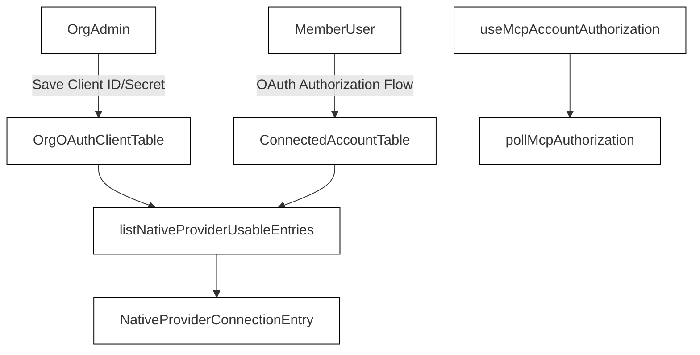
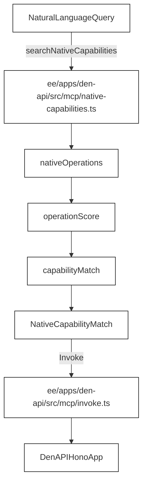

<!-- source: DeepWiki mcp.deepwiki.com · repo different-ai/openwork · extra page Native Provider Connectors · fetched 2026-10-26 -->

# Native Provider Connectors

<details>
<summary>Relevant source files</summary>

The following files were used as context for generating this wiki page:

- [ee/apps/den-api/src/audit/routes/integrations.ts](ee/apps/den-api/src/audit/routes/integrations.ts)
- [ee/apps/den-api/src/capability-sources/gmail.ts](ee/apps/den-api/src/capability-sources/gmail.ts)
- [ee/apps/den-api/src/capability-sources/google-workspace-api.ts](ee/apps/den-api/src/capability-sources/google-workspace-api.ts)
- [ee/apps/den-api/src/capability-sources/microsoft-graph.ts](ee/apps/den-api/src/capability-sources/microsoft-graph.ts)
- [ee/apps/den-api/src/capability-sources/oauth-callback-page.ts](ee/apps/den-api/src/capability-sources/oauth-callback-page.ts)
- [ee/apps/den-api/src/mcp/catalog.ts](ee/apps/den-api/src/mcp/catalog.ts)
- [ee/apps/den-api/src/mcp/invoke.ts](ee/apps/den-api/src/mcp/invoke.ts)
- [ee/apps/den-api/src/mcp/native-capabilities.ts](ee/apps/den-api/src/mcp/native-capabilities.ts)
- [ee/apps/den-api/src/mcp/tool-content.ts](ee/apps/den-api/src/mcp/tool-content.ts)
- [ee/apps/den-api/src/routes/org/google-drive-files.ts](ee/apps/den-api/src/routes/org/google-drive-files.ts)
- [ee/apps/den-api/src/routes/org/google-workspace-actions.ts](ee/apps/den-api/src/routes/org/google-workspace-actions.ts)
- [ee/apps/den-api/src/routes/org/google-workspace.ts](ee/apps/den-api/src/routes/org/google-workspace.ts)
- [ee/apps/den-api/src/routes/org/microsoft-365.ts](ee/apps/den-api/src/routes/org/microsoft-365.ts)
- [ee/apps/den-web/app/(den)/dashboard/_components/admin-connector-page-screen.tsx](ee/apps/den-web/app/(den)/dashboard/_components/admin-connector-page-screen.tsx)
- [ee/apps/den-web/app/(den)/dashboard/_components/admin-connector-setup-screen.tsx](ee/apps/den-web/app/(den)/dashboard/_components/admin-connector-setup-screen.tsx)
- [ee/apps/den-web/app/(den)/dashboard/_components/admin-connectors.ts](ee/apps/den-web/app/(den)/dashboard/_components/admin-connectors.ts)
- [ee/apps/den-web/app/(den)/dashboard/_components/connector-page-screen.tsx](ee/apps/den-web/app/(den)/dashboard/_components/connector-page-screen.tsx)
- [ee/apps/den-web/app/(den)/dashboard/_components/connector-settings.tsx](ee/apps/den-web/app/(den)/dashboard/_components/connector-settings.tsx)
- [ee/apps/den-web/app/(den)/dashboard/_components/connector-setup-fields.tsx](ee/apps/den-web/app/(den)/dashboard/_components/connector-setup-fields.tsx)
- [ee/apps/den-web/app/(den)/dashboard/_components/connector-setup.ts](ee/apps/den-web/app/(den)/dashboard/_components/connector-setup.ts)
- [ee/apps/den-web/app/(den)/dashboard/_components/mcp-account-authorization-state.test.ts](ee/apps/den-web/app/(den)/dashboard/_components/mcp-account-authorization-state.test.ts)
- [ee/apps/den-web/app/(den)/dashboard/_components/mcp-account-authorization-state.ts](ee/apps/den-web/app/(den)/dashboard/_components/mcp-account-authorization-state.ts)
- [ee/apps/den-web/app/(den)/dashboard/_components/mcp-authorization-url.ts](ee/apps/den-web/app/(den)/dashboard/_components/mcp-authorization-url.ts)
- [ee/apps/den-web/app/(den)/dashboard/_components/mcp-credential-input.tsx](ee/apps/den-web/app/(den)/dashboard/_components/mcp-credential-input.tsx)
- [ee/apps/den-web/app/(den)/dashboard/_components/member-api-key-dialog.tsx](ee/apps/den-web/app/(den)/dashboard/_components/member-api-key-dialog.tsx)
- [ee/apps/den-web/app/(den)/dashboard/_components/use-mcp-account-authorization.ts](ee/apps/den-web/app/(den)/dashboard/_components/use-mcp-account-authorization.ts)
- [evals/packages/labs/src/mock-service-actions.ts](evals/packages/labs/src/mock-service-actions.ts)
- [evals/proofs/connector-setup-escape.proof.test.ts](evals/proofs/connector-setup-escape.proof.test.ts)
- [evals/worlds/connector-setup-escape.ts](evals/worlds/connector-setup-escape.ts)
- [packages/docs/start-here/connect-your-stack/connect-services.mdx](packages/docs/start-here/connect-your-stack/connect-services.mdx)

</details>


## Purpose and Scope
This page details the implementation of native provider connectors within the OpenWork Enterprise control plane (`ee/apps/den-api`) and dashboard (`ee/apps/den-web`). Native connectors—specifically Google Workspace, Gmail, and Microsoft 365/Graph—provide pre-integrated agent capabilities without requiring operators to manually configure external Model Context Protocol (MCP) servers. This architecture bridges OAuth credential management (`oauth-credentials.ts`), provider scope validation (`native-provider-connections.ts`), REST route handlers (`google-workspace.ts`, `microsoft-365.ts`), connector setup screens (`connector-setup.ts`), and the dynamic tool catalog search subsystem (`native-capabilities.ts`, `catalog.ts`, `search.ts`).

---

## 1. Provider Registry, Credential Management, and OAuth Flow

Native providers operate through a shared dual-table architecture stored in `ee/apps/den-api/src/capability-sources/oauth-credentials.ts`. Organization administrators store client application credentials in `OrgOAuthClientTable`, while individual members authorize specific third-party accounts via `ConnectedAccountTable`.

The `native-provider-connections.ts` module unifies native provider connection states so they appear in the same member-facing surface as external MCP connections [ee/apps/den-api/src/capability-sources/native-provider-connections.ts:18-26](). The frontend state machine in `use-mcp-account-authorization.ts` coordinates popup authorization windows and polling intervals (`pollMcpAuthorization`) to update the usable connection store [ee/apps/den-web/app/(den)/dashboard/_components/use-mcp-account-authorization.ts:17-84]().


*Diagram 1: OAuth Credential Materialization and Resolution Flow*

Sources:
- `ee/apps/den-api/src/capability-sources/oauth-credentials.ts:1-181`
- `ee/apps/den-api/src/capability-sources/native-provider-connections.ts:1-166`
- `ee/apps/den-web/app/(den)/dashboard/_components/use-mcp-account-authorization.ts:1-137`
- `ee/apps/den-web/app/(den)/dashboard/_components/connector-setup.ts:1-142`

---

## 2. Google Workspace, Gmail, and Drive Integration

Google Workspace integration is implemented across `ee/apps/den-api/src/routes/org/google-workspace.ts` and helper modules under `ee/apps/den-api/src/capability-sources/`. It exposes API endpoints for Gmail messaging, drafts, Calendar events, and Google Drive files.

### Gmail Draft Construction and MIME Encoding
The `gmail.ts` utility constructs pure RFC 822 messages, base64url-encoding them for the Gmail API `users.messages/drafts` endpoints [ee/apps/den-api/src/capability-sources/gmail.ts:1-6](). Actions enforce validation schemas such as `draftMetadataSchema` and `createDraftBodySchema` [ee/apps/den-api/src/routes/org/google-workspace.ts:68-79]().

```typescript
// Example snippet representation of draft parameter validation
const draftMetadataSchema = z.object({
  to: draftHeaderSchema.min(3).max(320).describe("Recipient email address."),
  subject: draftHeaderSchema.min(1).max(500).describe("Draft subject line."),
  body: z.string().min(1).max(50_000).describe("Plain-text draft body."),
  threadId: z.string().trim().min(1).max(512).optional(),
}).strict()
```
*Reference: [ee/apps/den-api/src/routes/org/google-workspace.ts:68-75]()*

Action error handling and token validation occur in `google-workspace-actions.ts`, where `requestGoogleAction()` intercepts expired tokens or missing permission scopes to return structured `needs_connection` error payloads [ee/apps/den-api/src/routes/org/google-workspace-actions.ts:88-108]().

Sources:
- `ee/apps/den-api/src/routes/org/google-workspace.ts:1-113`
- `ee/apps/den-api/src/capability-sources/google-workspace-api.ts:1-75`
- `ee/apps/den-api/src/capability-sources/gmail.ts:1-68`
- `ee/apps/den-api/src/routes/org/google-workspace-actions.ts:1-127`

---

## 3. Microsoft 365 and Microsoft Graph Integration

The Microsoft 365 connector (`ee/apps/den-api/src/routes/org/microsoft-365.ts`) provides Outlook mail, calendar, and Graph item operations using `MicrosoftGraphClient`. 

### Key Validation Schemas
* **`graphItemIdSchema`**: Validates Microsoft Graph item IDs while blocking path traversal attempts (`.` or `..` or special URI characters) [ee/apps/den-api/src/routes/org/microsoft-365.ts:22-23]().
* **`mailSendBodySchema`**: Enforces strict confirmation flags before executing outbound mail transmission [ee/apps/den-api/src/routes/org/microsoft-365.ts:85-87]().

Sources:
- `ee/apps/den-api/src/routes/org/microsoft-365.ts:1-146`

---

## 4. Marketplace Capabilities, Catalog Search, and Natural Language Space Bridge

To allow AI agents to invoke provider operations dynamically, Den exposes search and execution facades over the OpenAPI tool catalog via `searchNativeCapabilities` and `invokeMcpOperation` [ee/apps/den-api/src/mcp/native-capabilities.ts:123-163]().


*Diagram 2: Natural Language Space to Code Entity Space Bridge for Native Connectors*

### Core Search and Shortening Functions
* **`shortenToolName(operationId: string, taken?: ReadonlySet<string>)`**: Structurally shortens OpenAPI operation IDs (stripping version prefixes like `V1` and path parameter markers like `ByParamId`) to fit LLM tool name constraints under `BEDROCK_MAX_TOOL_NAME_LENGTH` [ee/apps/den-api/src/mcp/catalog.ts:23-64]().
* **`searchNativeCapabilities(...)`**: Queries usable native provider connections, matching operation text tokens against member prompts and handling unconfigured connection states (`connectionStatusMatch`) [ee/apps/den-api/src/mcp/native-capabilities.ts:123-163]().

Sources:
- `ee/apps/den-api/src/mcp/catalog.ts:1-189`
- `ee/apps/den-api/src/mcp/native-capabilities.ts:1-256`
- `ee/apps/den-api/src/mcp/search.ts:1-161`
- `ee/apps/den-api/src/mcp/invoke.ts:1-165`

---

