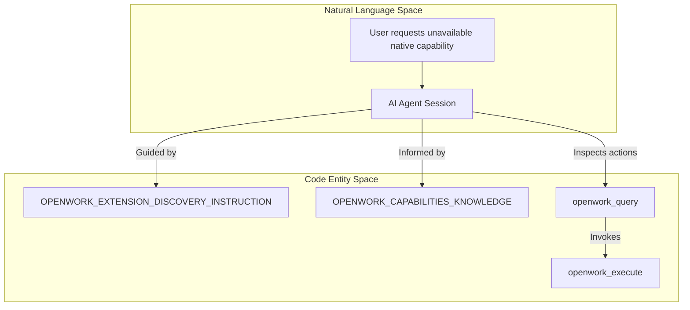
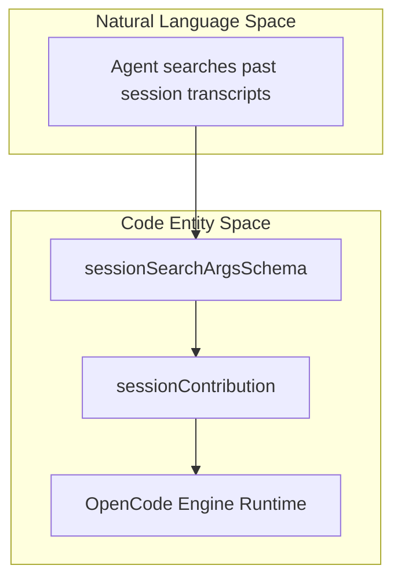

<!-- source: DeepWiki mcp.deepwiki.com · repo different-ai/openwork · extra page OpenCode Plugins and Extensions Preview · fetched 2026-10-26 -->

# OpenCode Plugins and Extensions Preview

Relevant source files

The following files were used as context for generating this wiki page:

- [apps/app/src/react-app/domains/connections/cloud-mcp-reconciler.ts](apps/app/src/react-app/domains/connections/cloud-mcp-reconciler.ts)
- [apps/app/src/react-app/domains/connections/use-session-mcp-maintenance.ts](apps/app/src/react-app/domains/connections/use-session-mcp-maintenance.ts)
- [apps/app/src/react-app/domains/session/control/list-control-sessions.ts](apps/app/src/react-app/domains/session/control/list-control-sessions.ts)
- [apps/app/src/react-app/domains/session/control/session-control-actions.ts](apps/app/src/react-app/domains/session/control/session-control-actions.ts)
- [apps/app/src/react-app/domains/session/sidebar/use-session-archive.tsx](apps/app/src/react-app/domains/session/sidebar/use-session-archive.tsx)
- [apps/app/tests/session-archive-agent-contract.test.tsx](apps/app/tests/session-archive-agent-contract.test.tsx)
- [apps/server/src/cloud-mcp-health.ts](apps/server/src/cloud-mcp-health.ts)
- [apps/server/src/connect-state.ts](apps/server/src/connect-state.ts)
- [apps/server/src/opencode-plugins/openwork-capabilities-knowledge.ts](apps/server/src/opencode-plugins/openwork-capabilities-knowledge.ts)
- [apps/server/src/opencode-plugins/openwork-extensions-preview-steering.ts](apps/server/src/opencode-plugins/openwork-extensions-preview-steering.ts)
- [apps/server/src/opencode-plugins/openwork-extensions-preview.ts](apps/server/src/opencode-plugins/openwork-extensions-preview.ts)
- [apps/server/src/opencode-plugins/openwork-provider-adapters.ts](apps/server/src/opencode-plugins/openwork-provider-adapters.ts)
- [apps/server/src/opencode-plugins/session-activity.ts](apps/server/src/opencode-plugins/session-activity.ts)
- [apps/server/src/routes/cloud-mcp.ts](apps/server/src/routes/cloud-mcp.ts)
- [apps/server/src/runtime-opencode-config-store.ts](apps/server/src/runtime-opencode-config-store.ts)
- [docs/mcp-ui-control-profile.md](docs/mcp-ui-control-profile.md)
- [ee/apps/den-api/src/mcp/builtin-skills.ts](ee/apps/den-api/src/mcp/builtin-skills.ts)
- [packages/docs/start-here/do-work-with-it/cross-chat-memory.mdx](packages/docs/start-here/do-work-with-it/cross-chat-memory.mdx)
- [packages/types/src/openwork-affordance.ts](packages/types/src/openwork-affordance.ts)

This page details the implementation of OpenCode plugins and extensions preview features located under `apps/server/src/opencode-plugins/*`, covering extension discovery, capabilities knowledge injection, runtime steering, provider adapters, session affordances, and `opencode.json` plugin configurations.

---

## Purpose and Scope

OpenCode plugins extend the OpenCode engine execution runtime via server-side modules and configuration files. The backend server implements an extension preview layer in `apps/server/src/opencode-plugins/` that coordinates capabilities knowledge, steering directives, provider-adapted session affordances, and tool configurations.

Sources: [apps/server/src/opencode-plugins/openwork-extensions-preview.ts:1-53](), [apps/server/src/opencode-plugins/openwork-capabilities-knowledge.ts:1-22]()

---

## Configuration and Storage (`opencode.json`)

Plugins are managed through configuration files (`opencode.json` or `opencode.jsonc`) supporting project-specific and global scopes. The backend runtime configuration store [apps/server/src/runtime-opencode-config-store.ts:60-65]() manages client-side and server-side state synchronized with these config files.

### Configuration Structure
- **Plugin list**: Registered package specs and local paths via `runtimePluginList` [apps/server/src/runtime-opencode-config-store.ts:81-83]().
- **MCP integrations**: Server descriptors mapped in `runtimeMcpMap` [apps/server/src/runtime-opencode-config-store.ts:91-93]().

### Scopes
1. **Project Scope**: `.opencode/opencode.json` located at the workspace root.
2. **Global Scope**: User home configuration directory `~/.config/opencode/opencode.json` or global runtime config entries governed by `ENGINE_GLOBAL_RUNTIME_CONFIG_ID` [apps/server/src/runtime-opencode-config-store.ts:21-21]().

Sources: [apps/server/src/runtime-opencode-config-store.ts:1-65](), [apps/server/src/runtime-opencode-config-store.ts:81-93]()

---

## Server-Side Extension Preview & Steering (`apps/server/src/opencode-plugins/*`)

The server-side extension layer exposes specialised sub-modules that govern agent behavior, capability inventory, and runtime steering:

- **Capabilities Knowledge (`openwork-capabilities-knowledge.ts`)**: Injects contextual knowledge about OpenWork features (AI providers, authorized folders, Connect/Library MCP servers, and Automations) into the model's system prompt [apps/server/src/opencode-plugins/openwork-capabilities-knowledge.ts:1-45](). Functions like `automationRuntimeKnowledge` dynamically adjust prompt instructions depending on whether the runtime is hosted in OpenWork Desktop or OpenWork Cloud (`daytona`) [apps/server/src/opencode-plugins/openwork-capabilities-knowledge.ts:25-46]().
- **Steering (`openwork-extensions-preview-steering.ts`)**: Supplies constants such as `OPENWORK_EXTENSION_DISCOVERY_INSTRUCTION` and `OPENWORK_GOOGLE_CONNECTION_INSTRUCTION` to guide agents on when and how to query extension actions using `openwork_query` and `openwork_execute` [apps/server/src/opencode-plugins/openwork-extensions-preview-steering.ts:130-138]().

Diagram: Extension Discovery and Steering Flow

Sources: [apps/server/src/opencode-plugins/openwork-capabilities-knowledge.ts:1-85](), [apps/server/src/opencode-plugins/openwork-extensions-preview-steering.ts:1-138]()

---

## Provider Adapters and Session Affordances

Provider adapters (`openwork-provider-adapters.ts`) define structured affordances that expose server-side capabilities as tool calls to the underlying engine [apps/server/src/opencode-plugins/openwork-provider-adapters.ts:1-12]().

### Affordance Schemas
- **Session Search**: `sessionSearchArgsSchema` defines query parameters, workspace filters, scan limits, and text match modes (`all`, `any`, `phrase`) [apps/server/src/opencode-plugins/openwork-provider-adapters.ts:25-35]().
- **Session Read**: `sessionReadArgsSchema` controls message chunk reading, counts, direction (`start` or `end`), and summary generation [apps/server/src/opencode-plugins/openwork-provider-adapters.ts:37-43]().
- **Session Creation & Messaging**: `sessionCreateArgsSchema` and `sessionSendArgsSchema` allow agents to start new tasks or message existing session transcripts asynchronously [apps/server/src/opencode-plugins/openwork-provider-adapters.ts:47-62]().

Diagram: Session Affordance Execution Flow

Sources: [apps/server/src/opencode-plugins/openwork-provider-adapters.ts:25-72](), [apps/server/src/opencode-plugins/openwork-provider-adapters.ts:136-145]()

---

