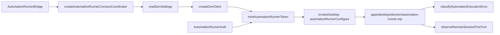
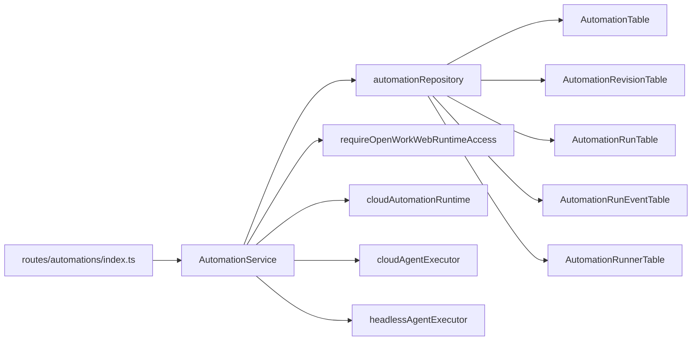
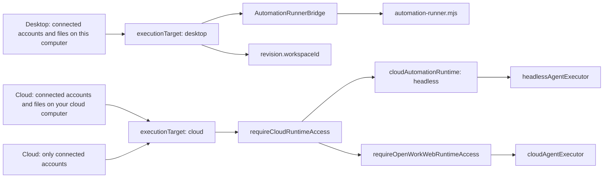
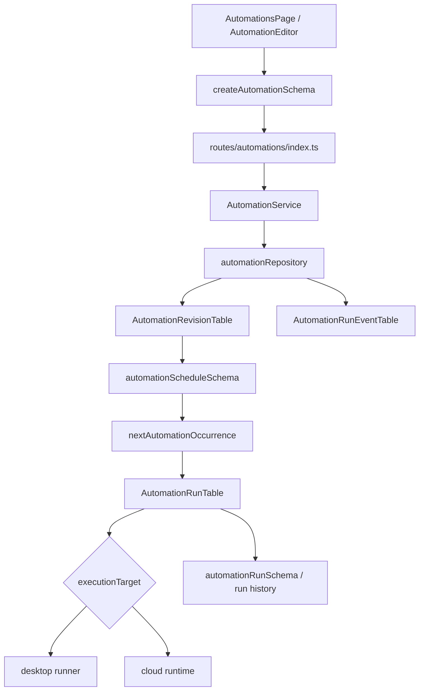

<!-- source: DeepWiki mcp.deepwiki.com · repo different-ai/openwork · extra page Automations and the Automation Runner · fetched 2026-10-26 -->

# Automations and the Automation Runner

Relevant source files

The following files were used as context for generating this wiki page:

- [apps/app/src/react-app/domains/automations/automation-editor.tsx](apps/app/src/react-app/domains/automations/automation-editor.tsx)
- [apps/app/src/react-app/domains/automations/automation-model-options.ts](apps/app/src/react-app/domains/automations/automation-model-options.ts)
- [apps/app/src/react-app/domains/automations/automation-runner-bridge.tsx](apps/app/src/react-app/domains/automations/automation-runner-bridge.tsx)
- [apps/app/src/react-app/domains/automations/automation-runner-connect-coordinator.ts](apps/app/src/react-app/domains/automations/automation-runner-connect-coordinator.ts)
- [apps/app/src/react-app/domains/automations/automations-page.tsx](apps/app/src/react-app/domains/automations/automations-page.tsx)
- [apps/app/tests/automation-proposal-model.test.ts](apps/app/tests/automation-proposal-model.test.ts)
- [apps/desktop/electron/automation-runner.mjs](apps/desktop/electron/automation-runner.mjs)
- [ee/apps/den-api/src/automations/repository.ts](ee/apps/den-api/src/automations/repository.ts)
- [ee/apps/den-api/src/automations/runner-auth.ts](ee/apps/den-api/src/automations/runner-auth.ts)
- [ee/apps/den-api/src/automations/service.ts](ee/apps/den-api/src/automations/service.ts)
- [ee/apps/den-api/src/mcp/remote-session-capabilities.ts](ee/apps/den-api/src/mcp/remote-session-capabilities.ts)
- [ee/apps/den-api/src/remote-sessions/commands.ts](ee/apps/den-api/src/remote-sessions/commands.ts)
- [ee/apps/den-api/src/routes/automations/index.ts](ee/apps/den-api/src/routes/automations/index.ts)
- [ee/apps/den-api/test/remote-session-capabilities.test.ts](ee/apps/den-api/test/remote-session-capabilities.test.ts)
- [ee/packages/den-db/src/schema/remote-session-commands.ts](ee/packages/den-db/src/schema/remote-session-commands.ts)
- [packages/types/src/automations.ts](packages/types/src/automations.ts)

## Purpose and scope

This page describes the automation management UI, the desktop runner connection, the Den API routes, service and repository responsibilities, and the available desktop and cloud execution targets. It also summarizes the shared automation data model and the scheduling and run-history concepts exposed by the API. [apps/app/src/react-app/domains/automations/automations-page.tsx:24-31]()[apps/app/src/react-app/domains/automations/automation-runner-bridge.tsx:40-51]()[ee/apps/den-api/src/routes/automations/index.ts:1-42]()[ee/apps/den-api/src/automations/service.ts:57-68]()[ee/apps/den-api/src/automations/repository.ts:32-45]()[packages/types/src/automations.ts:15-43]()

Sources: `apps/app/src/react-app/domains/automations/automations-page.tsx`, `apps/app/src/react-app/domains/automations/automation-runner-bridge.tsx`, `ee/apps/den-api/src/routes/automations/index.ts`, `ee/apps/den-api/src/automations/service.ts`, `ee/apps/den-api/src/automations/repository.ts`, `packages/types/src/automations.ts`

---

## 1. Desktop Automation Runner Bridge and IPC Integration

`AutomationRunnerBridge` is the renderer-side connection coordinator for a signed-in desktop. It only attempts to connect in the desktop runtime when Electron’s `invokeDesktop` bridge is available. It reads Den settings, requires an authentication token and active organization, then creates a Den client and mints a runner credential. [apps/app/src/react-app/domains/automations/automation-runner-bridge.tsx:40-71]()

The bridge stores a per-install runner ID in `localStorage`. Its registration identifies protocol version, the desktop execution target, app version, platform, concurrency, and supported capabilities. The bridge refreshes the runner token every 30 minutes, and disconnects the Electron runner configuration when the user is signed out or required Den settings are absent. [apps/app/src/react-app/domains/automations/automation-runner-bridge.tsx:24-37]()[apps/app/src/react-app/domains/automations/automation-runner-bridge.tsx:50-68]()

When automation deployment is enabled, the bridge tries progressively smaller capability sets if an older Den rejects unknown capabilities with HTTP 400. For a legacy runner identity conflict, it derives an organization-specific ID and retries registration. The resulting runner token and configuration are passed into Electron through `automationRunnerConfigure`. [apps/app/src/react-app/domains/automations/automation-runner-bridge.tsx:76-121]()[apps/app/src/react-app/domains/automations/automation-runner-bridge.tsx:123-148]()

On the Den side, `AutomationRunnerAuth` issues signed bearer tokens with a 12-hour lifetime. The token carries organization, member, runner, capabilities, audience, and expiry; authentication checks the signature, audience and expiry, and validates the capability list. [ee/apps/den-api/src/automations/runner-auth.ts:11-22]()[ee/apps/den-api/src/automations/runner-auth.ts:74-98]()[ee/apps/den-api/src/automations/runner-auth.ts:100-138]()

Electron’s `apps/desktop/electron/automation-runner.mjs` contains runner-side execution support. In the shown implementation, `classifyAutomationExecutionError` distinguishes lost model access from generic execution failure; `classifyRemoteSessionError` additionally classifies provider credential failures. `observeRemoteSessionFirstTurn` watches a newly prompted session for assistant output, an explicit error, or an idle session without output, and returns `replied`, `failed`, or `busy`. [apps/desktop/electron/automation-runner.mjs:21-39]()[apps/desktop/electron/automation-runner.mjs:51-65]()[apps/desktop/electron/automation-runner.mjs:81-129]()

**Desktop runner registration and execution path**

Sources: `apps/app/src/react-app/domains/automations/automation-runner-bridge.tsx`, `ee/apps/den-api/src/automations/runner-auth.ts`, `apps/desktop/electron/automation-runner.mjs`

### Desktop inventory and remote-session support

The Electron runner module defines limits for inventory collection, including a 50-workspace limit, a 200-model limit, a 10-second request timeout and concurrency of four. The inventory minimum interval is two minutes; inventory is intended to be sent only when it changes. [apps/desktop/electron/automation-runner.mjs:4-11]()

The same module also defines remote-session observation and background-watch timing constants. `remoteSessionThreadIdentity` extracts supported engine and model identity from a thread record. These remote-session facilities are related runner responsibilities; they should not be mistaken for the automation scheduling and persistence layer described below. [apps/desktop/electron/automation-runner.mjs:41-49]()[apps/desktop/electron/automation-runner.mjs:132-163]()

Sources: `apps/desktop/electron/automation-runner.mjs`

---

## 2. Den API Automations Service and Repository

The Den API automations routes validate request bodies and parameters with schemas from `@openwork/types/automations`, derive organization/member scope from request context, and delegate operations to `automationService`. The routes also register session-runner routes and use a runner protocol for runner-specific endpoints. [ee/apps/den-api/src/routes/automations/index.ts:4-42]()[ee/apps/den-api/src/routes/automations/index.ts:44-77]()

`AutomationService` coordinates automation operations and execution placement. It receives injectable cloud-runtime and OpenWork Web access resolvers; `requireCloudRuntimeAccess` permits the headless runtime directly and otherwise requires OpenWork Web runtime access. The service has separate configured executor hooks for cloud workflows, cloud agents and headless agents. [ee/apps/den-api/src/automations/service.ts:96-130]()[ee/apps/den-api/src/automations/service.ts:132-155]()

The service distinguishes the automation’s configured placement from an individual run’s target. A manual run may execute at a target different from the automation’s own target; failure of that one-off run is recorded on that run rather than pausing the automation’s own schedule. Agent callers may move work to the cloud, but not onto the owner’s desktop. [ee/apps/den-api/src/automations/service.ts:57-68]()[ee/apps/den-api/src/automations/service.ts:82-89]()

The `automationRepository` is the persistence layer over the Den database’s automation, revision, run, run-event, runner and runner-notification tables. It maps database records into automation-domain objects and provides scoped runner identity and workspace-target helpers. [ee/apps/den-api/src/automations/repository.ts:32-45]()[ee/apps/den-api/src/automations/repository.ts:105-144]()

Notable repository helpers include:

| Helper | Role |
| --- | --- |
| `automationRunnerRowId` | Hashes normalized organization and member IDs together with the install’s runner ID to create an organization/member-scoped runner row ID. [ee/apps/den-api/src/automations/repository.ts:70-80]() |
| `automationRunnerComputerIds` | Returns the scoped row ID and the bare install ID, preserving compatibility with older runner rows. [ee/apps/den-api/src/automations/repository.ts:82-89]() |
| `runWorkspaceId` | Preserves a pinned workspace only when the run executes at the revision’s configured target; a run moved to the other target does not inherit that workspace pin. [ee/apps/den-api/src/automations/repository.ts:91-101]() |
| `mapAutomation` / `mapRevision` / `mapRun` | Convert database rows into the domain shapes returned by the repository; `mapRevision` also supplies a legacy agent action when the stored action is absent. [ee/apps/den-api/src/automations/repository.ts:105-165]() |

**Den service and persistence relationships**

Sources: `ee/apps/den-api/src/routes/automations/index.ts`, `ee/apps/den-api/src/automations/service.ts`, `ee/apps/den-api/src/automations/repository.ts`

### API behavior and error translation

The routes expose schemas for automation creation, updates, lists, details, runs, run ranges, runner heartbeats and runner events. The `runNowBody` helper permits an empty body, supporting clients that send `{}` or omit a body. [ee/apps/den-api/src/routes/automations/index.ts:4-25]()[ee/apps/den-api/src/routes/automations/index.ts:44-52]()[ee/apps/den-api/src/routes/automations/index.ts:84-98]()

The route-level `failure` mapper translates known service errors into HTTP responses. Examples include missing automations, target mismatches, agents attempting desktop placement, unavailable cloud workers, inactive owners, and lost model access. Runner credential routes are explicitly marked non-MCP so an MCP caller cannot use write scope to mint a desktop-runner bearer credential. [ee/apps/den-api/src/routes/automations/index.ts:57-62]()[ee/apps/den-api/src/routes/automations/index.ts:100-133]()

Sources: `ee/apps/den-api/src/routes/automations/index.ts`

---

## 3. Desktop, Cloud and Headless Execution Targets

An automation revision carries an optional `executionTarget` (`desktop` or `cloud`) and an optional pinned `workspaceId`. The editor presents choices in terms of what the automation can access: the local computer, a cloud computer, or connected accounts only. [packages/types/src/automations.ts:146-170]()[apps/app/src/react-app/domains/automations/automation-editor.tsx:61-74]()[apps/app/src/react-app/domains/automations/automation-editor.tsx:85-125]()

For desktop placement, the editor describes execution on the owner’s computer and notes that OpenWork must be open at the scheduled time. For a cloud-computer choice, it describes execution on the cloud computer even when the desktop is offline. The accounts-only option also runs in the cloud while the owner’s computer is off. [apps/app/src/react-app/domains/automations/automation-editor.tsx:114-125]()

At the service layer, cloud placement requires an available runtime. If `cloudAutomationRuntime` reports `headless`, `requireCloudRuntimeAccess` accepts it; otherwise the service checks OpenWork Web runtime access. The service exposes distinct executor configuration hooks for cloud workflows, cloud agents and headless agents. The available files establish these integration points, but do not include the executor implementations, so their internal provisioning and invocation steps are not specified here. [ee/apps/den-api/src/automations/service.ts:96-130]()[ee/apps/den-api/src/automations/service.ts:148-155]()

The shared model types include a cloud-default model identity intended for headless cloud agent automations, where the runner’s configured model is used. Model options in the desktop UI can also be filtered against the executing desktop’s local provider catalog. [packages/types/src/automations.ts:99-112]()[apps/app/src/react-app/domains/automations/automation-model-options.ts:22-40]()

**Natural-language placement choices mapped to code entities**

Sources: `apps/app/src/react-app/domains/automations/automation-editor.tsx`, `apps/app/src/react-app/domains/automations/automation-runner-bridge.tsx`, `apps/desktop/electron/automation-runner.mjs`, `packages/types/src/automations.ts`, `ee/apps/den-api/src/automations/service.ts`, `ee/apps/den-api/src/automations/repository.ts`

Sources: `apps/app/src/react-app/domains/automations/automation-editor.tsx`, `ee/apps/den-api/src/automations/service.ts`, `packages/types/src/automations.ts`

---

## 4. Automations User Interface and Management Page

`AutomationsPage` is the main UI for listing and managing automations. It uses shared automation types, Den authentication, placement helpers, an editor, and query/action hooks from `use-automations`. [apps/app/src/react-app/domains/automations/automations-page.tsx:24-67]()[apps/app/src/react-app/domains/automations/automations-page.tsx:169-178]()

The page maps automation states and run statuses to display labels and badge variants. `ExecutionIcon` shows a monitor for desktop execution and a cloud icon otherwise. Run usage is formatted from input tokens, output tokens and cost in micros. [apps/app/src/react-app/domains/automations/automations-page.tsx:74-96]()[apps/app/src/react-app/domains/automations/automations-page.tsx:152-157]()

The editor supports a pinned Workflow automation without free-form instructions or a model of its own, and the page can prefill name, instructions and schedule from calendar query parameters. The UI also imports helpers for automation detail, list, run-history queries, and actions. [apps/app/src/react-app/domains/automations/automations-page.tsx:100-139]()[apps/app/src/react-app/domains/automations/automations-page.tsx:57-68]()

Sources: `apps/app/src/react-app/domains/automations/automations-page.tsx`

### Shared automation and schedule model

The shared type package defines automation states (`active`, `inactive`, `needs_attention`, `archived`), run statuses (`queued`, `claimed`, `running`, `succeeded`, `failed`, `cancelled`, `skipped`), and run triggers (`scheduled`, `recovery`, `manual`). [packages/types/src/automations.ts:15-24]()

Schedules are discriminated by `kind`: one-time schedules have a timestamp, daily schedules have a local hour and minute, and weekly schedules add selected days of the week. Each schedule includes an IANA timezone validated by the schema. [packages/types/src/automations.ts:6-13]()[packages/types/src/automations.ts:26-43]()

An automation revision includes its schedule, model, action, execution target, optional workspace pin and maximum runtime. Actions are either an agent action with instructions and a model, or a saved-script action referencing a plugin and versioned configuration object. [packages/types/src/automations.ts:66-85]()[packages/types/src/automations.ts:156-170]()

The route module describes Den as scheduling automations and retaining durable run history. The repository imports occurrence calculation and claim-deadline helpers, and maps persisted runs and revisions for service/API use. The provided excerpts do not show the scheduler loop or the complete claim/lease implementation, so their detailed timing and retry mechanics are not inferred here. [ee/apps/den-api/src/routes/automations/index.ts:136-137]()[ee/apps/den-api/src/automations/repository.ts:2-17]()[ee/apps/den-api/src/automations/repository.ts:146-165]()

**Automation lifecycle data flow**

Sources: `apps/app/src/react-app/domains/automations/automations-page.tsx`, `apps/app/src/react-app/domains/automations/automation-editor.tsx`, `ee/apps/den-api/src/routes/automations/index.ts`, `ee/apps/den-api/src/automations/service.ts`, `ee/apps/den-api/src/automations/repository.ts`, `packages/types/src/automations.ts`

---

