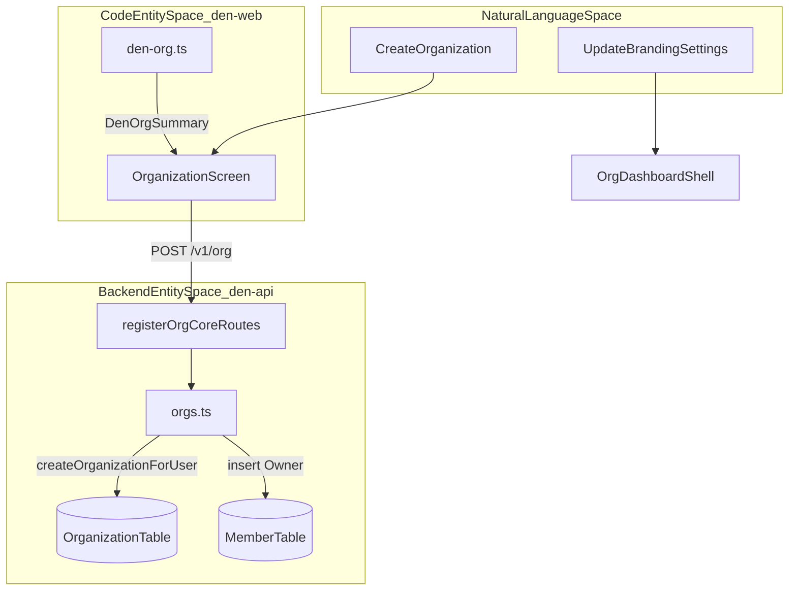
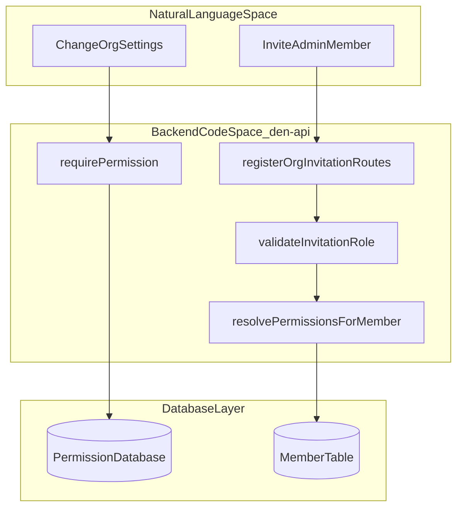

<!-- source: DeepWiki mcp.deepwiki.com · repo different-ai/openwork · extra page Organizations, Members and RBAC · fetched 2026-10-26 -->

# Organizations, Members and RBAC

Relevant source files

The following files were used as context for generating this wiki page:

- [apps/app/src/react-app/domains/settings/pages/library-page.tsx](apps/app/src/react-app/domains/settings/pages/library-page.tsx)
- [apps/app/src/react-app/domains/settings/pages/library-share-page.tsx](apps/app/src/react-app/domains/settings/pages/library-share-page.tsx)
- [ee/apps/den-api/src/auth-protection.ts](ee/apps/den-api/src/auth-protection.ts)
- [ee/apps/den-api/src/auth.ts](ee/apps/den-api/src/auth.ts)
- [ee/apps/den-api/src/organization-limits.ts](ee/apps/den-api/src/organization-limits.ts)
- [ee/apps/den-api/src/orgs.ts](ee/apps/den-api/src/orgs.ts)
- [ee/apps/den-api/src/routes/admin/index.ts](ee/apps/den-api/src/routes/admin/index.ts)
- [ee/apps/den-api/src/routes/auth/index.ts](ee/apps/den-api/src/routes/auth/index.ts)
- [ee/apps/den-api/src/routes/org/core.ts](ee/apps/den-api/src/routes/org/core.ts)
- [ee/apps/den-api/src/routes/org/invitations.ts](ee/apps/den-api/src/routes/org/invitations.ts)
- [ee/apps/den-api/src/routes/org/permissions.ts](ee/apps/den-api/src/routes/org/permissions.ts)
- [ee/apps/den-api/src/routes/workers/core.ts](ee/apps/den-api/src/routes/workers/core.ts)
- [ee/apps/den-api/src/routes/workers/shared.ts](ee/apps/den-api/src/routes/workers/shared.ts)
- [ee/apps/den-api/src/workers/cloud-lifecycle.ts](ee/apps/den-api/src/workers/cloud-lifecycle.ts)
- [ee/apps/den-web/app/(den)/_components/auth-panel.tsx](ee/apps/den-web/app/(den)/_components/auth-panel.tsx)
- [ee/apps/den-web/app/(den)/_components/auth-screen.tsx](ee/apps/den-web/app/(den)/_components/auth-screen.tsx)
- [ee/apps/den-web/app/(den)/_components/join-org-screen.tsx](ee/apps/den-web/app/(den)/_components/join-org-screen.tsx)
- [ee/apps/den-web/app/(den)/_components/join-org-success.tsx](ee/apps/den-web/app/(den)/_components/join-org-success.tsx)
- [ee/apps/den-web/app/(den)/_components/organization-screen.tsx](ee/apps/den-web/app/(den)/_components/organization-screen.tsx)
- [ee/apps/den-web/app/(den)/_components/ui/button.tsx](ee/apps/den-web/app/(den)/_components/ui/button.tsx)
- [ee/apps/den-web/app/(den)/_components/ui/chip.tsx](ee/apps/den-web/app/(den)/_components/ui/chip.tsx)
- [ee/apps/den-web/app/(den)/_components/ui/tabs.tsx](ee/apps/den-web/app/(den)/_components/ui/tabs.tsx)
- [ee/apps/den-web/app/(den)/_lib/den-org.ts](ee/apps/den-web/app/(den)/_lib/den-org.ts)
- [ee/apps/den-web/app/(den)/_providers/den-flow-provider.tsx](ee/apps/den-web/app/(den)/_providers/den-flow-provider.tsx)
- [ee/apps/den-web/app/(den)/dashboard/_components/command-palette/den-command-palette.tsx](ee/apps/den-web/app/(den)/dashboard/_components/command-palette/den-command-palette.tsx)
- [ee/apps/den-web/app/(den)/dashboard/_components/manage-members-screen.tsx](ee/apps/den-web/app/(den)/dashboard/_components/manage-members-screen.tsx)
- [ee/apps/den-web/app/(den)/dashboard/_components/member-role-select.tsx](ee/apps/den-web/app/(den)/dashboard/_components/member-role-select.tsx)
- [ee/apps/den-web/app/(den)/dashboard/_components/org-dashboard-shell.tsx](ee/apps/den-web/app/(den)/dashboard/_components/org-dashboard-shell.tsx)
- [ee/apps/den-web/app/(den)/dashboard/_components/permission-set-screen.tsx](ee/apps/den-web/app/(den)/dashboard/_components/permission-set-screen.tsx)
- [ee/apps/den-web/app/(den)/dashboard/_components/permissions-data.ts](ee/apps/den-web/app/(den)/dashboard/_components/permissions-data.ts)
- [ee/apps/den-web/app/(den)/dashboard/_components/role-picker.tsx](ee/apps/den-web/app/(den)/dashboard/_components/role-picker.tsx)
- [ee/apps/den-web/app/(den)/dashboard/_components/roles-tab.tsx](ee/apps/den-web/app/(den)/dashboard/_components/roles-tab.tsx)
- [ee/apps/den-web/app/(den)/dashboard/_components/shared-team-role-panel.tsx](ee/apps/den-web/app/(den)/dashboard/_components/shared-team-role-panel.tsx)
- [ee/apps/den-web/app/(den)/dashboard/_components/team-roles.test.ts](ee/apps/den-web/app/(den)/dashboard/_components/team-roles.test.ts)
- [ee/apps/den-web/app/(den)/dashboard/_components/team-roles.ts](ee/apps/den-web/app/(den)/dashboard/_components/team-roles.ts)
- [ee/apps/den-web/app/(den)/dashboard/_lib/dashboard-navigation.ts](ee/apps/den-web/app/(den)/dashboard/_lib/dashboard-navigation.ts)
- [ee/apps/den-web/app/(den)/dashboard/_providers/org-dashboard-provider.tsx](ee/apps/den-web/app/(den)/dashboard/_providers/org-dashboard-provider.tsx)
- [ee/apps/den-web/app/(den)/organization/page.tsx](ee/apps/den-web/app/(den)/organization/page.tsx)
- [ee/apps/den-web/app/globals.css](ee/apps/den-web/app/globals.css)
- [ee/apps/den-web/components/den-admin-panel.tsx](ee/apps/den-web/components/den-admin-panel.tsx)
- [ee/apps/den-web/package.json](ee/apps/den-web/package.json)

This page provides full technical documentation for organization management, member lifecycles, role-based access control (RBAC), invitations, teams, organization limits, and the administrative control plane within OpenWork Cloud (`ee/apps/den-api` and `ee/apps/den-web`).

## Purpose and Scope

Organizations act as the top-level tenancy and resource boundary in OpenWork Cloud. The system manages tenancy through Hono routing endpoints in `ee/apps/den-api/src/routes/org/` [ee/apps/den-api/src/routes/org/core.ts:1]() and core business logic in `ee/apps/den-api/src/orgs.ts` [ee/apps/den-api/src/orgs.ts:1](). Front-end interactions are driven by `ee/apps/den-web/app/(den)/_lib/den-org.ts` [ee/apps/den-web/app/(den)/_lib/den-org.ts:1]() and components like `ee/apps/den-web/app/(den)/dashboard/_components/org-dashboard-shell.tsx` [ee/apps/den-web/app/(den)/dashboard/_components/org-dashboard-shell.tsx:1]().

---

## 1. Organization Core Routes and Business Logic

Tenancy creation, settings updates, and metadata synchronization are handled by core organization routes.

### Core API Routes (`ee/apps/den-api/src/routes/org/core.ts`)
The core router defines endpoints for creating organizations (`POST /v1/org`), updating organization attributes (`PATCH /v1/org`), and resolving single-org configurations [ee/apps/den-api/src/routes/org/core.ts:46](). Updates allow modification of organization names, allowed email domains, branding settings (`brandAppName`, `brandLogoUrl`, `brandIconUrl`, `brandAccentColor`), and desktop version policies [ee/apps/den-api/src/routes/org/core.ts:50]().

### Business Logic (`ee/apps/den-api/src/orgs.ts`)
The `ee/apps/den-api/src/orgs.ts` module implements fundamental operations including:
*   `createOrganizationForUser`: Initializes an organization, inserts the creator into `MemberTable` as an owner, and provisions default policies [ee/apps/den-api/src/orgs.ts:32]()
*   `updateOrganizationSettings`: Handles persistence of metadata and JSON serialization for managed branding assets [ee/apps/den-api/src/orgs.ts:40]()
*   `acceptInvitationForUser`: Processes invitation tokens, validates membership states, and executes transition hooks [ee/apps/den-api/src/orgs.ts:31]()

Title: "Organization Management Data Flow"

Sources: [ee/apps/den-api/src/routes/org/core.ts:46-61](), [ee/apps/den-api/src/orgs.ts:31-41](), [ee/apps/den-web/app/(den)/_components/organization-screen.tsx:136-155]()

---

## 2. Members, Invitations and Role Guards

OpenWork implements a strict permission model combining static roles with granular permission flags.

### Roles and Permissions
Roles are categorized into canonical tiers (`owner`, `admin`, `member`) [ee/apps/den-web/app/(den)/_lib/den-org.ts:88](). The `DenOrgAccessFlags` type defines the capabilities granted to a signed-in member, mapping explicitly to required catalog permissions such as `organization.update`, `members.update`, `invitations.manage`, and `teams.manage` [ee/apps/den-web/app/(den)/_lib/den-org.ts:99]().

### Invitation Routes (`ee/apps/den-api/src/routes/org/invitations.ts`)
The invitations router governs member onboarding via `POST /v1/invitations` [ee/apps/den-api/src/routes/org/invitations.ts:42](). Key enforcement mechanisms include:
*   `validateInvitationRole`: Ensures callers attempting to invite an `Admin` hold sufficient permissions and passes role assignment denials if unauthorized [ee/apps/den-api/src/routes/org/invitations.ts:148]().
*   Domain restrictions: `isEmailAllowedForOrganization` checks if the invitee's email domain matches the organization's `allowedEmailDomains` policy [ee/apps/den-api/src/routes/org/invitations.ts:19]()
*   Seat entitlement validation: Verifies whether subscription limits permit adding a new seat before dispatching invitation emails [ee/apps/den-api/src/routes/org/invitations.ts:23]().

Title: "RBAC and Role Guards Enforcement Flow"

Sources: [ee/apps/den-api/src/routes/org/invitations.ts:42-149](), [ee/apps/den-api/src/routes/org/shared.ts:73-81](), [ee/apps/den-web/app/(den)/_lib/den-org.ts:99-204]()

---

## 3. Teams and Admin Team Access

Teams group members for collection and provider access, and can be configured to grant organization-wide `Admin` privileges.

### Team Administration (`ee/apps/den-api/src/organization-team-roles.ts`)
*   Manages organization admin team grants (`grantsOrganizationAdmin`) [ee/apps/den-api/src/orgs.ts:51]()
*   Synchronizes membership from SCIM providers when teams are marked as `managedByScim` [ee/apps/den-api/src/orgs.ts:50]()
*   Computes effective roles by merging direct roles with inherited admin grants from approved teams [ee/apps/den-api/src/orgs.ts:51]()

Sources: [ee/apps/den-api/src/orgs.ts:50-51](), [ee/apps/den-api/src/organization-team-roles.ts:1-50]()

---

## 4. Organization Limits and Metadata

Organization limits govern feature access, resource quotas, and compliance states.

### Metadata and Limits (`ee/apps/den-api/src/organization-limits.ts`)
*   `DEFAULT_ORGANIZATION_LIMITS` defines default ceilings for user counts, data retention, and cloud execution nodes [ee/apps/den-api/src/organization-limits.ts:1]()
*   `normalizeOrganizationMetadata` cleans and validates arbitrary JSON metadata payloads attached to organization records [ee/apps/den-api/src/organization-limits.ts:1]()

### Security and Operations (`packages/docs/cloud/security-and-operations.mdx`)
*   Enforces encrypted transport (HTTPS/TLS) and application-level AES-256-GCM encryption for sensitive database columns using `DEN_DB_ENCRYPTION_KEY` [packages/docs/cloud/security-and-operations.mdx:10]()
*   Mandates that privileged actions (SSO configuration, SCIM tokens, API keys, member role updates) require a fresh session created within the last 15 minutes [packages/docs/cloud/security-and-operations.mdx:53]()

Sources: [ee/apps/den-api/src/organization-limits.ts:1-30](), [packages/docs/cloud/security-and-operations.mdx:10-63]()

---

## 5. Admin Routes and Den Admin Panel

System administrators use a centralized control plane to oversee all platform organizations.

### Admin API Routes (`ee/apps/den-api/src/routes/admin/index.ts`)
The administration router exposes privileged endpoints secured by `adminRoute` middleware [ee/apps/den-api/src/routes/admin/index.ts:39](). It supports:
*   Updating organization subscription tiers (`free`, `team`, `enterprise`) and custom seat limits (`updateOrganizationPlanSchema`) [ee/apps/den-api/src/routes/admin/index.ts:111]()
*   Granting complimentary access and modifying feature flag overrides per organization (`updateOrganizationCapabilitiesSchema`) [ee/apps/den-api/src/routes/admin/index.ts:120]()

### Den Admin Panel (`ee/apps/den-web/components/den-admin-panel.tsx`)
The React administrative interface provides views for listing organizations, monitoring user activity metrics (`AdminSummary`), inspecting billing statuses, and adjusting feature flag rollouts (`AdminOrganizationFeatures`) [ee/apps/den-web/components/den-admin-panel.tsx:81]() [ee/apps/den-web/components/den-admin-panel.tsx:136]().

Sources: [ee/apps/den-api/src/routes/admin/index.ts:39-140](), [ee/apps/den-web/components/den-admin-panel.tsx:81-215]()

---

