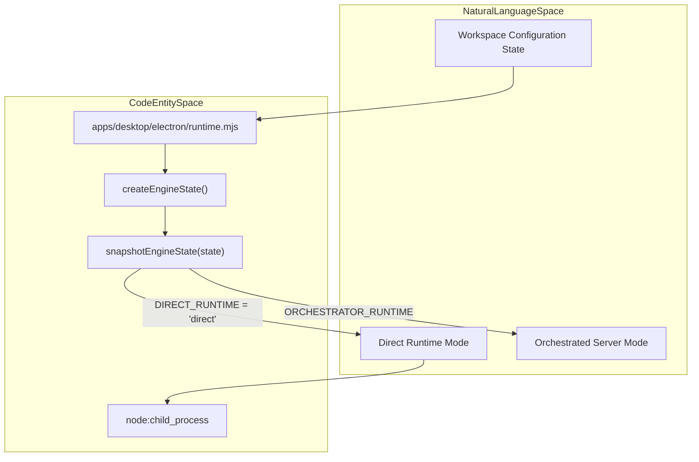
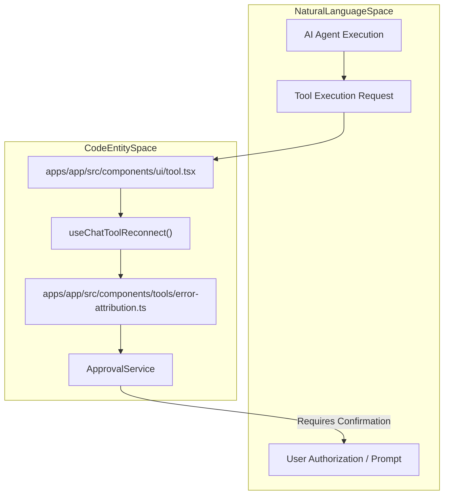
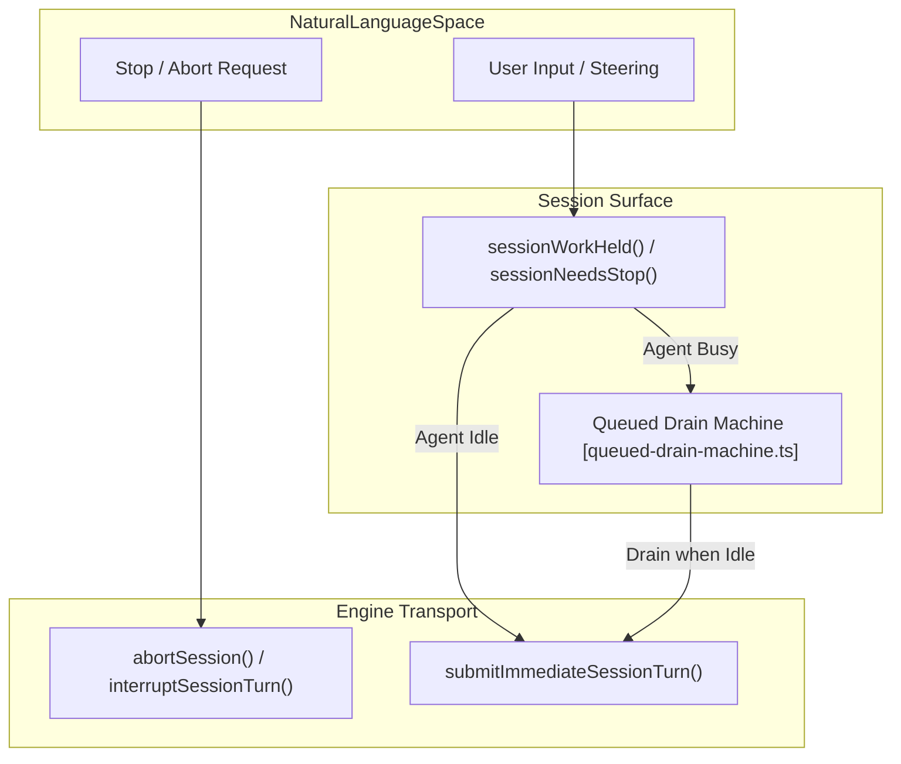

<!-- source: DeepWiki mcp.deepwiki.com · repo different-ai/openwork · extra page Permission System and Operational Modes · fetched 2026-10-26 -->

# Permission System and Operational Modes

Relevant source files

The following files were used as context for generating this wiki page:

- [DESIGN.md](DESIGN.md)
- [apps/app/src/components/chat/connection-card.tsx](apps/app/src/components/chat/connection-card.tsx)
- [apps/app/src/components/tools/error-attribution.ts](apps/app/src/components/tools/error-attribution.ts)
- [apps/app/src/components/tools/use-chat-tool-reconnect.ts](apps/app/src/components/tools/use-chat-tool-reconnect.ts)
- [apps/app/src/components/ui/hover-card.tsx](apps/app/src/components/ui/hover-card.tsx)
- [apps/app/src/components/ui/popover.tsx](apps/app/src/components/ui/popover.tsx)
- [apps/app/src/components/ui/tool.tsx](apps/app/src/components/ui/tool.tsx)
- [apps/app/src/lib/build-in-tools.ts](apps/app/src/lib/build-in-tools.ts)
- [apps/app/src/lib/latest-assistant-tool-parts.ts](apps/app/src/lib/latest-assistant-tool-parts.ts)
- [apps/app/src/lib/tool-activity.ts](apps/app/src/lib/tool-activity.ts)
- [apps/app/src/react-app/domains/session/panel/debug-rail-slot.tsx](apps/app/src/react-app/domains/session/panel/debug-rail-slot.tsx)
- [apps/app/src/react-app/domains/session/surface/composer/composer-suggestion-menu.tsx](apps/app/src/react-app/domains/session/surface/composer/composer-suggestion-menu.tsx)
- [apps/app/src/react-app/domains/session/surface/debug-panel.tsx](apps/app/src/react-app/domains/session/surface/debug-panel.tsx)
- [apps/app/src/react-app/domains/session/surface/debug-providers.tsx](apps/app/src/react-app/domains/session/surface/debug-providers.tsx)
- [apps/app/src/react-app/domains/session/surface/debug-resources.tsx](apps/app/src/react-app/domains/session/surface/debug-resources.tsx)
- [apps/app/src/react-app/domains/session/surface/mcp-chat-reconnect.ts](apps/app/src/react-app/domains/session/surface/mcp-chat-reconnect.ts)
- [apps/app/tests/floating-surface-guard.test.ts](apps/app/tests/floating-surface-guard.test.ts)
- [evals/core/agent-permissions.e2e.test.ts](evals/core/agent-permissions.e2e.test.ts)
- [evals/proofs/session-debug.proof.test.ts](evals/proofs/session-debug.proof.test.ts)
- [evals/worlds/engine-connectors-parity.ts](evals/worlds/engine-connectors-parity.ts)
- [evals/worlds/model-removal-cdp.ts](evals/worlds/model-removal-cdp.ts)
- [evals/worlds/session-debug.ts](evals/worlds/session-debug.ts)

## Purpose and Scope

This document details the permission system and operational runtime modes in OpenWork Desktop and Server. It covers tool-execution approvals, workspace run modes, direct versus orchestrated engine runtimes, and session lifecycle control mechanisms such as interruption, steering, and prompt admission.

---

## 1. Engine Operational Modes: Direct vs. Orchestrated Runtimes

OpenWork Desktop supports multiple runtime strategies that control how AI workspace services (`OpenCode`, `OpenWork Server`) are spawned, managed, and isolated. These modes determine the process lifecycle, persistence behavior, and multi-workspace capabilities.

OpenWork manages these processes within the Electron main process via the `runtime.mjs` module [apps/desktop/electron/runtime.mjs:1-25](). It distinguishes between two primary runtime strategies: `direct` and orchestrated server modes.

### Runtime Mode Architecture & Code Entities

Title: "Engine Runtime Lifecycle and Process Management"

Sources: [apps/desktop/electron/runtime.mjs:1-40](), [apps/desktop/electron/runtime.mjs:105-138]()

### Key Characteristics

| Aspect | Direct Runtime | Orchestrated / Server Runtime |
|--------|----------------|-----------------------------|
| **Process Ownership** | Managed directly as a child process via `node:child_process` [apps/desktop/electron/runtime.mjs:2-10](). | Offloaded to a dedicated CLI daemon or local sidecar server. |
| **Persistence** | Services terminate when the desktop application closes [apps/desktop/electron/runtime.mjs:125-138](). | Persists independently of the Desktop UI, supporting background tasks. |
| **Port Management** | Assigns ports dynamically within a designated range (`48000–51000`) [apps/desktop/electron/runtime.mjs:27-30](). | Binds to configured or discovered server endpoints. |

Sources: [apps/desktop/electron/runtime.mjs:1-40](), [apps/desktop/electron/runtime.mjs:105-138]()

---

## 2. Workspace Run Modes and Execution Policies

Workspaces execute under specific operational constraints defined by workspace run modes. The OpenWork server maintains run-mode state per workspace using configuration stores and handlers.

### Implementation and Routing
- **Read & Write State**: Run modes are retrieved via `readWorkspaceRunMode()` and modified via `setWorkspaceRunMode()` [apps/server/src/server.ts:135-140]().
- **Execution Boundaries**: Run modes dictate whether an agent can perform autonomous mutations (e.g., executing shell scripts, modifying filesystem resources directly) or requires explicit step-by-step gatekeeping.

Sources: [apps/server/src/server.ts:135-140]()

---

## 3. Tool-Execution Approvals and Permission System

When agents execute capabilities—such as shell commands, file modifications, or external API calls via Model Context Protocol (MCP) servers—OpenWork enforces strict authorization guardrails through its approval and permission system.

### Approval Service Architecture & Code Entities

Title: "Tool Execution Approval Flow and Error Attribution"

Sources: [apps/app/src/components/ui/tool.tsx:1-50](), [apps/app/src/components/tools/error-attribution.ts:1-45]()

- **Approval Service**: The backend coordinates pending authorization states through an `ApprovalService` instance [apps/server/src/server.ts:14-16]().
- **Effective Permissions**: The system evaluates governing agents and summarizes effective permissions using helper utilities before granting tool access [apps/server/src/agent-context-diagnostics.js:1-25](), [apps/server/src/effective-permissions.js:130-140]().
- **Error Attribution & Reconnection**: When tool executions fail or require OAuth credentials, `error-attribution.ts` and `use-chat-tool-reconnect.ts` analyze error payloads and expose recovery actions [apps/app/src/components/tools/error-attribution.ts:100-140](), [apps/app/src/components/tools/use-chat-tool-reconnect.ts:35-65]().

Sources: [apps/server/src/server.ts:14-16](), [apps/server/src/agent-context-diagnostics.js:1-25](), [apps/server/src/effective-permissions.js:130-140](), [apps/app/src/components/ui/tool.tsx:1-201](), [apps/app/src/components/tools/error-attribution.ts:1-164](), [apps/app/src/components/tools/use-chat-tool-reconnect.ts:35-65]()

---

## 4. Session Interruption, Steering, and Admission

OpenWork provides granular control over active agent turns, allowing users to interrupt execution, steer responses mid-task, queue subsequent inputs, or handle prompt admissions.

### Session Interruption State Machine

Title: "Session Submission, Interruption, and Queue Draining"

Sources: [apps/app/src/react-app/domains/session/surface/session-surface.tsx:12-80]()

### Key Control Functions
- **Interruption**: Users can abort active turns using `abortSession()` and `interruptSessionTurn()` [apps/app/src/react-app/domains/session/surface/session-surface.tsx:12-16]().
- **Admission & Queuing**: The queued drain machine (`queued-drain-machine.ts`) manages prompts submitted while an agent is executing, determining whether a submission should be sent immediately (`Steer`) or buffered until task completion (`Queue`) [apps/app/src/react-app/domains/session/surface/session-surface.tsx:70-80]().

Sources: [apps/app/src/react-app/domains/session/surface/session-surface.tsx:12-16](), [apps/app/src/react-app/domains/session/surface/session-surface.tsx:70-80]()

---

