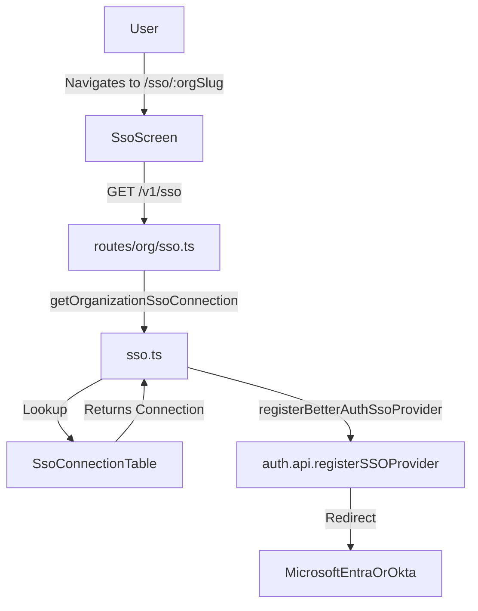
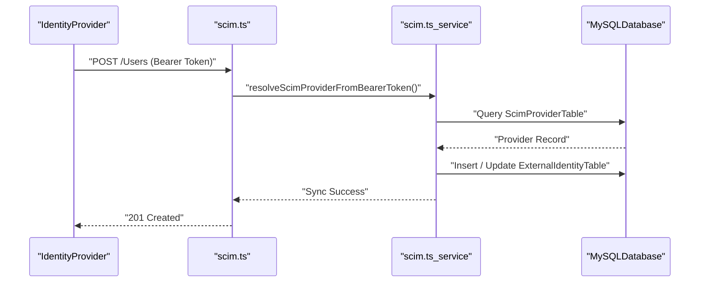

<!-- source: DeepWiki mcp.deepwiki.com · repo different-ai/openwork · extra page SSO, SCIM and Audit Logging · fetched 2026-10-26 -->

# SSO, SCIM and Audit Logging

Relevant source files

The following files were used as context for generating this wiki page:

- [docs/microsoft-entra-sso-scim.md](docs/microsoft-entra-sso-scim.md)
- [ee/apps/den-api/src/audit-events.ts](ee/apps/den-api/src/audit-events.ts)
- [ee/apps/den-api/src/enterprise-auth-requirement.ts](ee/apps/den-api/src/enterprise-auth-requirement.ts)
- [ee/apps/den-api/src/observability/logger.ts](ee/apps/den-api/src/observability/logger.ts)
- [ee/apps/den-api/src/observability/runtime.ts](ee/apps/den-api/src/observability/runtime.ts)
- [ee/apps/den-api/src/observability/scim-diagnostics.ts](ee/apps/den-api/src/observability/scim-diagnostics.ts)
- [ee/apps/den-api/src/openapi.ts](ee/apps/den-api/src/openapi.ts)
- [ee/apps/den-api/src/organization-member-guards.ts](ee/apps/den-api/src/organization-member-guards.ts)
- [ee/apps/den-api/src/routes/auth/README.md](ee/apps/den-api/src/routes/auth/README.md)
- [ee/apps/den-api/src/routes/org/api-keys.ts](ee/apps/den-api/src/routes/org/api-keys.ts)
- [ee/apps/den-api/src/routes/org/members.ts](ee/apps/den-api/src/routes/org/members.ts)
- [ee/apps/den-api/src/routes/org/scim.ts](ee/apps/den-api/src/routes/org/scim.ts)
- [ee/apps/den-api/src/routes/org/shared.ts](ee/apps/den-api/src/routes/org/shared.ts)
- [ee/apps/den-api/src/routes/org/sso.ts](ee/apps/den-api/src/routes/org/sso.ts)
- [ee/apps/den-api/src/scim-existing-user-linking.ts](ee/apps/den-api/src/scim-existing-user-linking.ts)
- [ee/apps/den-api/src/scim-token-storage.ts](ee/apps/den-api/src/scim-token-storage.ts)
- [ee/apps/den-api/src/scim.ts](ee/apps/den-api/src/scim.ts)
- [ee/apps/den-api/src/sso-domain-verification.ts](ee/apps/den-api/src/sso-domain-verification.ts)
- [ee/apps/den-api/src/sso-entra-domain.ts](ee/apps/den-api/src/sso-entra-domain.ts)
- [ee/apps/den-api/src/sso-readiness.ts](ee/apps/den-api/src/sso-readiness.ts)
- [ee/apps/den-api/src/sso-saml-policy.ts](ee/apps/den-api/src/sso-saml-policy.ts)
- [ee/apps/den-api/src/sso.ts](ee/apps/den-api/src/sso.ts)
- [ee/apps/den-web/app/(den)/_components/reauth-dialog.tsx](ee/apps/den-web/app/(den)/_components/reauth-dialog.tsx)
- [ee/apps/den-web/app/(den)/dashboard/_components/api-keys-screen.tsx](ee/apps/den-web/app/(den)/dashboard/_components/api-keys-screen.tsx)
- [ee/apps/den-web/app/(den)/dashboard/_components/org-settings-screen.tsx](ee/apps/den-web/app/(den)/dashboard/_components/org-settings-screen.tsx)
- [ee/apps/den-web/app/(den)/dashboard/_components/scim-screen.tsx](ee/apps/den-web/app/(den)/dashboard/_components/scim-screen.tsx)
- [ee/apps/den-web/app/(den)/dashboard/_components/sso-screen.tsx](ee/apps/den-web/app/(den)/dashboard/_components/sso-screen.tsx)
- [ee/apps/den-web/app/(den)/dashboard/_lib/stripe-web-billing.ts](ee/apps/den-web/app/(den)/dashboard/_lib/stripe-web-billing.ts)
- [ee/apps/den-web/app/(den)/dashboard/web/page.tsx](ee/apps/den-web/app/(den)/dashboard/web/page.tsx)
- [ee/apps/den-web/app/(den)/reauth/complete/page.tsx](ee/apps/den-web/app/(den)/reauth/complete/page.tsx)
- [ee/apps/den-web/app/api/_lib/den-api-redirect.ts](ee/apps/den-web/app/api/_lib/den-api-redirect.ts)
- [ee/apps/den-web/app/api/_lib/upstream-proxy.ts](ee/apps/den-web/app/api/_lib/upstream-proxy.ts)
- [ee/apps/den-web/app/api/auth/[...path]/route.ts](ee/apps/den-web/app/api/auth/[...path]/route.ts)
- [ee/apps/den-web/app/api/den/[...path]/route.ts](ee/apps/den-web/app/api/den/[...path]/route.ts)
- [ee/apps/den-web/observability/runtime-logger.ts](ee/apps/den-web/observability/runtime-logger.ts)
- [ee/apps/den-web/observability/sentry-runtime.ts](ee/apps/den-web/observability/sentry-runtime.ts)
- [packages/docs/cloud/get-started.mdx](packages/docs/cloud/get-started.mdx)
- [packages/docs/cloud/members-and-rbac.mdx](packages/docs/cloud/members-and-rbac.mdx)
- [packages/docs/cloud/run-in-the-cloud/open-cloud-in-browser.mdx](packages/docs/cloud/run-in-the-cloud/open-cloud-in-browser.mdx)
- [packages/docs/cloud/run-in-the-cloud/shared-workspace.mdx](packages/docs/cloud/run-in-the-cloud/shared-workspace.mdx)
- [packages/docs/cloud/scim-google-workspace.mdx](packages/docs/cloud/scim-google-workspace.mdx)
- [packages/docs/cloud/scim-microsoft-entra.mdx](packages/docs/cloud/scim-microsoft-entra.mdx)
- [packages/docs/cloud/scim-okta.mdx](packages/docs/cloud/scim-okta.mdx)
- [packages/docs/cloud/security-and-operations.mdx](packages/docs/cloud/security-and-operations.mdx)
- [packages/docs/cloud/sso-google-workspace.mdx](packages/docs/cloud/sso-google-workspace.mdx)
- [packages/docs/cloud/sso-microsoft-entra.mdx](packages/docs/cloud/sso-microsoft-entra.mdx)
- [packages/docs/cloud/sso-okta.mdx](packages/docs/cloud/sso-okta.mdx)
- [packages/docs/images/cloud-org-settings.png](packages/docs/images/cloud-org-settings.png)

OpenWork provides enterprise-grade identity management through **Single Sign-On (SSO)**, **System for Cross-domain Identity Management (SCIM)**, comprehensive **Audit Logging**, and an **Upstream Proxy** for cloud routing. These systems allow large organizations to automate member provisioning, enforce centralized authentication policies via SAML/OIDC, handle Microsoft Entra domain validation, track sensitive administrative actions for compliance, and securely proxy requests between the Next.js frontend control plane (`ee/apps/den-web`) and the backend API (`ee/apps/den-api`).

The implementation is centered in `ee/apps/den-api` and `ee/apps/den-web`, utilizing the **Better Auth** framework with specialized plugins and organization-scoped routing.

---

## Single Sign-On (SSO) and SAML/OIDC Policy

SSO integration allows organizations to enforce authentication through their own identity providers using SAML or OIDC protocols. The core management logic resides in `ee/apps/den-api/src/sso.ts`, supporting registration, configuration revisions, and Better Auth provider synchronization.

### Implementation Details
- **SAML Policy**: Configured using `ORGANIZATION_SAML_WANT_ASSERTIONS_SIGNED` [ee/apps/den-api/src/sso.ts:14]() to dictate assertion signature verification requirements.
- **OIDC Discovery**: Automatically resolves issuer endpoints via `resolveOidcEndpoints` using `.well-known/openid-configuration` with timeout and schema validation (`oidcDiscoverySchema`), or allows manual endpoint overrides (`skipDiscovery`) [ee/apps/den-api/src/sso.ts:51-145]().
- **Provider Registration**: `registerOrganizationSsoConnection` and `registerBetterAuthSsoProvider` bridge the database configuration with Better Auth's runtime provider store [ee/apps/den-api/src/sso.ts:190-250]().

**SSO Identity Mapping & Code Bridge**

Sources: [ee/apps/den-api/src/sso.ts:51-145](), [ee/apps/den-api/src/routes/org/sso.ts:1-25](), [ee/apps/den-web/app/(den)/dashboard/_components/sso-screen.tsx:28-94]()

---

## Entra Domain Handling

To secure enterprise integrations and prevent domain spoofing or unauthorized overlap, OpenWork features dedicated handling for Microsoft Entra managed domains.

### Implementation Details
- **Domain Verification**: Organizations must prove ownership of email domains associated with an SSO connection [ee/apps/den-api/src/routes/org/sso.ts:190-192]().
- **Microsoft Entra Check**: `isMicrosoftEntraManagedDomain` identifies verified enterprise tenants and governs automatic validation rules [ee/apps/den-api/src/sso.ts:12]().
- **Domain Changes**: Changes to organization domains trigger audit tracking via helper functions like `appendDomainChanges` [ee/apps/den-api/src/sso.ts:6]().

Sources: [ee/apps/den-api/src/sso.ts:1-16](), [ee/apps/den-api/src/routes/org/sso.ts:190-195]()

---

## SCIM Provisioning and Token Storage

SCIM allows external identity providers (such as Okta or Entra ID) to manage user lifecycles within an OpenWork organization automatically.

### Implementation Architecture
- **Provisioning Endpoints**: Exposed via RFC 7644 compliant routes under `ee/apps/den-api/src/routes/auth/scim.ts` [ee/apps/den-api/src/routes/auth/scim.ts:1-80]().
- **Token Resolution**: Incoming bearer tokens are checked against stored credentials via `resolveScimProviderFromBearerToken` and `resolveStoredScimProvider` [ee/apps/den-api/src/scim.ts:69-78]() which interface with `ee/apps/den-api/src/scim-token-storage.ts`.
- **Sync & Tombstones**: `syncExternalIdentityForProvider` manages user creation, updates, and deactivation, interacting with `ScimUserTombstoneTable` and `ExternalIdentityTable` [ee/apps/den-api/src/scim.ts:90-174]().

**SCIM Provisioning Flow**

Sources: [ee/apps/den-api/src/scim.ts:69-174](), [ee/apps/den-api/src/routes/auth/scim.ts:99-133]()

---

## Audit Logging and `audit-events.ts` Classification

All enterprise identity changes, security updates, and administrative actions are systematically captured and recorded via `ee/apps/den-api/src/audit-events.ts`.

### Classification and Alert Actions
- **Audit Actions**: Defined in `ORGANIZATION_AUDIT_ACTIONS`, covering API keys, invitations, roles, SCIM token rotations, SCIM group mapping updates, and SSO registrations/modifications [ee/apps/den-api/src/audit-events.ts:7-35]().
- **Alert Classification**: `isOrganizationAuditAlertAction` determines whether a given audit action warrants an immediate operational alert (`[audit-alert]`) written to the logs [ee/apps/den-api/src/audit-events.ts:59-93]().
- **Recording**: `recordOrganizationAuditEvent` persists the event to `AuditEventTable` and emits a structured log line via `buildOrganizationAuditAlertLogLine` [ee/apps/den-api/src/audit-events.ts:95-139]().

| Action Constant | Description | Code Reference |
|:---|:---|:---|
| `ssoConnectionRegistered` | New SAML/OIDC provider added | `ORGANIZATION_AUDIT_ACTIONS` [ee/apps/den-api/src/audit-events.ts:23]() |
| `ssoConnectionEnabled` | SSO connection activated | `ORGANIZATION_AUDIT_ACTIONS` [ee/apps/den-api/src/audit-ensors.ts:24]() |
| `scimTokenRotated` | SCIM bearer token refreshed | `ORGANIZATION_AUDIT_ACTIONS` [ee/apps/den-api/src/audit-events.ts:19]() |
| `scimConnectionDeleted` | SCIM integration removed | `ORGANIZATION_AUDIT_ACTIONS` [ee/apps/den-api/src/audit-events.ts:20]() |
| `memberRoleUpdated` | Role changed for an existing member | `ORGANIZATION_AUDIT_ACTIONS` [ee/apps/den-api/src/audit-events.ts:16]() |

Sources: [ee/apps/den-api/src/audit-events.ts:7-139]()

---

## Upstream Proxy and Cloud Routing

OpenWork Cloud instances are served from dynamic origins that are re-signed on every wake. The frontend control plane (`ee/apps/den-web`) leverages an upstream proxy located at `ee/apps/den-web/app/api/_lib/upstream-proxy.ts` to forward requests safely to `ee/apps/den-api`.

### Implementation Details
- **Route Prefixes**: The Den API proxy opts in via `DEN_API_ROUTE_PREFIX` (`/api/den`) and `BROWSER_API_ROUTE_PREFIX` (`/api/browser/v1`) [ee/apps/den-web/app/api/_lib/upstream-proxy.ts:71-72]().
- **Cloud Instance Verification**: `isCloudInstanceOrigin` validates if incoming requests originate from allowed Daytona preview domains (e.g., `.daytonaproxy01.net`) [ee/apps/den-web/app/api/_lib/upstream-proxy.ts:73-99]().
- **Security Isolation**: `reflectsCloudInstanceOrigin` strips cookie headers from forwarded instance requests. Instance-origin calls are authenticated solely by their bearer tokens, protecting sessions from cross-origin tampering [ee/apps/den-web/app/api/_lib/upstream-proxy.ts:57-70]().

Sources: [ee/apps/den-web/app/api/_lib/upstream-proxy.ts:1-121]()

---

