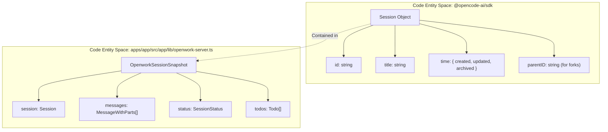
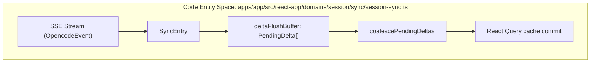
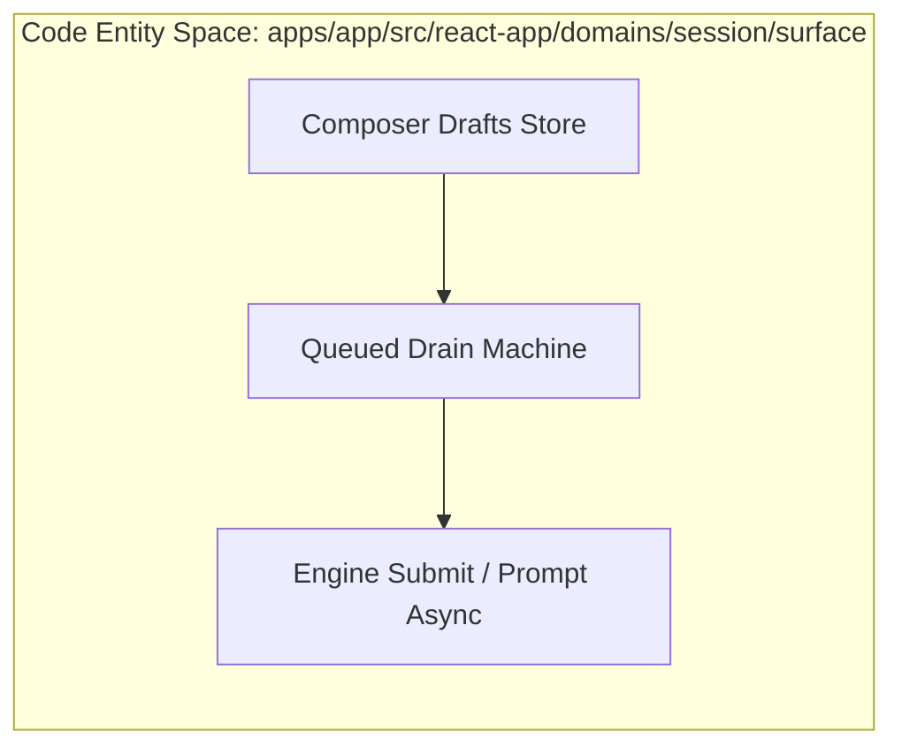
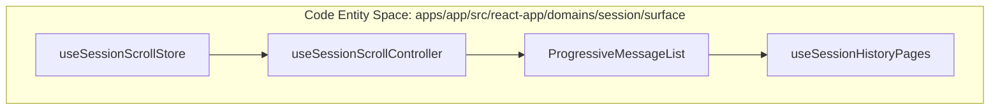

<!-- source: DeepWiki mcp.deepwiki.com · repo different-ai/openwork · extra page Sessions and Synchronization · fetched 2026-10-26 -->

# Sessions and Synchronization

Relevant source files

The following files were used as context for generating this wiki page:

- [apps/app/src/app/lib/opencode-interruption.ts](apps/app/src/app/lib/opencode-interruption.ts)
- [apps/app/src/app/lib/opencode-session-native.ts](apps/app/src/app/lib/opencode-session-native.ts)
- [apps/app/src/app/lib/opencode.ts](apps/app/src/app/lib/opencode.ts)
- [apps/app/src/app/lib/openwork-server.ts](apps/app/src/app/lib/openwork-server.ts)
- [apps/app/src/components/chat/message-list-provider.tsx](apps/app/src/components/chat/message-list-provider.tsx)
- [apps/app/src/components/chat/message-list.tsx](apps/app/src/components/chat/message-list.tsx)
- [apps/app/src/components/chat/progressive-message-list.tsx](apps/app/src/components/chat/progressive-message-list.tsx)
- [apps/app/src/i18n/locales/en.ts](apps/app/src/i18n/locales/en.ts)
- [apps/app/src/react-app/domains/connections/provider-auth/store.ts](apps/app/src/react-app/domains/connections/provider-auth/store.ts)
- [apps/app/src/react-app/domains/session/chat/session-page.tsx](apps/app/src/react-app/domains/session/chat/session-page.tsx)
- [apps/app/src/react-app/domains/session/sidebar/app-sidebar-provider.tsx](apps/app/src/react-app/domains/session/sidebar/app-sidebar-provider.tsx)
- [apps/app/src/react-app/domains/session/sidebar/app-sidebar.tsx](apps/app/src/react-app/domains/session/sidebar/app-sidebar.tsx)
- [apps/app/src/react-app/domains/session/sidebar/utils.ts](apps/app/src/react-app/domains/session/sidebar/utils.ts)
- [apps/app/src/react-app/domains/session/status/session-activity-store.ts](apps/app/src/react-app/domains/session/status/session-activity-store.ts)
- [apps/app/src/react-app/domains/session/status/session-attention.ts](apps/app/src/react-app/domains/session/status/session-attention.ts)
- [apps/app/src/react-app/domains/session/surface/composer-state-store.ts](apps/app/src/react-app/domains/session/surface/composer-state-store.ts)
- [apps/app/src/react-app/domains/session/surface/queued-drain-machine.ts](apps/app/src/react-app/domains/session/surface/queued-drain-machine.ts)
- [apps/app/src/react-app/domains/session/surface/scroll-controller.ts](apps/app/src/react-app/domains/session/surface/scroll-controller.ts)
- [apps/app/src/react-app/domains/session/surface/scroll-store.ts](apps/app/src/react-app/domains/session/surface/scroll-store.ts)
- [apps/app/src/react-app/domains/session/surface/session-history-pages.ts](apps/app/src/react-app/domains/session/surface/session-history-pages.ts)
- [apps/app/src/react-app/domains/session/surface/session-history.tsx](apps/app/src/react-app/domains/session/surface/session-history.tsx)
- [apps/app/src/react-app/domains/session/surface/session-render-state.ts](apps/app/src/react-app/domains/session/surface/session-render-state.ts)
- [apps/app/src/react-app/domains/session/surface/session-surface.tsx](apps/app/src/react-app/domains/session/surface/session-surface.tsx)
- [apps/app/src/react-app/domains/session/sync/env-context.ts](apps/app/src/react-app/domains/session/sync/env-context.ts)
- [apps/app/src/react-app/domains/session/sync/global-queue-drainer.ts](apps/app/src/react-app/domains/session/sync/global-queue-drainer.ts)
- [apps/app/src/react-app/domains/session/sync/message-merge.ts](apps/app/src/react-app/domains/session/sync/message-merge.ts)
- [apps/app/src/react-app/domains/session/sync/session-sync.ts](apps/app/src/react-app/domains/session/sync/session-sync.ts)
- [apps/app/src/react-app/domains/session/sync/transcript-reconcile.ts](apps/app/src/react-app/domains/session/sync/transcript-reconcile.ts)
- [apps/app/src/react-app/domains/session/sync/use-session-interactions.ts](apps/app/src/react-app/domains/session/sync/use-session-interactions.ts)
- [apps/app/src/react-app/domains/session/sync/usechat-adapter.ts](apps/app/src/react-app/domains/session/sync/usechat-adapter.ts)
- [apps/app/src/react-app/shell/session-route.tsx](apps/app/src/react-app/shell/session-route.tsx)
- [apps/app/src/react-app/shell/settings-route.tsx](apps/app/src/react-app/shell/settings-route.tsx)
- [apps/app/tests/opencode-session-native.test.ts](apps/app/tests/opencode-session-native.test.ts)
- [apps/app/tests/opencode-stream-timeout.test.ts](apps/app/tests/opencode-stream-timeout.test.ts)
- [apps/app/tests/session-history.test.tsx](apps/app/tests/session-history.test.tsx)
- [apps/app/tests/session-scroll.test.tsx](apps/app/tests/session-scroll.test.tsx)
- [apps/app/tests/session-send-isolation.test.ts](apps/app/tests/session-send-isolation.test.ts)
- [apps/app/tests/session-stop-refresh.test.ts](apps/app/tests/session-stop-refresh.test.ts)
- [apps/server/src/server.ts](apps/server/src/server.ts)

This page covers section 3.1.2 of the OpenWork architecture: session lifecycle, real-time synchronization, transcript reconciliation, message merging, the queued drain machine, scroll/history paging, and the activity/attention stores.

---

## Data Model and Lifecycle

A session represents an individual conversation thread with the AI agent within OpenWork. Each session maintains its own message history, task list (todos), and execution context.

### Session Structure

The frontend interacts with sessions through two primary lenses: the **Snapshot** (a point-in-time state from the server) and the **Live Stream** (real-time updates via SSE).

**Sources:** [apps/app/src/app/lib/openwork-server.ts:1-100](), [apps/app/src/react-app/domains/session/sync/session-sync.ts:36-40]()

### Session Management Primitives

OpenWork provides several operations to manage the session lifecycle via helper modules like `opencode-session.ts`:

| Operation | Function | Description |
|-----------|----------|-------------|
| **Abort** | `abortSessionSafe` | Stops an active AI run. Handles safety checks to prevent UI crashes. [apps/app/src/react-app/shell/session-route.tsx:30-30]() |
| **Revert** | `revertSession` | Rolls back the conversation to a specific message boundary. [apps/app/src/react-app/shell/session-route.tsx:30-30]() |
| **Fork** | `forkSession` | Creates a new session branch starting from a specific message. [apps/app/src/react-app/shell/session-route.tsx:30-30]() |
| **Archive** | `setSessionArchived` | Non-destructively hides a session from the active list by stamping `time.archived`. |
| **Compact** | `compactSession` | Summarizes long sessions to reduce LLM context window usage. |

**Sources:** [apps/app/src/react-app/shell/session-route.tsx:28-35]()

---

## Session Synchronization Architecture

Real-time session updates are handled by the `session-sync.ts` module, which manages `SyncEntry` objects to bridge the OpenCode SSE stream with the React application state.

### Real-time Event Handling

The application uses `session-sync.ts` to manage high-frequency events. To maintain UI performance, "deltas" (streaming tokens) are buffered and flushed in batches via request animation frames or background timers [apps/app/src/react-app/domains/session/sync/session-sync.ts:125-135]().

**Sources:** [apps/app/src/react-app/domains/session/sync/session-sync.ts:110-155](), [apps/app/src/react-app/domains/session/sync/session-transcript-deltas.ts:50-65]()

### Transcript Reconciliation and Message Merging

The rendered transcript is a hybrid of the persisted history (`OpenworkSessionSnapshot`) and the live stream updates. The reconciliation logic ensures data integrity:

*   **Deduplication & Revert Curation:** `transcript-reconcile.ts` applies revert cursors and reconciles live message structures.
*   **Chronological Message Merge:** `message-merge.ts` implements `upsertMessageByChronology` to interleave new messages and parts smoothly without layout thrashing [apps/app/src/react-app/domains/session/sync/session-sync.ts:38-40]().

**Sources:** [apps/app/src/react-app/domains/session/sync/session-sync.ts:35-45](), [apps/app/src/react-app/domains/session/sync/message-merge.ts:1-20]()

---

## Queued Drain Machine and Composer State

When users submit messages while an agent run is active, messages are intercepted by the queued drain state machine (`queued-drain-machine.ts`) [apps/app/src/react-app/domains/session/surface/session-surface.tsx:72-79](). 

The queued drain machine manages pending submissions, handling retries, automatic draining upon turn completion, and failure recovery without duplicating inputs.

**Sources:** [apps/app/src/react-app/domains/session/surface/session-surface.tsx:70-80](), [apps/app/src/react-app/domains/session/surface/queued-drain-machine.ts:1-35]()

---

## Scroll and History Paging

To maintain responsiveness over long conversation histories, OpenWork implements progressive virtualized paging using TanStack Virtual and custom scroll controllers.

*   **Virtualization:** `ProgressiveMessageList` utilizes virtualization to manage message groups and maintain stable scroll anchors [apps/app/src/components/chat/progressive-message-list.tsx:65-75]().
*   **Scroll Store:** `scroll-store.ts` tracks anchor positions, geometry owners, and sticky-bottom states across sessions [apps/app/src/react-app/domains/session/surface/scroll-store.ts:1-25]().

**Sources:** [apps/app/src/react-app/domains/session/surface/scroll-controller.ts:1-50](), [apps/app/src/react-app/domains/session/surface/scroll-store.ts:1-30](), [apps/app/src/components/chat/progressive-message-list.tsx:60-80]()

---

## Activity and Attention Stores

OpenWork uses dedicated Zustand stores to track ongoing execution and user attention requirements across sessions.

*   **Activity Store (`session-activity-store.ts`):** Tracks real-time states such as execution phases, tool calls, and background sync status [apps/app/src/react-app/domains/session/sync/session-sync.ts:40-45]().
*   **Attention Store (`session-attention.ts`):** Identifies sessions requiring user input (e.g., `waiting` status or permission requests) so notification badges and indicators update correctly.

**Sources:** [apps/app/src/react-app/domains/session/sync/session-sync.ts:40-45](), [apps/app/src/react-app/domains/session/status/session-attention.ts:1-20]()

---

## Key Code Entities

| Entity | Location | Purpose |
|--------|----------|---------|
| `SyncEntry` / `session-sync.ts` | [apps/app/src/react-app/domains/session/sync/session-sync.ts:111-155]() | Manages SSE streams, delta buffering, and event listeners for active sessions. |
| `reconcileTranscriptMessages` | [apps/app/src/react-app/domains/session/sync/transcript-reconcile.ts:1-20]() | Reconciles server snapshots and live SSE streaming messages. |
| `upsertMessageByChronology` | [apps/app/src/react-app/domains/session/sync/message-merge.ts:1-15]() | Merges incoming transcript parts chronologically. |
| `useSessionScrollController` | [apps/app/src/react-app/domains/session/surface/scroll-controller.ts:1-40]() | Manages user scroll interactions, sticky bottom state, and anchor restoration. |
| `ProgressiveMessageList` | [apps/app/src/components/chat/progressive-message-list.tsx:65-75]() | Virtualized list component for efficient rendering of long conversation histories. |

**Sources:** [apps/app/src/react-app/domains/session/sync/session-sync.ts:111-155](), [apps/app/src/react-app/domains/session/sync/transcript-reconcile.ts:1-20](), [apps/app/src/react-app/domains/session/sync/message-merge.ts:1-15](), [apps/app/src/react-app/domains/session/surface/scroll-controller.ts:1-40](), [apps/app/src/components/chat/progressive-message-list.tsx:65-75]()

---

