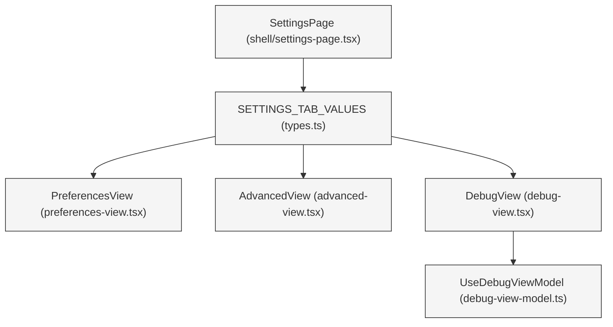
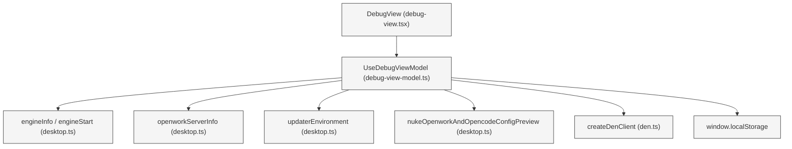

<!-- source: DeepWiki mcp.deepwiki.com · repo different-ai/openwork · extra page Settings, Preferences and Developer Mode · fetched 2026-10-26 -->

# Settings, Preferences and Developer Mode

Relevant source files

The following files were used as context for generating this wiki page:

- [apps/app/src/react-app/domains/settings/pages/advanced-view-sections.tsx](apps/app/src/react-app/domains/settings/pages/advanced-view-sections.tsx)
- [apps/app/src/react-app/domains/settings/pages/advanced-view.tsx](apps/app/src/react-app/domains/settings/pages/advanced-view.tsx)
- [apps/app/src/react-app/domains/settings/pages/debug-view.tsx](apps/app/src/react-app/domains/settings/pages/debug-view.tsx)
- [apps/app/src/react-app/domains/settings/pages/preferences-view.tsx](apps/app/src/react-app/domains/settings/pages/preferences-view.tsx)
- [apps/app/src/react-app/domains/settings/state/debug-view-model.ts](apps/app/src/react-app/domains/settings/state/debug-view-model.ts)
- [apps/app/src/react-app/domains/settings/state/feature-flags-preferences.ts](apps/app/src/react-app/domains/settings/state/feature-flags-preferences.ts)
- [apps/app/src/react-app/kernel/local-preferences-storage.ts](apps/app/src/react-app/kernel/local-preferences-storage.ts)
- [apps/app/src/react-app/kernel/local-provider.tsx](apps/app/src/react-app/kernel/local-provider.tsx)
- [apps/desktop/electron/nuke-worker.mjs](apps/desktop/electron/nuke-worker.mjs)
- [apps/desktop/electron/nuke.mjs](apps/desktop/electron/nuke.mjs)

## Purpose and Scope
This page covers the technical architecture of OpenWork's settings shell, preferences, feature-flag preferences, local provider integration, debug view-model, advanced configuration views, and destructive reset/nuke flows. It details how client-side state is synchronized with Electron main-process IPC handlers and persistent storage layers.

---

## 1. Settings Shell, Navigation and Pages
The settings interface is hosted within the application shell [apps/app/src/react-app/domains/settings/shell/settings-page.tsx]() and driven by a statically typed array of tab identifiers defined in `SETTINGS_TAB_VALUES` [apps/app/src/app/types.ts:186-206]().

The settings shell manages active tab selection, sub-navigation routing, and modal versus embedded view states. It renders dedicated domains for general configuration, AI providers, preferences, permissions, cloud accounts, extensions, advanced options, and diagnostics [apps/app/src/app/types.ts:186-206]().

*Figure 1: Settings component hierarchy bridging natural language navigation to settings shell and view-model code entities.*

**Sources:** [apps/app/src/app/types.ts:186-206](), [apps/app/src/react-app/domains/settings/state/debug-view-model.ts:1-25]()

---

## 2. Preferences and Feature-Flag Preferences
Application preferences and feature flags are managed via local storage helpers and feature-flag preference utilities [apps/app/src/react-app/domains/settings/state/feature-flags-preferences.ts]().

Preferences persist user toggles—such as link-opening behavior (`linkOpenDestination`), confirmation gates (`askBeforeOpeningLinks`), and update channels—directly into `window.localStorage` and synchronize with the Electron main process via preference synchronizers [apps/desktop/electron/preload.mjs:76-85](). Feature-flag preferences evaluate rollout dimensions, operator locks, and deployment environment overrides [packages/features/]().

The `LocalPreferences` type [apps/app/src/react-app/kernel/local-provider.tsx:33-70]() defines the structure of persisted preferences, including `showThinking`, `modelVariant`, `defaultModel`, `selectedAgent`, `releaseChannel`, `featureFlags`, `hasCompletedOnboarding`, `analyticsEnabled`, `desktopNotifications`, `linkOpenDestination`, and `askBeforeOpeningLinks`. These preferences are initialized with `INITIAL_PREFS` [apps/app/src/react-app/kernel/local-provider.tsx:86-98]() and read/written using `readPersisted` and `writePersisted` functions [apps/app/src/react-app/kernel/local-provider.tsx:100-122]().

The `useFeatureFlagsPreferences` hook [apps/app/src/react-app/domains/settings/state/feature-flags-preferences.ts:5-23]() provides access to and modification of feature flags, such as `workspaceRunMode`.

**Sources:** [apps/app/src/react-app/domains/settings/state/feature-flags-preferences.ts](), [apps/desktop/electron/preload.mjs:76-85](), [apps/app/src/react-app/kernel/local-provider.tsx:33-98](), [apps/app/src/react-app/kernel/local-provider.tsx:100-122](), [apps/app/src/react-app/kernel/local-preferences-storage.ts:3-7]()

---

## 3. Local Provider Kernel State
The local provider kernel layer (`local-provider.tsx`) initializes local AI engine bindings, manages default local model fallback parameters, and coordinates runtime status between the React renderer and the embedded OpenWork server sidecar. It observes engine lifecycle health and exposes local connection parameters to the settings data flow.

The `LocalProvider` component [apps/app/src/react-app/kernel/local-provider.tsx:128-255]() manages the `LocalUIState` and `LocalPreferences` using React's `useState` and `useCallback` hooks. It persists these states to `window.localStorage` using `writePersisted` [apps/app/src/react-app/kernel/local-provider.tsx:175-177](), [apps/app/src/react-app/kernel/local-provider.tsx:179-181](). It also handles the migration of `MODEL_PREF_KEY` and `THINKING_PREF_KEY` from older storage mechanisms [apps/app/src/react-app/kernel/local-provider.tsx:199-202](), [apps/app/src/react-app/kernel/local-provider.tsx:207-210]().

**Sources:** [apps/app/src/react-app/kernel/local-provider.tsx]()

---

## 4. Debug View-Model and Diagnostics
The debug subsystem relies on `UseDebugViewModel` [apps/app/src/react-app/domains/settings/state/debug-view-model.ts:67-74]() to aggregate engine telemetry, build metadata, updater status, and diagnostic bundles.

*Figure 2: Data flow between the debug view surface, the debug view-model, and Electron desktop IPC commands.*

The `UseDebugViewModel` hook [apps/app/src/react-app/domains/settings/state/debug-view-model.ts:76-1173]() provides various functions and state for the `DebugView` [apps/app/src/react-app/domains/settings/pages/debug-view.tsx](). Key functionalities include:
- **Reading and Writing Stored Strings**: `readStoredString` [apps/app/src/react-app/domains/settings/state/debug-view-model.ts:76-83]() and `writeStoredString` [apps/app/src/react-app/domains/settings/state/debug-view-model.ts:85-92]() for managing local storage items like `ENGINE_SOURCE_KEY` [apps/app/src/react-app/domains/settings/state/debug-view-model.ts:52]().
- **Engine Information**: `describeEngine` [apps/app/src/react-app/domains/settings/state/debug-view-model.ts:185-202]() and `formatOpencodeBinary` [apps/app/src/react-app/domains/settings/state/debug-view-model.ts:204-206]() to display details about the running OpenCode engine.
- **Status Pills**: `statusPill` [apps/app/src/react-app/domains/settings/state/debug-view-model.ts:147-161]() and `auditStatusPill` [apps/app/src/react-app/domains/settings/state/debug-view-model.ts:163-183]() for visual indicators of service status.
- **Den Session Revocation**: `revokeDenSessionBeforeNuke` [apps/app/src/react-app/domains/settings/state/debug-view-model.ts:124-136]() handles signing out from Den before a nuke operation.
- **Local Storage Cleanup**: `clearOpenworkLocalStorageForReset` [apps/app/src/react-app/domains/settings/state/debug-view-model.ts:103-122]() for selectively clearing onboarding-related local storage keys or all local storage.

**Sources:** [apps/app/src/react-app/domains/settings/state/debug-view-model.ts:67-1173](), [apps/app/src/react-app/domains/settings/pages/debug-view.tsx]()

---

## 5. Advanced View and Configuration Toggles
The advanced configuration section (`advanced-view.tsx`) provides granular access to experimental runtime toggles, custom binary path overrides, environment variable inspection, and raw configuration file editors. It interfaces directly with workspace configuration schemas and local configuration stores [apps/app/src/react-app/domains/settings/pages/advanced-view.tsx]().

The `AdvancedView` component [apps/app/src/react-app/domains/settings/pages/advanced-view.tsx:61-236]() orchestrates various advanced settings sections, including:
- `AdvancedOrganizationServerSection` [apps/app/src/react-app/domains/settings/pages/advanced-view-sections.tsx:177-182]() for managing Den control plane URLs.
- `AdvancedDeveloperSection` [apps/app/src/react-app/domains/settings/pages/advanced-view.tsx:20-24]() for developer mode toggles and deep link testing.
- `AdvancedRuntimeConfigSourcesSection` [apps/app/src/react-app/domains/settings/pages/advanced-view.tsx:20-24]() for inspecting runtime configuration.

The `ServerEndpointsCard` component [apps/app/src/react-app/domains/settings/pages/advanced-view-sections.tsx:121-173]() displays the effective Den endpoints, their sources (custom, bootstrap, or default), and any warnings (e.g., localhost usage or URL mismatch). It uses `describeDenEndpointSource` [apps/app/src/react-app/domains/settings/pages/advanced-view-sections.tsx:21-23]() to determine the source of the endpoint configuration.

**Sources:** [apps/app/src/react-app/domains/settings/pages/advanced-view.tsx](), [apps/app/src/react-app/domains/settings/pages/advanced-view-sections.tsx]()

---

## 6. Reset and Nuke Flows
Destructive reset and "nuke" operations clear application state, local OpenCode configs, and workspace caches. These flows are orchestrated by the Electron main process Nuke module [apps/desktop/electron/nuke.mjs]() and exposed to the settings interface via IPC bindings [apps/desktop/electron/preload.mjs:133-136]() and `UseDebugViewModel`.

- **Preview Generation**: `nukeOpenworkAndOpencodeConfigPreview` [apps/app/src/react-app/domains/settings/state/debug-view-model.ts:10]() builds a manifest of files and directories targeted for removal.
- **Execution & Exit**: `nukeOpenworkAndOpencodeConfigAndExit` [apps/app/src/react-app/domains/settings/state/debug-view-model.ts:11]() invokes `executeNukeFreshStart` to wipe designated paths atomically, clear secure storage tokens, and restart or exit the application shell [apps/desktop/electron/nuke.mjs]().

The nuke process involves several steps:
1. **Payload Validation**: The `nuke-worker.mjs` [apps/desktop/electron/nuke-worker.mjs:38-82]() validates the incoming payload, ensuring paths are absolute and other parameters are correctly formatted.
2. **Parent Process Wait**: The worker waits for the parent Electron process to exit using `waitForParentExit` [apps/desktop/electron/nuke-worker.mjs:85-90](), preventing file locking issues.
3. **Cleanup Execution**: `cleanupUntilDeadline` [apps/desktop/electron/nuke-worker.mjs:92-100]() repeatedly attempts to remove files and directories specified in the nuke manifest, retrying on certain errors (e.g., `EBUSY` on Windows).
4. **Handle Release Grace**: A short delay (`waitForHandleReleaseGrace` [apps/desktop/electron/nuke-worker.mjs:108-111]()) is introduced to allow the OS to release file handles.
5. **App Relaunch**: If configured, the application is relaunched using `launchApp` [apps/desktop/electron/nuke-worker.mjs:114-127]().

The `nuke.mjs` module [apps/desktop/electron/nuke.mjs]() defines the paths to be nuked, including user data, configuration files, and cache directories. It distinguishes between isolated profiles (e.g., dev mode) and the default profile to prevent accidental data loss [apps/desktop/electron/nuke.mjs:97-105]().

**Sources:** [apps/desktop/electron/nuke.mjs](), [apps/app/src/react-app/domains/settings/state/debug-view-model.ts:10-11](), [apps/desktop/electron/preload.mjs:133-136](), [apps/desktop/electron/nuke-worker.mjs:38-127]()

---

