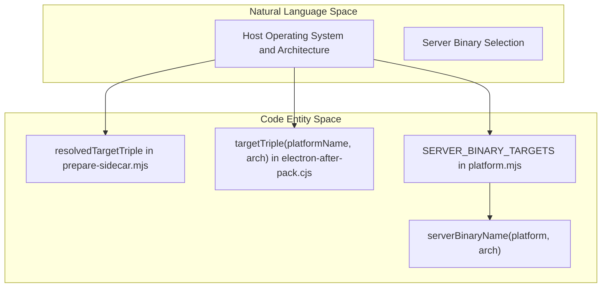
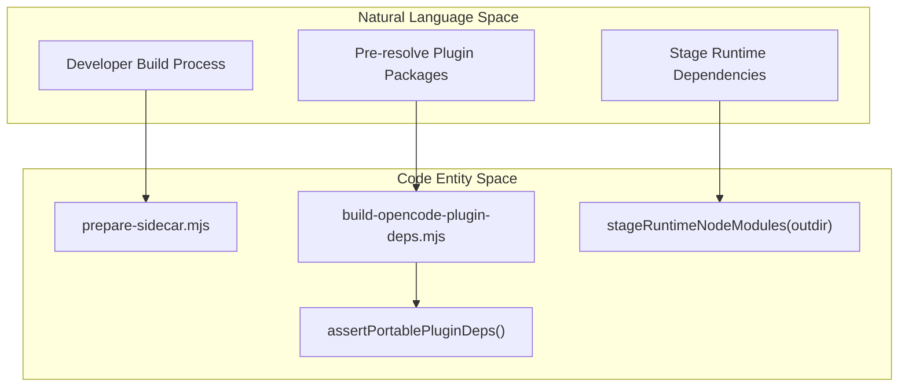

<!-- source: DeepWiki mcp.deepwiki.com · repo different-ai/openwork · extra page Sidecar and Runtime Preparation · fetched 2026-10-26 -->

# Sidecar and Runtime Preparation

Relevant source files

The following files were used as context for generating this wiki page:

- [.github/actions/windows-signing/action.yml](.github/actions/windows-signing/action.yml)
- [apps/desktop/electron-builder.yml](apps/desktop/electron-builder.yml)
- [apps/desktop/scripts/electron-after-pack.cjs](apps/desktop/scripts/electron-after-pack.cjs)
- [apps/desktop/scripts/electron-after-sign.cjs](apps/desktop/scripts/electron-after-sign.cjs)
- [apps/desktop/scripts/electron-after-sign.test.cjs](apps/desktop/scripts/electron-after-sign.test.cjs)
- [apps/desktop/scripts/prepare-runtime-node-modules.mjs](apps/desktop/scripts/prepare-runtime-node-modules.mjs)
- [apps/desktop/scripts/prepare-sidecar.mjs](apps/desktop/scripts/prepare-sidecar.mjs)
- [apps/desktop/scripts/windows-sign.cjs](apps/desktop/scripts/windows-sign.cjs)
- [apps/desktop/test/sidecar-layout.test.mjs](apps/desktop/test/sidecar-layout.test.mjs)
- [apps/desktop/test/windows-sign.test.cjs](apps/desktop/test/windows-sign.test.cjs)
- [apps/server/README.md](apps/server/README.md)
- [apps/server/bin/openwork-server.mjs](apps/server/bin/openwork-server.mjs)
- [apps/server/bin/platform.mjs](apps/server/bin/platform.mjs)
- [apps/server/scripts/build-opencode-plugin-deps.mjs](apps/server/scripts/build-opencode-plugin-deps.mjs)
- [apps/server/scripts/build-opencode-plugin-deps.test.mjs](apps/server/scripts/build-opencode-plugin-deps.test.mjs)
- [apps/server/scripts/npm-web-smoke.mjs](apps/server/scripts/npm-web-smoke.mjs)
- [apps/server/scripts/publish-npm.mjs](apps/server/scripts/publish-npm.mjs)
- [scripts/release/windows-signatures.ps1](scripts/release/windows-signatures.ps1)
- [scripts/release/windows-signatures.test.ps1](scripts/release/windows-signatures.test.ps1)

## Purpose and Scope

This document details the compilation, resolution, staging, and bundling of sidecar binaries, runtime node modules, and OpenCode plugin dependencies within the OpenWork ecosystem. Sidecars and runtime assets are platform-specific executables and pre-resolved packages that the OpenWork Desktop application (`apps/desktop`), the standalone OpenWork server (`apps/server`), and orchestrators spawn as child processes or bundle into Electron and npm distributions.

The project relies on a multi-stage build architecture involving target triple resolution, artifact pinning (`versions.json`), runtime node module staging, and plugin dependency pre-resolution.

Sources: [apps/desktop/scripts/prepare-sidecar.mjs:32-96](), [apps/desktop/scripts/prepare-runtime-node-modules.mjs:8-17]()

## Platform and Target Triples

OpenWork maps host operating systems and CPU architectures to precise platform-specific target triples. These triples dictate how build scripts, Electron packaging hooks, and self-hosted runners resolve binaries for macOS, Linux, and Windows (both `x64` and `arm64`).

The target triple mapping is implemented in packaging scripts such as `apps/desktop/scripts/electron-after-pack.cjs` and `apps/server/bin/platform.mjs`.

| Operating System | Architecture | Target Triple / Asset Suffix |
|------------------|--------------|------------------------------|
| macOS | `arm64` | `aarch64-apple-darwin` / `darwin-arm64` |
| macOS | `x64` | `x86_64-apple-darwin` / `darwin-x64` |
| Linux | `x64` | `x86_64-unknown-linux-gnu` / `linux-x64` |
| Linux | `arm64` | `aarch64-unknown-linux-gnu` / `linux-arm64` |
| Windows | `x64` | `x86_64-pc-windows-msvc` / `windows-x64` |
| Windows | `arm64` | `aarch64-pc-windows-msvc` / `windows-arm64` |

Sources: [apps/desktop/scripts/electron-after-pack.cjs:14-28](), [apps/desktop/scripts/prepare-sidecar.mjs:70-86](), [apps/server/bin/platform.mjs:4-17]()

## Artifact Pinning and Version Resolution

OpenWork pins exact versions of sidecar dependencies (such as `opencode` and `opencode2`) using manifest files and release metadata. 

- **`versions.json`**: Bundled alongside sidecar binaries in `resources/sidecars/`, providing version verification maps for each target architecture `versions.json-<triple>` [apps/desktop/test/sidecar-layout.test.mjs:41-42]().
- **Constants and Version Parsing**: Engine version numbers are read directly from `constants.json` at the monorepo root via `prepare-sidecar.mjs` [apps/desktop/scripts/prepare-sidecar.mjs:34-58]().
- **Self-Hosted Engine Downloads**: The self-hosted server download utility reads pinned version contracts, queries GitHub releases (`anomalyco/opencode`), and installs matching engines into `~/.openwork/openwork-server/engines/` on first run [apps/server/README.md:23-26](), [apps/desktop/scripts/prepare-sidecar.mjs:36-65]().

Sources: [apps/desktop/scripts/prepare-sidecar.mjs:34-65](), [apps/desktop/test/sidecar-layout.test.mjs:41-49](), [apps/server/README.md:23-26]()

## Runtime Preparation Scripts

The build pipeline executes several discrete preparation scripts prior to final packaging:

1. **`prepare-sidecar.mjs`**: Resolves target triples, detects stub or missing binaries, copies or downloads sidecars (`opencode`, `opencode2`), and applies ad-hoc code signing on macOS [apps/desktop/scripts/prepare-sidecar.mjs:32-202]().
2. **`prepare-runtime-node-modules.mjs`**: Stages required MCP and server runtime node dependencies (such as `@openwork/computer-use`, `@modelcontextprotocol/sdk`, and `@openwork/remote-sessions`) into `.electron-runtime/node_modules`, ensuring they are correctly packed into `app.asar` [apps/desktop/scripts/prepare-runtime-node-modules.mjs:8-17](), [apps/desktop/scripts/prepare-runtime-node-modules.mjs:50-103]().
3. **`build-opencode-plugin-deps.mjs`**: Pre-resolves first-run plugin dependencies into a bundled `.tgz` archive (`opencode-plugin-deps-<version>.tgz`), enforcing portability and asserting no native binaries (`.node`, ELF, Mach-O) are bundled, enabling zero-friction initial-boot plugin installation for npm distributions [apps/server/scripts/build-opencode-plugin-deps.mjs:13-54](), [apps/server/scripts/build-opencode-plugin-deps.mjs:56-83]().

Sources: [apps/desktop/scripts/prepare-sidecar.mjs:32-202](), [apps/desktop/scripts/prepare-runtime-node-modules.mjs:8-103](), [apps/server/scripts/build-opencode-plugin-deps.mjs:13-83]()

## Packaging and Bundling Pipelines

### Electron Desktop Packaging (`electron-builder`)
During desktop compilation, build scripts orchestrate sidecar fetching, runtime staging, configuration writing, and Vite frontend bundling. Post-packing, `apps/desktop/scripts/electron-after-pack.cjs` executes verification checks:
- **`verifyRuntimeDependencies(context)`**: Asserts that all staged node modules exist within the packaged `app.asar` archive [apps/desktop/scripts/electron-after-pack.cjs:62-101]().
- **Sidecar Aliasing & Pruning**: Copies architecture-specific binaries (`opencode-<triple>`, `opencode2-<triple>`) to standard runtime aliases (`opencode`, `opencode2`) and prunes unneeded platform artifacts from `resources/sidecars/` [apps/desktop/scripts/electron-after-pack.cjs:143-166]().
- **Computer Use Helper Signing**: Signs the bundled `OpenWork Computer Use.app` helper on macOS with entitlement runtime options [apps/desktop/scripts/electron-after-pack.cjs:103-125]().

### Standalone npm Staging (`openwork-server`)
The npm packaging utility (`apps/server/scripts/publish-npm.mjs`) bundles the Node server (`openwork-server.mjs`), PDFium WebAssembly binaries (`pdfium.wasm`), built OpenCode plugins, pre-resolved plugin dependency tarballs, and the self-hosted web UI bundle into `dist/npm/` for global registry distribution [apps/server/scripts/publish-npm.mjs:12-93](). 

Release smoketest scripts (`apps/server/scripts/npm-web-smoke.mjs`) execute a headless server integration test against the staged package to guarantee first-run engine downloads, dependency unpacking, and session creation succeed [apps/server/scripts/npm-web-smoke.mjs:1-161]().

Sources: [apps/desktop/scripts/electron-after-pack.cjs:62-166](), [apps/server/scripts/publish-npm.mjs:12-93](), [apps/server/scripts/npm-web-smoke.mjs:1-161]()

---

