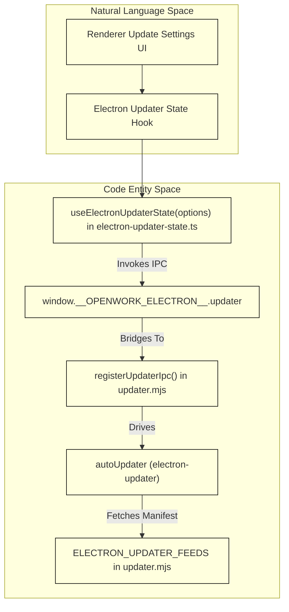
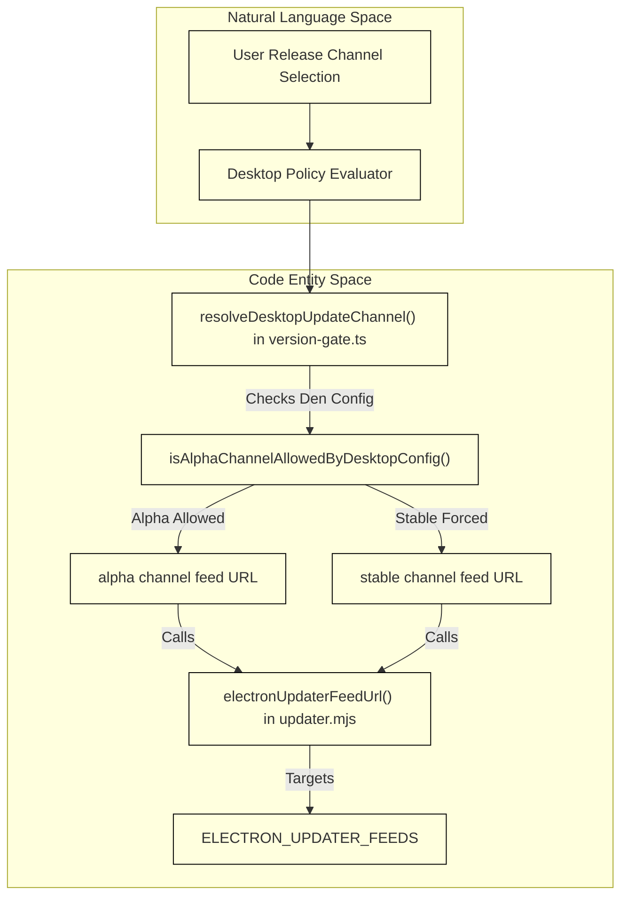
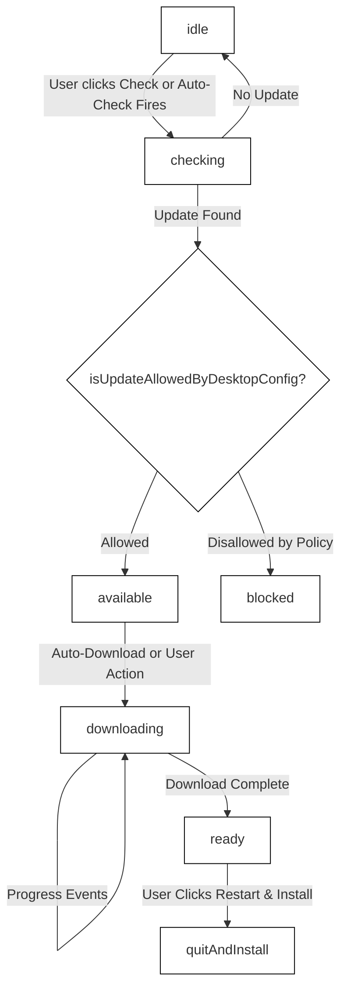
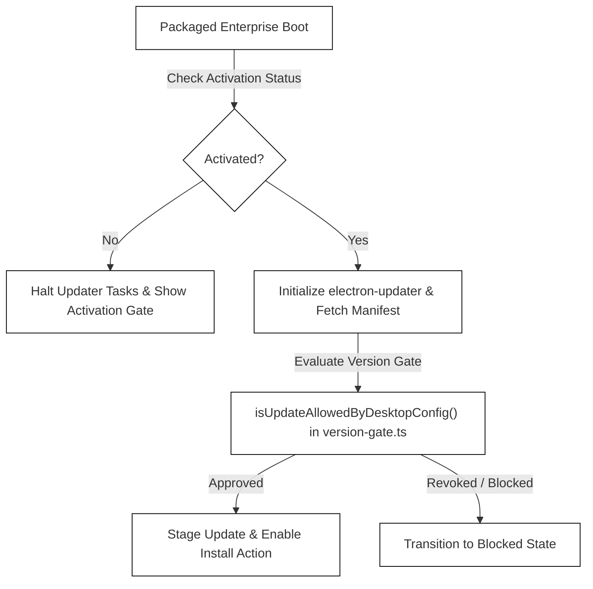

<!-- source: DeepWiki mcp.deepwiki.com · repo different-ai/openwork · extra page Updates and Version Gating · fetched 2026-10-26 -->

# Updates and Version Gating

Relevant source files

The following files were used as context for generating this wiki page:

- [apps/app/src/app/lib/version-gate.ts](apps/app/src/app/lib/version-gate.ts)
- [apps/app/src/react-app/domains/settings/pages/updates-view.tsx](apps/app/src/react-app/domains/settings/pages/updates-view.tsx)
- [apps/app/src/react-app/domains/settings/state/electron-updater-state.ts](apps/app/src/react-app/domains/settings/state/electron-updater-state.ts)
- [apps/app/tests/electron-updater-check-now.test.ts](apps/app/tests/electron-updater-check-now.test.ts)
- [apps/app/tests/electron-updater-install-policy.test.ts](apps/app/tests/electron-updater-install-policy.test.ts)
- [apps/app/tests/version-gate.test.ts](apps/app/tests/version-gate.test.ts)
- [apps/desktop/electron/updater.mjs](apps/desktop/electron/updater.mjs)
- [apps/desktop/electron/updater.test.mjs](apps/desktop/electron/updater.test.mjs)
- [evals/worlds/packaged-preactivation-updater.ts](evals/worlds/packaged-preactivation-updater.ts)

This page details the implementation of desktop application updates, release channels, background update flows, organization-level version gating, and packaged update install journeys within OpenWork.

---

## 1. Electron-Updater Integration and Main Process Architecture

OpenWork Desktop integrates `electron-updater` within the Electron main process (`apps/desktop/electron/updater.mjs`) to handle release discovery, background downloading, staging, and installation. Renderer-side state management is handled by `useElectronUpdaterState` (`apps/app/src/react-app/domains/settings/state/electron-updater-state.ts`), which communicates with the main process via IPC bindings (`window.__OPENWORK_ELECTRON__.updater`).

The main process registers updater IPC handlers and manages feed configurations, app version resolution (handling differences between development environments and packaged builds), and recovery mechanics (`apps/desktop/electron/updater.mjs`).

*Figure 1: Bridge architecture connecting natural language updater components to code entities in `electron-updater-state.ts` and `updater.mjs`.*

Sources: `apps/desktop/electron/updater.mjs:1-187` [apps/desktop/electron/updater.mjs](), `apps/app/src/react-app/domains/settings/state/electron-updater-state.ts:1-123` [apps/app/src/react-app/domains/settings/state/electron-updater-state.ts]().

---

## 2. Release Channels and Feed Resolution

OpenWork supports multiple release channels, controlled via user preferences and enterprise policies. The updater supports `stable` and `alpha` channels, where `alpha` builds are restricted to macOS environments (`apps/desktop/electron/updater.mjs`).

Feed URLs are defined statically in `ELECTRON_UPDATER_FEEDS` or overridden via loopback evaluation feeds for testing (`evalUpdaterFeedUrl`):
- **Stable**: `https://github.com/different-ai/openwork/releases/latest/download`
- **Alpha**: `https://github.com/different-ai/openwork/releases/download/alpha-macos-latest`

*Figure 2: Channel resolution pipeline mapping settings inputs to `resolveDesktopUpdateChannel` and `electronUpdaterFeedUrl`.*

Sources: `apps/desktop/electron/updater.mjs:46-108` [apps/desktop/electron/updater.mjs](), `apps/app/src/app/lib/version-gate.ts:129-142` [apps/app/src/app/lib/version-gate.ts]().

---

## 3. Background Update Flow and State Machine

The settings updater view and background workers rely on a structured lifecycle state machine defined in `SettingsUpdateStatus` (`apps/app/src/react-app/domains/settings/state/electron-updater-state.ts`). The states include `idle`, `checking`, `available`, `blocked`, `downloading`, `ready`, and `error`.

*Figure 3: State transitions managed by `useElectronUpdaterState` during update lifecycles.*

Sources: `apps/app/src/react-app/domains/settings/state/electron-updater-state.ts:20-41` [apps/app/src/react-app/domains/settings/state/electron-updater-state.ts](), `apps/app/src/react-app/domains/settings/pages/updates-view.tsx:91-152` [apps/app/src/react-app/domains/settings/pages/updates-view.tsx]().

---

## 4. Version Gating and Enterprise Policy Enforcement

OpenWork Enterprise control planes (Den) enforce deployment boundaries using `allowedDesktopVersions` stored in `DenDesktopConfig`. When an update is discovered, `isUpdateAllowedByDesktopConfig` evaluates whether the candidate version matches organization-approved semver constraints (`apps/app/src/app/lib/version-gate.ts`).

If an update has already been downloaded in the background, but the organization subsequently revokes that version through a Den policy update, the staging or installation action transitions the update state to `blocked`, disabling the restart/install trigger.

| Function / Entity | Location | Role |
| :--- | :--- | :--- |
| `compareVersions` | `apps/app/src/app/lib/version-gate.ts:94-107` [apps/app/src/app/lib/version-gate.ts]() | Parses and compares semver strings including prerelease tags. |
| `isUpdateAllowedByDesktopConfig` | `apps/app/src/app/lib/version-gate.ts:116-127` [apps/app/src/app/lib/version-gate.ts]() | Validates candidate versions against organization `allowedDesktopVersions`. |
| `resolveDesktopUpdateChannel` | `apps/app/src/app/lib/version-gate.ts:135-142` [apps/app/src/app/lib/version-gate.ts]() | Enforces fallback to stable if alpha updates are disabled by enterprise config. |
| `UpdatesView` | `apps/app/src/react-app/domains/settings/pages/updates-view.tsx:91-348` [apps/app/src/react-app/domains/settings/pages/updates-view.tsx]() | React UI component displaying version info, download progress, and restart controls. |

Sources: `apps/app/src/app/lib/version-gate.ts:94-142` [apps/app/src/app/lib/version-gate.ts](), `apps/app/tests/electron-updater-install-policy.test.ts:18-120` [apps/app/tests/electron-updater-install-policy.test.ts]().

---

## 5. Packaged Update Install Journeys and E2E Verification

End-to-end testing suites validate update behavior across packaged binaries, pre-activation states, and policy revocations (`evals/worlds/packaged-preactivation-updater.ts`, `evals/specs/packaged-preactivation-updater.e2e.test.ts`). 

Enterprise builds incorporate an activation gate. Updater checks are deferred or inhibited until enterprise activation succeeds, ensuring unactivated client instances do not fetch unauthorized release bundles prior to binding to their designated Den instance (`evals/worlds/packaged-preactivation-updater.ts`).

*Figure 4: Activation gating sequence prior to enterprise update checks.*

Sources: `evals/worlds/packaged-preactivation-updater.ts:25-117` [evals/worlds/packaged-preactivation-updater.ts]().

---

